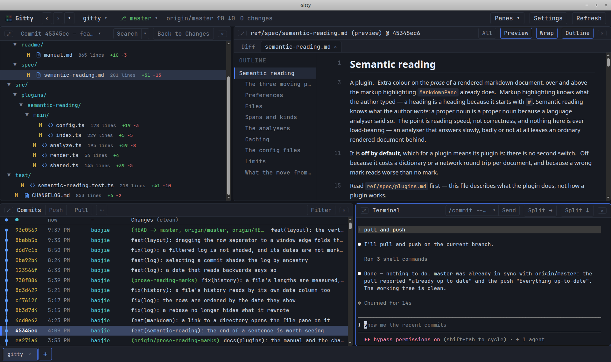

# Gitty

[English](../../README.md) · [简体中文](README.zh-CN.md) · [日本語](README.ja.md) · [한국어](README.ko.md) · [Français](README.fr.md) · [Deutsch](README.de.md) · **Español** · [Русский](README.ru.md) · [Português](README.pt.md)

> **Traducido el 2026-11-18; corresponde a Gitty v0.2.3.**
> El [README en inglés](../../README.md) es la versión oficial y la única que se
> mantiene al día. Este documento es una instantánea de ese momento; donde
> discrepen, manda el inglés. Este documento solo cubre este archivo: el
> [manual](manual.es.md) tiene sus propias traducciones, y allí también el inglés
> es la versión oficial. La interfaz está en inglés, así que los nombres de
> botones y menús se dejan tal cual.

Un navegador de historial de git para escritorio con cuatro paneles, en la línea
de `lazygit` pero con interacción de ratón de verdad: doble clic para abrir un
archivo, clic derecho para copiar su ruta, clic en dos commits para compararlos.

```
┌──────────────────────┬──────────────────────┐
│ Changes              │ Diff                 │
│ (or a commit's files)│ (unified, coloured)  │
├──────────────────────┼──────────────────────┤
│ Commits              │ Terminal             │
│ (log, ↑↓, Enter)     │ (a real shell)       │
└──────────────────────┴──────────────────────┘
```

Todos los paneles se redimensionan arrastrando los separadores, y cada uno se
oculta y vuelve — véase [Pantalla completa y ocultar](manual.es.md#full-screen-and-hiding).

Cosas que los demás navegadores de git, en su mayoría, no hacen:

- **Una shell de verdad acoplada al historial.** No un widget que llama a git,
  sino una shell de inicio de sesión genuina (`$SHELL`) con raíz en el
  repositorio, en la misma ventana que el diff y divisible en varias. La mayoría
  de los navegadores de git o no tienen terminal o lanzan una externa, así que
  comprobar una corazonada significa saltar de ventana. Aquí está ahí mismo, y
  todos los demás paneles se refrescan según cambia el repositorio.
- **Una preparación que acaba en un agente, no en una caja de mensaje.** Prepara
  un archivo, un hunk o solo las líneas que has seleccionado; entonces **Send**
  escribe tu propia orden — `claude "commit the staged changes"`, `codex exec …`,
  la que uses — en la shell de abajo y pulsa Enter. Escribir el mensaje es
  trabajo del agente. Decidir *qué cambios son un commit* es el tuyo, y para eso
  están los cuatro paneles. Dentro de Gitty no se llama a ningún modelo, así que
  nada sale de la máquina que no hayas enviado tú.
- **Documentos, no solo diffs.** El Markdown se representa, el HTML se muestra en
  un marco aislado y las imágenes se muestran como dibujos — todo en la revisión
  en la que estás. Un README de hace dos años se representa con las capturas que
  *ese* commit publicó, leídas directamente de la base de datos de objetos: no
  interviene nada del disco y no se descarga nada de la web, porque leer el README
  de otra persona no debería anunciarte al servidor al que apunte.
- **Markdown representado que aún te dice dónde estás en el archivo.** Activa
  **Markdown source lines** y cada encabezado, párrafo, elemento de lista, tabla,
  bloque delimitado e imagen se numera en el margen con la línea en la que empieza
  en la fuente — así un pasaje que encontraste leyendo puede editarse por línea.
- **Un diff, un blame, el historial de un archivo y un README representado,
  abiertos a la vez.** Los archivos se abren como sus propias pestañas *junto* al
  diff y no encima, cada una recordando la revisión en la que se abrió. Leer un
  archivo nunca te cuesta el cambio que estabas mirando.
- **<kbd>Ctrl+F</kbd> que funciona en lo que sea que muestre el panel** —
  incluido el markdown representado, donde una frase se encuentra a través de los
  tramos en negrita y de código porque la búsqueda lee el texto representado, y
  dentro del marco de la vista previa de HTML.
- **El historial, servido a tu navegador.** **Open in Browser** entrega un commit
  — sus metadatos, sus archivos, sus diffs — al navegador del sistema, desde un
  servidor web dentro de la aplicación vinculado a `127.0.0.1` cuyas URLs llevan
  un token acuñado para esta sesión. Los commits son URLs reales, así que el
  historial se puede leer en pestañas, mantener abierto y buscar con el buscador
  del navegador, mientras la aplicación siga en marcha.
- **[gource](https://gource.io/) desde el menú de commits**, cuando está
  instalado: todo el historial del repositorio como una animación, en su propia
  ventana. Donde gource no está, la entrada no se dibuja — no se descarga ni se
  ofrece nada que no pueda ejecutarse.
- **Nueve idiomas de interfaz y una zona horaria explícita.** Git registra cada
  commit con el desfase de su autor, así que una marca de tiempo es siempre una
  elección de zona; aquí la eliges tú, y toda la interfaz — log, blame, historial
  de archivo, la frontera entre «hoy» y una fecha — la sigue.



## ¿Por qué otro más? <a id="why-another-one"></a>

Porque cada herramienta a la que recurrí fallaba en algo:

- **IDEs** — demasiado pesados y demasiado lentos. (Créeme, he probado todos los
  que he encontrado.)
- **lazygit, grv** — herramientas excelentes, pero poco amables con el ratón y
  con seleccionar texto.
- **gitui** — quiero la lista de commits y el diff en pantalla a la vez.
- **SmartGit, GitKraken** — Java, pesados, anticuados, y quieren tu dinero.
- **gitg** y compañía — otra vez, sin lista de commits y diff en paralelo.
- **tig** — solo diffs, sin árbol de archivos que explorar.
- **gitk** — ¡feo!

Dos cosas más que quería y que casi nadie ofrecía: **vista previa de Markdown** y
**copiar y pegar que funcione** en cualquier parte de la ventana.

## Requisitos <a id="requirements"></a>

- `git` en el `PATH`
- Linux, macOS o Windows con una sesión de escritorio
- Node.js 22.12 o posterior — solo para las instalaciones por npm y desde el
  código de abajo; el `.deb` trae su propio runtime
- Opcionalmente [gource](https://gource.io/) en el `PATH`, para
  [la animación](manual.es.md#gource); nada cambia si no está

## Ejecución <a id="running"></a>

### Descargar un paquete (Linux) <a id="download-a-package-linux"></a>

El `.deb` es el camino más corto — sin Node, sin compilación:

```bash
wget https://github.com/baojie/gitty/releases/download/v0.2.3/gitty-desktop_0.2.3_amd64.deb
sudo dpkg -i gitty-desktop_0.2.3_amd64.deb
```

Instala `/usr/bin/gitty`, una entrada del menú de aplicaciones con su icono, y
corre con la sandbox de Chromium **activada** — véase
[Integración de escritorio en Linux](manual.es.md#linux-desktop-integration).

A su lado hay un [`.deb` arm64](https://github.com/baojie/gitty/releases/download/v0.2.3/gitty-desktop_0.2.3_arm64.deb)
y un AppImage para las distribuciones sin dpkg
([x86_64](https://github.com/baojie/gitty/releases/download/v0.2.3/Gitty-0.2.3-x86_64.AppImage),
[arm64](https://github.com/baojie/gitty/releases/download/v0.2.3/Gitty-0.2.3-arm64.AppImage)) —
la segunda opción, porque un AppImage no puede instalar el ayudante de la sandbox.
Las versiones anteriores están en la
[página de versiones](https://github.com/baojie/gitty/releases).

### Desde npm <a id="from-npm"></a>

```bash
npm install -g gitty-desktop      # installs the gitty command globally
```

### Desde una copia <a id="from-a-checkout"></a>

Enlázalo a tu PATH con:

```bash
./setup.sh               # symlink into ~/.local/bin (no sudo)
./setup.sh --system      # symlink into /usr/local/bin (needs sudo)
```

`setup.sh` también instala un lanzador ejecutable — una entrada de escritorio en
Linux, un `Gitty.app` mínimo en macOS, accesos directos en el menú Inicio y en el
escritorio en Windows. Todos envuelven el mismo `run.sh`, y todos llevan los
apaños que un Electron sin empaquetar necesita; véase
[Notas de plataforma](manual.es.md#platform-notes).

Luego abre un repositorio desde donde sea:

```bash
gitty                    # open the repository in the current directory
gitty /path/to/repo      # open another repository
gitty --fg               # keep it attached to the terminal (Ctrl+C quits)
gitty --dev              # hot-reloading development mode
gitty --any              # start even outside a work tree (what the desktop
                         # entry uses), falling back to the last repositories
```

Gitty se separa de la terminal e imprime su pid, así que la shell sigue usable y
cerrarla no se lleva la ventana. La salida va a
`${XDG_STATE_HOME:-~/.local/state}/gitty/gitty.log`, que se recorta a su último
megabyte cuando pasa de 4 MB.

`./run.sh` es el mismo script y funciona igual sin el enlace simbólico. El
lanzador instala dependencias y reconstruye el bundle cuando las fuentes han
cambiado, así que la primera ejecución puede tardar un momento. `npm run dev`,
`npm run build` y `npm start` también están disponibles directamente.

Arrancar Gitty desde un directorio que no está dentro de un árbol de trabajo
recurre al último repositorio abierto, en vez de limitarse a protestar.

### En Windows <a id="on-windows"></a>

No hay instalador para Windows; Gitty se ejecuta desde una copia. Necesita
[Git for Windows](https://gitforwindows.org/), cuyo Git Bash ejecuta los scripts,
además de Node.js y el runtime de Visual C++ de 64 bits. En PowerShell:

```powershell
winget install Git.Git
winget install OpenJS.NodeJS.LTS
winget install Microsoft.VCRedist.2015+.x64
```

Luego, en una ventana **nueva** de Git Bash, para que vea Node:

```bash
git clone https://github.com/baojie/gitty.git && cd gitty
npm install
./setup.sh
```

`setup.sh` instala `gitty` para Git Bash y `gitty.cmd` para cmd y PowerShell en
`%USERPROFILE%\.local\bin`, además de los accesos directos. A partir de ahí,
`gitty` en cualquier repositorio lo abre, desde la shell que sea. No hace falta
Visual Studio. Si `npm install` falla con *not a valid Win32 application*, o git
tacha un repositorio de *dubious ownership*, véase
[Windows](manual.es.md#windows).

## Lo que Gitty no hace <a id="what-gitty-does-not-do"></a>

Gitty lee el historial y prepara (stage) lo que tú decides que va junto. No hace
rebase, merge, cherry-pick, resolución de conflictos, ni crear, borrar o cambiar
de rama — y no aprenderá a hacerlo. Son operaciones con estado y de varios pasos
cuyos momentos interesantes son aquellos en los que algo sale mal, y una shell que
las maneja todas está acoplada en la misma ventana, ya en el directorio correcto.
Medio botón de rebase es peor que ninguno.

Tampoco hay una caja de commit, lo que es una afirmación menor de lo que suena. Lo
que falta no es el mensaje: lo que falta es un lugar para decidir *qué cambios son
un commit*, y para eso sirve la preparación de arriba. Una vez que el índice dice
una cosa, **Send** se la entrega a lo que escribe tus mensajes.

## El manual <a id="the-manual"></a>

El resto — cada panel, cada ajuste, cada atajo — está en
**[el manual](manual.es.md)**:

- [La ventana](manual.es.md#the-window): la barra de título, volver atrás, las
  pestañas, los repositorios recientes, la pantalla completa y el ocultar paneles.
- [Los paneles](manual.es.md#the-panes): el árbol de trabajo y la preparación, el
  diff, ver archivos y documentos representados, el log de commits y su grafo, la
  terminal.
- [Buscar texto](manual.es.md#finding-text), la
  [tabla de ajustes](manual.es.md#settings) y los
  [atajos de teclado](manual.es.md#keyboard-shortcuts).
- [Notas de plataforma](manual.es.md#platform-notes): la integración de escritorio
  en Linux, el bundle de aplicación macOS, Windows y el registro que Gitty guarda
  cuando su ventana se congela.

## Arquitectura <a id="architecture"></a>

```
src/main       Electron main process — git commands, ptys, fs watchers,
               the recent-repository store, the stall log, IPC
src/preload    contextBridge API exposed to the renderer as window.gitty
src/renderer   React UI — App.tsx manages tabs, RepoTab.tsx owns one
               repository's four panes
src/shared     Types shared by both sides
build          Application icon (SVG source and rendered PNG)
```

git se maneja con `execFile('git', …)` analizando `--porcelain=v2 -z` /
`--name-status -z`, así que las rutas con espacios y los renombrados sobreviven.
No se empaqueta ninguna biblioteca de git; lo que veas es el `git` que haya en el
`PATH`. El renderer corre con `contextIsolation` y sin integración de node.

El renderer se divide en fragmentos de carga diferida para que la ventana se
pinte antes de que se analicen xterm, highlight.js y markdown-it. La división
—los cuatro fragmentos, las reglas para mantener las bibliotecas pesadas fuera de
los fragmentos calientes y cómo añadir una nueva— está especificada en
[ref/spec/lazy-loading.md](../../ref/spec/lazy-loading.md).

## Licencia <a id="licence"></a>

MIT
