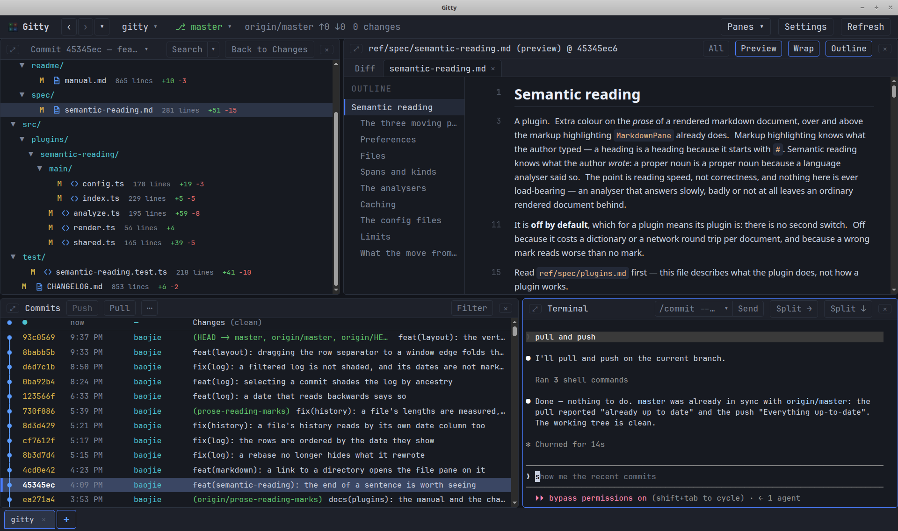

# Gitty

[English](../../README.md) · [简体中文](README.zh-CN.md) · [日本語](README.ja.md) · [한국어](README.ko.md) · **Français** · [Deutsch](README.de.md) · [Español](README.es.md) · [Русский](README.ru.md) · [Português](README.pt.md)

> **Traduit le 2026-11-18, pour Gitty v0.2.3.**
> Le [README en anglais](../../README.md) est la version officielle et la seule
> tenue à jour. Ce document en est un instantané ; en cas de divergence, c'est
> l'anglais qui fait foi. Ce document ne couvre que ce fichier — le
> [manuel](manual.fr.md) a ses propres traductions, et là aussi l'anglais est la
> version officielle. L'interface est en anglais, donc les noms de boutons et
> d'entrées de menu sont laissés tels quels.

Un navigateur d'historique git pour le bureau, à quatre volets, dans l'esprit de
`lazygit` mais avec une vraie interaction à la souris : double-clic pour ouvrir
un fichier, clic droit pour copier son chemin, deux commits cliqués pour les
comparer.

```
┌──────────────────────┬──────────────────────┐
│ Changes              │ Diff                 │
│ (or a commit's files)│ (unified, coloured)  │
├──────────────────────┼──────────────────────┤
│ Commits              │ Terminal             │
│ (log, ↑↓, Enter)     │ (a real shell)       │
└──────────────────────┴──────────────────────┘
```

Tous les volets se redimensionnent en tirant les séparateurs, et chacun se cache
puis revient — voir [Plein écran et masquage](manual.fr.md#full-screen-and-hiding).

Ce que les autres navigateurs git ne font pour la plupart pas :

- **Un vrai shell amarré à l'historique.** Pas un widget qui appelle git, mais
  un véritable shell de connexion (`$SHELL`) enraciné dans le dépôt, dans la même
  fenêtre que le diff, et scindable en plusieurs. La plupart des navigateurs git
  n'ont pas de terminal ou en lancent un externe, si bien que vérifier une
  intuition oblige à changer de fenêtre. Ici il est juste là, et tous les autres
  volets se rafraîchissent à mesure que le dépôt change.
- **Une indexation qui finit chez un agent, pas dans une boîte à message.**
  Indexez un fichier, une section, ou seulement les lignes que vous avez
  sélectionnées ; **Send** tape ensuite votre propre commande — `claude "commit
  the staged changes"`, `codex exec …`, ce que vous lancez — dans le shell du
  dessous et appuie sur Entrée. Écrire le message est le travail de l'agent.
  Décider *quelles modifications forment un commit* est le vôtre, et c'est à cela
  que servent les quatre volets. Aucun modèle n'est appelé depuis Gitty : rien ne
  quitte la machine que vous n'ayez envoyé.
- **Des documents, pas seulement des diffs.** Le markdown est rendu, le HTML
  s'affiche dans un cadre isolé, les images se montrent comme des images — le
  tout à la révision où vous êtes. Un README d'il y a deux ans se rend avec les
  captures que *ce* commit a livrées, lues directement dans la base d'objets —
  rien sur le disque n'entre en jeu, et rien n'est récupéré depuis le web, car
  lire le README de quelqu'un d'autre ne devrait pas vous annoncer à l'hôte vers
  lequel il pointe.
- **Du markdown rendu qui sait encore vous dire où vous êtes dans le fichier.**
  Activez **Markdown source lines** et chaque titre, paragraphe, élément de
  liste, tableau, bloc délimité et image est numéroté dans la gouttière avec la
  ligne où il commence dans la source — si bien qu'un passage trouvé en lisant
  peut être édité par ligne.
- **Un diff, un blame, l'historique d'un fichier et un README rendu, ouverts à
  la fois.** Les fichiers s'ouvrent comme leurs propres onglets *à côté* du diff
  plutôt que par-dessus, chacun se souvenant de la révision à laquelle il a été
  ouvert. Lire un fichier ne vous coûte jamais la modification que vous
  regardiez.
- **Un <kbd>Ctrl+F</kbd> qui marche dans tout ce que montre le volet** — y
  compris le markdown rendu, où une phrase est trouvée à travers les portées de
  gras et de code parce que la recherche lit le texte rendu, et à l'intérieur du
  cadre de l'aperçu HTML.
- **L'historique, servi à votre navigateur.** **Open in Browser** remet un commit
  — ses métadonnées, ses fichiers, ses diffs — au navigateur du système, depuis
  un serveur web à l'intérieur de l'application lié à `127.0.0.1`, dont les URL
  portent un jeton forgé pour cette session. Les commits sont de vraies URL, donc
  l'historique peut se lire en onglets, rester ouvert et se chercher avec la
  recherche du navigateur, tant que l'application tourne.
- **[gource](https://gource.io/) depuis le menu des commits**, quand il est
  installé : tout l'historique du dépôt en animation, dans sa propre fenêtre. Là où gource est
  absent, le bouton n'est pas dessiné — rien n'est téléchargé ni proposé qui ne
  puisse tourner.
- **Neuf langues d'interface et un fuseau horaire explicite.** Git enregistre
  chaque commit avec le décalage de son auteur, si bien qu'un horodatage est
  toujours un choix de fuseau ; ici c'est vous qui le faites, et toute l'UI —
  journal, blame, historique de fichier, la frontière entre « aujourd'hui » et
  une date — suit.



## Pourquoi un de plus ? <a id="why-another-one"></a>

Parce que chaque outil vers lequel je me suis tourné se trompait sur un point :

- **Les IDE** — trop lourds et trop lents. (Croyez-moi, j'ai essayé tous ceux que
  j'ai pu trouver.)
- **lazygit, grv** — d'excellents outils, mais hostiles à la souris et à la
  sélection de texte.
- **gitui** — je veux la liste des commits et le diff à l'écran en même temps.
- **SmartGit, GitKraken** — Java, lourds, datés, et ils veulent votre argent.
- **gitg** et consorts — là encore, pas de liste de commits et de diff côte à
  côte.
- **tig** — que des diffs, aucun arbre de fichiers à parcourir.
- **gitk** — moche !

Deux autres choses que je voulais et que presque personne n'offrait : un **aperçu
Markdown**, et un **copier-coller qui marche** partout dans la fenêtre.

## Prérequis <a id="requirements"></a>

- `git` dans le `PATH`
- Linux, macOS ou Windows avec une session de bureau
- Node.js 22.12 ou plus récent — uniquement pour les installations par npm et
  depuis les sources ci-dessous ; le `.deb` apporte son propre runtime
- [gource](https://gource.io/) dans le `PATH`, optionnel, pour
  [l'animation](manual.fr.md#gource) ; rien ne change s'il est absent

## Lancement <a id="running"></a>

### Télécharger un paquet (Linux) <a id="download-a-package-linux"></a>

Le `.deb` est le chemin le plus court — pas de Node, pas de build :

```bash
wget https://github.com/baojie/gitty/releases/download/v0.2.3/gitty-desktop_0.2.3_amd64.deb
sudo dpkg -i gitty-desktop_0.2.3_amd64.deb
```

Il installe `/usr/bin/gitty`, une entrée de menu d'application avec son icône, et
tourne avec le bac à sable de Chromium **activé** — voir
[Intégration au bureau Linux](manual.fr.md#linux-desktop-integration).

À côté se trouvent un [`.deb` arm64](https://github.com/baojie/gitty/releases/download/v0.2.3/gitty-desktop_0.2.3_arm64.deb)
et une AppImage pour les distributions sans dpkg
([x86_64](https://github.com/baojie/gitty/releases/download/v0.2.3/Gitty-0.2.3-x86_64.AppImage),
[arm64](https://github.com/baojie/gitty/releases/download/v0.2.3/Gitty-0.2.3-arm64.AppImage)) —
le second choix, car une AppImage ne peut pas installer l'aide au bac à sable. Les
versions plus anciennes sont sur la [page des versions](https://github.com/baojie/gitty/releases).

### Depuis npm <a id="from-npm"></a>

```bash
npm install -g gitty-desktop      # installs the gitty command globally
```

### Depuis une copie <a id="from-a-checkout"></a>

Liez-la dans votre PATH :

```bash
./setup.sh               # symlink into ~/.local/bin (no sudo)
./setup.sh --system      # symlink into /usr/local/bin (needs sudo)
```

`setup.sh` installe aussi un lanceur cliquable — une entrée de bureau sous Linux,
un `Gitty.app` minimal sous macOS, des raccourcis dans le menu Démarrer et sur le
bureau sous Windows. Tous enveloppent le même `run.sh`, et tous portent les
contournements dont un Electron non empaqueté a besoin ; voir
[Notes de plateforme](manual.fr.md#platform-notes).

Puis ouvrez un dépôt depuis n'importe où :

```bash
gitty                    # open the repository in the current directory
gitty /path/to/repo      # open another repository
gitty --fg               # keep it attached to the terminal (Ctrl+C quits)
gitty --dev              # hot-reloading development mode
gitty --any              # start even outside a work tree (what the desktop
                         # entry uses), falling back to the last repositories
```

Gitty se détache du terminal et affiche son pid, si bien que le shell reste
utilisable et que le fermer n'emporte pas la fenêtre. La sortie va dans
`${XDG_STATE_HOME:-~/.local/state}/gitty/gitty.log`, ramené à son dernier
mégaoctet dès qu'il dépasse 4 Mo.

`./run.sh` est le même script et fonctionne à l'identique sans le lien
symbolique. Le lanceur installe les dépendances et reconstruit le bundle quand
les sources ont changé, donc le premier lancement peut prendre un moment.
`npm run dev`, `npm run build` et `npm start` sont également disponibles
directement.

Démarrer Gitty depuis un répertoire qui n'est pas dans un arbre de travail se
rabat sur le dernier dépôt ouvert, au lieu de se contenter de râler.

### Sous Windows <a id="on-windows"></a>

Il n'y a pas d'installeur pour Windows ; lancez Gitty depuis une copie. Il faut
[Git for Windows](https://gitforwindows.org/), dont le Git Bash exécute les
scripts, ainsi que Node.js et le runtime Visual C++ 64 bits. Dans PowerShell :

```powershell
winget install Git.Git
winget install OpenJS.NodeJS.LTS
winget install Microsoft.VCRedist.2015+.x64
```

Puis, dans une **nouvelle** fenêtre Git Bash, pour qu'elle voie Node :

```bash
git clone https://github.com/baojie/gitty.git && cd gitty
npm install
./setup.sh
```

`setup.sh` installe `gitty` pour Git Bash et `gitty.cmd` pour cmd et
PowerShell dans `%USERPROFILE%\.local\bin`, plus les raccourcis. Ensuite,
`gitty` dans n'importe quel dépôt l'ouvre, depuis n'importe quel shell. Visual
Studio n'est pas nécessaire. Si `npm install` échoue avec *not a valid Win32
application*, ou si git qualifie un dépôt de *dubious ownership*, voir
[Windows](manual.fr.md#windows).

## Ce que Gitty ne fait pas <a id="what-gitty-does-not-do"></a>

Gitty lit l'historique et indexe (stage) ce que vous décidez de réunir. Il ne fait
pas de rebase, de merge, de cherry-pick, de résolution de conflits, ni de
création, suppression ou bascule de branche — et il n'apprendra pas à le faire.
Ce sont des opérations à états et à plusieurs étapes dont les moments intéressants
sont ceux où quelque chose tourne mal, et un shell qui les gère toutes est amarré
dans la même fenêtre, déjà dans le bon répertoire. Un demi-bouton de rebase est
pire que pas de bouton du tout.

Il n'y a pas non plus de boîte de commit, ce qui est une affirmation plus petite
qu'il n'y paraît. Ce qui manque n'est pas le message : c'est un endroit pour
décider *quelles modifications forment un commit*, et c'est à cela que sert
l'indexation ci-dessus. Une fois que l'index dit une chose, **Send** la
remet à ce qui écrit vos messages.

## Le manuel <a id="the-manual"></a>

Le reste — chaque volet, chaque réglage, chaque raccourci — est dans
**[le manuel](manual.fr.md)** :

- [La fenêtre](manual.fr.md#the-window) : la barre de titre, revenir en arrière,
  les onglets, les dépôts récents, le plein écran et le masquage des volets.
- [Les volets](manual.fr.md#the-panes) : l'arbre de travail et l'indexation, le
  diff, la lecture des fichiers et des documents rendus, le journal des commits
  et son graphe, le terminal.
- [La recherche de texte](manual.fr.md#finding-text), le
  [tableau des réglages](manual.fr.md#settings) et les
  [raccourcis clavier](manual.fr.md#keyboard-shortcuts).
- [Notes de plateforme](manual.fr.md#platform-notes) : l'intégration au bureau
  Linux, le bundle applicatif macOS, Windows, et le journal que Gitty tient
  quand sa fenêtre se fige.

## Architecture <a id="architecture"></a>

```
src/main       Electron main process — git commands, ptys, fs watchers,
               the recent-repository store, the stall log, IPC
src/preload    contextBridge API exposed to the renderer as window.gitty
src/renderer   React UI — App.tsx manages tabs, RepoTab.tsx owns one
               repository's four panes
src/shared     Types shared by both sides
build          Application icon (SVG source and rendered PNG)
```

git est piloté par `execFile('git', …)` avec l'analyse de `--porcelain=v2 -z` /
`--name-status -z`, si bien que les chemins avec espaces et les renommages
survivent. Aucune bibliothèque git n'est embarquée ; le `git` du `PATH` est ce
que vous voyez. Le renderer tourne avec `contextIsolation` et sans intégration
node.

Le renderer est découpé en morceaux chargés à la demande pour que la fenêtre se
peigne avant que xterm, highlight.js et markdown-it ne soient analysés. Ce
découpage — les quatre morceaux, les règles pour tenir les bibliothèques lourdes
hors des morceaux chauds, et comment en ajouter une — est spécifié dans
[ref/spec/lazy-loading.md](../../ref/spec/lazy-loading.md).

## Licence <a id="licence"></a>

MIT
