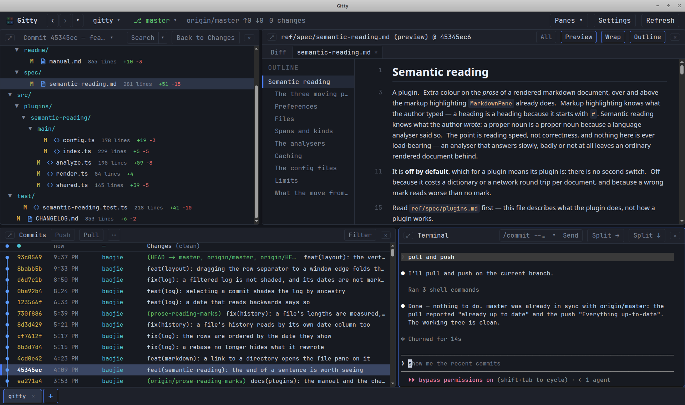

# Gitty

[English](../../README.md) · [简体中文](README.zh-CN.md) · [日本語](README.ja.md) · **한국어** · [Français](README.fr.md) · [Deutsch](README.de.md) · [Español](README.es.md) · [Русский](README.ru.md) · [Português](README.pt.md)

> **번역일: 2026-11-18 (Gitty v0.2.3 기준).**
> [영어 README](../../README.md)가 공식 버전이며, 계속 갱신되는 유일한 문서입니다. 이
> 문서는 그 시점의 스냅샷이고, 둘이 다르면 영어가 우선합니다. 이 문서는 이 파일만
> 다루며, [매뉴얼](manual.ko.md)은 자체 번역이 있고 그쪽에서도 영어가 공식 버전입니다.
> UI 자체가 영어이므로, 아래의 버튼 이름과 메뉴 항목은 원문 그대로 둡니다.

데스크톱용 네 개의 창으로 이뤄진 git 히스토리 브라우저로, `lazygit`의 정신을 따르되
진짜 마우스 조작을 갖췄습니다. 파일을 열려면 더블클릭, 경로를 복사하려면 오른쪽 클릭,
두 커밋을 비교하려면 둘을 클릭하세요.

```
┌──────────────────────┬──────────────────────┐
│ Changes              │ Diff                 │
│ (or a commit's files)│ (unified, coloured)  │
├──────────────────────┼──────────────────────┤
│ Commits              │ Terminal             │
│ (log, ↑↓, Enter)     │ (a real shell)       │
└──────────────────────┴──────────────────────┘
```

모든 창은 구분선을 드래그해 크기를 조절할 수 있고, 각각 숨겼다 되돌릴 수 있습니다 —
[전체 화면과 숨기기](manual.ko.md#full-screen-and-hiding)를 보세요.

다른 git 브라우저가 대개 하지 않는 것들:

- **히스토리에 도킹된 진짜 셸.** git을 호출하는 위젯이 아니라, 저장소를 루트로 하는
  진짜 로그인 셸(`$SHELL`)이 diff와 같은 창 안에 있고, 여러 개로 분할할 수 있습니다.
  대부분의 git 브라우저는 터미널이 아예 없거나 외부 터미널을 띄우기 때문에, 어떤
  직감을 확인하려면 alt-tab을 해야 합니다. 여기서는 그것이 바로 거기 있고, 저장소가
  바뀌면 다른 모든 창이 새로 고쳐집니다.
- **커밋 메시지 상자가 아니라 agent로 끝나는 스테이징.** 파일 하나, hunk 하나, 아니면
  고른 줄만 스테이지한 다음 **Send**가 당신의 명령 — `claude "commit the staged
  changes"`, `codex exec …`, 무엇을 쓰든 — 을 아래 셸에 입력하고 Enter를 누릅니다.
  메시지를 쓰는 건 agent의 일입니다. *어느 변경을 한 커밋으로 삼을지* 정하는 건 당신의
  일이고, 네 개의 창이 바로 그것을 위한 것입니다. Gitty 안에서는 어떤 모델도 호출되지
  않으므로, 당신이 보내지 않은 것은 이 기계를 떠나지 않습니다.
- **문서이지 diff만이 아님.** Markdown은 렌더링되고, HTML은 샌드박스 프레임에서
  실행되며, 이미지는 그림으로 표시됩니다 — 모두 당신이 보고 있는 리비전 그대로입니다.
  2년 전의 README는 *그* 커밋이 담아낸 스크린샷과 함께 렌더링되며, 오브젝트
  데이터베이스에서 곧바로 읽어옵니다. 디스크의 어떤 것도 관여하지 않고, 웹에서
  아무것도 가져오지 않습니다 — 남의 README를 읽는 일이 그것이 가리키는 호스트에
  당신의 존재를 알리는 일이 되어서는 안 되니까요.
- **파일 안에서 내가 어디에 있는지 알려주는 렌더링된 markdown.** **Markdown source
  lines**를 켜면 모든 제목, 문단, 목록 항목, 표, 코드 펜스, 이미지가 소스에서 시작하는
  줄 번호를 거터에 붙입니다 — 그래서 읽다가 찾은 구절을 줄 단위로 고칠 수 있습니다.
- **diff, blame, 파일 히스토리, 렌더링된 README를 한꺼번에.** 파일은 diff 위가 아니라
  diff *옆*에 자기 탭으로 열리고, 각각이 어느 리비전에서 열렸는지 기억합니다. 파일을
  읽는다고 보고 있던 변경이 사라지지 않습니다.
- **창이 무엇을 보여주든 동작하는 <kbd>Ctrl+F</kbd>** — 렌더링된 markdown(굵은 글씨와
  코드 스팬을 가로질러 구절을 찾을 수 있는데, 검색이 렌더링된 텍스트를 읽기 때문)과
  HTML 미리보기 프레임 내부를 포함해서요.
- **브라우저로 전달되는 히스토리.** **Open in Browser**는 커밋 — 메타데이터, 파일,
  diff — 을 앱 내부의 `127.0.0.1`에 바인딩된 웹 서버에서 시스템 브라우저로 건넵니다.
  그 URL에는 이번 세션을 위해 발급된 토큰이 실립니다. 커밋은 진짜 URL이므로, 앱이
  실행되는 동안에는 히스토리를 탭으로 읽고, 열어 두고, 브라우저의 찾기로 검색할 수
  있습니다.
- **설치돼 있으면 커밋 메뉴에서 [gource](https://gource.io/)를**: 저장소의 전체
  히스토리를 애니메이션으로, 자기 창에서 재생합니다. gource가 없으면 그 항목이 그려지지
  않습니다 — 실행할 수 없는 것은 다운로드하거나 제안하지 않습니다.
- **아홉 개의 인터페이스 언어와 명시적 시간대.** git은 모든 커밋을 작성자의 오프셋과
  함께 기록하므로, 시간 표시는 언제나 시간대의 선택입니다. 여기서는 당신이 선택하고,
  UI 전체 — 로그, blame, 파일 히스토리, "오늘"과 어떤 날짜의 경계 — 가 따라갑니다.



## 왜 또 하나를? <a id="why-another-one"></a>

손이 닿는 모든 도구가 하나씩은 틀렸기 때문입니다:

- **IDE** — 너무 무겁고 너무 느립니다. (믿어주세요, 찾을 수 있는 건 다 써봤습니다.)
- **lazygit, grv** — 훌륭한 도구지만 마우스와 텍스트 선택에 불친절합니다.
- **gitui** — 커밋 목록과 diff를 화면에 동시에 두고 싶습니다.
- **SmartGit, GitKraken** — Java, 무겁고, 낡았고, 돈을 원합니다.
- **gitg** 류 — 역시 커밋 목록과 diff가 나란히 있지 않습니다.
- **tig** — diff만 있고, 둘러볼 파일 트리가 없습니다.
- **gitk** — 못생겼습니다!

또 하나, 거의 아무도 제공하지 않아서 원했던 두 가지: **markdown 미리보기**와, 창
어디서나 **그냥 되는 복사-붙여넣기**.

## 요구 사항 <a id="requirements"></a>

- `PATH`에 `git`
- 데스크톱 세션이 있는 Linux, macOS 또는 Windows
- Node.js 22.12 이상 — 아래의 npm 설치와 소스 설치에만 필요합니다. `.deb`는 자체
  런타임을 포함합니다
- 선택: [gource](https://gource.io/)가 `PATH`에 있으면
  [애니메이션](manual.ko.md#gource)에 사용; 없어도 아무것도 바뀌지 않음

## 실행 <a id="running"></a>

### 패키지 다운로드 (Linux) <a id="download-a-package-linux"></a>

`.deb`가 가장 빠른 길입니다 — Node도 빌드도 필요 없습니다:

```bash
wget https://github.com/baojie/gitty/releases/download/v0.2.3/gitty-desktop_0.2.3_amd64.deb
sudo dpkg -i gitty-desktop_0.2.3_amd64.deb
```

`/usr/bin/gitty`, 아이콘이 딸린 애플리케이션 메뉴 항목이 설치되고, Chromium 샌드박스가
**켜진** 채로 실행됩니다 —
[Linux 데스크톱 통합](manual.ko.md#linux-desktop-integration)을 보세요.

옆에는 [arm64 `.deb`](https://github.com/baojie/gitty/releases/download/v0.2.3/gitty-desktop_0.2.3_arm64.deb)가
있고, dpkg가 없는 배포판을 위한 AppImage
([x86_64](https://github.com/baojie/gitty/releases/download/v0.2.3/Gitty-0.2.3-x86_64.AppImage),
[arm64](https://github.com/baojie/gitty/releases/download/v0.2.3/Gitty-0.2.3-arm64.AppImage))도
있습니다. AppImage는 샌드박스 헬퍼를 설치할 수 없으므로 두 번째 선택입니다. 예전
버전은 [릴리스 페이지](https://github.com/baojie/gitty/releases)에 있습니다.

### npm에서 <a id="from-npm"></a>

```bash
npm install -g gitty-desktop      # installs the gitty command globally
```

### 체크아웃에서 <a id="from-a-checkout"></a>

PATH로 연결합니다:

```bash
./setup.sh               # symlink into ~/.local/bin (no sudo)
./setup.sh --system      # symlink into /usr/local/bin (needs sudo)
```

`setup.sh`는 클릭 가능한 런처도 설치합니다 — Linux에서는 데스크톱 항목, macOS에서는
최소한의 `Gitty.app`, Windows에서는 시작 메뉴와 바탕 화면 바로 가기입니다. 모두 같은
`run.sh`를 감싸고, 모두 미패키징 Electron이 필요로 하는 우회를 갖습니다. [플랫폼 노트](manual.ko.md#platform-notes)를 보세요.

그런 다음 어디서든 저장소를 엽니다:

```bash
gitty                    # open the repository in the current directory
gitty /path/to/repo      # open another repository
gitty --fg               # keep it attached to the terminal (Ctrl+C quits)
gitty --dev              # hot-reloading development mode
gitty --any              # start even outside a work tree (what the desktop
                         # entry uses), falling back to the last repositories
```

Gitty는 터미널에서 분리되어 자신의 pid를 출력하므로, 셸은 계속 쓸 수 있고 셸을 닫아도
창은 꺼지지 않습니다. 출력은
`${XDG_STATE_HOME:-~/.local/state}/gitty/gitty.log`로 가고, 4 MB를 넘으면 마지막
1 MB로 잘립니다.

`./run.sh`는 같은 스크립트이며 심링크 없이도 동일하게 동작합니다. 런처는 소스가
바뀌면 의존성을 설치하고 번들을 다시 빌드하므로, 첫 실행은 잠시 걸릴 수 있습니다.
`npm run dev`, `npm run build`, `npm start`도 직접 쓸 수 있습니다.

작업 트리 안이 아닌 디렉터리에서 Gitty를 시작하면, 그냥 불평만 하는 대신 마지막으로
연 저장소로 되돌아갑니다.

### Windows에서 <a id="on-windows"></a>

Windows용 설치 프로그램은 없습니다. 체크아웃에서 Gitty를 실행합니다. 스크립트를
실행할 Git Bash가 들어 있는 [Git for Windows](https://gitforwindows.org/)와, Node.js,
64비트 Visual C++ 런타임이 필요합니다. PowerShell에서:

```powershell
winget install Git.Git
winget install OpenJS.NodeJS.LTS
winget install Microsoft.VCRedist.2015+.x64
```

그런 다음 Node를 인식하도록 **새** Git Bash 창에서:

```bash
git clone https://github.com/baojie/gitty.git && cd gitty
npm install
./setup.sh
```

`setup.sh`는 Git Bash용 `gitty`와 cmd·PowerShell용 `gitty.cmd`를
`%USERPROFILE%\.local\bin`에 설치하고, 바로 가기도 만듭니다. 그 뒤로는 어느 셸에서든
저장소 안에서 `gitty`를 치면 그 저장소가 열립니다. Visual Studio는 필요 없습니다.
`npm install`이 *not a valid Win32 application*으로 실패하거나, git이 저장소를
*dubious ownership*이라고 하면 [Windows](manual.ko.md#windows)를 보세요.

## Gitty가 하지 않는 것 <a id="what-gitty-does-not-do"></a>

Gitty는 히스토리를 읽고, 당신이 함께 묶기로 정한 것을 스테이징합니다. rebase, merge,
cherry-pick, 충돌 해결, 브랜치 생성·삭제·전환은 하지 않으며 — 배우지도 않을 것입니다.
그것들은 상태를 갖는 여러 단계의 작업이고, 흥미로운 순간은 무언가 잘못될 때의 순간
입니다. 그 모두를 다루는 셸이 같은 창에, 이미 올바른 디렉터리에 도킹되어 있습니다.
반쪽짜리 rebase 버튼은 없는 것보다 못합니다.

커밋 상자도 없습니다. 이는 들리는 것보다 작은 주장입니다. 빠진 것은 메시지가 아닙니다:
빠진 것은 *어느 변경을 한 커밋으로 삼을지* 정할 자리이고, 위의 스테이징이 바로 그것을
위한 것입니다. 인덱스가 하나를 말하면, **Send**가 그것을 당신의 메시지를
쓰는 무언가에 건넵니다.

## 매뉴얼 <a id="the-manual"></a>

나머지 — 모든 창, 모든 설정, 모든 단축키 — 는 **[매뉴얼](manual.ko.md)**에 있습니다:

- [창](manual.ko.md#the-window): 제목 표시줄, 뒤로 가기, 탭, 최근 저장소, 전체 화면과
  창 숨기기.
- [창들](manual.ko.md#the-panes): 작업 트리와 스테이징, diff, 파일과 렌더링된 문서
  보기, 커밋 로그와 그 그래프, 터미널.
- [텍스트 찾기](manual.ko.md#finding-text),
  [설정 표](manual.ko.md#settings),
  [키보드 단축키](manual.ko.md#keyboard-shortcuts).
- [플랫폼 노트](manual.ko.md#platform-notes): Linux 데스크톱 통합, macOS 앱 번들,
  Windows, 그리고 창이 멈출 때 Gitty가 남기는 로그.

## 구조 <a id="architecture"></a>

```
src/main       Electron main process — git commands, ptys, fs watchers,
               the recent-repository store, the stall log, IPC
src/preload    contextBridge API exposed to the renderer as window.gitty
src/renderer   React UI — App.tsx manages tabs, RepoTab.tsx owns one
               repository's four panes
src/shared     Types shared by both sides
build          Application icon (SVG source and rendered PNG)
```

git은 `execFile('git', …)`로 구동되고 `--porcelain=v2 -z` / `--name-status -z`
파싱을 쓰므로, 공백이 있는 경로와 이름 변경이 살아남습니다. 어떤 git 라이브러리도
묶이지 않습니다; `PATH`의 `git`이 무엇이든 당신이 보는 것입니다. 렌더러는
`contextIsolation`과 함께, node 통합 없이 실행됩니다.

렌더러는 지연 로드 덩어리들로 나뉘어, xterm, highlight.js, markdown-it이 파싱되기
전에 창이 그려집니다. 그 나눔 — 네 덩어리, 무거운 라이브러리를 따뜻한 덩어리에서
막는 규칙, 그리고 새 것을 추가하는 법 — 은
[ref/spec/lazy-loading.md](../../ref/spec/lazy-loading.md)에 명시되어 있습니다.

## 라이선스 <a id="licence"></a>

MIT
