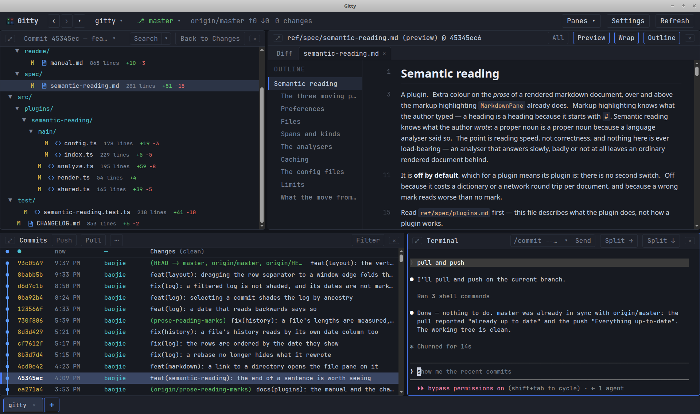

# Gitty

[English](../../README.md) · [简体中文](README.zh-CN.md) · [日本語](README.ja.md) · [한국어](README.ko.md) · [Français](README.fr.md) · [Deutsch](README.de.md) · [Español](README.es.md) · [Русский](README.ru.md) · **Português**

> **Traduzido em 2026-11-18; corresponde ao Gitty v0.2.3.**
> O [README em inglês](../../README.md) é a versão oficial e a única mantida
> em dia. Este documento é um instantâneo daquele momento; onde houver
> divergência, prevalece o inglês. Este documento cobre apenas este arquivo — o
> [manual](manual.pt.md) tem suas próprias traduções, e lá também o inglês é a
> versão oficial. A interface em si é em inglês, então os nomes de botões e itens
> de menu ficam no original.

Um navegador de histórico do git com quatro painéis para o desktop, no espírito
do `lazygit`, mas com interação real de mouse: clique duplo para abrir um
arquivo, clique direito para copiar o caminho, clique em dois commits para
compará-los.

```
┌──────────────────────┬──────────────────────┐
│ Changes              │ Diff                 │
│ (or a commit's files)│ (unified, coloured)  │
├──────────────────────┼──────────────────────┤
│ Commits              │ Terminal             │
│ (log, ↑↓, Enter)     │ (a real shell)       │
└──────────────────────┴──────────────────────┘
```

Todos os painéis são redimensionáveis arrastando os separadores, e cada um pode
ser ocultado e trazido de volta — veja [Tela cheia e ocultar](manual.pt.md#full-screen-and-hiding).

Coisas que os outros navegadores de git em geral não fazem:

- **Um shell de verdade encaixado no histórico.** Não é um widget que chama o
  git — é um shell de login genuíno (`$SHELL`) com raiz no repositório, na mesma
  janela que o diff, divisível em vários. A maioria dos navegadores de git não
  tem terminal ou abre um externo, então checar uma suspeita significa trocar de
  janela. Aqui ele está bem ali, e todos os outros painéis se atualizam quando o
  repositório muda.
- **Uma preparação que termina num agente, não numa caixa de mensagem.** Prepare
  um ficheiro, um hunk, ou apenas as linhas que selecionou; então o **Send**
  escreve um comando seu — `claude "commit the staged changes"`, `codex exec …`,
  o que quer que use — no shell abaixo e carrega em Enter. Escrever a mensagem é
  trabalho do agente. Decidir *quais mudanças formam um commit* é o seu, e é para
  isso que servem os quatro painéis. Nenhum modelo é chamado de dentro do Gitty,
  portanto nada sai da máquina sem que o tenha enviado.
- **Documentos, não só diffs.** Markdown é renderizado, HTML é mostrado em um
  frame com sandbox, imagens são mostradas como figuras — tudo na revisão em que
  você está. Um README de dois anos atrás renderiza com as capturas de tela que
  *aquele* commit incluía, lidas diretamente do banco de objetos — nada no disco
  é envolvido, e nada é buscado da web, porque ler o README de outra pessoa não
  deveria anunciar você para qualquer host que ele aponte.
- **Markdown renderizado que ainda diz onde você está no arquivo.** Ative
  **Markdown source lines** e cada título, parágrafo, item de lista, tabela,
  bloco cercado e imagem é numerado na margem com a linha em que começa no
  código-fonte — assim um trecho que você encontrou lendo pode ser editado por
  linha.
- **Um diff, um blame, o histórico de um arquivo e um README renderizado,
  abertos ao mesmo tempo.** Arquivos abrem como abas próprias *ao lado* do diff,
  e não por cima dele, cada um lembrando a revisão em que foi aberto. Ler um
  arquivo nunca custa a mudança que você estava vendo.
- **<kbd>Ctrl+F</kbd> que funciona em tudo o que o painel está mostrando** —
  inclusive markdown renderizado, onde uma frase é encontrada entre spans em
  negrito e de código porque a busca lê o texto renderizado, e dentro do frame da
  pré-visualização de HTML.
- **O histórico, servido para o seu navegador.** **Open in Browser** entrega um
  commit — seus metadados, seus arquivos, seus diffs — ao navegador do sistema, a
  partir de um servidor web dentro do app ligado a `127.0.0.1`, cujas URLs levam
  um token cunhado para esta sessão. Os commits são URLs reais, então o histórico
  pode ser lido em abas, mantido aberto e pesquisado com a busca do próprio
  navegador, enquanto o app estiver rodando.
- **[gource](https://gource.io/) a partir do menu dos commits**, quando
  instalado: todo o histórico do repositório como uma animação, em sua própria
  janela. Onde o gource está ausente, a entrada não é desenhada — nada é baixado
  ou oferecido que não possa rodar.
- **Nove idiomas de interface e um fuso horário explícito.** O git registra cada
  commit com o offset do autor, então um registro de data/hora é sempre uma
  escolha de fuso; aqui você a faz, e toda a UI — log, blame, histórico de
  arquivo, a fronteira entre "hoje" e uma data — a acompanha.



## Por que mais um? <a id="why-another-one"></a>

Porque toda ferramenta que eu procurei errava em uma coisa:

- **IDEs** — pesadas e lentas demais. (Acredite, eu tentei todas que consegui
  encontrar.)
- **lazygit, grv** — ferramentas excelentes, mas hostis ao mouse e à seleção de
  texto.
- **gitui** — eu quero a lista de commits e o diff na tela ao mesmo tempo.
- **SmartGit, GitKraken** — Java, pesadas, datadas, e querem seu dinheiro.
- **gitg** e companhia — de novo, sem lista de commits e diff lado a lado.
- **tig** — só diffs, sem árvore de arquivos para navegar.
- **gitk** — feio!

Duas outras coisas que eu queria e quase ninguém oferecia: uma
**pré-visualização de Markdown**, e **copiar e colar que simplesmente funciona**
em qualquer lugar da janela.

## Requisitos <a id="requirements"></a>

- `git` no `PATH`
- Linux, macOS ou Windows com uma sessão de desktop
- Node.js 22.12 ou mais recente — apenas para as instalações via npm e a partir
  do código abaixo; o `.deb` traz seu próprio runtime
- Opcionalmente [gource](https://gource.io/) no `PATH`, para
  [a animação](manual.pt.md#gource); nada muda se estiver ausente

## Como executar <a id="running"></a>

### Baixar um pacote (Linux) <a id="download-a-package-linux"></a>

O `.deb` é o caminho mais curto — sem Node, sem build:

```bash
wget https://github.com/baojie/gitty/releases/download/v0.2.3/gitty-desktop_0.2.3_amd64.deb
sudo dpkg -i gitty-desktop_0.2.3_amd64.deb
```

Ele instala `/usr/bin/gitty`, uma entrada no menu de aplicativos com seu ícone, e
roda com a sandbox do Chromium **ligada** — veja
[Integração com o desktop Linux](manual.pt.md#linux-desktop-integration).

Ao lado há um [`.deb` arm64](https://github.com/baojie/gitty/releases/download/v0.2.3/gitty-desktop_0.2.3_arm64.deb)
e um AppImage para distribuições sem dpkg
([x86_64](https://github.com/baojie/gitty/releases/download/v0.2.3/Gitty-0.2.3-x86_64.AppImage),
[arm64](https://github.com/baojie/gitty/releases/download/v0.2.3/Gitty-0.2.3-arm64.AppImage)) —
a segunda opção, porque um AppImage não pode instalar o auxiliar da sandbox. As
versões mais antigas estão na
[página de releases](https://github.com/baojie/gitty/releases).

### Do npm <a id="from-npm"></a>

```bash
npm install -g gitty-desktop      # installs the gitty command globally
```

### De um checkout <a id="from-a-checkout"></a>

Vincule-o ao seu PATH com:

```bash
./setup.sh               # symlink into ~/.local/bin (no sudo)
./setup.sh --system      # symlink into /usr/local/bin (needs sudo)
```

O `setup.sh` também instala um lançador clicável — uma entrada de desktop no
Linux, um `Gitty.app` mínimo no macOS, atalhos no Menu Iniciar e na área de
trabalho no Windows. Todos envolvem o mesmo `run.sh`, e todos carregam as
soluções de contorno que um Electron não empacotado precisa; veja
[Notas de plataforma](manual.pt.md#platform-notes).

Depois, abra um repositório de qualquer lugar:

```bash
gitty                    # open the repository in the current directory
gitty /path/to/repo      # open another repository
gitty --fg               # keep it attached to the terminal (Ctrl+C quits)
gitty --dev              # hot-reloading development mode
gitty --any              # start even outside a work tree (what the desktop
                         # entry uses), falling back to the last repositories
```

O Gitty se desconecta do terminal e imprime seu pid, então o shell continua
usável e fechá-lo não derruba a janela. A saída vai para
`${XDG_STATE_HOME:-~/.local/state}/gitty/gitty.log`, que é aparada para o último
megabyte quando passa de 4 MB.

`./run.sh` é o mesmo script e funciona de forma idêntica sem o symlink. O
lançador instala dependências e reconstrói o bundle quando as fontes mudam, então
a primeira execução pode demorar um pouco. `npm run dev`, `npm run build` e
`npm start` também estão disponíveis diretamente.

Iniciar o Gitty a partir de um diretório que não está dentro de uma árvore de
trabalho recai no último repositório aberto, em vez de apenas reclamar.

### No Windows <a id="on-windows"></a>

Não há instalador para Windows; rode o Gitty a partir de um checkout. Ele precisa
do [Git for Windows](https://gitforwindows.org/), cujo Git Bash executa os
scripts, além do Node.js e do runtime do Visual C++ de 64 bits. No PowerShell:

```powershell
winget install Git.Git
winget install OpenJS.NodeJS.LTS
winget install Microsoft.VCRedist.2015+.x64
```

Depois, em uma janela **nova** do Git Bash, para que ela enxergue o Node:

```bash
git clone https://github.com/baojie/gitty.git && cd gitty
npm install
./setup.sh
```

O `setup.sh` instala `gitty` para o Git Bash e `gitty.cmd` para o cmd e o
PowerShell em `%USERPROFILE%\.local\bin`, além dos atalhos. A partir daí,
`gitty` em qualquer repositório o abre, seja qual for o shell. O Visual Studio
não é necessário. Se o `npm install` falhar com *not a valid Win32 application*,
ou se o git chamar um repositório de *dubious ownership*, veja
[Windows](manual.pt.md#windows).

## O que o Gitty não faz <a id="what-gitty-does-not-do"></a>

O Gitty lê o histórico e prepara (stage) o que você decide que fica junto. Ele
não faz rebase, merge, cherry-pick, resolução de conflitos, nem cria, exclui ou
troca de branch — e não aprenderá a fazer. São operações com estado e de vários
passos cujos momentos interessantes são aqueles em que algo dá errado, e um shell
que cuida de todas elas está encaixado na mesma janela, já no diretório certo.
Meio botão de rebase é pior do que nenhum.

Também não há caixa de commit, o que é uma afirmação menor do que parece. O que
falta não é a mensagem: o que falta é um lugar para decidir *quais mudanças formam
um commit*, e é para isso que serve a preparação acima. Uma vez que o índice diz
uma coisa, o **Send** a entrega a quem escreve suas mensagens.

## O manual <a id="the-manual"></a>

O resto — cada painel, cada configuração, cada atalho — está no
**[manual](manual.pt.md)**:

- [A janela](manual.pt.md#the-window): a barra de título, voltar, as abas, os
  repositórios recentes, a tela cheia e o ocultar de painéis.
- [Os painéis](manual.pt.md#the-panes): a árvore de trabalho e a preparação, o
  diff, ver arquivos e documentos renderizados, o log de commits e seu grafo, o
  terminal.
- [Buscar texto](manual.pt.md#finding-text), a
  [tabela de configurações](manual.pt.md#settings) e os
  [atalhos de teclado](manual.pt.md#keyboard-shortcuts).
- [Notas de plataforma](manual.pt.md#platform-notes): a integração com o desktop
  Linux, o bundle do app macOS, o Windows e o log que o Gitty mantém quando sua
  janela congela.

## Arquitetura <a id="architecture"></a>

```
src/main       Electron main process — git commands, ptys, fs watchers,
               the recent-repository store, the stall log, IPC
src/preload    contextBridge API exposed to the renderer as window.gitty
src/renderer   React UI — App.tsx manages tabs, RepoTab.tsx owns one
               repository's four panes
src/shared     Types shared by both sides
build          Application icon (SVG source and rendered PNG)
```

O git é conduzido por `execFile('git', …)` com parsing `--porcelain=v2 -z` /
`--name-status -z`, então caminhos com espaços e renomeações sobrevivem. Nenhuma
biblioteca de git é embutida; qualquer que seja o `git` no `PATH` é o que você vê.
O renderer roda com `contextIsolation` e sem integração com node.

O renderer é dividido em chunks carregados sob demanda para que a janela pinte
antes de xterm, highlight.js e markdown-it serem analisados. A divisão — os quatro
chunks, as regras para manter bibliotecas pesadas fora dos quentes, e como
adicionar um novo — é especificada em
[ref/spec/lazy-loading.md](../../ref/spec/lazy-loading.md).

## Licença <a id="licence"></a>

MIT
