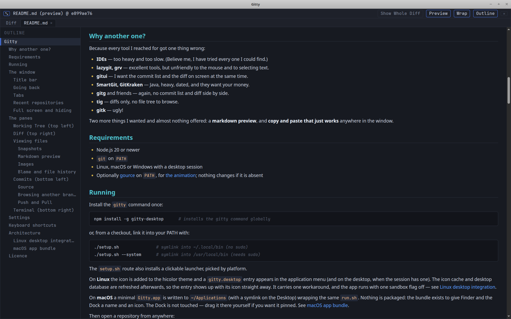
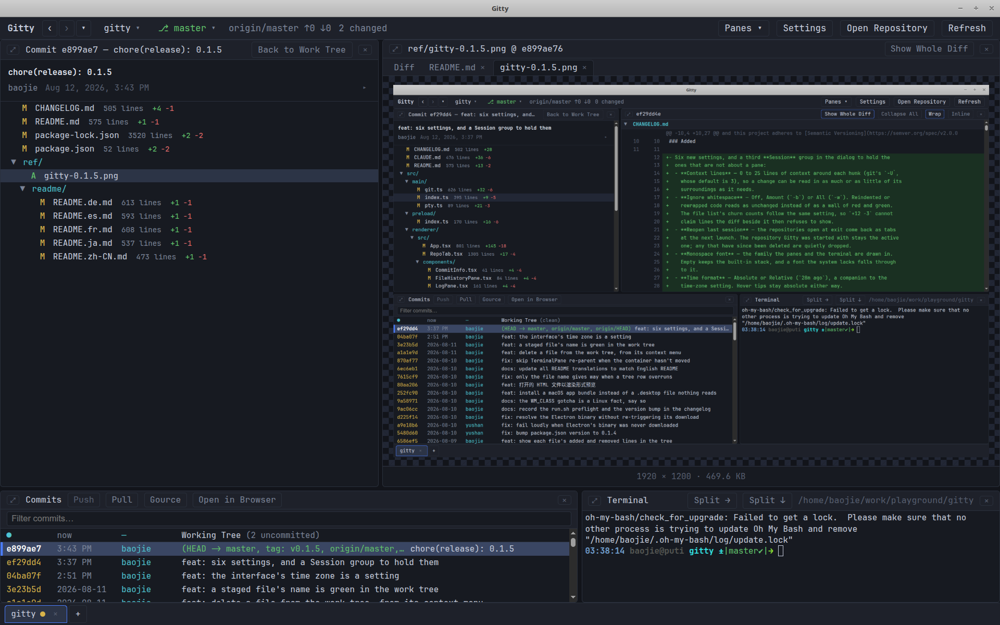
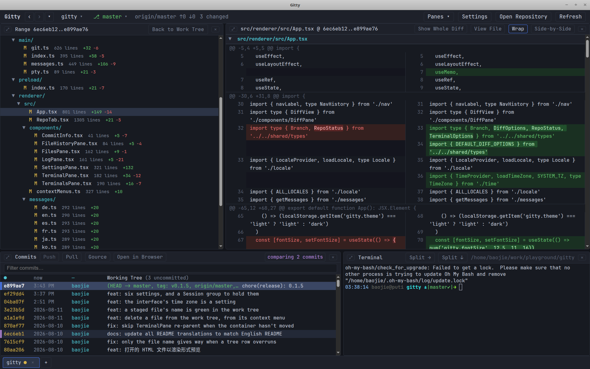

# El manual de Gitty

[English](manual.md) · [简体中文](manual.zh-CN.md) · [日本語](manual.ja.md) · [한국어](manual.ko.md) · [Français](manual.fr.md) · [Deutsch](manual.de.md) · **Español** · [Русский](manual.ru.md) · [Português](manual.pt.md)

Todo lo que hace Gitty, panel por panel. El [README](../../README.md) es la versión
corta — qué es, por qué existe, cómo instalarlo — y sigue siéndolo; aquí viven los
detalles.

> **Traducido el 2026-11-18; corresponde a Gitty v0.2.3.**
> El [manual en inglés](manual.md) es la versión oficial y la única que se mantiene
> al día. Este documento es una instantánea de ese momento; donde discrepen, manda
> el inglés. La interfaz está en inglés, así que los nombres de botones y menús se
> dejan tal cual.

---

## La ventana <a id="the-window"></a>

Cuatro paneles en el centro, una barra de título encima y una barra de pestañas
debajo.

### Barra de título <a id="title-bar"></a>

De izquierda a derecha, describe el repositorio activo y luego actúa sobre él:

- **Gitty** — el icono y el nombre en el extremo izquierdo abren el diálogo
  **About**: la versión, la hora de compilación, el autor y las versiones de
  Electron, Chromium y Node, con enlaces a la página de inicio y a los
  [atajos de teclado](#keyboard-shortcuts).
- **‹ › ▾** — dónde has estado en este repositorio. Véase
  [Volver atrás](#going-back).
- **La ruta del repositorio** es un botón: abre el menú de
  [repositorios recientes](#recent-repositories).
  La **+** al final de la [barra de pestañas](#tabs) y <kbd>Ctrl+O</kbd> abren
  el mismo menú.
- **⎇ rama** también es un botón — la rama que git tiene en checkout, y un menú
  con todas las demás para leerlas. Véase
  [explorar otra rama](#browsing-another-branch).
- **`origin/main ↑2 ↓0`** — el upstream de la rama actual y cuánto se adelanta o
  se retrasa. Ausente en una rama que no sigue a ninguna.
- **`3 changes`** — cuántos archivos tiene el árbol de trabajo sin confirmar, el
  mismo recuento que lleva la fila **Changes** del panel de commits.
- **Panes ▾** — mostrar u ocultar cada uno de los cuatro; véase
  [Pantalla completa y ocultar](#full-screen-and-hiding).
- **Settings** — el diálogo de preferencias ([Ajustes](#settings)), también con
  <kbd>Ctrl+,</kbd>.
- **Refresh** — releer el estado y el log a mano (<kbd>F5</kbd> /
  <kbd>Ctrl+R</kbd>). Gitty vigila el repositorio y se refresca solo; esto es
  para las veces en que la vigilancia no ve un cambio — en Linux, un árbol de
  trabajo de más de unos 8.000 directorios solo se vigila en parte.

Mientras lees otra rama el botón de rama muestra `⎇ main › other-branch`, y los
errores del último comando de git aparecen en rojo junto a los recuentos.

### Volver atrás <a id="going-back"></a>

Leer historial significa deambular: un commit, un archivo dentro de él, otro
commit dos páginas más abajo en el log, y luego volver al primero. Los tres
botones a la izquierda de la barra de título recuerdan ese deambular, como lo
hace un navegador.

- **‹** (<kbd>Alt+←</kbd>) vuelve al lugar que estabas mirando antes de este, y
  **›** (<kbd>Alt+→</kbd>) regresa al que dejaste atrás. Ambos se atenúan cuando
  no hay adónde ir, y al pasar el ratón por cualquiera de ellos se nombra el
  lugar al que te llevaría.
- **▾** lista los lugares en sí, el más reciente primero, con un punto en el que
  estás. Elige cualquiera para saltar directamente allí.

Un *lugar* es todo lo que los dos paneles superiores estaban mostrando: la vista
— los cambios sin confirmar, un commit, un rango de dos, una instantánea — el
archivo seleccionado dentro de ella, y el documento abierto junto al diff. Así que
una parada se lee como `Changes`, `7bb7787 — Refresh screenshot batches`,
`src/main/git.ts @ 7bb7787` o `blame: src/main/git.ts @ 7bb7787`, y volver a
ella devuelve el mismo archivo a pantalla en la misma revisión en vez de
simplemente volver a seleccionar el commit.

El historial pertenece al repositorio, no a la ventana: cada pestaña recuerda sus
propios cincuenta lugares más recientes, y cambiar de pestaña cambia por cuáles
caminan los botones. No se conserva entre reinicios.

### Pestañas <a id="tabs"></a>

Una barra de pestañas en la parte inferior contiene cada repositorio abierto — su
nombre base, un punto amarillo cuando el árbol de trabajo tiene cambios sin
confirmar, y una **×** para cerrarlo. El punto cuenta todo lo que reporta
`git status`, archivos sin seguimiento incluidos, y se gana su sitio en las
pestañas que *no* estás mirando: el repositorio activo ya dice `3 changed` en la
barra de título, mientras que una pestaña de fondo está oculta por completo, así
que el punto es la única señal de que allí queda trabajo. Al pasar el ratón por
una pestaña se nombra el repositorio y se dice con palabras.

**+** (y <kbd>Ctrl+O</kbd>) abre otro repositorio en una pestaña nueva, a través
del menú de [repositorios recientes](#recent-repositories); la barra
de título siempre muestra el activo. Cada pestaña conserva sus propios paneles y
su terminal, así que el commit que estás leyendo y la shell que dejaste corriendo
siguen exactamente donde estaban cuando te vas y vuelves. Arrastra una pestaña a
otro lugar de la barra para reordenar los repositorios. Al pulsar con el botón
derecho una pestaña aparece **Rename tab…** — el nombre se recuerda para ese
repositorio, se muestra en la barra de pestañas y en la de título, y la ruta real
sigue en la ayuda emergente —, **Open in File Manager**, que abre el directorio
raíz del repositorio, y **Close repository**. Cerrar la última pestaña
deja una ventana vacía con un botón para abrir el siguiente repositorio.

Las pestañas abiertas cuando Gitty se cierra se vuelven a abrir en el siguiente
arranque — el repositorio con el que se arrancó sigue quedando como pestaña
activa, y uno que se haya borrado entretanto se descarta sin aviso. **Reopen last
session** en los ajustes lo desactiva. Con varias ventanas (**Instances:
Multiple**) la sesión que se conserva es la de la última ventana cerrada.

Cerrar la ventana o salir con más de un repositorio abierto pide confirmación
antes, para que un <kbd>Ctrl+Q</kbd> despistado no se lleve todo el conjunto. Con
un solo repositorio abierto se cierra sin preguntar.

### Repositorios recientes <a id="recent-repositories"></a>

La ruta del repositorio en la barra de título es un menú de los repositorios
abiertos antes — nombre base más su directorio padre — el más reciente primero.

- **Clic** — abrirlo en una pestaña nueva.
- **Ctrl/Cmd+clic** o **clic central** — abrirlo en la pestaña actual,
  reemplazando el repositorio que hubiera allí y conservando el sitio de la
  pestaña en la barra.
- La **×** a la derecha de una entrada — sacarla de la lista; el clic derecho sobre la entrada hace lo mismo. El menú sigue abierto, así
  que se pueden limpiar varias seguidas.

El menú muestra los doce más recientes; **More…** al final lista el resto. La
caja de búsqueda de arriba filtra la lista entera mientras escribes — cada
palabra tiene que aparecer en el nombre del repositorio o en su directorio, y las
coincidencias en el nombre van primero. <kbd>↑</kbd>/<kbd>↓</kbd> se mueven,
<kbd>Enter</kbd> abre en una pestaña nueva, <kbd>Ctrl+Enter</kbd> en la actual,
<kbd>Esc</kbd> cierra.

Cuando nada de la lista coincide, la búsqueda pasa al disco: Gitty busca un
repositorio cuyo nombre de directorio coincida, en los lugares donde viven los
repositorios que recuerda — el directorio padre de cada uno, y el que está por
encima de ese, buscando dos niveles hacia abajo, de modo que `~/work/<group>/<repo>` queda cubierto
sin configurar nada — y en los sitios habituales bajo el directorio personal
(`~/work`, `~/code`, `~/src`, `~/projects`, …). Lo que encuentra se lista bajo
*Is it one of these?* con su ruta completa, y solo se abre cuando lo eliges; una
vez abierto, se une a la lista.

**+** y <kbd>Ctrl+O</kbd> abren este mismo menú, así que un repositorio se
encuentra escribiendo su nombre; un segundo <kbd>Ctrl+O</kbd>, o
**Open Repository…**, pasa al diálogo de carpetas.

**Open Repository…** y **Clear Recent** están debajo; Clear Recent pregunta antes
de vaciar la lista, lo que no se puede deshacer. La lista vive en
`~/.config/Gitty/recent-repos.json`, guarda los últimos cien repositorios y omite
los que se hayan movido o borrado.

### Pantalla completa y ocultar <a id="full-screen-and-hiding"></a>

La cabecera de cada panel lleva los mismos dos controles: **⤢** a su izquierda
llena la ventana con ese panel, y **×** a su derecha lo oculta.

La pantalla completa cubre todo lo demás, incluidas las barras de título y de
pestañas, y los paneles de debajo siguen funcionando — la terminal continúa
ejecutándose mientras está tapada. **⤡** en la misma esquina, <kbd>Esc</kbd>, un
doble clic en la cabecera (en su espacio vacío — los botones, y el menú de título
del panel Changes, tienen su propio significado), o <kbd>Ctrl+Shift+1</kbd> …
<kbd>Ctrl+Shift+4</kbd>
restauran la disposición. Solo un panel está a pantalla completa a la vez.

<kbd>Ctrl+Tab</kbd> lleva la pantalla completa al siguiente panel en el orden de
la disposición y <kbd>Ctrl+Shift+Tab</kbd> al anterior, saltándose los ocultos y
dando la vuelta en ambos extremos. Solo funciona mientras un panel llena la
ventana, que es donde hace falta: con la disposición en pantalla, cada panel está
ya a un clic. La terminal no ve la tecla, así que también funciona desde una shell.

Ocultar es la otra dirección — cualquier panel puede guardarse y recuperarse:

- **Panes** en la barra de título lista los cuatro, con un punto junto a los
  visibles; al pulsar uno se alterna, y **Show All Panes** restaura la
  disposición de cuatro paneles.
- <kbd>Ctrl+1</kbd> … <kbd>Ctrl+4</kbd> alternan Files, Diff, Commits y Terminal,
  en ese orden.
- <kbd>Ctrl+Shift+0</kbd> recupera los cuatro — cero por «todos», una tecla más
  allá de las cuatro que alternan cada uno. Lleva Shift porque
  <kbd>Ctrl+0</kbd> es el restablecer-zoom del motor del navegador, que el menú
  View conserva.

Lo que queda se reparte la ventana, así que ocultar el panel de commits le da al
diff toda la altura. El último panel visible no tiene **×** — una ventana vacía
no dejaría nada donde hacer clic. Los paneles ocultos se recuerdan entre
reinicios, y el panel de la terminal solo se guarda, nunca se cierra: sus shells
siguen corriendo y vuelven con su historial de desplazamiento intacto.

Un panel también se puede plegar arrastrando un separador hasta el borde de la
ventana: el separador entre las dos filas pliega esa fila, y cualquiera de los
separadores verticales pliega el panel de ese lado — el vecino se queda el sitio
liberado. Arrastrar el separador de vuelta restaura el reparto. Útil cuando una
parte de la ventana merece todo el ancho o todo el alto.

## Los paneles <a id="the-panes"></a>

### Changes (arriba a la izquierda) <a id="changes-top-left"></a>

Los archivos modificados como un árbol plegable, cada uno con su número de líneas
junto al nombre. Explorar un repositorio entero — el árbol de trabajo o la
instantánea de un commit — abre con todos los directorios cerrados, puesto que es
un árbol en el que descender y no una lista de cambios que leer; una lista de
cambios se abre desplegada. Los directorios van antes que los archivos en todos
los niveles, y dentro de cada grupo los nombres se ordenan como espera un lector
y no como lo haría una comparación de bytes: los dígitos de un nombre cuentan
como número, de modo que `W9` va antes que `W10`, y las mayúsculas no son una
diferencia de primer orden, de modo que `butler/` se ordena con las bes en vez de
después de cada letra mayúscula.

Cada nombre lleva un icono de tipo: la forma es la familia — código, datos
estructurados, marcado, hoja de estilo, prosa, imagen, archivo comprimido, script
de shell, archivo de bloqueo, salida compilada — y el color es el lenguaje, así
que `.ts` y `.py` son el mismo glifo en colores distintos. Python es el único
lenguaje dibujado como él mismo, en su propio azul y amarillo. Una extensión que
Gitty no conoce recibe una hoja lisa en vez de una conjetura.

Se muestran dos columnas de estado: el del área
de preparación (verde) y el del árbol de trabajo (amarillo / rojo); los archivos
sin seguimiento son `??`. El recuento se lee del disco en el árbol de trabajo y de
la revisión en los demás casos; donde no hay ninguno que leer — un archivo
binario, o cualquiera de más de 8 MB — la fila dice en su lugar cuánto ocupa el
archivo, y un archivo borrado no dice nada. Después va la rotación — cuántas líneas
añadió y quitó este cambio en ese archivo, `+12 −3`, contra HEAD en el árbol de
trabajo y contra el padre para un commit o un rango. Una instantánea es un árbol y
no un cambio, así que no tiene rotación; tampoco los archivos binarios ni un merge
commit, cuyo diff combinado no atribuye nada.

Donde iría la rotación, un árbol — el listado de Working Tree y la instantánea de
un commit — nombra en su lugar **quién confirmó por última vez cada archivo**: un
cambio ya es de alguien, pero un árbol plantea de quién es este archivo. Pasa el
ratón por el nombre para leer la frase completa. Un archivo que git nunca ha visto
no tiene ninguno, así que los archivos sin seguimiento y los ignorados no muestran
nada.

El título del panel dice qué se está listando, y al pulsarlo se abre un menú de
las dos vistas permanentes: **Changes**, los cambios sin confirmar, y
**Working Tree**, cada archivo del directorio en el disco, de solo lectura. Una
marca señala cuál está en pantalla; desde un commit, un rango o una instantánea el
mismo menú es el camino de vuelta a cualquiera de las dos.

**Working Tree** quiere decir cada archivo: los que cubre `.gitignore` — salida de
compilación, `node_modules`, lo que sea — se listan como los demás, en cursiva
atenuada, y una carpeta que no contiene más que archivos ignorados también se
atenúa. Se abren y se leen como cualquier otro archivo; solo se dejan fuera sus
recuentos de líneas, porque contarlas significaría leer cada byte de un directorio
que suele ser lo más grande del disco. `.git` no se lista.

<kbd>Ctrl+B</kbd> — b de browse — es el atajo que lleva ahí desde cualquier parte,
y no solo cambia la vista: también prepara la ventana para leer, apartando Commits
y la terminal y dejando el árbol y lo que abre. <kbd>Ctrl+D</kbd> es el camino de
vuelta: otra vez los cambios, con los cuatro paneles. En una terminal esa tecla
sigue siendo el fin de entrada, que es como se sale de una shell, así que la
pareja funciona en todas partes menos ahí. Ambas teclas están en la ayuda
emergente del título del panel.

- **Clic** — mostrar el diff del archivo a la derecha.
- **Doble clic** — abrir el archivo entero como documento junto al diff, con
  números de línea y resaltado de sintaxis (un documento representado para
  markdown, la propia imagen para una imagen).
- **Clic en una columna de estado** — preparar el archivo, o deshacer su
  preparación si ya estaba preparado.
- **Clic derecho** — View File, Open in System App, Reveal in File Manager, Open
  Remote URL, Copy Relative Path, Copy Absolute Path, Copy File Name, Blame
  File, File History, Stage / Unstage File, Discard Changes, Delete File. La fila
  de un submódulo ofrece además **Pull Submodule**.
- **Clic derecho → Open Remote URL** — la página de este archivo en el sitio que
  aloja el repositorio, abierta en el navegador del sistema. La revisión es la
  que se está mirando — un commit, una instantánea — y la rama en checkout en las
  vistas Changes y Working Tree. La dirección se deduce del remoto igual que la
  del [elemento del menú de commits](#commits-bottom-left), así que solo aparece
  donde esa deducción funciona, y nunca para un archivo sin seguimiento, un HEAD
  separado o un commit que aún no se ha subido — el sitio todavía no tiene página
  para él.
- **Clic en una carpeta** — plegarla o desplegarla.
- **Clic derecho en una carpeta** — Copy Relative Path, Copy Absolute Path, Copy
  Folder Name, y las dos formas de abrirla fuera de Gitty: **Open in Browser**,
  que es el propio listado del directorio en el navegador, y **Open in File
  Manager**. La instantánea de una revisión lista un árbol que no está en el
  disco, así que solo ofrece las rutas.
- **Clic derecho en el espacio vacío bajo las filas** — **Open in File Manager**
  sobre el directorio raíz del repositorio (no en la instantánea de una
  revisión), y **Paste** cuando hay archivos que pegar.

Los archivos copiados en un gestor de archivos se pueden **pegar en el árbol**:
un clic derecho en el espacio vacío bajo las filas da **Paste**, que escribe en la
raíz del repositorio, y un clic derecho sobre un archivo da
**Paste into `dir`/**, que escribe a su lado. <kbd>Ctrl+V</kbd> hace lo mismo con
el panel enfocado — en el directorio del archivo seleccionado, o en la raíz cuando
no hay nada seleccionado. Los archivos cortados se mueven en vez de copiarse, y
por un nombre que el directorio ya tiene se pregunta una vez: quedarse con los dos,
lo que añade `(copy)` al nombre que llega, o reemplazar.

Pegar pertenece a las dos vistas que *son* el directorio en el disco —
**Changes** y **Working Tree**. Un commit, un rango o la instantánea de una
revisión es el listado de algo que no está ahí para escribir dentro, así que no se
ofrece pegar.

<kbd>Ctrl+F</kbd> con este panel enfocado — o **Filter** en el botón de búsqueda
de la cabecera, cuya flecha elige entre buscar en el repositorio y filtrar esta
lista — abre una caja de filtro encima del árbol y lo reduce a las rutas que
contienen lo que escribes, con el recuento de cuántos de cuántos archivos quedan.
Lo que escribes es una **expresión regular** — `\.tsx?$`, `main|renderer` —
comparada con la ruta entera, así que `src/main` conserva todo lo que haya bajo
ese directorio, y no distingue mayúsculas. El texto corriente es una expresión que
se significa a sí misma, y una expresión que todavía no compila (`src/(`, la mitad
de `src/(main|renderer)`) se compara literalmente en vez de darse por error. Nada
permanece cerrado mientras la caja tenga texto — una coincidencia cinco
directorios más abajo es justo el motivo de haber escrito. <kbd>Esc</kbd> o la
**✕** lo limpia y devuelve el árbol entero, y pasar a otro commit también.

<kbd>Ctrl+E</kbd> responde a la otra pregunta — no «reduce lo que se lista aquí»
sino «enséñame ese archivo, esté donde esté». Abre una caja sobre la ventana desde
cualquier parte, sin necesidad de un panel enfocado, y lista el directorio de
trabajo entero en vez del árbol en pantalla: cada archivo que nombraría `git`,
dejando fuera los que cubre `.gitignore`, para que `node_modules` no pueda
enterrar la respuesta. Las letras se buscan **en orden pero no contiguas** —
`dfpn` encuentra `DiffPane.tsx` — y la clasificación prefiere letras que empiezan
una palabra (un segmento de ruta, o tras `-`, `_`, `.` o un paso de minúscula a
mayúscula), letras del nombre del archivo antes que de los directorios por encima
de él, y tramos que se mantienen juntos; una ruta más corta deshace el empate.
<kbd>↑</kbd> <kbd>↓</kbd> eligen, <kbd>Enter</kbd> abre el archivo como documento
junto al diff, y <kbd>Esc</kbd> cierra la caja. El archivo se abre tal como está
en el disco aunque haya un commit en pantalla, ya que lo que listó la caja es el
directorio de trabajo. La tecla funciona también dentro de una terminal, donde la
shell no la ve — a diferencia de <kbd>Ctrl+D</kbd>, que sigue siendo el fin de
entrada porque así se sale de una shell; el fin de línea de readline es también
<kbd>End</kbd>.

**Pull Submodule** aparece en la fila de una ruta que nombra `.gitmodules`, en las
dos vistas que son el directorio en el disco — **Changes** y **Working Tree**.
Trae el remoto propio de ese submódulo y lo lleva a la punta de la rama que sigue
(`git submodule update --init --remote`), así que un submódulo que nunca se sacó
lo clona esa misma entrada. El superproyecto se queda apuntando al commit que
registró, y por eso el submódulo aparece luego en **Changes**: confirmar el nuevo
puntero sigue siendo decisión tuya. Lo que dijo git aterriza en la franja de
mensajes sobre el log de commits, donde informan push y pull.

**Discard Changes** devuelve el archivo a lo que guarda el índice, tras una
confirmación nativa que dice claramente que no hay vuelta atrás; un archivo sin
seguimiento no tiene versión en el índice a la que volver, así que en su lugar
ofrece **Delete File**, que va a la papelera del sistema.

El clic derecho sobre la fila del árbol de trabajo en el log de commits ofrece
también **Copy Staged Diff**, para una conversación que ocurre en otra ventana.
Cuando hay un commit o un rango seleccionado, este panel lista los archivos de
ese commit; **Back to Changes** (o <kbd>Esc</kbd>) vuelve a los cambios sin confirmar.
En una [instantánea](#snapshots) lista el árbol entero en ese commit, no solo lo
que cambió. Explorar el árbol de trabajo no tiene un botón así — el selector del
título por el que se abrió es también la salida.
que cambió.

### Diff (arriba a la derecha) <a id="diff-top-right"></a>

Diff unificado con números de línea antiguos y nuevos, cabeceras de hunk y color
de añadido/borrado, dispuesto como una lista de archivos: cada ruta es un título
a todo lo ancho, la cabecera de hunk está atenuada — es un rango de líneas, no lo
primero que hay que mirar — y un renombrado se lee `old → new`. Sin archivo
seleccionado lo muestra todo a la vez: cada cambio sin confirmar del árbol de
trabajo, o cada archivo del commit seleccionado.

- **Show Whole Diff** — volver a ese diff combinado tras elegir un archivo. Se
  queda en la cabecera y se ilumina mientras el diff completo es lo que estás
  viendo. La versión del árbol de trabajo cubre a la vez los cambios preparados y
  sin preparar, e inserta los archivos sin seguimiento (hasta 50, luego un
  aviso), que `git diff` por sí solo deja fuera.
- **Wrap** — ajustar las líneas largas en vez de desplazarse en horizontal.
  Activado por defecto.
- **Inline** — un interruptor como **Wrap**: pulsado, una columna con marcas
  `+`/`-`; suelto, antiguo y nuevo uno al lado del otro, donde una tirada de
  borrados se empareja con los añadidos que la siguen. Las mitades ajustadas
  siguen alineadas.
- **Títulos de archivo** — cada título pliega su archivo: el triángulo lo reduce
  al nombre, y **Collapse All** / **Expand All** en la cabecera lo hacen con
  todos. **Ctrl+clic** en un título abre ese archivo en una pestaña de documento
  nueva; con clic derecho salen **Open in a New Tab**, **Select in the File
  List**, las copias de ruta y — en el árbol de trabajo, donde el archivo del
  disco es la versión mostrada — **Open in System App** y **Reveal in File
  Manager**. Un renombrado abre su ruta nueva.
- **Stage / Unstage** — mientras el diff sea el trabajo de un archivo con
  seguimiento, cada cabecera de hunk lleva un botón que mete ese hunk en el índice
  o lo saca. Selecciona primero líneas y el botón se vuelve **Stage 3 lines**: un
  añadido sin seleccionar queda fuera del patch, una supresión sin seleccionar se
  degrada a línea de contexto, y la cabecera del hunk se recalcula — la misma
  división que hace `git add -p`, desde una ventana donde tienes el archivo entero
  delante. La selección es la selección de texto normal, así que arrastrar sigue
  copiando. Una selección que abarca dos hunks le da a cada uno su parte.
- **Unstaged / Staged** — de qué lado del índice se lee un archivo, mostrado una
  vez que ambos lados guardan algo. Preparar actúa sobre el que esté en pantalla.
  Los archivos binarios, los cambios de modo y los renombrados no tienen hunks que
  elegir y se preparan enteros desde la lista de archivos; los botones de hunk
  también desaparecen mientras **Ignore whitespace** está activo, porque ese diff
  no guarda cada cambio que aplicaría.
- **Clic derecho** — Copy Selection, Copy Whole Diff y los mismos interruptores.

Las palabras que cambian dentro de una línea modificada se resaltan cuando eso se
lee mejor que la línea entera; es **Word highlight** en [Ajustes](#settings).

Los ajustes se recuerdan entre ejecuciones. Las filas se representan en bloques
de 1500 y se extienden al desplazarse, así que los commits grandes siguen ágiles;
los diffs de más de 2 MB se truncan con un aviso.

### Ver archivos enteros <a id="viewing-files"></a>

Por defecto el panel muestra un diff, pero cualquier archivo puede abrirse
entero: **doble clic** en el árbol, **View File** / **Preview** en la cabecera,
**Ctrl+clic** en un título de archivo dentro del diff, o desde cualquiera de los
dos menús contextuales.

El archivo se abre como documento propio en una tira de pestañas *junto* al diff,
en vez de encima, así que se puede leer sin perder el diff en el que estabas. La
pestaña **Diff** siempre va primera y un solo clic en el árbol sigue navegando
diffs en el sitio. Cada documento recuerda la revisión en la que se abrió, se
cierra con su propia **×** y relee un archivo del árbol de trabajo cuando el
repositorio cambia. **Clic derecho** en la pestaña de un documento da el mismo
menú que tiene su fila en el árbol de archivos; un archivo que la lista no
contiene — uno sin cambios, en la vista Changes — recibe el de Working Tree, sin
preparar, descartar ni borrar. Los archivos de código llevan números de línea y resaltado de
sintaxis; markdown se abre [representado](#markdown-preview), con un interruptor
para volver a la fuente; HTML se abre [representado también](#html-preview); una
imagen se abre como [la imagen](#images).

Qué revisión obtienes sigue al panel: el archivo del disco en el árbol de
trabajo, el archivo tal como estaba en el commit seleccionado en los demás casos.
Abrir un documento es una acción y no un modo — seleccionar otro archivo u otro
commit devuelve el diff — así que el panel nunca se queda atascado mostrando
archivos cuando querías cambios.

#### El esquema de un archivo de código <a id="the-outline-of-a-source-file"></a>

Un archivo de código lleva un botón **Outline**, el mismo que tiene un documento
representado: las clases, funciones y miembros del archivo a su lado como un
árbol, sangrados según el anidamiento y coloreados según lo que declara cada uno.
Pulsa una entrada para saltar a ella — el archivo se dibuja lo bastante lejos como
para contenerla, por honda que esté — y la entrada a la que has llegado
desplazándote queda marcada. Arrastra el separador para dar más sitio a cualquiera
de los dos lados; el ancho lo comparten todos los archivos del repositorio.

Lee dieciséis lenguajes — C, C++, C#, Go, Java, JavaScript, Lua, Perl, PHP,
Python, Ruby, Rust, shell, Swift, TypeScript y las variantes JSX de los dos
últimos — y los lee reconociendo declaraciones en vez de analizando: primero se
vacían comentarios y cadenas, el anidamiento viene de la profundidad de llaves (o
de la sangría, donde el lenguaje se escribe así), y un nombre solo aparece donde
una palabra clave lo puso. Todo lo demás — formatos de datos, hojas de estilo, un
lenguaje que no conoce — no muestra panel alguno en vez de una lista adivinada. El
markdown tiene [un esquema propio](#markdown-preview), hecho de sus títulos.

#### Instantáneas <a id="snapshots"></a>

Haz clic derecho en un commit y elige **Browse Snapshot** para leer el
repositorio tal como estaba en él: el panel superior izquierdo lista el árbol
*entero* en vez de los archivos que ese commit tocó, y cualquier archivo se abre
en esa revisión. Una instantánea no tiene diff que mostrar, así que allí todos
los archivos son documentos.

Los archivos de una instantánea nunca existieron en el disco en esa revisión, y
por eso **Open in System App** entrega una copia temporal y **Reveal in File
Manager** ni se ofrece. **Back to Changes** (o <kbd>Esc</kbd>) sale.

Un archivo que git registró como ejecutable — modo `755` — ofrece además
**Run in the Terminal**. Elegirlo saca el commit a un directorio temporal y
escribe `cd <ese directorio> && ./<archivo>` en el panel de la terminal, de modo
que el programa corre como era entonces, junto a los vecinos que tenía entonces y
no los de hoy. La línea solo se escribe: pulsar <kbd>Enter</kbd> es cosa tuya, y
hasta que lo hagas no corre nada. El panel de la terminal se recupera si estaba
oculto. Explorar el árbol de trabajo ofrece la misma entrada, y allí no hace falta
copia — el comando corre en el propio repositorio.

Ese directorio temporal es un árbol de trabajo enlazado de verdad
(`git worktree`), desprendido en el commit, así que un programa que le pregunte a
git dónde está obtiene respuesta; tiene índice y HEAD propios, y nada de lo que
corra ahí toca tu copia de trabajo. También significa un registro bajo
`.git/worktrees`, que `git worktree list` muestra y que Gitty va podando; la copia
en sí se guarda por commit, así que lanzar una segunda cosa desde la misma
instantánea es inmediato. Un commit cuyo árbol pase de 256 MB se rechaza en vez de
extraerse — la entrada sirve para lanzar un script, no para escribir un
repositorio entero de binarios en el directorio temporal.

#### Vista previa de Markdown <a id="markdown-preview"></a>

Seleccionar un archivo `.md` añade un botón **Preview** — apagado por defecto,
así que un diff sigue siendo un diff hasta que pidas el documento representado.
Representa el archivo entero: la versión del disco en el árbol de trabajo, la
versión del commit seleccionado en los demás casos.

Los bloques de código delimitados se resaltan cuando nombran un lenguaje, el
front matter YAML se extrae y se muestra como su propio bloque resaltado, y los
niveles de encabezado, las marcas de lista, los enlaces y el código en línea
llevan color para que la estructura se lea de un vistazo.

- **Wrap** — el mismo interruptor que el del diff, activado por defecto. La prosa
  siempre se ajusta; en una vista previa esto decide si los bloques de código, las
  tablas anchas y las cadenas largas en línea se ajustan también, en vez de
  desplazarse en horizontal.
- **Table columns** — las columnas de una tabla se dimensionan según su
  contenido, y cada borde se puede arrastrar: agarra el borde derecho de una celda
  de cabecera y la columna sigue al puntero, mientras las demás conservan la
  anchura que tenían. Una tabla más ancha que el panel se desplaza en horizontal.
  Doble clic en un borde devuelve la tabla al navegador, es decir, a anchuras que
  se ajustan al contenido. Las anchuras duran mientras el documento siga abierto.
- **Outline** — la estructura de encabezados junto al documento, sangrada por
  nivel, siguiendo el encabezado hasta el que has bajado. Haz clic en una entrada
  para saltar, y arrastra el separador entre ella y el documento para darle más
  espacio a cualquiera de los dos lados. La anchura es compartida por todos los
  documentos del repositorio — es una preferencia de lectura, no una propiedad de
  un archivo — y dura tanto como la ventana, como los tamaños de los demás
  paneles.
- **Source lines** — apagado por defecto, y se activa en
  [Ajustes](#settings): cada encabezado, párrafo, elemento de lista, tabla,
  bloque delimitado e imagen se numera en el margen izquierdo con la línea en la
  que empieza en la fuente. Los números se dibujan en vez de insertarse, así que
  se quedan fuera de la selección que copias y de lo que busca <kbd>Ctrl+F</kbd>.
  Cuando el documento es uno del que trata el diff en pantalla, el número de un
  bloque que ese diff insertó o cambió se dibuja verde sobre verde — los colores
  con los que el propio diff pinta una línea `+` — para que el margen refleje lo
  que dijo el diff. Un bloque cuenta como cambiado cuando lo está cualquiera de
  las líneas que abarca, así que un bloque delimitado editado se marca aunque su
  línea de apertura no se haya tocado. Una imagen escrita dentro de una frase toma la línea de su párrafo, al no tener
  una propia.
- **<kbd>Ctrl+F</kbd>** — buscar en el documento; véase
  [Buscar texto](#finding-text).
- **Clic derecho** — Copy Selection, Copy Markdown Source, los interruptores de
  ajuste y esquema, y Show Diff Instead.

El HTML crudo dentro del markdown no se representa, y un enlace a la web se abre
en el navegador del sistema y no dentro de la aplicación. Un enlace a otro archivo
del repositorio — `ref/readme/manual.md`, `../README.md`, `/CHANGELOG.md` — se
sigue aquí en cambio: **Ctrl/Cmd+clic** abre ese archivo como su propio documento
junto al diff, en la misma revisión que el documento que lleva el enlace, así que
un README leído en un commit antiguo lleva a los archivos de ese commit. Un
`#fragment` al final viaja con él — `manual.md#the-window` abre el manual en ese
encabezado, como lo haría en una forja — y un encabezado que este documento no
tiene simplemente lo abre arriba. Pasar el ratón por un enlace así lo dice. Un
clic simple no hace nada, como antes, y un enlace que trepa más allá de la raíz
del repositorio no es uno de estos.

Un enlace que en cambio nombra un directorio — `src/`, `ref/spec` — abre el panel
de archivos en esa carpeta, en la misma revisión: el árbol de trabajo para un
documento leído del disco, la instantánea de ese commit para uno leído en un
commit.

Las imágenes escritas con ruta relativa al documento se leen del repositorio — en
la misma revisión que el documento, así que un commit antiguo muestra las capturas
con las que se publicó. Una que el repositorio no tenga ahí deja un marcador de
posición punteado con su texto alternativo. Las imágenes de la web no se descargan
en absoluto: leer el README de un desconocido no debería anunciarte al servidor al
que apunte.



#### Vista previa de HTML <a id="html-preview"></a>

Un archivo `.html`, `.htm` o `.xhtml` recibe el mismo botón **Preview**, y el
documento se representa en vez de mostrarse como fuente — la versión del disco en
el árbol de trabajo, la versión del commit seleccionado en los demás casos.

Se representa en un marco aislado cargado mediante `srcdoc`, así que la página
nunca puede sacar a la aplicación de sí misma. Se aplican sus propias hojas de
estilo — maquetación, colores, fuentes son del documento. Los scripts no se
ejecutan y las imágenes remotas no se descargan: el marco hereda la política de
seguridad de contenido de la aplicación, que no admite ni una cosa ni la otra.
Una página se muestra, no se ejecuta. **Wrap** decide si el marco se desplaza por
sí solo o crece hasta su contenido para que la página entera se desplace como
una. <kbd>Ctrl+F</kbd> y <kbd>Ctrl+Shift+C</kbd> funcionan dentro del marco,
cuyas teclas nunca llegan al resto de la ventana.

#### JSON <a id="json"></a>

Un archivo `.json`, `.geojson`, `.topojson` o `.webmanifest` se abre tal como lo
guarda el archivo y recibe un botón **Format** junto a **Wrap**: al pulsarlo, el
documento se vuelve a sangrar con dos espacios por nivel, así que un archivo
minificado que llega como una única línea interminable se lee como un árbol.
Púlsalo otra vez para ver el archivo tal como está guardado.

Mientras el documento está formateado, cada objeto y cada array que contiene algo
lleva un **▼** junto a su número de línea: haz clic en él para plegar ese nodo, y
la línea en la que se abría conserva un **…** para indicar que falta algo. Haz
clic en el **▶** en que se convierte para volver a abrirlo. Los pliegues se
anidan, así que un nodo plegado dentro de otro sigue plegado cuando se abre su
padre, y <kbd>Ctrl+F</kbd> busca lo que hay en pantalla — las líneas de un nodo
plegado no se representan en absoluto. Nada sigue plegado cuando se abre otro
documento, o cuando se relee un archivo del árbol de trabajo tras cambiar el
repositorio: las líneas que nombraba un pliegue pueden no ser ya esas líneas.

Solo cambia el espacio en blanco entre los tokens. Los números conservan los
dígitos que escribe el archivo — un valor demasiado largo para un double, un
exponente demasiado grande —, las claves conservan su orden, y una clave
duplicada se queda. El botón solo aparece donde el texto se analiza como un único
documento JSON completo, así que una plantilla llena de marcadores, o una descarga
truncada, no ofrece nada en vez de un botón que no hace nada. Formatear es una
manera de leer el archivo; no se escribe nada de vuelta.

#### Imágenes <a id="images"></a>

Un `.png`, `.jpg`, `.gif`, `.webp`, `.bmp`, `.ico`, `.avif` o `.svg` se abre como
la imagen y no como un aviso de que es binario — del disco en el árbol de
trabajo, del commit en los demás casos. Se ajusta al panel sobre un tablero de
ajedrez, para que la transparencia se lea como transparencia; **haz clic** para
verla a tamaño real y desplazarte, y otra vez para ajustarla. Sus dimensiones en
píxeles y su tamaño en disco van debajo. Las imágenes de más de 12 MB no se
insertan.



#### PDF <a id="pdfs"></a>

Un `.pdf` se abre como el documento, leído por el visor que el motor del navegador
ya lleva incorporado: páginas en el lateral, zoom, rotación, su propia búsqueda y
botones para imprimir o guardar una copia. Funciona igual en una revisión — un PDF
en la instantánea de un commit se lee de git, así que una edición antigua de un
artículo se lee como era entonces sin hacer checkout de nada. El tamaño del
archivo va debajo. Los PDF de más de 64 MB no se abren, y el nombre en la propia
barra de herramientas del visor no es el del archivo; el de la cabecera del panel
de encima sí.

#### Archivos guardados con Git LFS <a id="files-stored-with-git-lfs"></a>

Un archivo seguido por [Git LFS](https://git-lfs.com/) es, en el propio
repositorio, un puntero de tres líneas, con el archivo real en un almacén a su
lado. Gitty sigue el puntero, así que una imagen o un PDF seguidos por LFS se
previsualizan como cualquier otro — en una revisión igual que en el árbol de
trabajo, y esté o no instalado `git lfs` en la máquina. Cuando el objeto no se ha
descargado, el panel lo dice en vez de mostrar una imagen rota o un error del
visor. `git lfs pull` lo trae, y entonces la vista previa funciona. El tamaño
junto al archivo en el árbol sigue siendo el del puntero, que es lo que el
repositorio guarda de verdad.

#### Blame e historial de archivo <a id="blame-and-file-history"></a>

Haz clic derecho en cualquier archivo del árbol y elige **Blame File** o **File
History**; ambos se abren como documentos junto al diff. Blame muestra una fila
por línea de código fuente — el commit, su autor, su fecha y la línea en sí,
resaltada como el visor de código, con un guion largo donde una línea aún no está
confirmada — en la revisión que estás viendo. File History lista cada commit que
tocó el archivo y sigue los renombrados; una
columna entre la fecha y el autor dice cuánto medía el archivo en ese commit, y
cuánto ocupaba donde el recuento no puede establecerse — una revisión binaria, y
todo lo anterior a ella. Sus filas se comportan como las del log de commits: un
clic elige una, un doble clic abre ese commit, y Shift+clic en una segunda fila
muestra el diff del archivo entre las dos revisiones — la misma vista de rango que
abre la segunda selección del log, con el archivo ya seleccionado.

El clic derecho sobre una fila de blame ofrece **History of These Lines**:
`git log -L` sobre las líneas que cubre la selección — o la línea pulsada, sin
selección — que se abre como su propio documento mostrando cada commit que las tocó
junto con lo que les hizo. Blame responde *quién fue el último*; esto responde
*cómo llegó a ser así*. Sigue el rango a través de los renombrados por sí mismo.

#### Buscar en el repositorio <a id="searching-the-repository"></a>

**Search** en la cabecera del panel Changes abre una caja encima de la lista de
archivos y ejecuta `git grep`. La flecha de al lado cambia ese botón a **Filter**,
que en su lugar reduce la lista de archivos; el que elijas sigue elegido, y solo
una de las dos cajas está abierta a la vez. Los resultados son un documento agrupado
por archivo, con los números de línea a la izquierda; al hacer clic en uno se abre
ese archivo en esa línea, con la línea marcada.

La búsqueda sigue la revisión en pantalla: en el árbol de trabajo lee lo que hay en
el disco, trabajo sin confirmar incluido, y en un commit o una instantánea lee esa
revisión — la caja dice cuál. Por encima de 2000 resultados se detiene y lo dice,
como hace un diff demasiado grande.

La caja toma una consulta y no un patrón desnudo, con la forma que un cliente de
correo enseñó a todo el mundo:

| Escrito | Encontrado |
| --- | --- |
| `foo bar` | las líneas que contienen ambas palabras |
| `"foo bar"` | la frase, espacios incluidos |
| `-foo` | las líneas sin ella |
| `foo in:*.py` | solo los archivos que casan con el glob; `in:*.py,*.pyi` para varios |
| `foo -in:test/*` | esos archivos dejados fuera |
| `foo in *.py` | lo mismo que `in:` — sin los dos puntos se lee como el operador solo cuando le sigue una ruta, así que `for x in list` siguen siendo cuatro palabras |

Las comillas apagan los operadores; así se busca `"in:*.py"` literalmente. Cada
término y cada glob llega a git como argumento propio — no se empalma nada en una
línea de comandos — así que una expresión regular no se deshace por el camino. Una
consulta que dice dónde mirar pero no qué buscar (`in:*.py` a solas) no se
ejecuta; la franja dice que no hay nada que buscar.

### Commits (abajo a la izquierda) <a id="commits-bottom-left"></a>

El log de la rama actual, cargado de 300 en 300 y ampliado al desplazarse. La
primera fila es **Changes** — los cambios sin confirmar, con un recuento de
archivos modificados; seleccionarla devuelve a ellos los paneles superiores.
**Filter**, a la derecha de la cabecera, abre una caja de filtro encima del log
que reduce la lista — con espera — y el resultado pagina de la misma manera. La
✕, <kbd>Esc</kbd> o el botón de nuevo guardan la caja y devuelven el log entero.

La cabecera conserva **Push** y **Pull**, los dos que se usan a menudo; todo lo
demás sobre el log está a un clic detrás de **⋯** — **Graph**, **All Branches**,
**Gource** donde esté instalado, y **Open in Browser**. Los dos interruptores
llevan un punto en ese menú mientras están activos.

**Graph** dibuja los carriles junto a los hashes: dónde se separó
una rama, dónde aterrizó un merge, a qué línea pertenece un commit. Se calcula a
partir de los padres de cada commit en vez de analizarse desde `git log --graph`,
cuyo ASCII está compuesto para una terminal. Un carril conserva su color página
abajo, y la paleta es fija — deliberadamente a diferencia del blame, cuyos colores
derivan del SHA y significan «quién». Pasados los diez carriles, el desborde
comparte la última columna, anillada, de modo que un repositorio con muchas
cabezas no puede empujar los asuntos fuera del panel. **All Branches** muestra
todas las ramas a la vez (`git log --all`), que es como dos ramas pueden verse en
relación la una con la otra; el menú de rama sigue leyendo una a la vez.

El log se ordena por la **fecha de autoría**, la de la columna, así que un commit
repetido en vez de escrito — rebasado, aplicado con cherry-pick, fusionado desde
un pull request aplastado — se lee entre las fechas en que fue escrito y no el día
en que aterrizó. Lo que ningún orden puede cambiar es que un padre siempre se
dibuja debajo de sus hijos, así que semejante commit todavía puede sentarse entre
filas a las que precede; donde eso pasa la fecha va marcada, y su ayuda emergente
dice por qué. Bajo un filtro la marca se apaga: la fila de encima no es entonces
el commit anterior a este, así que una fecha que va hacia atrás solo dice que las
filas de en medio no coincidieron.

Seleccionar un commit **sombrea el log por ascendencia**: las filas sobre las que
está construido y las construidas sobre él se quedan como están, y todo lo demás
retrocede. Esa es la única relación que la posición no puede mostrar — la fila
justo encima puede estar en otra rama, y un padre puede sentarse cien filas más
abajo. El recorrido cubre lo que se ha cargado, así que una ascendencia que sigue
más allá de la última fila se muestra hasta donde alcanza el log; bajo un filtro,
donde las filas son un subconjunto y faltan las cadenas entre ellas, no se sombrea
nada.

El menú desplegable de al lado dice qué se está buscando:

| | |
| --- | --- |
| **Message / Author** | El mensaje del commit y el autor, sin distinguir mayúsculas, como expresión regular extendida — `fix\|revert` es cualquiera de las dos palabras. El predeterminado. |
| **Content** | el `-S` de git: los commits donde el *número de apariciones* del texto cambió — donde se introdujo o se eliminó. Literal, de modo que una búsqueda llena de `.` y `(` significa esos caracteres. |
| **Content regex** | el `-G` de git: cada commit cuyo diff coincide con la expresión — extendida, como el modo de arriba — incluidos los que solo movieron la línea. |

El texto que todavía no es una expresión — `(fix`, camino de `(fix|revert)` — se
busca literalmente en los dos modos de expresión, para que una caja que se lee en
cada pulsación no vacíe el log mientras terminas de escribir.

Los dos modos de contenido responden a la pregunta que el blame no puede — *qué
commit introdujo esta línea* — y para ello leen cada diff del historial, así que
la caja dice que está buscando mientras corren. Cambiar el texto o el modo mata la
búsqueda en curso; no se empalma nada en una línea de comandos, así que una
expresión regular llega a git como un solo argumento.

- **Clic** o <kbd>Enter</kbd> — mostrar ese commit: sus archivos llenan el panel
  superior izquierdo y su diff completo el superior derecho. El asunto, autor,
  fecha y cuerpo completo del commit aparecen en una franja encima de la lista de
  archivos; cuando el cuerpo es largo, un interruptor ▸ lo pliega para que la
  lista de archivos conserve el espacio.
- <kbd>Shift+clic</kbd> o <kbd>Space</kbd> — elegir un segundo commit y comparar
  los dos, el más antiguo primero.
- **Ctrl+clic** (<kbd>Cmd</kbd> en macOS) — abrir la página del commit en el
  sitio que aloja el repositorio, la misma dirección que **Open Remote URL** más
  abajo. Donde no se pueda deducir tal página el clic no hace nada, y la fila se
  queda como estaba.
- **↑ ↓ / j k / PgUp / PgDn / Home / End** — mover el cursor.
- **Clic derecho** — mostrar el diff, copiar el hash, el hash corto o el asunto,
  [explorar la instantánea](#snapshots), o comparar con el commit seleccionado.
- **Clic derecho → Open in Browser** — representar este commit en el navegador
  del sistema; **Copy Commit URL** copia el enlace. Un servidor web dentro de la
  aplicación sirve cada repositorio abierto como una lista de commits navegable —
  el botón **Open in Browser** del panel de commits aterriza ahí — con los
  metadatos, archivos y diff de cada commit, y los diffs por archivo a un clic.
- **Clic derecho → Open Remote URL** — la página de ese commit en el sitio que
  aloja el repositorio, abierta en el navegador del sistema. La dirección se
  deduce del remoto (el que sigue la rama actual, si no `origin`), y la entrada
  aparece solo cuando esa deducción sale bien: GitHub, GitLab, Bitbucket, Gitea,
  Forgejo, Codeberg y sourcehut son conocidos, como cualquier servidor propio que
  siga la disposición `/commit/<hash>`. Un repositorio sin remoto, o alojado en
  Azure DevOps, no recibe la entrada, y tampoco un commit que aún no se ha subido
  — ni Ctrl+clic lo abre.

  Escucha en `127.0.0.1`, y eso solo no sería gran cosa: la vuelta local mantiene
  fuera a otras máquinas, no a otras páginas de tu propio navegador, cualquiera de
  las cuales podría recuperarlo. Así que cada URL lleva un token generado al
  arrancar y guardado en memoria — `/t/<token>/…` — que los enlaces que Gitty te
  entrega ya tienen. Un token equivocado es un 404 y no un 403, una petición cuyo
  `Host` no sea la vuelta local se rechaza (eso es lo que vuelve inútil el
  reenlace de DNS), y las páginas se sirven con `Referrer-Policy: no-referrer`,
  de modo que seguir un enlace fuera de un mensaje de commit no se lleva el token.
  El token es nuevo en cada lanzamiento, así que las URLs funcionan mientras corre
  esta sesión.
- Seleccionar un archivo en el panel superior izquierdo estrecha el diff a ese
  archivo; **Show Whole Diff** lo vuelve a ensanchar.



#### Gource <a id="gource"></a>

Si [gource](https://gource.io/) está en el `PATH`, el menú **⋯** de la cabecera de
commits gana una entrada **Gource**: reproduce el historial del
repositorio como una animación — el árbol de directorios creciendo, los archivos
iluminándose al aterrizar cada commit, un autor volando entre ellos por cada
nombre en el log. Gource abre su propia ventana y sigue ejecutándose después de
cerrar Gitty; la entrada solo espera lo suficiente para ver que arrancó, y muestra
lo que gource dijo si no lo hizo.

Se inicia con un día de historial por cada medio segundo, los archivos inactivos
se mantienen en pantalla y los huecos largos se saltan, que es lo que hace que un
repositorio real sea legible en vez de un goteo lento. No se instala nada por ti:
donde gource no está en el `PATH`, la entrada simplemente no aparece.

#### Explorar otra rama <a id="browsing-another-branch"></a>

La rama de la barra de título abre un menú con todas las ramas locales y de
seguimiento remoto, la del commit más nuevo primero, y al elegir una se muestra
el historial de esa rama. Es una mirada de solo lectura: gitty no ejecuta ningún
`checkout`, así que el árbol de trabajo, sus diffs y las terminales se quedan
exactamente donde git los dejó. Mientras miras otra rama la barra de título dice
`⎇ main › other-branch` y el panel de commits indica qué rama está listando;
**Back to \<branch\>** vuelve. Cada uno de los dos nombres tiene su propio texto
al pasar el ratón que dice cuál es cuál, ya que la distinción es todo el sentido
de esta función. Cada pestaña explora por su cuenta.

#### Push y Pull <a id="push-and-pull"></a>

**Push** y **Pull** están en la cabecera, y ambos actúan sobre la rama en
checkout, apunte el log a la rama que apunte. **Push** cuenta lo que falta por
enviar — **Push 3** — y se apaga cuando no hay nada; en una rama que no sigue a
ninguna, publica la rama en `origin` y fija el upstream. **Pull** avanza en fast
forward desde el upstream, y se apaga cuando no hay upstream del que tirar.
Cuando las ramas han divergido el fast forward es imposible, y Gitty pregunta si
tirar con un rebase en su lugar — tus commits locales vueltos a aplicar sobre el
upstream. Rechazarlo deja el repositorio como estaba y muestra la negativa de git;
aceptarlo exige un árbol de trabajo limpio, y un conflicto detiene el rebase para
que lo remates en la terminal. Lo que diga git aparece sobre el log — clic para
descartarlo; los fallos se quedan hasta que lo hagas.

Ninguno puede responder a una petición: no hay terminal detrás, así que un push
que quiere una contraseña o una frase de paso falla con el mensaje de git en vez
de quedarse colgado. Ambos se rematan luego a mano en el panel de la terminal,
que está justo ahí.

### Terminal (abajo a la derecha) <a id="terminal-bottom-right"></a>

Una shell de inicio de sesión interactiva de verdad (`$SHELL`) con raíz en el
repositorio, así que cualquier comando de git se ejecuta directamente.
<kbd>Ctrl+Shift+C</kbd> copia la selección de la terminal — <kbd>Ctrl+C</kbd>
allí es la interrupción, y sigue siendo la interrupción. El mismo acorde copia
también en todos los demás paneles, así que no cambia de significado al moverse
el foco. Los demás paneles se refrescan automáticamente cuando el repositorio
cambia en el disco. Qué shell inicia, y si inicia como shell de inicio de sesión,
son [Ajustes](#settings); ambas se leen cuando se crea una terminal, así que un
cambio surte efecto en la siguiente división.

El panel se divide en tantas shells como quieras: **Split →** pone una nueva al
lado de la terminal enfocada, **Split ↓** debajo, y los separadores entre ellas
se arrastran como los de cualquier otro panel. Al hacer clic en una terminal se
enfoca — la del contorno es donde aterrizan la siguiente división o **Close**.
Dividir dos veces en la misma dirección alarga la fila o la columna en vez de
anidar, así que tres terminales en paralelo se redimensionan entre sí.

**Close** termina la shell enfocada; salir de una shell con `exit` cierra su
división por sí solo. La última terminal siempre se queda: salir de ella deja el
aviso en pantalla en vez de un panel vacío.

**Send** en la cabecera de este panel entrega el índice. Escribe un comando en la
shell enfocada y pulsa Enter, y eso es todo: no se llama a ningún modelo desde
Gitty, no sale de la máquina nada que no hayas enviado. Las peticiones y la salida
del agente aparecen en la terminal, donde hay un tty de verdad, así que los hooks
y la firma gpg funcionan como siempre.

La caja a su izquierda nombra el comando que ejecutaría, y es donde se elige otro
— no hay ajuste para ello, porque es una pregunta que se hace una vez por entrega
y no una vez por instalación. El menú lista los comandos que Gitty recuerda, el
ejecutado más recientemente primero, y ejecuta el que elijas; ejecutar un comando
lo sube al principio, así que la caja muestra siempre el último usado. Sin nada
recordado, la caja se ve pálida y **Send** queda en gris. La **×** a la derecha de
una entrada la saca de la lista, tras una confirmación — la lista es el único
sitio donde se anota un comando, y el menú sigue abierto para poder quitar varios
seguidos. **New command…** abajo abre una caja de una línea, prerrellenada con el
comando actual, para lo que no esté en la lista. La lista empieza con unas cuantas
sugerencias — qué agente está instalado no es algo que Gitty pueda saber — y un
comando entra en ella por haber sido ejecutado, así que nada se recuerda por la
fuerza de una línea a medio escribir.

## Buscar texto <a id="finding-text"></a>

<kbd>Ctrl+F</kbd> busca lo que sea que muestre el panel de la derecha: un diff, un
archivo, un documento markdown representado, una [vista previa de
HTML](#html-preview), un blame o el historial de un archivo. Con el árbol de
archivos enfocado hace otra cosa — filtra ese árbol, descrito en
[Changes](#changes-top-left). Cada coincidencia se
resalta con la actual destacada, <kbd>Enter</kbd> y <kbd>Shift+Enter</kbd> (o las
flechas) las recorren y dan la vuelta en ambos extremos, el recuento dice dónde
estás, y <kbd>Esc</kbd> cierra.

La búsqueda no distingue mayúsculas y lee el texto como se representa, no el
marcado que hay detrás — así una frase se encuentra a través de los tramos en
negrita y de código que markdown deja dentro, y un diff se busca como las líneas
que ves. Las vistas que se representan en bloques al desplazarte (un archivo
largo, un diff grande) representan el resto cuando se abre la franja, así que el
recuento cubre el todo y no la parte a la que has bajado hasta ahora. Un archivo
plegado en un diff de varios archivos sigue plegado y no se busca.

## Ajustes <a id="settings"></a>

**Settings** en la barra de título, o <kbd>Ctrl+,</kbd>. Todo lo de aquí se
aplica a todas las pestañas y se recuerda entre reinicios; **Restore Defaults** lo
devuelve todo a su sitio. El diálogo está en tres pestañas — **Appearance**,
**View** y **Session** — así que cabe en una pantalla a medida que crece; la tabla
de abajo las lista en ese orden.

| | |
| --- | --- |
| **Theme** | Dark o Light. |
| **Language** | English, 简体中文, 日本語, 한국어, Français, Deutsch, Español, Русский o Português — la interfaz, los menús y los diálogos cambian todos a la vez sin reiniciar. |
| **Time zone** | La zona en la que se representa cada fecha y hora en pantalla: la de la máquina por defecto, o UTC, o cualquier zona que el sistema conozca. Git registra cada commit con el desfase de su autor, así que una marca de tiempo es siempre una elección de zona — aquí es donde se hace. La columna de fechas del log la sigue, lo que significa que la frontera entre «hoy» y una fecha se mueve con ella. |
| **Time format** | Absoluto (una hora de reloj o una fecha) o Relativo (`28m ago`, `2h ago`). El relativo esquiva del todo la cuestión de la zona; la pista al pasar el ratón por una fila sigue siendo absoluta en cualquier caso, y nombra su zona. |
| **Font size** | 9 – 20, en medios puntos. Se aplica a todos los paneles, la terminal incluida. |
| **Monospace font** | La familia con la que se dibujan los paneles y la terminal, elegida entre las fuentes monoespaciadas encontradas en esta máquina. **System default** es la pila integrada (JetBrains Mono, Fira Code, DejaVu Sans Mono, …). |
| **Row height** | 18 – 26 píxeles — la altura de línea sobre la que se construye cada lista: el árbol de archivos, el log y el diff. Más apretado cabe más en pantalla, más suelto se lee mejor. |
| **Diff layout** | Inline o Side-by-Side, el mismo interruptor que lleva la cabecera del diff. |
| **Context lines** | 0 – 25 líneas sin cambios alrededor de cada hunk — el `-U` de git, cuyo propio valor por defecto es 3. Ensánchalo para ver en qué está asentado un cambio, estréchalo para que quepa más de un diff grande en pantalla. |
| **Ignore whitespace** | Off, Amount (el `-b` de git: una tirada de espacios que cambia de longitud no es un cambio) o All (`-w`: ninguna diferencia de espacios lo es). El código reindentado o reaparejado se lee como sin cambios en vez de como un muro de rojo y verde. Los recuentos `+12 −3` de la lista de archivos siguen el mismo ajuste, así que no puede reclamar líneas que luego el diff se niega a mostrar. |
| **Word wrap** | Ajustar las líneas largas en vez de desplazarse en horizontal. |
| **Word highlight** | Marcar las palabras que cambiaron dentro de una línea modificada, no solo la línea. |
| **Outline** | Mostrar el esquema junto a un documento: los títulos en uno representado, las clases y funciones en un archivo de código. |
| **Markdown source lines** | Numerar cada bloque de un documento representado con la línea en la que empieza en la fuente. Encabezados, párrafos, elementos de lista, tablas, código delimitado e imágenes llevan uno cada uno, en un margen a la izquierda. Apagado por defecto. |
| **File sorting** | Orden Natural o Byte. El natural lee los dígitos de un nombre como número (`W9` antes que `W10`) y pone las mayúsculas en segundo lugar; el orden byte es el de git, donde cada mayúscula va por delante de cada minúscula. |
| **Reopen last session** | Reabrir los repositorios que estaban abiertos cuando la aplicación salió por última vez. El repositorio con el que arrancó Gitty sigue siendo la pestaña activa; los que desde entonces se hayan borrado se descartan en silencio. |
| **Instances** | **Single** — el valor por omisión — mantiene un solo Gitty por usuario: `gitty <repo>` desde cualquier directorio entrega el repositorio a la ventana ya abierta, que lo añade como pestaña y pasa al frente, y el segundo lanzamiento termina de inmediato. **Multiple** abre en cambio una ventana aparte por lanzamiento. A diferencia del resto de la tabla, este lo guarda la aplicación y no la ventana, así que es igual para todas; cambiarlo se aplica al siguiente `gitty` que escribas, no al siguiente reinicio. |
| **Shell** | La shell con la que arranca una terminal, listada desde `/etc/shells` más las rutas habituales (`COMSPEC` y PowerShell en Windows). **System default** es `$SHELL`. Una ruta que desde entonces haya desaparecido recae en ella en vez de dejar un panel muerto. |
| **Login shell** | Arrancarla con `-l`, para que se cargue el perfil del usuario. Apágalo para una shell más rápida y silenciosa — sin salida de perfil, sin comprobaciones de inicio de sesión. Las shells de Windows no tienen tal bandera y lo ignoran. |

### Extensiones <a id="plugins"></a>

La última pestaña de los ajustes. Todo lo que no es el núcleo de un navegador de
historial vive aquí como extensión: con su propio interruptor, sus propios
ajustes, sus propios archivos. Todas empiezan apagadas.

| extensión | qué hace |
| --- | --- |
| **Semantic reading** | Un analizador de lengua lee la prosa de un documento markdown representado y subraya los nombres propios que contiene — nombres de personas, lugares y organizaciones — de modo que un párrafo se puede ojear para saber de quién y de dónde habla. Las palabras latinas dentro de prosa CJK (`GPT-4`, `Claude`, `v0.1.9` en una frase china) reciben un color propio en vez de una raya, y el final de cada frase recibe peso y un poco de aire detrás, de modo que un párrafo se cuenta en frases de un vistazo. Ninguna de esas dos cosas necesita analizador, así que ambas se sostienen aunque ninguno pueda responder. El marcado no se toca, y el código tampoco: un bloque delimitado, un fragmento de código en línea y el destino de un enlace nunca se marcan. |

Semantic reading tiene tres ajustes propios, visibles una vez encendida.
**Analyser** es quién hace la lectura: **jieba** segmenta el texto en esta
máquina, no necesita red ni clave, y sabe chino; **Model** envía el texto al
endpoint compatible con OpenAI que nombre `Model access`, lo que cuesta una ida y
vuelta por documento y lee cualquier lengua que lea el modelo. En cualquier caso,
un analizador que no puede responder deja el documento exactamente como estaba.

**Mark styles** abre `rules.json`, que dice qué aspecto tiene cada clase de
marca: `underline` (`none`, `solid`, `dotted`, `dashed`, `double`, `wavy`),
`underlineColor`, `color`, `background`, `bold`, `italic` y `spaceAfter`, una
entrada para cada uno de `person`, `place`, `org`, `proper`, `latin` y
`sentence-end`. `spaceAfter` es el aire tras la marca, en em, hasta 2 — que es lo
que el valor por omisión le da a un final de frase en vez de otro color. Los
colores son `#rgb`, `#rrggbb` o `#rrggbbaa`, y son los del tema oscuro — el
archivo no tiene una segunda paleta para el claro. Edítalo, vuelve a abrir el
documento y el cambio está ahí.

**Model access** abre `models.json`: el `baseUrl`, el `model` y la clave del
analizador **Model**. `apiKeyEnv` nombra una variable de entorno de la que leer
la clave, lo que la mantiene fuera del archivo; `apiKey` la guarda directamente
para quien lo prefiera. Ambos archivos están en el directorio de estado del
propio Gitty, bajo `plugins/semantic-reading/`, nunca en un repositorio, y su
contenido nunca sale del proceso principal.

**Shell** y **Login shell** se leen al crear un terminal, así que surten
efecto en la siguiente división o la siguiente pestaña de repositorio, no en las
shells ya en marcha. **Word wrap**, **Diff layout** y **Outline** son los
mismos interruptores que lleva la cabecera del diff, así que cambiar uno en
cualquiera de los dos sitios cambia ambos. **Word highlight** solo vive aquí.

## Atajos de teclado <a id="keyboard-shortcuts"></a>

<kbd>F1</kbd> muestra esta tabla dentro de la aplicación — **Help ▸ Keyboard
Shortcuts** abre la misma hoja.

| Tecla | Acción |
| --- | --- |
| <kbd>↑</kbd> <kbd>↓</kbd> / <kbd>PgUp</kbd> <kbd>PgDn</kbd> / <kbd>Home</kbd> <kbd>End</kbd> | Mover la selección en la lista de commits |
| <kbd>Enter</kbd> | Mostrar el commit seleccionado |
| <kbd>Space</kbd> / <kbd>Shift+Click</kbd> | Marcar un segundo commit y comparar el par |
| <kbd>Ctrl+Click</kbd> en un commit | Abrir su página en el sitio que lo aloja |
| <kbd>Ctrl+Click</kbd> en un título de archivo | Abrir ese archivo en una pestaña de documento nueva |
| <kbd>Ctrl+F</kbd> | Buscar en el diff, el archivo o lo que sea que muestre el panel — o filtrar el árbol de archivos, con ese panel enfocado |
| <kbd>Ctrl+C</kbd> / <kbd>Ctrl+Shift+C</kbd> | Copiar la selección, en cualquier parte de la ventana |
| <kbd>Esc</kbd> | Volver a los cambios sin confirmar |
| <kbd>Ctrl+B</kbd> | Explorar el árbol de trabajo, con Commits y Terminal apartados |
| <kbd>Ctrl+D</kbd> | Volver a los cambios, con los cuatro paneles (no en una terminal, donde es fin de entrada) |
| <kbd>Ctrl+V</kbd> | Pegar los archivos del portapapeles en el árbol, con ese panel enfocado |
| <kbd>Alt+←</kbd> / <kbd>Alt+→</kbd> | Atrás y adelante por los lugares visitados |
| <kbd>Alt</kbd> | Mostrar u ocultar la barra de menús de la aplicación (no en macOS, donde siempre está) |
| <kbd>F1</kbd> | Los atajos, en una hoja sobre la ventana |
| <kbd>F5</kbd> / <kbd>Ctrl+R</kbd> | Refrescar estado y log |
| <kbd>Ctrl+O</kbd> | Abrir otro repositorio en una pestaña nueva: el menú de repositorios recientes; otra vez para el diálogo de carpetas |
| <kbd>Ctrl+E</kbd> | Abrir un archivo por su nombre, desde cualquier parte de la ventana — la terminal incluida |
| <kbd>Ctrl+,</kbd> | Ajustes |
| <kbd>Ctrl+1</kbd> … <kbd>Ctrl+4</kbd> | Ocultar o mostrar Files, Diff, Commits, Terminal |
| <kbd>Ctrl+Shift+0</kbd> | Mostrar de nuevo los cuatro paneles |
| <kbd>Ctrl+Shift+1</kbd> … <kbd>Ctrl+Shift+4</kbd> | Llenar la ventana con ese panel |
| <kbd>Ctrl+Tab</kbd> / <kbd>Ctrl+Shift+Tab</kbd> | La pantalla completa pasa al panel siguiente, o al anterior |

## Notas de plataforma <a id="platform-notes"></a>

### Integración de escritorio en Linux <a id="linux-desktop-integration"></a>

Los dos apaños de abajo tienen la misma causa — una aplicación Electron que se
*ejecuta* en vez de empaquetarse — así que ambos han desaparecido del `.deb`, y
ambos siguen en la vía de `setup.sh`, que de verdad ejecuta un Electron sin
empaquetar.

**Clase de ventana.** La entrada de escritorio que escribe `setup.sh` lleva
`StartupWMClass=electron`: eso es lo que reporta un Electron sin empaquetar se
llame como se llame la aplicación, y es contra lo que la lista de ventanas y el
dock hacen coincidir una ventana para encontrar su icono. El efecto secundario es
que otra aplicación Electron sin empaquetar de la misma sesión toma prestado el
icono de Gitty. El build empaquetado tiene su propio ejecutable, así que su
entrada coincide con `gitty` y la colisión no puede ocurrir.

**Sandbox.** `run.sh` y `cli.js` fijan `ELECTRON_DISABLE_SANDBOX=1`, porque
`chrome-sandbox` no puede conservar un bit setuid propiedad de root dentro de
`node_modules`. El `.deb` no tiene nada que sortear: su `postinst` pone el ayudante
en 4755 en kernels sin espacios de nombres de usuario sin privilegios, lo deja en
0755 donde funciona el sandbox de espacio de nombres, e instala el perfil AppArmor
que pide Ubuntu 24.04. Así que el sandbox está activo para todo lo instalado desde
el paquete.

El `.AppImage` es el más débil de los dos: nada en él puede llevar un bit setuid,
así que depende de los espacios de nombres de usuario sin privilegios — que la
política AppArmor de Ubuntu 24.04 restringe por defecto. Espera pasar allí
`--no-sandbox`, o instalar tu propio perfil AppArmor. Prefiere el `.deb` donde
puedas.

### Wayland y monitores con escalas distintas <a id="wayland-and-monitors-scaled-differently"></a>

Una sesión GNOME Wayland que mueve dos monitores con escalas distintas puede
dejar a Chromium incapaz de decidirse por una: cambia el factor de escala de la
ventana entre las dos varias veces por segundo, rehace la maquetación en cada
cambio, y toda la interfaz tiembla un píxel o dos mientras la ventana esté
abierta. A pantalla completa es donde peor se ve. Nada de Gitty lo causa — una
ventana de Electron sin contenido alguno tiembla igual — y ningún tamaño de
ventana lo evita.

Gitty lo resuelve por ti: al arrancar pregunta cómo están escalados los
monitores, y si vuelven dos respuestas se lanza otra vez con el escalado
fraccionario de Chromium desactivado. Eso ocurre antes de que exista ninguna
ventana, así que no hay nada que ver salvo un arranque un poco más tardío. El
precio es que entonces se ignora el escalado fraccionario del escritorio — la
interfaz se dibuja a escala 1 y se ve más pequeña que el resto.
<kbd>Ctrl+=</kbd> la amplía de vuelta, y los tamaños de fuente de **Settings**
son la otra manera de compensar la diferencia.

Dos variables de entorno se imponen a esa suposición.
`GITTY_DISABLE_FRACTIONAL_SCALE=1` desactiva el escalado fraccionario digan lo
que digan los monitores — útil si el segundo monitor se enchufa después de que
Gitty haya arrancado, el único caso que la comprobación del arranque no puede
atrapar. `GITTY_DISABLE_FRACTIONAL_SCALE=0` lo mantiene activo y evita el
reinicio, temblor incluido.

Poner los dos monitores a la misma escala, en **Settings → Displays**, no le deja
a Chromium nada entre lo que oscilar — el mismo arreglo por el otro extremo, allí
donde dos pantallas pueden compartir una escala.

Una consecuencia del reinicio: el identificador de proceso que imprime `run.sh`
es el del proceso que se apartó, así que un instante después no nombra nada.

### Bundle de aplicación macOS <a id="macos-app-bundle"></a>

`Gitty.app` es un envoltorio, no un paquete: `Contents/MacOS/Gitty` es un script
de dos líneas que ejecuta `run.sh --fg --any`. `--fg` importa — hacer exec todo
el camino significa que el icono del Dock se queda sobre el bundle en vez de
quedar huérfano por un proceso que le sobrevive — y `--any` permite que un
lanzamiento desde Finder, que no tiene directorio de trabajo del que hablar,
recurra a los repositorios abiertos más recientemente.

El nombre es correcto en los tres sitios donde aparece, y solo uno de ellos
proviene del bundle. Finder y el Dock leen `CFBundleName` y `CFBundleIconFile` de
`Info.plist`; la barra de menú es `app.name`, que `app.setName('Gitty')`
establece antes de que exista ventana alguna y `{ role: 'appMenu' }` usa como su
etiqueta. Así que, a diferencia del problema de clase de ventana en Linux, aquí
nada es un apaño — por eso empaquetar no aportaría nada salvo la firma, y por eso
`electron-builder.yml` solo configura objetivos Linux.

Un bundle lanzado desde Finder hereda el `PATH` mínimo de launchd, sin nvm ni
Homebrew, y `run.sh` necesita `node` y `npm` para reconstruir cuando el bundle
está desactualizado. `setup.sh` los resuelve en el momento de instalación y los
antepone — un prefijo, para que un lanzamiento desde terminal no se vea afectado.
Cambiar de versión de Node más tarde deja esa ruta obsoleta; vuelve a ejecutar
`setup.sh` para reajustarla.

### Windows <a id="windows"></a>

Windows se ejecuta desde una copia, con los mismos `run.sh` y `setup.sh` que las
demás plataformas, ejecutados por Git Bash, que viene con
[Git for Windows](https://gitforwindows.org/). El README enumera los
[pasos](../../README.md#on-windows). No se empaqueta nada:
`electron-builder.yml` solo configura destinos de Linux.

**Lo que instala `setup.sh`.** Un enlace simbólico no sirve aquí, porque el
`ln -s` de Git Bash hace una copia sin avisar, y una copia de `run.sh` busca la
copia del repositorio a su lado. Así que `%USERPROFILE%\.local\bin` recibe en su
lugar dos pequeños envoltorios: `gitty`, un script de bash para Git Bash, y
`gitty.cmd` para cmd y PowerShell, que pasa sus argumentos al `bash.exe -l` de
Git. El `-l` pone las herramientas propias de Git en el `PATH`;
`CHERE_INVOKING=1` impide que el perfil de inicio de sesión cambie a tu
directorio personal, así que `gitty` sigue significando el actual. Git Bash
construye su `PATH` a partir del de Windows, así que una sola entrada para ese
directorio sirve a todas las shells, y `setup.sh` imprime la línea de PowerShell
que la añade cuando falta.

El menú Inicio y el escritorio reciben un `Gitty.lnk` que ejecuta `run.sh --any`
en una ventana de Git Bash minimizada. Esa ventana se cierra en cuanto Electron
ha arrancado. Su icono es `build/icon.png` envuelto en un `.ico` bajo
`%LOCALAPPDATA%\Gitty`. El registro es
`%USERPROFILE%\.local\state\gitty\gitty.log`, la misma ruta que en las demás
plataformas.

**Sin Visual Studio.** El `node-pty` del panel de terminal trae binarios N-API
precompilados para Windows que cargan con cualquier Electron, así que el paso
`postinstall` se salta el `electron-rebuild` que ejecuta en Linux y macOS. Esa
reconstrucción necesitaría las herramientas de C++ de Visual Studio, y fallaría
sin ellas.

**_not a valid Win32 application_ durante `npm install`.** Esto significa que
falta el runtime de Visual C++ de 64 bits, no que una descarga esté rota. Sin él,
Windows busca `vcruntime140.dll` a lo largo del `PATH`, y una copia de 32 bits
dejada allí por algún otro programa (un Python de 32 bits es el caso habitual) no
puede cargarse en un Node de 64 bits. Instala el runtime con
`winget install Microsoft.VCRedist.2015+.x64` y vuelve a ejecutar `npm install`.

**_dubious ownership_.** En una unidad que no registra los propietarios de los
archivos, como FAT/exFAT o algunos recursos de red compartidos, git rechaza un
repositorio del que no puede demostrar que eres dueño, y Gitty no muestra nada de
él. Confía en el repositorio, o en todos los repositorios de esa unidad, en la
propia configuración de git:

```bash
git config --global --add safe.directory D:/path/to/repo
git config --global --add safe.directory '*'   # every repository
```

**La terminal** arranca `COMSPEC`, que es `cmd.exe`, salvo que **Settings →
Shell** elija PowerShell u otra shell. **Login shell** no hace nada aquí.

**Finales de línea.** Git for Windows saca el texto con CRLF por defecto, y bash
lee un CR final como parte del comando. `.gitattributes` mantiene `*.sh` en LF en
cada checkout. Una copia hecha antes de que existiera ese archivo lo aplica en
cuanto se vuelven a sacar los dos scripts, con
`rm run.sh setup.sh && git checkout -- run.sh setup.sh`.

### Cuando la ventana se congela <a id="when-the-window-freezes"></a>

Gitty guarda un registro de sus propios bloqueos: cada vez que el proceso
principal o la ventana deja de responder durante medio segundo o más, una línea
JSON registra cuánto tiempo, y qué llamadas a git estaban en curso en ese
momento. Ejecutado desde una copia, el registro es `logs/stalls/<date>.jsonl`
dentro de ella (ignorado por git); empaquetado, es
`~/.config/Gitty/logs/stalls/`. Adjuntar el archivo de ese día a un informe de
fallo sobre un congelamiento dice más de lo que puede decir una descripción.
`GITTY_STALL_MS=200` baja el umbral.
