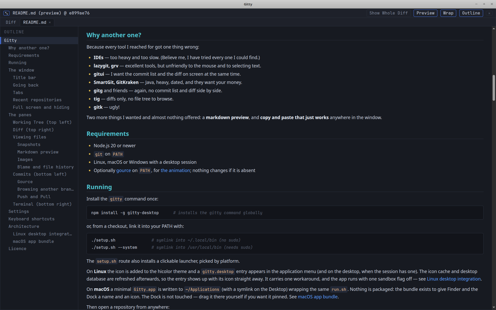
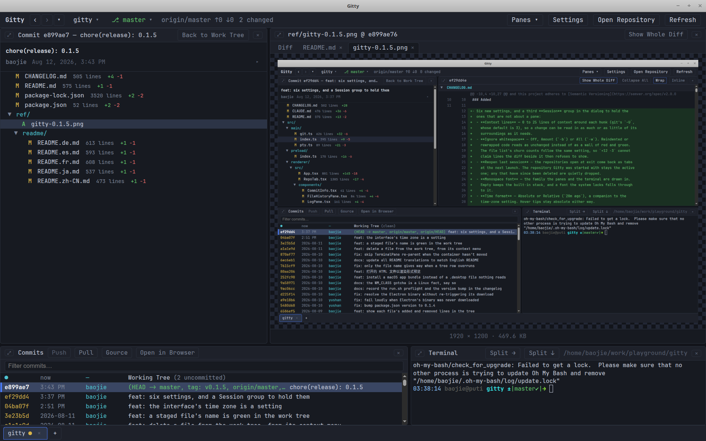
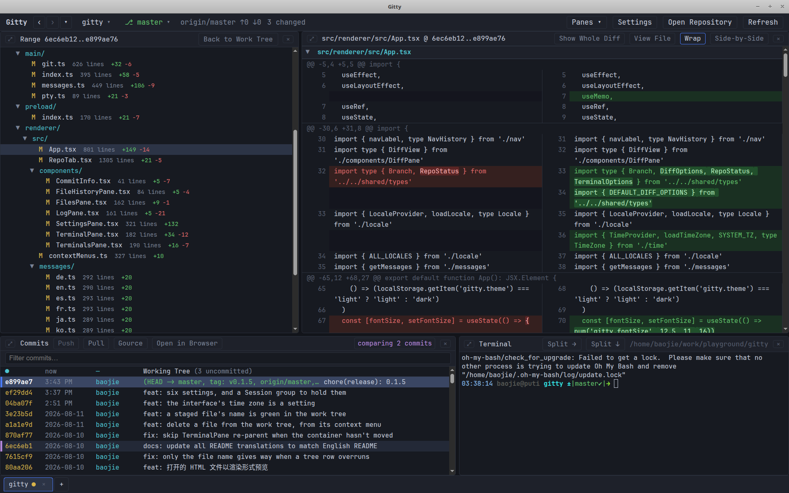

# Le manuel de Gitty

[English](manual.md) · [简体中文](manual.zh-CN.md) · [日本語](manual.ja.md) · [한국어](manual.ko.md) · **Français** · [Deutsch](manual.de.md) · [Español](manual.es.md) · [Русский](manual.ru.md) · [Português](manual.pt.md)

Tout ce que fait Gitty, volet par volet. Le [README](../../README.md) est la
version courte — ce que c'est, pourquoi il existe, comment l'installer — et le
reste ; c'est ici que vivent les détails.

> **Traduit le 2026-11-18, pour Gitty v0.2.3.**
> Le [manuel en anglais](manual.md) est la version officielle et la seule tenue
> à jour. Ce document en est un instantané ; en cas de divergence, c'est l'anglais
> qui fait foi. L'interface est en anglais, donc les noms de boutons et d'entrées
> de menu sont laissés tels quels.

---

## La fenêtre <a id="the-window"></a>

Quatre volets au milieu, une barre de titre au-dessus et une barre d'onglets en
dessous.

### Barre de titre <a id="title-bar"></a>

De gauche à droite, elle décrit le dépôt actif puis agit dessus :

- **Gitty** — l'icône et le nom à l'extrême gauche ouvrent la boîte de dialogue
  **About** : la version, l'heure de construction, l'auteur, et les versions
  d'Electron, Chromium et Node, avec des liens vers la page d'accueil et vers les
  [raccourcis clavier](#keyboard-shortcuts).
- **‹ › ▾** — où vous êtes allé dans ce dépôt. Voir
  [Revenir en arrière](#going-back).
- **Le chemin du dépôt** est un bouton : il ouvre le menu des
  [dépôts récents](#recent-repositories).
  Le **+** au bout de la [barre d'onglets](#tabs) et <kbd>Ctrl+O</kbd> ouvrent
  le même menu.
- **⎇ branche** est un bouton aussi — la branche que git a sortie, et un menu de
  toutes les autres branches à lire. Voir
  [parcourir une autre branche](#browsing-another-branch).
- **`origin/main ↑2 ↓0`** — l'amont de la branche sortie et de combien elle est
  en avance ou en retard. Absent sur une branche qui ne suit rien.
- **`3 changes`** — combien de fichiers l'arbre de travail a de non validés, le
  même compte que porte la ligne **Changes** du volet des commits.
- **Panes ▾** — afficher ou masquer chacun des quatre ; voir
  [Plein écran et masquage](#full-screen-and-hiding).
- **Settings** — la boîte de dialogue des préférences ([Réglages](#settings)),
  également par <kbd>Ctrl+,</kbd>.
- **Refresh** — relire l'état et le journal à la main (<kbd>F5</kbd> /
  <kbd>Ctrl+R</kbd>). Gitty surveille le dépôt et se rafraîchit tout seul ; ceci
  est pour les fois où la surveillance ne voit pas un changement — sous Linux, un
  arbre de travail de plus de 8 000 répertoires environ n'est surveillé qu'en
  partie.

Pendant que vous lisez une autre branche, le bouton de branche affiche
`⎇ main › other-branch`, et les erreurs de la dernière commande git apparaissent
en rouge à côté des compteurs.

### Revenir en arrière <a id="going-back"></a>

Lire l'historique, c'est vagabonder : un commit, un fichier dedans, un autre
commit deux pages plus bas dans le journal, puis retour au premier. Les trois
boutons à gauche de la barre de titre se souviennent de ce cheminement, comme un
navigateur web.

- **‹** (<kbd>Alt+←</kbd>) revient à l'endroit que vous regardiez avant celui-ci,
  et **›** (<kbd>Alt+→</kbd>) retourne à celui que vous venez de quitter. Les
  deux sont grisés quand il n'y a nulle part où aller, et survoler l'un ou l'autre
  nomme l'endroit où il vous mènerait.
- **▾** liste les endroits eux-mêmes, le plus récent en premier, avec un point
  sur celui où vous êtes. Choisissez-en un pour y sauter directement.

Un *endroit* est tout ce que les deux volets du haut montraient : la vue — les
modifications non validées, un commit, une plage de deux, un instantané — le
fichier sélectionné à l'intérieur, et le document ouvert à côté du diff. Un arrêt
se lit donc `Changes`, `7bb7787 — Refresh screenshot batches`,
`src/main/git.ts @ 7bb7787` ou `blame: src/main/git.ts @ 7bb7787`, et y revenir
replace le même fichier à l'écran à la même révision plutôt que de simplement
resélectionner le commit.

L'historique appartient au dépôt, pas à la fenêtre : chaque onglet garde ses
cinquante derniers endroits, et changer d'onglet change ceux que les boutons
parcourent. Il n'est pas conservé d'un lancement à l'autre.

### Onglets <a id="tabs"></a>

Une barre d'onglets en bas contient chaque dépôt ouvert — son nom de base, un
point jaune quand l'arbre de travail a des modifications non validées, et une
**×** pour le fermer. Le point compte tout ce que rapporte `git status`, fichiers
non suivis compris, et il gagne sa place sur les onglets que vous ne regardez
*pas* : le dépôt actif affiche déjà `3 changed` dans la barre de titre, alors
qu'un onglet en arrière-plan est entièrement caché ; le point est donc le seul
signe qu'il reste du travail là-bas. Survoler un onglet nomme le dépôt et le dit
en toutes lettres.

**+** (et <kbd>Ctrl+O</kbd>) ouvre un autre dépôt dans un nouvel onglet, en
passant par le menu des [dépôts récents](#recent-repositories) ; la barre de titre montre toujours l'actif. Chaque onglet garde ses propres volets et
son terminal, si bien qu'un commit que vous lisez et un shell que vous avez
laissé tourner restent exactement là où ils étaient quand vous partez et
revenez. Tirez un onglet à une nouvelle place dans la barre pour réordonner les
dépôts. Un clic droit sur un onglet propose **Rename tab…** — le nom est retenu
pour ce dépôt, montré dans la barre d'onglets et la barre de titre, le vrai
chemin restant dans l'infobulle —, **Open in File Manager**, qui ouvre le
répertoire racine du dépôt, et **Close repository**. Fermer le dernier onglet
laisse une fenêtre vide avec un bouton pour ouvrir le dépôt suivant.

Les onglets ouverts à la fermeture de Gitty sont rouverts au lancement suivant —
le dépôt avec lequel il a été lancé reste l'onglet actif, et un dépôt supprimé
entre-temps est écarté sans bruit. **Reopen last session** dans les réglages
désactive ce comportement. Avec plusieurs fenêtres (**Instances: Multiple**),
c'est la session de la dernière fenêtre fermée qui est gardée.

Fermer la fenêtre ou quitter avec plus d'un dépôt ouvert demande d'abord
confirmation, pour qu'un <kbd>Ctrl+Q</kbd> égaré n'emporte pas tout l'ensemble.
Un seul dépôt ouvert se ferme sans question.

### Dépôts récents <a id="recent-repositories"></a>

Le chemin du dépôt dans la barre de titre est un menu des dépôts ouverts
auparavant — nom de base plus répertoire parent — le plus récent en premier.

- **Clic** — l'ouvrir dans un nouvel onglet.
- **Ctrl/Cmd+clic** ou **clic milieu** — l'ouvrir dans l'onglet courant, en
  remplaçant le dépôt qui s'y trouve et en gardant la place de l'onglet dans la
  barre.
- Le **×** à droite d'une entrée — la retirer de la liste ; un clic droit sur l'entrée fait de même. Le menu reste ouvert, on peut
  donc en effacer plusieurs de suite.

Le menu montre les douze plus récents ; **More…** en bas liste les autres. Le
champ de recherche en haut filtre toute la liste au fil de la frappe — chaque mot
doit figurer dans le nom du dépôt ou dans son répertoire, et les correspondances
sur le nom passent en premier. <kbd>↑</kbd>/<kbd>↓</kbd> déplacent,
<kbd>Enter</kbd> ouvre dans un nouvel onglet, <kbd>Ctrl+Enter</kbd> dans
l'onglet courant, <kbd>Esc</kbd> ferme.

Quand rien dans la liste ne correspond, la recherche passe au disque : Gitty
cherche un dépôt dont le nom de répertoire correspond, là où vivent les dépôts
retenus — leurs répertoires parents, et ceux au-dessus d'eux sur deux niveaux de
profondeur, si bien que `~/work/<group>/<repo>` est couvert sans configuration —
et aux endroits habituels sous le répertoire personnel (`~/work`, `~/code`,
`~/src`, `~/projects`, …). Ce qu'il trouve est listé sous *Is it one of these?*
avec son chemin complet, et ne s'ouvre que si vous le choisissez ; une fois
ouvert, il rejoint la liste.

**+** et <kbd>Ctrl+O</kbd> ouvrent ce même menu, si bien qu'on trouve un dépôt
en tapant son nom ; <kbd>Ctrl+O</kbd> une seconde fois, ou **Open
Repository…**, passe à la boîte de dialogue de dossier.

**Open Repository…** et **Clear Recent** se trouvent en dessous ; Clear Recent
demande confirmation avant de vider la liste, ce qui ne peut pas être annulé. La
liste vit dans `~/.config/Gitty/recent-repos.json`, contient les cent derniers
dépôts et saute ceux qui ont depuis été déplacés ou supprimés.

### Plein écran et masquage <a id="full-screen-and-hiding"></a>

L'en-tête de chaque volet porte les deux mêmes contrôles : **⤢** à sa gauche
remplit la fenêtre avec ce volet, et **×** à sa droite le masque.

Le plein écran couvre tout le reste, barres de titre et d'onglets comprises, et
les volets en dessous continuent de fonctionner — le terminal tourne toujours
pendant qu'il est couvert. **⤡** dans le même coin, <kbd>Esc</kbd>, un
double-clic sur l'en-tête (sur son espace vide — les boutons, et le menu de titre
du volet Changes, ont leur propre sens), ou <kbd>Ctrl+Shift+1</kbd> …
<kbd>Ctrl+Shift+4</kbd>
restaurent la disposition. Un seul volet est en plein écran à la fois.

<kbd>Ctrl+Tab</kbd> déplace le plein écran vers le volet suivant dans l'ordre de
la disposition et <kbd>Ctrl+Shift+Tab</kbd> vers le précédent, en sautant les
volets masqués et en rebouclant à chaque extrémité. Cela ne marche que pendant
qu'un volet remplit la fenêtre, c'est-à-dire là où c'est utile : avec la
disposition à l'écran, chaque volet est déjà à un clic. Le terminal ne voit pas
la touche, donc cela marche aussi depuis un shell.

Le masquage est l'autre direction — n'importe quel volet peut être rangé puis
rappelé :

- **Panes** dans la barre de titre liste les quatre, avec un point à côté des
  visibles ; cliquer l'un le bascule, et **Show All Panes** restaure la
  disposition à quatre volets.
- <kbd>Ctrl+1</kbd> … <kbd>Ctrl+4</kbd> basculent Files, Diff, Commits et
  Terminal, dans cet ordre.
- <kbd>Ctrl+Shift+0</kbd> les ramène tous les quatre — zéro pour « tous », une
  touche après les quatre qui basculent chacun. Elle prend Shift parce que
  <kbd>Ctrl+0</kbd> est le zoom par défaut du moteur du navigateur, que le menu
  View conserve.

Ce qui reste se partage la fenêtre, donc masquer le volet des commits donne au
diff toute la hauteur. Le dernier volet visible n'a pas de **×** — une fenêtre
vide ne laisserait rien à cliquer. Les volets masqués sont retenus d'un lancement
à l'autre, et le volet du terminal est seulement rangé, jamais fermé : ses shells
continuent de tourner et reviennent avec leur historique de défilement.

Un volet peut aussi être replié en tirant un séparateur jusqu'au bord de la
fenêtre : le séparateur entre les deux rangées replie cette rangée, et l'un ou
l'autre séparateur vertical replie le volet de ce côté — son voisin prend la place
libérée. Retirer le séparateur en arrière rétablit le partage. Utile quand une
partie de la fenêtre mérite toute la largeur ou toute la hauteur.

## Les volets <a id="the-panes"></a>

### Changes (en haut à gauche) <a id="changes-top-left"></a>

Les fichiers modifiés en arbre repliable, chacun avec son nombre de lignes à côté
du nom. Parcourir tout un dépôt — l'arbre de travail ou l'instantané d'un commit
— s'ouvre avec chaque répertoire fermé, puisque c'est un arbre dans lequel
descendre plutôt qu'une liste de modifications à lire ; une liste de
modifications s'ouvre dépliée. Les répertoires viennent avant les fichiers à
chaque niveau, et dans chaque groupe les noms sont triés comme un lecteur
l'attend plutôt que comme le ferait une comparaison d'octets : les chiffres d'un
nom comptent comme un nombre, si bien que `W9` vient avant `W10`, et la casse
n'est pas une différence de premier ordre, si bien que `butler/` se range avec
les b au lieu d'après toutes les majuscules.

Chaque nom porte une icône de type : la forme est la famille — source, données
structurées, balisage, feuille de style, prose, image, archive, script shell,
fichier de verrouillage, sortie compilée — et la couleur est le langage, si bien
que `.ts` et `.py` sont le même glyphe dans des couleurs différentes. Python est
le seul langage dessiné comme lui-même, dans son bleu et son jaune. Une extension
que Gitty ne connaît pas reçoit une page nue plutôt qu'une supposition.

Deux colonnes d'état sont affichées :
l'état de l'index (vert) et celui de l'arbre de travail (jaune / rouge) ; les
fichiers non suivis sont `??`. Le compte est lu sur le disque dans l'arbre de
travail et dans la révision partout ailleurs ; là où il n'y en a aucun à lire —
un fichier binaire, ou tout ce qui dépasse 8 Mo — la ligne indique plutôt la
taille du fichier, et un fichier supprimé n'indique rien du tout.
Vient ensuite le brassage — combien de lignes cette modification a ajoutées et
supprimées dans ce fichier, `+12 −3`, par rapport à HEAD dans l'arbre de travail
et par rapport au parent pour un commit ou une plage. Un instantané est un arbre
plutôt qu'une modification, donc il n'a pas de brassage ; pas plus que les
fichiers binaires ou un commit de fusion, dont le diff combiné n'attribue rien.

Là où serait le brassage, un arbre — la liste Working Tree et l'instantané d'un
commit — nomme plutôt **qui a validé chaque fichier en dernier** : une
modification appartient déjà à quelqu'un, mais devant un arbre la question est
de savoir à qui est ce fichier. Survolez le nom pour la phrase entière. Un
fichier que git n'a jamais vu n'en a pas, donc les fichiers non suivis et
ignorés n'affichent rien.

Le titre du volet dit ce qui est listé, et cliquer dessus ouvre un menu des deux
vues permanentes : **Changes**, les modifications non validées, et
**Working Tree**, chaque fichier du répertoire sur le disque, en lecture seule.
Une coche marque celle qui est à l'écran ; depuis un commit, une plage ou un
instantané, le même menu est le chemin de retour vers l'une ou l'autre.

**Working Tree** veut dire chaque fichier : ceux que couvre `.gitignore` — sortie
de build, `node_modules`, quoi que ce soit d'autre — sont listés comme les
autres, en italique atténué, et un dossier qui ne contient que des fichiers
ignorés est atténué aussi. Ils s'ouvrent et se lisent comme n'importe quel autre
fichier ; seuls leurs comptes de lignes sont omis, puisque les compter voudrait
dire lire chaque octet d'un répertoire qui est d'ordinaire la plus grosse chose
sur le disque. `.git` lui-même n'est pas listé.

<kbd>Ctrl+B</kbd> — b comme browse — est le raccourci qui y mène depuis n'importe
où, et il prépare la fenêtre à la lecture autant qu'il change de vue : Commits et
le terminal s'écartent, laissant l'arbre et ce qu'il ouvre. <kbd>Ctrl+D</kbd> est
le chemin du retour : de nouveau les modifications, avec les quatre volets. Dans
un terminal cette touche reste la fin d'entrée, la façon dont on quitte un shell,
si bien que la paire fonctionne partout ailleurs. Les deux touches sont indiquées
dans l'infobulle du titre du volet.

- **Clic** — afficher le diff du fichier à droite.
- **Double-clic** — ouvrir le fichier entier comme document à côté du diff, avec
  numéros de ligne et coloration syntaxique (un document rendu pour markdown,
  l'image elle-même pour une image).
- **Clic sur une colonne d'état** — indexer le fichier, ou le désindexer s'il est
  déjà indexé.
- **Clic droit** — View File, Open in System App, Reveal in File Manager, Open
  Remote URL, Copy Relative Path, Copy Absolute Path, Copy File Name, Blame
  File, File History, Stage / Unstage File, Discard Changes, Delete File. La
  ligne d'un sous-module propose en plus **Pull Submodule**.
- **Clic droit → Open Remote URL** — la page de ce fichier sur le site qui
  héberge le dépôt, ouverte dans le navigateur du système. La révision est celle
  qu'on regarde — un commit, un instantané — et la branche sortie dans les vues
  Changes et Working Tree. L'adresse est déduite du distant de la même façon que
  pour [l'entrée du menu des commits](#commits-bottom-left), donc elle n'apparaît
  que là où cette déduction réussit, et jamais pour un fichier non suivi, un HEAD
  détaché ou un commit qui n'a pas été poussé — le site n'a pas encore de page
  pour lui.
- **Clic sur un dossier** — le replier ou le déplier.
- **Clic droit sur un dossier** — Copy Relative Path, Copy Absolute Path, Copy
  Folder Name, et les deux façons de l'ouvrir hors de Gitty : **Open in
  Browser**, qui est la liste du répertoire propre au navigateur, et **Open in
  File Manager**. L'instantané d'une révision liste un arbre qui n'est pas sur
  le disque, il ne propose donc que les chemins.
- **Clic droit sur l'espace vide sous les lignes** — **Open in File Manager**
  sur le répertoire racine du dépôt (pas dans l'instantané d'une révision), et
  **Paste** quand il y a des fichiers à coller.

Les fichiers copiés dans un gestionnaire de fichiers peuvent être **collés dans
l'arbre** : un clic droit sur l'espace vide sous les lignes donne **Paste**, qui
écrit à la racine du dépôt, et un clic droit sur un fichier donne
**Paste into `dir`/**, qui écrit à côté de lui. <kbd>Ctrl+V</kbd> fait de même
avec ce volet actif — dans le répertoire du fichier sélectionné, ou à la racine
quand rien n'est sélectionné. Les fichiers coupés sont déplacés plutôt que copiés,
et un nom que le répertoire contient déjà fait l'objet d'une question posée une
fois : garder les deux, ce qui ajoute `(copy)` au nom qui arrive, ou remplacer.

Coller appartient aux deux vues qui *sont* le répertoire sur le disque —
**Changes** et **Working Tree**. Un commit, une plage ou l'instantané d'une
révision est la liste de quelque chose qui n'est pas là pour être écrit, donc
aucun collage n'est proposé.

<kbd>Ctrl+F</kbd> avec ce volet actif — ou **Filter** sur le bouton de recherche
de l'en-tête, dont la flèche choisit entre chercher dans le dépôt et filtrer
cette liste — ouvre un champ de filtre au-dessus de l'arbre et le réduit aux
chemins contenant ce que vous tapez, avec le compte de combien de fichiers sur
combien il reste. Ce que vous tapez est une **expression régulière** — `\.tsx?$`,
`main|renderer` — comparée au chemin entier, donc `src/main` garde tout ce qui est
sous ce répertoire, et la casse est ignorée. Un texte ordinaire est une expression
qui se signifie elle-même, et une expression qui ne compile pas encore (`src/(`,
la moitié de `src/(main|renderer)`) est comparée littéralement plutôt que signalée
comme une erreur. Rien ne reste fermé tant que le champ a du texte — une
correspondance cinq répertoires plus bas est tout l'intérêt d'avoir tapé.
<kbd>Esc</kbd> ou le **✕** l'efface et remet l'arbre entier, et passer à un autre
commit aussi.

<kbd>Ctrl+E</kbd> répond à l'autre question — non pas « réduire ce qui est listé
ici » mais « montrer ce fichier-là, où qu'il soit ». Elle ouvre un champ
par-dessus la fenêtre depuis n'importe où, sans qu'aucun volet ait besoin du
focus, et liste tout le répertoire de travail plutôt que l'arbre à l'écran :
chaque fichier que `git` nommerait, ceux que couvre `.gitignore` laissés de côté,
pour que `node_modules` ne puisse pas enfouir la réponse. Les lettres sont
comparées **dans l'ordre mais pas forcément côte à côte** — `dfpn` trouve
`DiffPane.tsx` — et le classement préfère les lettres qui commencent un mot (un
segment de chemin, ou après `-`, `_`, `.`, ou un passage de minuscule à
majuscule), les lettres du nom de fichier plutôt que celles des répertoires
au-dessus, et les suites qui restent groupées ; un chemin plus court départage
les ex aequo. <kbd>↑</kbd> <kbd>↓</kbd> choisissent, <kbd>Enter</kbd> ouvre le
fichier comme document à côté du diff, et <kbd>Esc</kbd> ferme le champ. Le
fichier s'ouvre tel qu'il est sur le disque même quand un commit est à l'écran,
puisque c'est le répertoire de travail que le champ a listé. La touche marche
aussi dans un terminal, où le shell ne la voit pas — contrairement à
<kbd>Ctrl+D</kbd>, qui reste la fin d'entrée parce que c'est ainsi qu'on quitte
un shell ; la fin de ligne de readline est aussi <kbd>End</kbd>.

**Pull Submodule** apparaît sur la ligne d'un chemin que nomme `.gitmodules`,
dans les deux vues qui sont le répertoire sur le disque — **Changes** et
**Working Tree**. Il récupère le distant propre à ce sous-module et le déplace à
la pointe de la branche qu'il suit (`git submodule update --init --remote`), si
bien qu'un sous-module jamais sorti est cloné par la même entrée. Le superprojet
reste sur le commit qu'il a enregistré, et c'est pourquoi le sous-module apparaît
ensuite dans **Changes** : valider le nouveau pointeur reste votre décision. Ce
que git a dit atterrit dans le bandeau de message au-dessus du journal des
commits, là où push et pull rendent compte.

**Discard Changes** remet le fichier à ce que l'index contient, après une
confirmation native qui dit clairement qu'il n'y a pas d'annulation ; un fichier
non suivi n'a pas de version d'index où revenir, donc il propose **Delete File**
à la place, qui va à la corbeille du système.

Un clic droit sur la ligne arbre de travail dans le journal des commits offre
aussi **Copy Staged Diff**, pour une conversation qui se tient dans une autre
fenêtre.

Quand un commit ou une plage de commits est sélectionné, ce volet liste les
fichiers de ce commit ; **Back to Changes** (ou <kbd>Esc</kbd>) revient à
l'arbre de travail. Dans un [instantané](#snapshots), il liste l'arbre entier à ce
commit, pas seulement ce qui a changé. Parcourir l'arbre de travail n'a pas de
bouton de ce genre — le sélecteur de titre par lequel on y est entré est aussi la
sortie.

### Diff (en haut à droite) <a id="diff-top-right"></a>

Diff unifié avec anciens et nouveaux numéros de ligne, en-têtes de hunk et
couleurs d'ajout/suppression, disposé comme une liste de fichiers : chaque chemin
est un titre pleine largeur, l'en-tête de hunk est atténué — c'est une plage de
lignes, pas la chose à regarder en premier — et un renommage se lit
`old → new`. Sans fichier sélectionné, il montre tout d'un coup : chaque
modification non validée de l'arbre de travail, ou chaque fichier du commit
sélectionné.

- **Show Whole Diff** — revenir à ce diff combiné après avoir choisi un fichier.
  Il reste dans l'en-tête et s'allume tant que c'est le diff entier que vous
  regardez. La version arbre de travail couvre ensemble les modifications
  indexées et non indexées et intègre les fichiers non suivis (jusqu'à 50, puis
  un avis), que `git diff` seul laisse de côté.
- **Wrap** — retour à la ligne au lieu du défilement horizontal. Actif par
  défaut.
- **Inline** — un interrupteur comme **Wrap** : enfoncé, une colonne avec des
  marques `+`/`-` ; relevé, l'ancien et le nouveau côte à côte, où une série de
  suppressions est appariée aux ajouts qui la suivent. Les moitiés repliées
  restent alignées.
- **Titres de fichier** — chaque titre replie son fichier : le triangle le réduit
  au nom, et **Collapse All** / **Expand All** dans l'en-tête s'occupent de tout.
  **Ctrl+clic** sur un titre ouvre ce fichier dans un nouvel onglet de document ;
  au clic droit viennent **Open in a New Tab**, **Select in the File List**, les
  copies de chemin et — dans l'arbre de travail, où le fichier sur le disque est
  la version affichée — **Open in System App** et **Reveal in File Manager**. Un
  renommage ouvre son nouveau chemin.
- **Stage / Unstage** — tant que le diff est le travail d'un fichier suivi, chaque
  en-tête de hunk porte un bouton qui met ce hunk dans l'index, ou l'en retire.
  Sélectionnez d'abord des lignes et le bouton devient **Stage 3 lines** : un ajout
  non sélectionné est laissé hors du patch, une suppression non sélectionnée est
  rétrogradée en ligne de contexte, et l'en-tête de hunk est recalculé — la même
  division que fait `git add -p`, depuis une fenêtre où tout le fichier est devant
  vous. La sélection est la sélection de texte ordinaire, donc un glisser copie
  toujours. Une sélection couvrant deux hunks donne à chacun sa part.
- **Unstaged / Staged** — de quel côté de l'index un fichier est lu, montré une
  fois que les deux côtés contiennent quelque chose. L'indexation agit sur celui
  qui est à l'écran. Les fichiers binaires, les changements de mode et les
  renommages n'ont pas de hunk à choisir et sont indexés en entier depuis la liste
  des fichiers ; les boutons de hunk disparaissent aussi pendant qu'**Ignore
  whitespace** est actif, car ce diff ne contient pas chaque modification qu'il
  appliquerait.
- **Clic droit** — Copy Selection, Copy Whole Diff, et les mêmes bascules.

Les mots modifiés à l'intérieur d'une ligne modifiée sont mis en évidence quand
cela se lit mieux que la ligne entière ; c'est **Word highlight** dans les
[Réglages](#settings).

Les réglages sont retenus d'une exécution à l'autre. Les lignes sont rendues par
blocs de 1500 et s'étendent au défilement, donc les gros commits restent réactifs ;
les diffs de plus de 2 Mo sont tronqués avec un avis.

### Voir des fichiers entiers <a id="viewing-files"></a>

Un diff est ce que le volet affiche par défaut, mais n'importe quel fichier peut
être ouvert en entier : **double-cliquez**-le dans l'arbre, utilisez
**View File** / **Preview** dans l'en-tête, **Ctrl+cliquez** un titre de fichier
dans le diff, ou prenez-le dans l'un des deux menus contextuels.

Le fichier s'ouvre comme document à part dans une bande d'onglets *à côté* du
diff plutôt que par-dessus, de sorte qu'on peut le lire sans perdre le diff où
l'on était. L'onglet **Diff** est toujours premier et un simple clic dans l'arbre
continue de parcourir les diffs sur place. Chaque document retient la révision à
laquelle il a été ouvert, se ferme avec sa propre **×**, et relit un fichier de
l'arbre de travail quand le dépôt change. Un **clic droit** sur l'onglet d'un
document donne le même menu que sa ligne dans l'arbre de fichiers ; un fichier
que la liste ne contient pas — un fichier inchangé, dans la vue Changes — reçoit
celui de Working Tree, sans indexer, annuler ni supprimer. Les fichiers source reçoivent numéros
de ligne et coloration syntaxique ; le markdown s'ouvre
[rendu](#markdown-preview), avec une bascule vers la source ; le HTML s'ouvre
[rendu aussi](#html-preview) ; une image s'ouvre comme [l'image](#images).

La révision obtenue suit le volet : le fichier sur le disque dans l'arbre de
travail, le fichier tel qu'il était au commit sélectionné partout ailleurs. Ouvrir
un document est une action et non un mode — sélectionner un autre fichier ou un
autre commit remet le diff — si bien que le volet ne reste jamais coincé sur des
fichiers quand vous vouliez des modifications.

#### Le plan d'un fichier source <a id="the-outline-of-a-source-file"></a>

Un fichier source porte un bouton **Outline**, le même qu'un document rendu : les
classes, fonctions et membres du fichier à côté de lui en arbre, indentés selon
l'imbrication et colorés selon ce que chacun déclare. Cliquez une entrée pour y
sauter — le fichier est dessiné assez loin pour la contenir, si profonde soit-elle
— et l'entrée où vous avez défilé est marquée. Tirez le séparateur pour donner
plus de place à l'un ou l'autre ; la largeur est partagée par tous les fichiers du
dépôt.

Il lit seize langages — C, C++, C#, Go, Java, JavaScript, Lua, Perl, PHP, Python,
Ruby, Rust, shell, Swift, TypeScript et les variantes JSX des deux derniers — et
les lit en reconnaissant des déclarations plutôt qu'en analysant : les commentaires
et les chaînes sont d'abord effacés, l'imbrication vient de la profondeur des
accolades (ou de l'indentation, là où le langage s'écrit ainsi), et un nom
n'apparaît que là où un mot-clé l'a mis. Tout le reste — formats de données,
feuilles de style, un langage qu'il ne connaît pas — n'affiche aucun panneau
plutôt qu'une liste devinée. Le markdown a
[son propre plan](#markdown-preview), fait de ses titres.

#### Instantanés <a id="snapshots"></a>

Faites un clic droit sur un commit et choisissez **Browse Snapshot** pour lire le
dépôt tel qu'il était à ce commit : le volet en haut à gauche liste l'arbre
*entier* plutôt que les fichiers que ce commit a touchés, et n'importe quel
fichier s'ouvre à cette révision. Un instantané n'a pas de diff à montrer, donc
là-bas chaque fichier est un document.

Les fichiers d'un instantané n'ont jamais existé sur le disque à cette révision,
c'est pourquoi **Open in System App** en remet une copie temporaire et que
**Reveal in File Manager** n'est pas proposé. **Back to Changes** (ou
<kbd>Esc</kbd>) en sort.

Un fichier que git a enregistré comme exécutable — mode `755` — propose aussi
**Run in the Terminal**. Le choisir sort le commit dans un répertoire temporaire
et tape `cd <ce répertoire> && ./<fichier>` dans le volet du terminal, si bien que
le programme tourne tel qu'il était alors, à côté des voisins qu'il avait alors
plutôt que ceux d'aujourd'hui. La ligne est seulement tapée : presser
<kbd>Enter</kbd> vous revient, et rien ne tourne avant. Le volet du terminal est
ramené s'il était masqué. Parcourir l'arbre de travail propose la même entrée, et
n'a besoin d'aucune copie — la commande tourne dans le dépôt lui-même.

Ce répertoire temporaire est un véritable arbre de travail lié (`git worktree`),
détaché sur le commit, si bien qu'un programme qui demande à git où il est obtient
une réponse ; il a un index et un HEAD à lui, et rien de ce qui tourne là ne
touche votre copie de travail. Cela veut dire aussi un enregistrement sous
`.git/worktrees`, que `git worktree list` montre et que Gitty élague au fil de
l'eau ; la sortie elle-même est gardée par commit, si bien que lancer une seconde
chose depuis le même instantané est immédiat. Un commit dont l'arbre dépasse
256 Mo est refusé plutôt que sorti — l'entrée sert à lancer un script, pas à
écrire l'équivalent d'un dépôt de binaires dans le répertoire temporaire.

#### Aperçu Markdown <a id="markdown-preview"></a>

Sélectionner un fichier `.md` ajoute un bouton **Preview** — désactivé par
défaut, ainsi un diff reste un diff jusqu'à ce que vous le demandiez. Il rend le
fichier dans son ensemble : la version sur le disque dans l'arbre de travail, la
version au commit sélectionné partout ailleurs.

Les blocs de code délimités sont colorés quand ils nomment un langage, le front
matter YAML est extrait et montré comme son propre bloc coloré, et les niveaux de
titre, les marques de liste, les liens et le code en ligne sont codés par couleur
pour que la structure se lise d'un coup d'œil.

- **Wrap** — la même bascule que pour le diff, active par défaut. La prose passe
  toujours à la ligne ; dans un aperçu, ceci décide si les blocs de code, les
  tableaux larges et les longues chaînes en ligne y passent aussi, au lieu de
  défiler latéralement.
- **Table columns** — les colonnes d'un tableau sont dimensionnées selon leur
  contenu, et chaque limite peut être tirée : saisissez le bord droit d'une
  cellule d'en-tête et la colonne suit le pointeur, les autres gardant la largeur
  qu'elles avaient. Un tableau plus large que le volet défile latéralement.
  Double-cliquez une limite pour rendre le tableau au navigateur, c'est-à-dire à
  des largeurs qui épousent le contenu. Les largeurs durent autant que le
  document reste ouvert.
- **Outline** — la structure des titres à côté du document, indentée par niveau,
  suivant le titre auquel vous avez défilé. Cliquez une entrée pour y sauter, et
  tirez le séparateur entre elle et le document pour donner plus de place à l'un
  ou l'autre côté. La largeur est partagée par tous les documents du dépôt —
  c'est une préférence de lecture, pas une propriété d'un seul fichier — et dure
  autant que la fenêtre, comme les tailles des autres volets.
- **Source lines** — désactivé par défaut, et activé dans
  [Réglages](#settings) : chaque titre, paragraphe, élément de liste, tableau,
  bloc délimité et image est numéroté dans la gouttière de gauche avec la ligne
  où il commence dans la source. Les numéros sont dessinés plutôt qu'insérés, si
  bien qu'ils restent hors d'une sélection que vous copiez et hors de ce que
  <kbd>Ctrl+F</kbd> cherche. Quand le document est celui dont parle le diff à
  l'écran, le numéro d'un bloc que ce diff a inséré ou modifié est dessiné en
  vert sur vert — les couleurs dont le diff lui-même peint une ligne `+` — si
  bien que la gouttière reflète ce que le diff a dit. Un bloc compte comme
  modifié dès qu'une des lignes qu'il couvre l'est, donc un bloc délimité retouché
  est marqué même si sa ligne d'ouverture est intacte. Une image écrite à l'intérieur d'une phrase prend la
  ligne de son paragraphe, n'en ayant pas à elle.
- **<kbd>Ctrl+F</kbd>** — chercher dans le document ; voir
  [Recherche de texte](#finding-text).
- **Clic droit** — Copy Selection, Copy Markdown Source, les bascules de retour à
  la ligne et de plan, et Show Diff Instead.

Le HTML brut dans le markdown n'est pas rendu, et un lien vers le web s'ouvre dans
le navigateur du système plutôt que dans l'application. Un lien vers un autre
fichier du dépôt — `ref/readme/manual.md`, `../README.md`, `/CHANGELOG.md` — est
au contraire suivi ici : **Ctrl/Cmd+clic** ouvre ce fichier comme son propre
document à côté du diff, à la même révision que le document qui porte le lien, si
bien qu'un README lu à un vieux commit mène aux fichiers de ce commit. Un
`#fragment` à la fin voyage avec lui — `manual.md#the-window` ouvre le manuel à ce
titre, comme le ferait une forge — et un titre que ce document n'a pas l'ouvre
simplement en haut. Survoler un tel lien le dit. Un clic simple ne fait rien,
comme avant, et un lien qui grimpe au-delà de la racine du dépôt n'en est pas un.

Un lien qui nomme au contraire un répertoire — `src/`, `ref/spec` — ouvre le volet
des fichiers sur ce dossier, à la même révision : l'arbre de travail pour un
document lu sur le disque, l'instantané de ce commit pour un document lu à un
commit.

Les images écrites en relatif par rapport au document sont lues dans le dépôt — à
la même révision que le document, donc un vieux commit montre les captures avec
lesquelles il est sorti. Une que le dépôt n'a pas à cet endroit laisse un cadre
pointillé portant son texte alternatif. Les images du web ne sont pas récupérées
du tout : lire le README d'un inconnu ne devrait pas vous annoncer à l'hôte vers
lequel il pointe.



#### Aperçu HTML <a id="html-preview"></a>

Un fichier `.html`, `.htm` ou `.xhtml` reçoit le même bouton **Preview**, et le
document est rendu plutôt que montré comme source — la version sur le disque dans
l'arbre de travail, la version au commit sélectionné partout ailleurs.

Il s'affiche dans un cadre isolé chargé par `srcdoc`, si bien que la page ne peut
jamais faire naviguer l'application loin d'elle-même. Ses propres feuilles de
style s'appliquent — la disposition, les couleurs, les polices sont celles du
document. Les scripts ne tournent pas et les images distantes ne sont pas
récupérées : le cadre hérite de la politique de sécurité du contenu de
l'application, qui n'admet ni l'un ni l'autre. Une page est montrée, pas
exécutée. **Wrap** décide si le cadre défile par lui-même ou grandit jusqu'à son
contenu pour que la page entière défile d'un bloc. <kbd>Ctrl+F</kbd> et
<kbd>Ctrl+Shift+C</kbd> fonctionnent à l'intérieur du cadre, dont les touches
n'atteignent jamais le reste de la fenêtre.

#### JSON <a id="json"></a>

Un fichier `.json`, `.geojson`, `.topojson` ou `.webmanifest` s'ouvre tel que le
fichier le stocke et reçoit un bouton **Format** à côté de **Wrap** : enfoncé, il
réindente le document de deux espaces par niveau, si bien qu'un fichier minifié
qui arrive en une seule ligne interminable se lit comme un arbre. Appuyez de
nouveau pour retrouver le fichier tel qu'il est stocké.

Tant que le document est formaté, chaque objet et chaque tableau non vide porte
un **▼** à côté de son numéro de ligne : cliquez dessus pour replier ce nœud, et
la ligne où il s'ouvrait garde un **…** pour signaler ce qui manque. Cliquez le
**▶** qu'il est devenu pour le rouvrir. Les replis s'emboîtent, si bien qu'un
nœud replié à l'intérieur d'un autre l'est toujours quand son parent est rouvert,
et <kbd>Ctrl+F</kbd> cherche dans ce qui est à l'écran — les lignes d'un nœud
replié ne sont pas rendues du tout. Rien ne reste replié quand un autre document
est ouvert, ni quand un fichier de l'arbre de travail est relu après un
changement du dépôt : les lignes qu'un repli désignait ne sont peut-être plus ces
lignes-là.

Seuls les blancs entre les jetons changent. Les nombres gardent les chiffres
qu'écrit le fichier — une valeur trop longue pour un double, un exposant trop
grand —, les clés gardent leur ordre, et une clé en double reste. Le bouton
n'apparaît que là où le texte s'analyse comme un document JSON complet, si bien
qu'un modèle plein d'espaces réservés, ou un téléchargement tronqué, n'offre rien
plutôt qu'un bouton qui ne fait rien. Le formatage est une façon de lire le
fichier ; rien n'est réécrit.

#### Images <a id="images"></a>

Un `.png`, `.jpg`, `.gif`, `.webp`, `.bmp`, `.ico`, `.avif` ou `.svg` s'ouvre
comme l'image plutôt que comme un constat qu'il est binaire — depuis le disque
dans l'arbre de travail, depuis le commit partout ailleurs. Elle est ajustée au
volet sur un damier, pour que la transparence se lise comme de la transparence ;
**cliquez** dessus pour la taille réelle et le défilement, cliquez encore pour
l'ajuster. Ses dimensions en pixels et sa taille sur le disque sont en dessous.
Les images de plus de 12 Mo ne sont pas intégrées.



#### PDF <a id="pdfs"></a>

Un `.pdf` s'ouvre comme le document, lu par la visionneuse que le moteur du
navigateur embarque déjà : les pages sur le côté, le zoom, la rotation, sa propre
recherche, et des boutons pour imprimer ou en enregistrer une copie. Cela
fonctionne de même à une révision — un PDF dans l'instantané d'un commit est lu
depuis git, si bien qu'une ancienne édition d'un article se lit telle qu'elle
était alors, sans rien extraire. La taille du fichier est indiquée en dessous.
Les PDF de plus de 64 Mo ne sont pas ouverts, et le nom dans la barre d'outils
de la visionneuse n'est pas celui du fichier ; c'est l'en-tête du volet au-dessus
qui le donne.

#### Fichiers stockés avec Git LFS <a id="files-stored-with-git-lfs"></a>

Un fichier suivi par [Git LFS](https://git-lfs.com/) est, dans le dépôt
lui-même, un pointeur de trois lignes, le vrai fichier se trouvant dans un
magasin à côté. Gitty suit le pointeur, si bien qu'une image ou un PDF suivi par
LFS s'affiche en aperçu comme n'importe quel autre — à une révision comme dans
l'arbre de travail, et que `git lfs` soit installé ou non sur la machine. Quand
l'objet n'a pas été récupéré, le volet le dit plutôt que de montrer une image
cassée ou une erreur de visionneuse. `git lfs pull` le récupère, et l'aperçu
fonctionne alors. La taille à côté du fichier dans l'arbre reste celle du
pointeur, qui est ce que le dépôt stocke réellement.

#### Blame et historique de fichier <a id="blame-and-file-history"></a>

Faites un clic droit sur n'importe quel fichier de l'arbre et choisissez **Blame
File** ou **File History** ; les deux s'ouvrent comme documents à côté du diff.
Blame montre une ligne par ligne source — le commit, son auteur, sa date et la
ligne elle-même, mis en évidence comme le visualiseur de code, avec un tiret
cadratin quand une ligne n'est pas encore validée — à la révision que vous
consultez. File History liste chaque commit qui a touché le fichier et suit les
renommages ; une colonne entre la date et l'auteur dit la longueur du fichier à
ce commit, et sa taille là où le compte ne peut pas être établi — une révision
binaire, et tout ce qui est plus ancien. Ses lignes se comportent comme celles
du journal des commits : un clic en choisit une, un double-clic ouvre ce commit,
et Shift+clic sur une seconde ligne fait le diff du fichier entre les deux
révisions — la même vue de plage qu'ouvre le second choix dans le journal, avec
le fichier déjà sélectionné.

Un clic droit sur une ligne de blame offre **History of These Lines** : `git log
-L` sur les lignes que couvre la sélection — ou la ligne cliquée, sans sélection
— qui s'ouvre comme son propre document montrant chaque commit qui les a touchées
avec ce qu'il leur a fait. Blame répond *qui en dernier* ; ceci répond *comment
c'en est arrivé là*. Il suit la plage à travers les renommages tout seul.

#### Chercher dans le dépôt <a id="searching-the-repository"></a>

**Search** dans l'en-tête du volet Changes ouvre une boîte au-dessus de la liste
des fichiers et lance `git grep`. La flèche à côté bascule ce bouton en
**Filter**, qui réduit la liste des fichiers à la place ; celui que vous choisissez
reste choisi, et une seule des deux boîtes est ouverte à la fois. Les résultats
sont un document groupé
par fichier, numéros de ligne en bas à gauche ; en cliquer un ouvre ce fichier à
cette ligne, la ligne étant marquée.

La recherche suit la révision à l'écran : dans l'arbre de travail elle lit ce qui
est sur le disque, travail non validé compris, et dans un commit ou un instantané
elle lit cette révision — la boîte dit laquelle. Au-delà de 2000 occurrences elle
s'arrête et le dit, comme le fait un diff trop grand.

La boîte prend une requête plutôt qu'un motif nu, dans la forme qu'un client de
messagerie a apprise à tout le monde :

| Tapé | Trouvé |
| --- | --- |
| `foo bar` | les lignes qui contiennent les deux mots |
| `"foo bar"` | la phrase, espaces compris |
| `-foo` | les lignes sans lui |
| `foo in:*.py` | seulement les fichiers qui correspondent au glob ; `in:*.py,*.pyi` pour plusieurs |
| `foo -in:test/*` | ces fichiers laissés de côté |
| `foo in *.py` | comme `in:` — sans les deux-points, cela ne se lit comme l'opérateur que si un chemin suit, si bien que `for x in list` reste quatre mots |

Les guillemets désactivent les opérateurs : c'est ainsi qu'on cherche `"in:*.py"`
littéralement. Chaque terme et chaque glob atteint git comme son propre argument —
rien n'est injecté dans une ligne de commande — si bien qu'une expression
régulière n'est pas mangée en route. Une requête qui dit où chercher mais pas quoi
(`in:*.py` seul) ne s'exécute pas ; le bandeau dit qu'il n'y a rien à chercher.

### Commits (en bas à gauche) <a id="commits-bottom-left"></a>

Le journal de la branche courante, chargé par 300 et étendu au défilement. La
première ligne est **Changes** — les modifications non validées, avec un compte de
fichiers modifiés ; la sélectionner y ramène les volets du haut. **Filter**, à
droite dans l'en-tête, ouvre un champ de filtre au-dessus du journal qui réduit la
liste — avec un délai — et le résultat se pagine de la même façon. Le ✕,
<kbd>Esc</kbd> ou le bouton à nouveau rangent le champ et remettent tout le
journal.

L'en-tête garde **Push** et **Pull**, les deux qui servent souvent ; tout le reste
au sujet du journal est à un clic derrière **⋯** — **Graph**, **All Branches**,
**Gource** là où il est installé, et **Open in Browser**. Les deux interrupteurs
portent un point dans ce menu tant qu'ils sont actifs.

**Graph** dessine les voies à côté des hashes : où une branche
s'est séparée, où une fusion a atterri, à quelle ligne appartient un commit. Il
est calculé depuis les parents de chaque commit plutôt qu'analysé depuis
`git log --graph`, dont l'ASCII est composé pour un terminal. Une voie garde sa
couleur sur la page, et la palette est fixe — délibérément à l'opposé du blame,
dont les couleurs sont dérivées du SHA et signifient « qui ». Au-delà de dix voies
le trop-plein partage la dernière colonne, cerclée, si bien qu'un dépôt aux
nombreuses têtes ne peut pas pousser les sujets hors du volet. **All Branches**
montre toutes les branches d'un coup (`git log --all`), ce qui est la façon de
voir deux branches se rapporter l'une à l'autre ; le menu de branche n'en lit
toujours qu'une à la fois.

Le journal est ordonné par la **date d'auteur**, celle de la colonne : un commit
rejoué plutôt qu'écrit — rebasé, cherry-piqué, fusionné depuis une pull request
écrasée — se lit donc parmi les dates auxquelles il a été écrit plutôt qu'au jour
où il a atterri. Ce qu'aucun ordre ne change, c'est qu'un parent est toujours
dessiné sous ses enfants : un tel commit peut donc quand même siéger parmi des
lignes qu'il précède ; là où cela arrive, la date est marquée et son infobulle dit
pourquoi. Sous un filtre la marque disparaît : la ligne du dessus n'est alors pas
le commit d'avant, si bien qu'une date qui recule dit seulement que les lignes
entre les deux ne correspondaient pas.

Sélectionner un commit **ombre le journal par ascendance** : les lignes sur
lesquelles il est bâti et celles qui sont bâties sur lui restent telles quelles,
tout le reste s'efface. C'est la seule relation que la position ne peut pas
montrer — la ligne juste au-dessus peut être sur une autre branche, et un parent
peut siéger cent lignes plus bas. Le parcours couvre ce qui a été chargé, si bien
qu'une ascendance qui court au-delà de la dernière ligne est montrée jusqu'où le
journal atteint ; sous un filtre, où les lignes sont un sous-ensemble et les
chaînes entre elles manquent, rien n'est ombré.

Le menu déroulant à côté dit ce qui est cherché :

| | |
| --- | --- |
| **Message / Author** | Le message du commit et l'auteur, sans tenir compte de la casse, comme expression régulière étendue — `fix\|revert` est l'un ou l'autre mot. Le défaut. |
| **Content** | le `-S` de git : les commits où le *nombre d'occurrences* du texte a changé — où il a été introduit ou retiré. Littéral, si bien qu'une recherche pleine de `.` et `(` signifie ces caractères. |
| **Content regex** | le `-G` de git : chaque commit dont le diff correspond à l'expression — étendue, comme le mode ci-dessus — y compris ceux qui n'ont fait que déplacer la ligne. |

Un texte qui n'est pas encore une expression — `(fix`, en route vers
`(fix|revert)` — est cherché littéralement dans les deux modes à expression, si
bien qu'une boîte lue à chaque frappe ne vide pas le journal pendant que vous
finissez de taper.

Les deux modes de contenu répondent à la question que le blame ne peut pas — *quel
commit a introduit cette ligne* — et ils lisent chaque diff de l'historique pour
le faire, si bien que la boîte dit qu'elle cherche pendant qu'ils tournent. Changer
le texte ou le mode tue la recherche en cours ; rien n'est injecté dans une ligne
de commande, donc une expression régulière atteint git en un seul argument.

- **Clic** ou <kbd>Enter</kbd> — montrer ce commit : ses fichiers remplissent le
  volet en haut à gauche et son diff complet celui en haut à droite. Le sujet,
  l'auteur, la date et le corps complet du commit apparaissent dans un bandeau
  au-dessus de la liste des fichiers ; quand le corps est long, un bouton ▸ le
  replie pour que la liste des fichiers garde la place.
- <kbd>Shift+Click</kbd> ou <kbd>Space</kbd> — choisir un second commit et
  comparer les deux, le plus ancien d'abord.
- **Ctrl+clic** (<kbd>Cmd</kbd> sur macOS) — ouvrir la page du commit sur le site
  qui héberge le dépôt, la même adresse que **Open Remote URL** ci-dessous. Là où
  une telle page ne peut pas être déduite, le clic ne fait rien et la ligne reste
  telle quelle.
- **↑ ↓ / j k / PgUp / PgDn / Home / End** — déplacer le curseur.
- **Clic droit** — montrer le diff, copier le hash, le hash court ou le sujet,
  [parcourir l'instantané](#snapshots), ou comparer au commit sélectionné.
- **Clic droit → Open in Browser** — rendre ce commit dans le navigateur du
  système ; **Copy Commit URL** copie le lien. Un serveur web à l'intérieur de
  l'application sert chaque dépôt ouvert comme une liste de commits parcourable —
  le bouton **Open in Browser** du volet des commits y atterrit — avec les
  métadonnées, les fichiers et le diff de chaque commit, et les diffs par fichier
  à un clic.
- **Clic droit → Open Remote URL** — la page de ce commit sur le site qui héberge
  le dépôt, ouverte dans le navigateur du système. L'adresse est déduite du
  distant (celui que suit la branche courante, sinon `origin`), et l'entrée
  n'apparaît que quand cette déduction aboutit : GitHub, GitLab, Bitbucket, Gitea,
  Forgejo, Codeberg et sourcehut sont connus, comme tout hôte auto-hébergé qui
  suit la disposition `/commit/<hash>`. Un dépôt sans distant, ou hébergé sur
  Azure DevOps, n'a pas l'entrée, pas plus qu'un commit qui n'a pas encore été
  poussé — et Ctrl+Click n'en ouvre pas non plus.

  Il écoute sur `127.0.0.1`, et cela seul ne serait pas grand-chose : la boucle
  locale tient les autres machines dehors, pas les autres pages de votre propre
  navigateur, dont n'importe laquelle pourrait le récupérer. Donc chaque URL porte
  un jeton généré au démarrage et gardé en mémoire — `/t/<jeton>/…` — que les
  liens que Gitty vous tend ont déjà. Un mauvais jeton est un 404 plutôt qu'un 403,
  une requête dont le `Host` n'est pas la boucle locale est refusée (c'est ce qui
  rend le rebinding DNS sans objet), et les pages sont servies en
  `Referrer-Policy: no-referrer`, si bien que suivre un lien hors d'un message de
  commit n'emporte pas le jeton. Le jeton est nouveau à chaque lancement, donc les
  URL fonctionnent tant que cette session tourne.
- Sélectionner un fichier dans le volet en haut à gauche restreint le diff à ce
  fichier ; **Show Whole Diff** le rélargit.



#### Gource <a id="gource"></a>

Si [gource](https://gource.io/) est dans le `PATH`, le menu **⋯** de l'en-tête des
commits gagne une entrée **Gource** : il joue l'historique du dépôt
comme une animation — l'arborescence qui pousse, les fichiers qui s'allument à
chaque commit, un auteur qui vole de l'un à l'autre par nom dans le journal.
Gource ouvre sa propre fenêtre et continue de tourner après que vous fermez
Gitty ; l'entrée attend juste assez longtemps pour voir qu'il a démarré, et
montre ce que gource a dit s'il ne l'a pas fait.

Il est lancé avec un jour d'historique par demi-seconde, les fichiers inactifs
gardés à l'écran et les longs intervalles sautés, ce qui rend un vrai dépôt
lisible plutôt qu'un lent filet. Rien n'est installé pour vous : là où gource
n'est pas dans le `PATH`, l'entrée n'est tout simplement pas là.

#### Parcourir une autre branche <a id="browsing-another-branch"></a>

La branche dans la barre de titre ouvre un menu de toutes les branches locales et
de suivi distant, la plus récemment commitée d'abord, et en choisir une affiche
l'historique de cette branche. C'est un regard en lecture seule : gitty ne lance
aucun `checkout`, donc l'arbre de travail, ses diffs et les terminaux restent
exactement où git les a laissés. Pendant que vous regardez une autre branche, la
barre de titre se lit `⎇ main › other-branch` et le volet des commits dit quelle
branche il liste ; **Back to \<branch\>** revient. Chacun des deux noms a son
propre texte de survol qui dit lequel est lequel, puisque la distinction est tout
l'intérêt de la fonction. Chaque onglet parcourt de son côté.

#### Push et Pull <a id="push-and-pull"></a>

**Push** et **Pull** sont dans l'en-tête, et tous deux agissent sur la branche
sortie, quelle que soit celle que le journal affiche. **Push** compte ce qui n'est
pas poussé — **Push 3** — et se grise quand il n'y a rien à envoyer ; sur une
branche qui ne suit rien, il publie la branche sur `origin` et règle l'amont.
**Pull** avance en fast-forward depuis l'amont, et est grisé quand il n'y a pas
d'amont d'où tirer. Quand les branches ont divergé, le fast-forward est
impossible, et Gitty demande s'il faut tirer avec un rebase à la place — vos
commits locaux rejoués par-dessus l'amont. Refuser laisse le dépôt tel qu'il était
et montre le refus de git ; accepter demande un arbre de travail propre, et un
conflit arrête le rebase pour que vous le terminiez dans le terminal. Ce que git
dit apparaît au-dessus du journal — cliquez pour l'écarter ; les échecs restent
jusqu'à ce que vous le fassiez.

Ni l'un ni l'autre ne peut répondre à une invite : il n'y a pas de terminal
derrière eux, donc un push qui veut un mot de passe ou une phrase secrète échoue
avec le message de git plutôt que de rester bloqué. Les deux se terminent ensuite
à la main dans le volet du terminal, qui est juste là.

### Terminal (en bas à droite) <a id="terminal-bottom-right"></a>

Un vrai shell de connexion interactif (`$SHELL`) enraciné dans le dépôt, si bien
que toute commande git peut être lancée directement. <kbd>Ctrl+Shift+C</kbd>
copie la sélection du terminal — <kbd>Ctrl+C</kbd> là-bas est l'interruption, et
reste l'interruption. La même combinaison copie aussi dans tous les autres
volets, si bien qu'elle ne change pas de sens quand le focus se déplace. Les
autres volets se rafraîchissent automatiquement quand le dépôt change sur le
disque. Quel shell il démarre, et s'il démarre comme shell de connexion,
relèvent des [Réglages](#settings) ; les deux sont lus quand un terminal est
créé, si bien qu'un changement prend effet à la prochaine division.

Le volet se divise en autant de shells que vous voulez : **Split →** en place un
nouveau à côté du terminal actif, **Split ↓** en dessous, et les séparateurs
entre eux se tirent comme ceux de tout autre volet. Cliquer un terminal lui donne
le focus — celui qui est encadré est là où atterrissent la prochaine division ou
**Close**. Diviser deux fois dans le même sens allonge la rangée ou la colonne au
lieu d'imbriquer, si bien que trois terminaux côte à côte se redimensionnent les
uns contre les autres.

**Close** termine le shell actif ; quitter un shell par `exit` ferme sa division
tout seul. Le dernier terminal reste toujours : en sortir laisse l'avis à l'écran
au lieu d'un volet vide.

**Send** dans l'en-tête de ce volet remet l'index. Il tape une commande dans le
shell actif et presse Entrée, et c'est tout : aucun modèle n'est appelé depuis
Gitty, rien ne quitte la machine que vous n'ayez envoyé. Les invites et la sortie
de l'agent apparaissent dans le terminal, où il y a un vrai tty, donc les hooks et
la signature gpg fonctionnent comme toujours.

La boîte à sa gauche nomme la commande qu'il lancerait, et c'est là qu'on en
choisit une autre — il n'y a pas de réglage pour cela, car c'est une question
posée une fois par remise plutôt qu'une fois par installation. Le menu liste les
commandes dont Gitty se souvient, la plus récemment lancée en premier, et lance
celle que vous choisissez ; lancer une commande la remonte en tête, si bien que
la boîte montre toujours la dernière utilisée. Sans rien en mémoire, la boîte est
pâle et **Send** est grisé. Le **×** à droite d'une entrée la retire de la liste,
après une confirmation — la liste est le seul endroit où une commande est écrite,
et le menu reste ouvert pour qu'on puisse en retirer plusieurs à la suite.
**New command…** en bas ouvre une boîte à une ligne, préremplie avec la commande
actuelle, pour tout ce qui n'est pas dans la liste. La liste commence par quelques
suggestions — quel agent est installé, Gitty ne peut pas le savoir — et une
commande y entre en ayant été exécutée, donc rien n'est retenu sur la force d'une
ligne à moitié tapée.

## Recherche de texte <a id="finding-text"></a>

<kbd>Ctrl+F</kbd> cherche dans tout ce que montre le volet de droite : un diff,
un fichier, un document markdown rendu, un [aperçu HTML](#html-preview), un
blame, ou l'historique d'un fichier. Avec l'arbre des fichiers actif, elle fait
autre chose — elle filtre cet arbre, décrit dans
[Changes](#changes-top-left). Chaque correspondance est mise en évidence
avec l'actuelle distinguée, <kbd>Enter</kbd> et <kbd>Shift+Enter</kbd> (ou les
flèches) les parcourent et rebouclent à chaque extrémité, le compte dit où vous
êtes, et <kbd>Esc</kbd> ferme.

La recherche est insensible à la casse et lit le texte tel qu'il est rendu, pas
le balisage derrière — si bien qu'une phrase est trouvée à travers les portées de
gras et de code que le markdown laisse à l'intérieur, et qu'un diff est cherché
comme les lignes que vous voyez. Les vues qui se rendent par blocs au défilement
(un long fichier, un grand diff) rendent le reste quand la bande s'ouvre, si bien
que le compte couvre le tout plutôt que la partie défilée jusqu'ici. Un fichier
replié dans un diff à plusieurs fichiers reste replié et n'est pas cherché.

## Réglages <a id="settings"></a>

**Settings** dans la barre de titre, ou <kbd>Ctrl+,</kbd>. Tout ici s'applique à
tous les onglets et est retenu d'un lancement à l'autre ; **Restore Defaults**
remet tout en place. La boîte de dialogue est en trois onglets — **Appearance**,
**View** et **Session** — si bien qu'elle reste sur un seul écran à mesure
qu'elle grandit ; le tableau ci-dessous les liste dans cet ordre.

| | |
| --- | --- |
| **Theme** | Dark ou Light. |
| **Language** | English, 简体中文, 日本語, 한국어, Français, Deutsch, Español, Русский ou Português — l'interface, les menus et les boîtes de dialogue changent tous ensemble sans redémarrer. |
| **Time zone** | Le fuseau dans lequel chaque date et heure à l'écran est rendue : celui de la machine par défaut, ou UTC, ou n'importe quel fuseau que le système connaît. Git enregistre chaque commit avec le décalage de son auteur, si bien qu'un horodatage est toujours un choix de fuseau — c'est ici qu'il se fait. La colonne de date du journal le suit, ce qui veut dire que la frontière entre « aujourd'hui » et une date bouge avec lui. |
| **Time format** | Absolute (une heure d'horloge ou une date) ou Relative (`28m ago`, `2h ago`). Relative contourne entièrement la question du fuseau ; l'infobulle au survol d'une ligne reste absolue dans les deux cas, et nomme son fuseau. |
| **Font size** | 9 – 20, par demi-points. S'applique à tous les volets, terminal compris. |
| **Monospace font** | La famille dans laquelle les volets et le terminal sont dessinés, choisie parmi les polices à chasse fixe trouvées sur cette machine. **System default** est la pile intégrée (JetBrains Mono, Fira Code, DejaVu Sans Mono, …). |
| **Row height** | 18 – 26 pixels — la hauteur de ligne sur laquelle chaque liste est bâtie : l'arbre des fichiers, le journal et le diff. Plus serré fait tenir davantage à l'écran, plus aéré se lit mieux. |
| **Diff layout** | Inline ou Side-by-Side, la même bascule que porte l'en-tête du diff. |
| **Context lines** | 0 – 25 lignes inchangées autour de chaque hunk — le `-U` de git, dont le propre défaut est 3. Élargissez-le pour voir dans quoi s'inscrit une modification, resserrez-le pour faire tenir davantage d'un grand diff à l'écran. |
| **Ignore whitespace** | Off, Amount (le `-b` de git : une suite d'espaces qui change de longueur n'est pas une modification) ou All (`-w` : aucune différence d'espace n'en est une). Du code réindenté ou remis à la ligne se lit comme inchangé plutôt que comme un mur de rouge et de vert. Les comptes `+12 −3` de la liste de fichiers suivent le même réglage, si bien qu'elle ne peut pas revendiquer des lignes que le diff refuse ensuite de montrer. |
| **Word wrap** | Retour à la ligne au lieu du défilement horizontal. |
| **Word highlight** | Marquer les mots qui ont changé dans une ligne modifiée, pas seulement la ligne. |
| **Outline** | Afficher le plan à côté d'un document : les titres dans un document rendu, les classes et fonctions dans un fichier source. |
| **Markdown source lines** | Numéroter chaque bloc d'un document rendu avec la ligne où il commence dans la source. Les titres, paragraphes, éléments de liste, tableaux, codes délimités et images en portent tous un, dans une gouttière en bas à gauche. Désactivé par défaut. |
| **File sorting** | Natural ou Byte order. Natural lit les chiffres d'un nom comme un nombre (`W9` avant `W10`) et met la casse en second ; l'ordre d'octets est celui de git, où chaque majuscule se range devant chaque minuscule. |
| **Reopen last session** | Rouvrir les dépôts qui étaient ouverts quand l'application a quitté la dernière fois. Le dépôt avec lequel Gitty a été lancé reste l'onglet actif ; ceux qui ont depuis été supprimés sont discrètement écartés. |
| **Instances** | **Single** — le défaut — garde un seul Gitty par utilisateur : `gitty <repo>` depuis n'importe quel répertoire remet le dépôt à la fenêtre déjà ouverte, qui l'ajoute comme onglet et passe devant, et le second lancement se termine aussitôt. **Multiple** ouvre au contraire une fenêtre séparée à chaque lancement. Contrairement au reste du tableau, celui-ci est gardé par l'application et non par la fenêtre : il est donc le même pour toutes, et le changer s'applique au prochain `gitty` tapé, pas au prochain redémarrage. |
| **Shell** | Le shell qu'un terminal démarre, listé depuis `/etc/shells` plus les chemins habituels (`COMSPEC` et PowerShell sous Windows). **System default** est `$SHELL`. Un chemin qui a depuis disparu y retombe plutôt que de laisser un volet mort. |
| **Login shell** | Le démarrer avec `-l`, pour que le profil de l'utilisateur soit sourcé. Désactivez-le pour un shell plus rapide et plus silencieux — pas de sortie de profil, pas de vérifications de connexion. Les shells Windows n'ont pas un tel drapeau et ignorent ceci. |

### Extensions <a id="plugins"></a>

Le dernier onglet des réglages. Tout ce qui n'est pas le cœur d'un navigateur
d'historique vit ici comme extension : son propre interrupteur, ses propres
réglages, ses propres fichiers. Toutes commencent désactivées.

| extension | ce qu'elle fait |
| --- | --- |
| **Semantic reading** | Un analyseur de langue lit la prose d'un document markdown rendu et souligne les noms propres qu'elle contient — noms de personnes, de lieux, d'organisations — de sorte qu'un paragraphe se survole pour savoir de qui et d'où il parle. Les mots latins dans une prose CJK (`GPT-4`, `Claude`, `v0.1.9` dans une phrase chinoise) reçoivent une couleur à eux plutôt qu'un trait, et la fin de chaque phrase reçoit de la graisse et un peu d'air après elle, si bien qu'un paragraphe se compte en phrases d'un coup d'œil. Ni l'un ni l'autre n'a besoin d'analyseur, donc les deux tiennent même quand aucun ne peut répondre. Le balisage n'est pas touché, ni le code : un bloc délimité, une portée de code en ligne et une cible de lien ne sont jamais marqués. |

Semantic reading a trois réglages à elle, montrés une fois activée. **Analyser**
est qui fait la lecture : **jieba** segmente le texte sur cette machine, n'a
besoin ni de réseau ni de clé, et connaît le chinois ; **Model** envoie le texte
au point d'accès compatible OpenAI que nomme `Model access`, ce qui coûte un
aller-retour par document et lit toute langue que le modèle lit. Dans les deux
cas, un analyseur qui ne peut pas répondre laisse le document exactement tel
qu'il était.

**Mark styles** ouvre `rules.json`, qui dit à quoi ressemble chaque sorte de
marque : `underline` (`none`, `solid`, `dotted`, `dashed`, `double`, `wavy`),
`underlineColor`, `color`, `background`, `bold`, `italic` et `spaceAfter`, une
entrée pour chacun de `person`, `place`, `org`, `proper`, `latin` et
`sentence-end`. `spaceAfter` est l'air après la marque, en em, jusqu'à 2 — c'est
ce que le défaut donne à une fin de phrase au lieu d'une couleur de plus. Les
couleurs s'écrivent `#rgb`, `#rrggbb` ou `#rrggbbaa`, et sont celles du thème
sombre — le fichier n'a pas de seconde palette pour le clair. Modifiez-le,
rouvrez le document, et le changement est là.

**Model access** ouvre `models.json` : le `baseUrl`, le `model` et la clé de
l'analyseur **Model**. `apiKeyEnv` nomme une variable d'environnement d'où lire
la clé, ce qui la garde hors du fichier ; `apiKey` la contient directement pour
qui préfère. Les deux fichiers sont dans le répertoire d'état de Gitty, sous
`plugins/semantic-reading/`, jamais dans un dépôt, et leur contenu ne quitte
jamais le processus principal.

**Shell** et **Login shell** sont lus à la création d'un terminal ; ils
prennent effet à la prochaine division ou au prochain onglet de dépôt, pas dans
les shells déjà en cours. **Word wrap**, **Diff layout** et **Outline**
sont les mêmes bascules que celles de l'en-tête du diff : en changer une d'un côté
la change des deux. **Word highlight** n'existe qu'ici.

## Raccourcis clavier <a id="keyboard-shortcuts"></a>

<kbd>F1</kbd> montre ce tableau dans l'application — **Help ▸ Keyboard
Shortcuts** ouvre la même feuille.

| Touche | Action |
| --- | --- |
| <kbd>↑</kbd> <kbd>↓</kbd> / <kbd>PgUp</kbd> <kbd>PgDn</kbd> / <kbd>Home</kbd> <kbd>End</kbd> | Déplacer la sélection dans la liste des commits |
| <kbd>Enter</kbd> | Montrer le commit sélectionné |
| <kbd>Space</kbd> / <kbd>Shift+Click</kbd> | Marquer un second commit et comparer la paire |
| <kbd>Ctrl+Click</kbd> sur un commit | Ouvrir sa page sur le site qui l'héberge |
| <kbd>Ctrl+Click</kbd> sur un titre de fichier | Ouvrir ce fichier dans un nouvel onglet de document |
| <kbd>Ctrl+F</kbd> | Chercher dans le diff, le fichier, ou tout ce que montre le volet — ou filtrer l'arbre des fichiers, ce volet étant actif |
| <kbd>Ctrl+C</kbd> / <kbd>Ctrl+Shift+C</kbd> | Copier la sélection, n'importe où dans la fenêtre |
| <kbd>Esc</kbd> | Retour aux modifications non validées |
| <kbd>Ctrl+B</kbd> | Parcourir l'arbre de travail, Commits et Terminal écartés |
| <kbd>Ctrl+D</kbd> | Retour aux modifications, avec les quatre volets (pas dans un terminal, où c'est la fin d'entrée) |
| <kbd>Ctrl+V</kbd> | Coller les fichiers du presse-papiers dans l'arbre, ce volet étant actif |
| <kbd>Alt+←</kbd> / <kbd>Alt+→</kbd> | Reculer et avancer parmi les endroits consultés |
| <kbd>Alt</kbd> | Afficher ou masquer la barre de menus de l'application (pas sur macOS, où elle est toujours là) |
| <kbd>F1</kbd> | Les raccourcis, dans une feuille par-dessus la fenêtre |
| <kbd>F5</kbd> / <kbd>Ctrl+R</kbd> | Rafraîchir l'état et le journal |
| <kbd>Ctrl+O</kbd> | Ouvrir un autre dépôt dans un nouvel onglet : le menu des dépôts récents ; une seconde fois pour la boîte de dialogue de dossier |
| <kbd>Ctrl+E</kbd> | Ouvrir un fichier par son nom, depuis n'importe où dans la fenêtre — terminal compris |
| <kbd>Ctrl+,</kbd> | Réglages |
| <kbd>Ctrl+1</kbd> … <kbd>Ctrl+4</kbd> | Masquer ou afficher Files, Diff, Commits, Terminal |
| <kbd>Ctrl+Shift+0</kbd> | Réafficher les quatre volets |
| <kbd>Ctrl+Shift+1</kbd> … <kbd>Ctrl+Shift+4</kbd> | Remplir la fenêtre avec ce volet |
| <kbd>Ctrl+Tab</kbd> / <kbd>Ctrl+Shift+Tab</kbd> | Le plein écran passe au volet suivant, ou au précédent |

## Notes de plateforme <a id="platform-notes"></a>

### Intégration au bureau Linux <a id="linux-desktop-integration"></a>

Les deux compromis ci-dessous ont la même cause — une application Electron
*lancée* plutôt qu'empaquetée — si bien que tous deux ont disparu du `.deb`, et
tous deux restent sur la voie `setup.sh`, qui lance vraiment un Electron non
empaqueté.

**Classe de fenêtre.** L'entrée de bureau que `setup.sh` écrit porte
`StartupWMClass=electron` : c'est ce qu'un Electron non empaqueté rapporte quel que
soit le nom que se donne l'application, et c'est contre cela que la liste des
fenêtres et le dock font correspondre une fenêtre pour trouver son icône. L'effet
de bord est qu'une autre application Electron non empaquetée de la même session
emprunte l'icône de Gitty. La version empaquetée a son propre exécutable, donc son
entrée correspond à `gitty` et la collision ne peut pas se produire.

**Bac à sable.** `run.sh` et `cli.js` règlent `ELECTRON_DISABLE_SANDBOX=1`, car
`chrome-sandbox` ne peut pas garder un bit setuid détenu par root dans
`node_modules`. Le `.deb` n'a rien à contourner : son `postinst` met l'aide à 4755
sur les noyaux sans espaces de noms utilisateur non privilégiés, la laisse à 0755
là où le bac à sable à espace de noms marche, et installe le profil AppArmor que
Ubuntu 24.04 demande. Le bac à sable est donc actif pour tout ce qui est installé
depuis le paquet.

L'`.AppImage` est le plus faible des deux : rien en elle ne peut porter un bit
setuid, donc elle dépend des espaces de noms utilisateur non privilégiés — que la
politique AppArmor d'Ubuntu 24.04 restreint par défaut. Attendez-vous à y passer
`--no-sandbox`, ou à installer votre propre profil AppArmor. Préférez le `.deb`
là où vous pouvez.

### Wayland et des moniteurs à échelles différentes <a id="wayland-and-monitors-scaled-differently"></a>

Une session GNOME Wayland qui pilote deux moniteurs à des échelles différentes
peut laisser Chromium incapable de se fixer sur l'une : il bascule le facteur
d'échelle de la fenêtre entre les deux plusieurs fois par seconde, remet la page
en page à chaque bascule, et toute l'interface tremble d'un pixel ou deux tant que
la fenêtre est ouverte. Le plein écran est là où cela se voit le pire. Rien dans
Gitty n'en est la cause — une fenêtre Electron sans le moindre contenu tremble
pareil — et aucune taille de fenêtre n'y échappe.

Gitty s'en charge pour vous : au démarrage il demande comment les moniteurs sont
mis à l'échelle, et si deux réponses reviennent il se relance avec la mise à
l'échelle fractionnaire de Chromium désactivée. Cela se passe avant qu'aucune
fenêtre n'existe, il n'y a donc rien à voir qu'un démarrage un peu plus tardif. Le
prix est que la mise à l'échelle fractionnaire du bureau est alors ignorée —
l'interface est rendue à l'échelle 1 et paraît plus petite que le reste du bureau.
<kbd>Ctrl+=</kbd> la ramène, et les tailles de police dans **Settings** sont
l'autre façon de combler la différence.

Deux variables d'environnement passent outre la supposition.
`GITTY_DISABLE_FRACTIONAL_SCALE=1` désactive la mise à l'échelle fractionnaire
quoi que disent les moniteurs — utile si le second moniteur est branché après le
démarrage de Gitty, le seul cas que la vérification au démarrage ne peut pas
attraper. `GITTY_DISABLE_FRACTIONAL_SCALE=0` la garde active et empêche le
redémarrage, tremblement compris.

Mettre les deux moniteurs à la même échelle, dans **Settings → Displays**, ne
laisse à Chromium rien entre quoi basculer — le même correctif par l'autre bout,
là où deux écrans peuvent partager une échelle.

Une conséquence du redémarrage : l'identifiant de processus qu'affiche `run.sh`
est celui du processus qui s'est effacé, il ne nomme donc plus rien un instant
après.

### Bundle applicatif macOS <a id="macos-app-bundle"></a>

`Gitty.app` est une enveloppe, pas un paquet : `Contents/MacOS/Gitty` est un
script de deux lignes qui exécute `run.sh --fg --any`. `--fg` compte — un exec
jusqu'au bout signifie que la tuile du Dock reste sur le bundle au lieu d'être
orpheline d'un processus qui lui survit — et `--any` permet à un lancement depuis
le Finder, qui n'a pas de répertoire de travail à proprement parler, de se
rabattre sur les dépôts ouverts le plus récemment.

Le nom est juste aux trois endroits où il apparaît, et un seul d'entre eux
provient du bundle. Le Finder et le Dock lisent `CFBundleName` et
`CFBundleIconFile` dans `Info.plist` ; la barre de menu est `app.name`, que
`app.setName('Gitty')` définit avant toute fenêtre et que `{ role: 'appMenu' }`
utilise comme étiquette. Contrairement au problème de classe de fenêtre Linux
ci-dessus, rien ici n'est un compromis — c'est pourquoi l'empaquetage n'apporterait
rien d'autre que la signature, et pourquoi `electron-builder.yml` ne configure que
des cibles Linux.

Un bundle lancé depuis le Finder hérite du `PATH` minimal de launchd, sans nvm ni
Homebrew, et `run.sh` a besoin de `node` et `npm` pour reconstruire quand le
bundle est périmé. `setup.sh` les résout au moment de l'installation et les
préfixe — un préfixe, pour qu'un lancement depuis le terminal ne soit pas
affecté. Changer de version de Node plus tard laisse ce chemin périmé ; relancez
`setup.sh` pour le remettre à jour.

### Windows <a id="windows"></a>

Windows tourne depuis une copie, par les mêmes `run.sh` et `setup.sh` que les
autres plateformes, exécutés par Git Bash, fourni avec
[Git for Windows](https://gitforwindows.org/). Le README donne les
[étapes](../../README.md#on-windows). Rien n'est empaqueté :
`electron-builder.yml` ne configure que des cibles Linux.

**Ce que `setup.sh` installe.** Un lien symbolique ne sert à rien ici, car le
`ln -s` de Git Bash fait discrètement une copie, et une copie de `run.sh`
cherche la copie du dépôt à côté d'elle-même. `%USERPROFILE%\.local\bin` reçoit
donc à la place deux petites enveloppes : `gitty`, un script bash pour Git Bash,
et `gitty.cmd` pour cmd et PowerShell, qui passe ses arguments au `bash.exe -l`
de Git. Le `-l` met les outils propres à Git dans le `PATH` ; `CHERE_INVOKING=1`
empêche le profil de connexion de passer dans votre répertoire personnel, si
bien que `gitty` désigne toujours le répertoire courant. Git Bash construit son
`PATH` à partir de celui de Windows, donc une seule entrée pour ce répertoire
sert à tous les shells, et `setup.sh` affiche la ligne PowerShell qui l'ajoute
quand elle manque.

Le menu Démarrer et le bureau reçoivent un `Gitty.lnk` qui lance
`run.sh --any` dans une fenêtre Git Bash réduite. Cette fenêtre se ferme dès
qu'Electron a démarré. Son icône est `build/icon.png` enveloppé dans un `.ico`
sous `%LOCALAPPDATA%\Gitty`. Le journal est
`%USERPROFILE%\.local\state\gitty\gitty.log`, le même chemin qu'ailleurs.

**Pas de Visual Studio.** Le `node-pty` du volet terminal fournit pour Windows
des binaires N-API précompilés qui se chargent sous n'importe quel Electron,
donc l'étape `postinstall` saute le `electron-rebuild` qu'elle lance sous Linux
et macOS. Cette reconstruction exigerait les outils C++ de Visual Studio, et
échouerait sans eux.

**_not a valid Win32 application_ pendant `npm install`.** Cela signifie que le
runtime Visual C++ 64 bits manque, pas qu'un téléchargement est corrompu. Sans
lui, Windows cherche `vcruntime140.dll` le long du `PATH`, et une copie 32 bits
laissée là par un autre programme (un Python 32 bits est le cas habituel) ne
peut pas se charger dans un Node 64 bits. Installez le runtime avec
`winget install Microsoft.VCRedist.2015+.x64` et relancez `npm install`.

**_dubious ownership_.** Sur un disque qui n'enregistre pas les propriétaires de
fichiers, comme FAT/exFAT ou certains partages réseau, git refuse un dépôt dont
il ne peut pas prouver qu'il vous appartient, et Gitty n'en montre rien. Faites
confiance au dépôt, ou à tous les dépôts de ce disque, dans la configuration de
git elle-même :

```bash
git config --global --add safe.directory D:/path/to/repo
git config --global --add safe.directory '*'   # every repository
```

**Le terminal** lance `COMSPEC`, c'est-à-dire `cmd.exe`, sauf si **Settings →
Shell** choisit PowerShell ou un autre shell. **Login shell** n'a ici aucun
effet.

**Fins de ligne.** Git for Windows extrait le texte en CRLF par défaut, et bash
lit un CR final comme faisant partie de la commande. `.gitattributes` garde
`*.sh` en LF à chaque extraction. Une copie faite avant l'existence de ce
fichier le prend en compte une fois les deux scripts extraits de nouveau, avec
`rm run.sh setup.sh && git checkout -- run.sh setup.sh`.

### Quand la fenêtre se fige <a id="when-the-window-freezes"></a>

Gitty tient un journal de ses propres blocages : chaque fois que le processus
principal ou la fenêtre cesse de répondre pendant une demi-seconde ou plus, une
ligne JSON enregistre combien de temps, et quels appels git tournaient à ce
moment-là. Lancé depuis une copie, le journal est `logs/stalls/<date>.jsonl` à
l'intérieur (ignoré par git) ; empaqueté, il est dans
`~/.config/Gitty/logs/stalls/`. Joindre le fichier du jour à un rapport de bogue
sur un gel en dit plus long que n'importe quelle description. `GITTY_STALL_MS=200`
abaisse le seuil.
