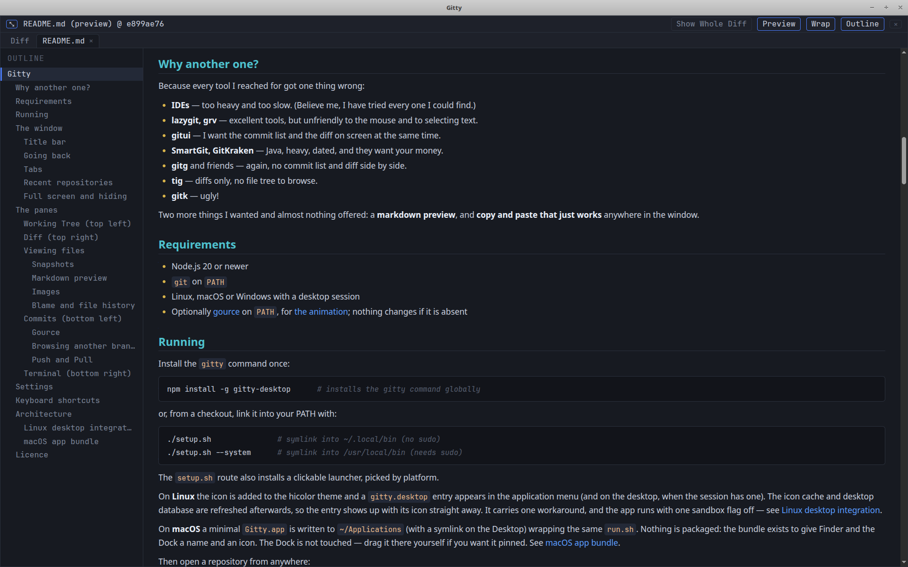
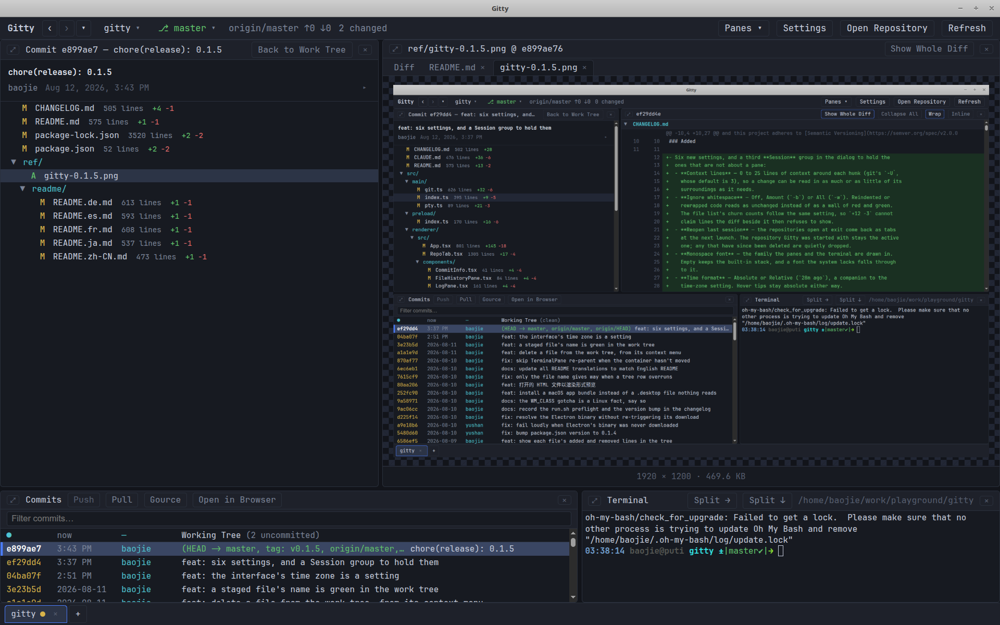
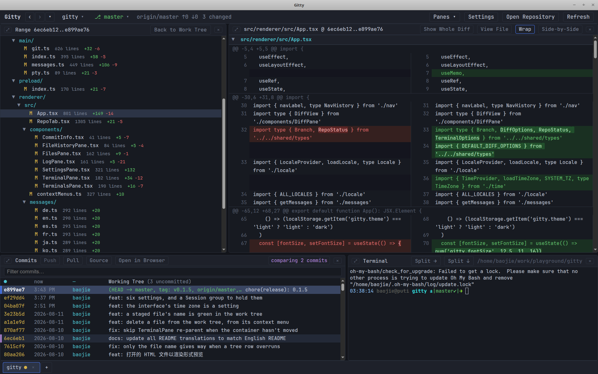

# Gitty 매뉴얼

[English](manual.md) · [简体中文](manual.zh-CN.md) · [日本語](manual.ja.md) · **한국어** · [Français](manual.fr.md) · [Deutsch](manual.de.md) · [Español](manual.es.md) · [Русский](manual.ru.md) · [Português](manual.pt.md)

Gitty가 하는 모든 것을, 창별로. [README](../../README.md)는 짧은 버전 — 그것이 무엇이고,
왜 존재하며, 어떻게 설치하는지 — 으로, 그 상태를 유지합니다; 세부는 여기에 있습니다.

> **번역일: 2026-11-18 (Gitty v0.2.3 기준).**
> [영어 매뉴얼](manual.md)이 공식 버전이며, 계속 갱신되는 유일한 문서입니다. 이 문서는
> 그 시점의 스냅샷이고, 둘이 다르면 영어가 우선합니다. UI 자체가 영어이므로, 아래의
> 버튼 이름과 메뉴 항목은 원문 그대로 둡니다.

---

## 창 <a id="the-window"></a>

가운데 네 개의 창, 그 위에 타이틀 바, 아래에 탭 바.

### 타이틀 바 <a id="title-bar"></a>

왼쪽부터 오른쪽으로, 현재 저장소를 설명한 뒤 그에 대해 행동합니다:

- **Gitty** — 맨 왼쪽의 아이콘과 이름은 **About** 대화상자를 엽니다: 버전, 빌드
  시각, 작성자, 그리고 Electron·Chromium·Node 버전, 홈페이지와
  [키보드 단축키](#keyboard-shortcuts)로 가는 링크가 함께.
- **‹ › ▾** — 이 저장소에서 다녀온 곳. [뒤로 가기](#going-back)를 보세요.
- **저장소 경로**는 버튼입니다: [최근 저장소](#recent-repositories) 메뉴를 엽니다.
  [탭 바](#tabs) 끝의 **+**와 <kbd>Ctrl+O</kbd>도 같은 메뉴를 엽니다.
- **⎇ branch**도 버튼입니다 — git이 체크아웃한 브랜치와, 읽을 수 있는 다른 모든
  브랜치의 메뉴. [다른 브랜치 둘러보기](#browsing-another-branch)를 보세요.
- **`origin/main ↑2 ↓0`** — 체크아웃한 브랜치의 업스트림과, 얼마나 앞서 있고
  뒤처져 있는지. 아무것도 추적하지 않는 브랜치에서는 나타나지 않습니다.
- **`3 changes`** — 작업 트리에 커밋되지 않은 파일이 몇 개인지, 커밋 창의
  **Changes** 행이 가진 것과 같은 수치입니다.
- **Panes ▾** — 네 개를 각각 보이거나 숨깁니다; [전체 화면과 숨기기](#full-screen-and-hiding)를 보세요.
- **Settings** — 환경설정 대화상자([설정](#settings)), <kbd>Ctrl+,</kbd>도 됨.
- **Refresh** — 상태와 로그를 직접 다시 읽습니다(<kbd>F5</kbd> /
  <kbd>Ctrl+R</kbd>). Gitty는 저장소를 지켜보며 스스로 새로 고치지만, 이 버튼은
  지켜보기가 못 본 변화를 위한 것입니다 — Linux에서는 디렉터리가 약 8,000개를 넘는
  작업 트리는 일부만 지켜봅니다.

다른 브랜치를 읽고 있는 동안에는 브랜치 버튼이 `⎇ main › other-branch`로 읽히고,
마지막 git 명령의 오류가 수치 옆에 빨간색으로 나타납니다.

### 뒤로 가기 <a id="going-back"></a>

히스토리를 읽는다는 것은 헤매는 일입니다: 커밋 하나, 그 안의 파일 하나, 로그 두
페이지 아래의 다른 커밋, 다시 처음으로. 타이틀 바 왼쪽의 세 버튼은 브라우저처럼 그
헤맴을 기억합니다.

- **‹**(<kbd>Alt+←</kbd>)는 지금 것보다 하나 전에 보고 있던 곳으로 돌아가고,
  **›**(<kbd>Alt+→</kbd>)는 당신이 떠나온 곳으로 되돌아갑니다. 갈 곳이 없으면 둘 다
  회색으로 비활성화되고, 어느 쪽이든 마우스를 올리면 데려다 줄 곳의 이름이 표시됩니다.
- **▾**는 그 위치들 자체를 나열합니다. 최근이 먼저이고, 지금 있는 곳에 점이
  찍힙니다. 아무거나 골라 바로 점프하세요.

*위치*란 위쪽 두 창이 보여주던 모든 것입니다: 뷰 — 커밋되지 않은 변경, 커밋 하나, 둘의
범위, 스냅샷 — 그 안에서 선택된 파일, 그리고 diff 옆에 열린 문서. 그래서 한 정거장은
`Changes`, `7bb7787 — Refresh screenshot batches`,
`src/main/git.ts @ 7bb7787` 또는 `blame: src/main/git.ts @ 7bb7787`로 읽히고,
그것으로 돌아가면 커밋을 다시 고르는 것에 그치지 않고 같은 파일을 같은 리비전으로
화면에 되돌립니다.

히스토리는 창이 아니라 저장소에 속합니다: 각 탭은 자기 최근 50개 위치를 기억하고, 탭을
전환하면 버튼이 걷는 대상도 바뀝니다. 재시작을 넘어서는 유지되지 않습니다.

### 탭 <a id="tabs"></a>

바닥의 탭 바가 열린 모든 저장소를 담습니다 — 디렉터리 이름, 작업 트리에 커밋되지
않은 변경이 있을 때의 노란 점, 그리고 닫기용 **×**. 이 점은 `git status`가 보고하는
모든 것을 세며, 추적되지 않는 파일도 포함합니다. 그리고 그 가치는 당신이 *보고 있지
않은* 탭에서 빛을 발합니다: 현재 저장소는 타이틀 바에 이미 `3 changed`라고 쓰여
있지만, 백그라운드 탭은 완전히 숨겨져 있으므로 이 점이 "저쪽에 남은 작업이 있다"는
유일한 신호입니다. 탭에 마우스를 올리면 저장소 경로가 표시되고 그 사실을 말로
알려줍니다.

**+**(그리고 <kbd>Ctrl+O</kbd>)는 [최근 저장소](#recent-repositories) 메뉴를 거쳐
다른 저장소를 새 탭에서 엽니다; 타이틀 바는 항상 활성 탭을 보여줍니다.
각 탭은 자기 창과 터미널을 가지므로, 읽고 있던 커밋과 실행해 둔 셸은 전환해도 정확히 그 자리에 남아 있습니다. 탭을 바 안의 다른 자리로 끌면 저장소의
순서를 바꿀 수 있습니다. 탭을 오른쪽 클릭하면 **Rename tab…** 이 나옵니다 — 그 이름은 그
저장소에 대해 기억되고, 탭 바와 타이틀 바에 표시되며, 진짜 경로는 여전히 호버 텍스트에
남습니다 — 저장소의 루트 디렉터리를 여는 **Open in File Manager**, 그리고 **Close
repository**. 마지막 탭을 닫으면 빈 창과 다음 저장소를 여는 버튼이 남습니다.

Gitty를 종료할 때 열려 있던 탭은 다음 시작 때 다시 열립니다 — Gitty를 시작할 때 지정한
저장소가 여전히 활성 탭이 되고, 그사이 삭제된 저장소는 조용히 빠집니다. 설정의
**Reopen last session**으로 이 동작을 끌 수 있습니다. 창이 여러 개일 때(**Instances:
Multiple**)는 마지막으로 닫힌 창의 세션이 보존됩니다.

저장소가 둘 이상 열린 상태에서 창을 닫거나 종료하면 먼저 묻습니다. 그래서 실수로 누른
<kbd>Ctrl+Q</kbd>가 전부를 함께 닫아 버리지 않습니다. 저장소가 하나만 열려 있으면 묻지
않고 닫힙니다.

### 최근 저장소 <a id="recent-repositories"></a>

타이틀 바의 저장소 경로는 이전에 연 저장소 — 디렉터리 이름과 부모 디렉터리 — 의
메뉴이며, 최근이 먼저입니다.

- **클릭** — 새 탭에서 엽니다.
- **Ctrl/Cmd+클릭** 또는 **가운데 클릭** — 현재 탭에서 열어, 거기 있던 저장소를
  교체하고 탭의 자리는 유지합니다.
- 항목 오른쪽의 **×** — 목록에서 그것을 뺍니다; 항목을 오른쪽 클릭해도 같습니다. 메뉴는 열린 채로 남으므로, 여러 개를
  연달아 지울 수 있습니다.

메뉴에는 최근 열두 개가 보이고, 맨 아래의 **More…** 가 나머지를 나열합니다. 위쪽의
검색 상자는 입력하는 대로 목록 전체를 거릅니다 — 모든 단어가 저장소 이름이나 그
디렉터리에 나타나야 하며, 이름에서 맞는 것이 먼저 옵니다. <kbd>↑</kbd>/<kbd>↓</kbd>로
이동하고, <kbd>Enter</kbd>는 새 탭에서, <kbd>Ctrl+Enter</kbd>는 현재 탭에서 열며,
<kbd>Esc</kbd>는 닫습니다.

목록에서 아무것도 맞지 않으면 검색은 디스크로 갑니다: Gitty는 기억된 저장소들이 있는
곳 — 그 부모 디렉터리, 그리고 그 위의 디렉터리에서 두 단계 아래까지이므로
`~/work/<group>/<repo>`가 따로 설정하지 않아도 포함됩니다 — 과 홈 아래의 흔한 자리
(`~/work`, `~/code`, `~/src`, `~/projects`, …)에서 디렉터리 이름이 맞는 저장소를
찾습니다. 찾은 것은 전체 경로와 함께 *Is it one of these?* 아래에 나열되고, 당신이
고를 때에만 열립니다. 한 번 열면 목록에 들어갑니다.

**+**와 <kbd>Ctrl+O</kbd>는 바로 이 메뉴를 열므로, 저장소는 이름을 쳐서 찾습니다.
<kbd>Ctrl+O</kbd>를 한 번 더 누르거나 **Open Repository…** 를 고르면 폴더 대화상자로
넘어갑니다.

**Open Repository…** 와 **Clear Recent** 가 그 아래에 있습니다. Clear Recent는 되돌릴
수 없으므로 목록을 비우기 전에 묻습니다. 목록은 `~/.config/Gitty/recent-repos.json`에
있고, 마지막 백 개의 저장소를 담으며, 이후 옮겨지거나 삭제된 것은 건너뜁니다.

### 전체 화면과 숨기기 <a id="full-screen-and-hiding"></a>

모든 창 헤더는 같은 두 컨트롤을 갖습니다: 왼쪽의 **⤢**는 그 창으로 창 전체를 채우고,
오른쪽의 **×**는 그것을 숨깁니다.

전체 화면은 타이틀 바와 탭 바를 포함한 다른 모든 것을 덮지만, 그 아래의 창들은 계속
작동합니다 — 터미널은 덮여 있는 동안에도 계속 실행됩니다. 같은 모서리의 **⤡**,
<kbd>Esc</kbd>, 헤더의 빈 공간 더블클릭(버튼과 Changes 창의 제목 메뉴는 저마다의 뜻이
있습니다), 또는 <kbd>Ctrl+Shift+1</kbd> …
<kbd>Ctrl+Shift+4</kbd>가 레이아웃을 되돌립니다. 한 번에 한 창만 전체 화면입니다.

<kbd>Ctrl+Tab</kbd>은 전체 화면을 레이아웃 순서의 다음 창으로, <kbd>Ctrl+Shift+Tab</kbd>은
이전 창으로 옮깁니다. 숨긴 창은 건너뛰고 양 끝에서 돌아옵니다. 창이 창을 가득 채우고
있을 때만 동작하는데, 그때가 바로 필요한 때입니다: 레이아웃이 보이면 어느 창이든 이미
클릭 한 번 거리입니다. 터미널은 이 키를 보지 못하므로 셸 안에서도 됩니다.

숨기기는 반대 방향입니다 — 어떤 창이든 치워뒀다 되돌릴 수 있습니다:

- 타이틀 바의 **Panes** 는 네 창을 나열하며 보이는 것들 옆에 점이 있습니다; 하나를
  클릭하면 토글되고, **Show All Panes** 가 네 창 레이아웃을 되돌립니다.
- <kbd>Ctrl+1</kbd> … <kbd>Ctrl+4</kbd>는 Files, Diff, Commits, Terminal을 그
  순서대로 토글합니다.
- <kbd>Ctrl+Shift+0</kbd>은 네 창을 모두 되돌립니다 — 0은 "전부", 각각 하나씩 토글하는
  네 키보다 하나 더 지나간 자리입니다. Shift가 필요한 이유는 <kbd>Ctrl+0</kbd>이
  브라우저 엔진의 줌 초기화이고, View 메뉴가 그것을 지키고 있기 때문입니다.

남은 것들이 창을 나눠 가지므로, 커밋 창을 숨기면 diff가 전체 높이를 얻습니다. 마지막
보이는 창에는 **×**가 없습니다 — 빈 창은 클릭할 것이 하나도 남지 않게 하니까요. 숨긴
창은 재시작을 넘어 기억되고, 터미널 창은 치워질 뿐 닫히지 않습니다: 그 셸들은 계속
실행되고 돌아올 때 스크롤백과 함께 돌아옵니다.

구분자를 창 가장자리까지 끌어도 창을 접을 수 있습니다: 두 행 사이의 구분자는 그 행을,
어느 세로 구분자든 그쪽의 창을 접고 — 비워진 자리는 이웃이 가져갑니다. 구분자를 도로
끌면 분할이 돌아옵니다. 창의 한 부분이 전체 너비나 전체 높이를 누릴 만할 때 쓸모가
있습니다.

## 창들 <a id="the-panes"></a>

### Changes (왼쪽 위) <a id="changes-top-left"></a>

바뀐 파일들을 접을 수 있는 트리로, 각 파일 이름 옆에 줄 수가 붙습니다. 저장소 전체 —
작업 트리나 커밋의 스냅샷 — 를 둘러볼 때는 모든 디렉터리가 닫힌 채 열립니다. 그것은
읽어야 할 변경 목록이 아니라 내려가 봐야 할 트리이기 때문입니다; 변경 목록은 펼쳐진
채 열립니다. 모든 단계에서 디렉터리가 파일보다 먼저 오고, 각 그룹 안에서 이름은 바이트
비교 방식이 아니라 독자가 기대하는 방식으로 정렬됩니다: 이름의 숫자는 수로 취급되어
`W9`가 `W10`보다 먼저 오고, 대소문자는 일차적 차이가 아니어서 `butler/`는 모든 대문자
뒤가 아니라 b들 사이에 정렬됩니다.

이름마다 종류 아이콘이 붙습니다: 모양이 갈래 — 소스, 구조화된 데이터, 마크업,
스타일시트, 산문, 이미지, 아카이브, 셸 스크립트, 잠금 파일, 컴파일 산출물 — 이고 색이
언어이므로, `.ts` 와 `.py` 는 같은 글리프의 다른 색입니다. 자기 자신으로 그려지는 유일한
언어가 Python이며, 그 자신의 파랑과 노랑입니다. Gitty가 모르는 확장자는 추측 대신 민무늬
종이를 얻습니다.

두 상태 열이 표시됩니다: 스테이징된 상태(초록)와
작업 트리 상태(노랑 / 빨강); 추적되지 않는 파일은 `??`입니다. 줄 수는 작업 트리에서는
디스크에서 읽고, 다른 곳에서는 리비전에서 읽습니다; 읽을 줄이 없는 곳 — 바이너리 파일,
또는 8 MB를 넘는 것 — 에서는 그 대신 파일 크기를 표시하고, 삭제된 파일은 아무것도
표시하지 않습니다. 그 뒤에는 churn이 옵니다 — 이 변경이
그 파일에서 몇 줄을 더하고 뺐는지, `+12 −3`으로: 작업 트리에서는 HEAD 대비, 커밋이나
범위에서는 부모 대비입니다. 스냅샷은 변경이 아니라 트리이므로 churn이 없습니다; 바이너리
파일과 병합 커밋도 없는데, 병합 diff는 어떤 것도 어느 파일에 귀속시키지 않기 때문입니다.

churn이 올 자리에, 트리 — Working Tree 목록과 커밋의 스냅샷 — 는 대신 **각 파일을
마지막으로 커밋한 사람**을 표시합니다: 변경은 이미 누군가의 것이지만, 트리에서는 이 파일이
누구의 것인지가 질문이기 때문입니다. 이름에 마우스를 올리면 문장 전체가 보입니다. git이
한 번도 본 적 없는 파일에는 그것이 없으므로, 추적되지 않는 파일과 무시되는 파일은 아무것도
표시하지 않습니다.

창의 제목은 지금 무엇이 나열되는지 말하고, 클릭하면 두 상설 뷰의 메뉴가 열립니다:
**Changes**, 커밋되지 않은 것들; 그리고 **Working Tree**, 디스크의 그 디렉터리에 있는
모든 파일, 읽기 전용입니다. 화면에 있는 쪽에 체크가 붙고; 커밋, 범위, 스냅샷에서도 같은
메뉴가 둘 중 어느 쪽으로든 돌아가는 길입니다.

**Working Tree** 는 모든 파일을 뜻합니다: `.gitignore` 가 덮는 것들 — 빌드 산출물,
`node_modules`, 그 밖에 무엇이든 — 도 나머지처럼, 흐린 이탤릭으로 나열됩니다. 무시되는
파일만 담은 폴더도 흐려집니다. 그것들도 다른 파일처럼 열리고 읽힙니다; 빠지는 것은 줄
수뿐인데, 그것을 세려면 대개 디스크에서 가장 큰 디렉터리의 모든 바이트를 읽어야 하기
때문입니다. `.git` 자체는 나열되지 않습니다.

<kbd>Ctrl+B</kbd> — browse의 b — 가 어디서든 그리로 들어가는 단축키이고, 뷰를 바꾸는 데
그치지 않고 창을 읽기 좋게 세웁니다: Commits와 터미널이 물러나고, 트리와 그것이 여는
것만 남습니다. <kbd>Ctrl+D</kbd> 가 돌아오는 길입니다: 다시 그 변경들로, 네 창을 모두
갖춘 채. 터미널에서 그 키는 입력의 끝 — 셸을 떠나는 방법 — 으로 남으므로, 이 한 쌍은 그
밖의 모든 곳에서 동작합니다. 두 키 모두 창 제목의 호버 텍스트에 적혀 있습니다.

- **클릭** — 오른쪽에 파일의 diff를 표시합니다.
- **더블클릭** — 파일 전체를 diff 옆의 문서로 엽니다. 줄 번호와 구문 하이라이트와 함께
  (markdown은 렌더링된 문서로, 이미지는 그림 자체로).
- **상태 열 클릭** — 파일을 스테이징합니다. 이미 스테이징됐다면 되돌립니다.
- **오른쪽 클릭** — View File, Open in System App, Reveal in File Manager, Open
  Remote URL, Copy Relative Path, Copy Absolute Path, Copy File Name, Blame
  File, File History, Stage / Unstage File, Discard Changes, Delete File. 서브모듈의
  행에는 **Pull Submodule** 도 함께 나옵니다.
- **오른쪽 클릭 → Open Remote URL** — 저장소가 호스팅된 사이트에서의 이 파일 페이지를
  시스템 브라우저에서 엽니다. 리비전은 보고 있는 것 — 커밋, 스냅샷 — 이고, Changes와
  Working Tree 뷰에서는 체크아웃된 브랜치입니다. 주소는
  [커밋 메뉴의 항목](#commits-bottom-left)과 같은 방식으로 원격에서 추론되므로, 그 추론이
  성공하는 곳에서만 나타나며, 추적되지 않는 파일, 분리된 HEAD, 아직 push되지 않은
  커밋에는 결코 나타나지 않습니다 — 사이트에 아직 그 페이지가 없으니까요.
- **폴더 클릭** — 접거나 펼칩니다.
- **폴더 오른쪽 클릭** — Copy Relative Path, Copy Absolute Path, Copy Folder
  Name, 그리고 Gitty 밖에서 여는 두 방법: 브라우저 자체의 디렉터리 목록인
  **Open in Browser**, 그리고 **Open in File Manager**. 리비전의 스냅샷은 디스크에 없는
  트리를 나열하므로, 경로 항목만 제공합니다.
- **행 아래의 빈 공간 오른쪽 클릭** — 저장소 루트 디렉터리에 대한 **Open in File
  Manager**(리비전의 스냅샷에서는 없음), 그리고 붙여넣을 파일이 있을 때의 **Paste**.

파일 관리자에서 복사한 파일은 **트리에 붙여넣을** 수 있습니다: 행 아래의 빈 공간을
오른쪽 클릭하면 **Paste** 가 저장소 루트에 쓰고, 파일을 오른쪽 클릭하면
**Paste into `dir`/** 이 그 옆에 씁니다. 이 창에 포커스가 있으면 <kbd>Ctrl+V</kbd> 도
같은 일을 합니다 — 선택된 파일의 디렉터리로, 아무것도 선택되지 않았으면 루트로. 잘라낸
파일은 복사가 아니라 이동되고, 디렉터리가 이미 가진 이름은 한 번 물어봅니다: 둘 다 두기
(도착하는 이름에 `(copy)` 가 붙습니다), 아니면 대체하기.

붙여넣기는 디스크의 그 디렉터리 *자체인* 두 뷰 — **Changes** 와 **Working Tree** —
의 것입니다. 커밋, 범위, 리비전의 스냅샷은 써넣을 수 있게 거기 있지 않은 것의
목록이므로, 붙여넣기가 제공되지 않습니다.

이 창에 포커스가 있을 때의 <kbd>Ctrl+F</kbd> — 또는 헤더 검색 버튼의 **Filter**, 그
옆의 화살표가 저장소를 검색할지 이 목록을 거를지 고릅니다 — 가 트리 위에 필터 상자를
열고, 입력한 것을 담은 경로만 남기며, 몇 개 중 몇 개가 남았는지 셉니다. 입력하는 것은
**정규 표현식**입니다 — `\.tsx?$`, `main|renderer` — 그리고 경로 전체와 맞춰지므로
`src/main` 은 그 디렉터리 아래를 모두 남기고, 대소문자는 가리지 않습니다. 평범한 글자는
자기 자신을 뜻하는 식이고, 아직 컴파일되지 않는 식(`src/(`, `src/(main|renderer)` 의
절반)은 오류로 보고되는 대신 문자 그대로 맞춰집니다. 상자에 글자가 있는 동안에는
아무것도 닫힌 채로 있지 않습니다 — 다섯 단계 아래의 일치야말로 타이핑한 이유이니까요.
<kbd>Esc</kbd>나 **✕** 가 그것을 지우고 트리 전체를 되돌리며, 다른 커밋으로 옮겨도
그렇습니다.

<kbd>Ctrl+E</kbd> 는 다른 질문에 답합니다 — "여기 나열된 것을 좁혀라"가 아니라 "그 파일이
어디 있든 보여 달라". 어디서든, 어느 창에도 포커스가 없어도 창 위에 상자를 열고, 화면의
트리가 아니라 작업 디렉터리 전체를 나열합니다: `git` 이 이름을 댈 모든 파일이며,
`.gitignore` 가 덮는 것은 빠지므로 `node_modules` 가 답을 파묻을 수 없습니다. 글자는
**순서대로, 그러나 붙어 있지 않아도** 맞춰집니다 — `dfpn` 은 `DiffPane.tsx` 를 찾습니다 —
그리고 순위는 단어를 시작하는 글자(경로 조각의 처음, 또는 `-`, `_`, `.` 뒤, 소문자에서
대문자로 넘어가는 자리), 위쪽 디렉터리가 아니라 파일 이름 안의 글자, 그리고 붙어 있는
연속을 우선합니다; 동점이면 짧은 경로가 이깁니다. <kbd>↑</kbd> <kbd>↓</kbd> 로 고르고,
<kbd>Enter</kbd> 는 파일을 diff 옆의 문서로 열며, <kbd>Esc</kbd> 는 상자를 닫습니다.
상자가 나열한 것은 작업 디렉터리이므로, 화면에 커밋이 있어도 파일은 디스크에 있는 그대로
열립니다. 이 키는 터미널 안에서도 동작하며 셸에는 전달되지 않습니다 — <kbd>Ctrl+D</kbd>
와는 다른데, 그쪽은 셸을 떠나는 방법이므로 입력의 끝으로 남습니다; readline의 줄
끝으로 가기는 <kbd>End</kbd> 로도 됩니다.

**Pull Submodule** 은 `.gitmodules` 가 지목하는 경로의 행에, 디스크의 디렉터리인 두
뷰 — **Changes** 와 **Working Tree** — 에서 나타납니다. 그 서브모듈 자신의 원격을
가져와 추적하는 브랜치의 끝으로 옮기므로
(`git submodule update --init --remote`), 한 번도 체크아웃된 적 없는 서브모듈도 같은
항목으로 클론됩니다. 상위 저장소는 자신이 기록한 커밋을 가리킨 채로 남고, 그래서
서브모듈은 그 뒤 **Changes** 에 나타납니다: 새 포인터를 커밋하는 것은 여전히 당신의
결정입니다. git이 말한 것은 push와 pull이 보고하는 곳, 커밋 로그 위의 메시지 띠에
내려앉습니다.

**Discard Changes** 는 파일을 인덱스가 가진 상태로 되돌립니다. 그 전에, 되돌릴 수 없다는
것을 담담히 말하는 네이티브 확인이 나옵니다; 추적되지 않는 파일은 돌아갈 인덱스 버전이
없으므로, 대신 **Delete File** 을 제공하고 시스템 휴지통으로 보냅니다.

커밋 로그에서 작업 트리 행을 오른쪽 클릭하면, 다른 창에서의 대화를 위한
**Copy Staged Diff** 도 나옵니다.

커밋이나 커밋 범위가 선택되면, 이 창은 그 커밋의 파일들을 대신 나열합니다;
**Back to Changes** (또는 <kbd>Esc</kbd>)가 커밋되지 않은 변경으로 돌아갑니다.
[스냅샷](#snapshots)에서는 바뀐 부분만이 아니라 그 커밋의 전체 트리를 나열합니다. 작업
트리 둘러보기에는 그런 버튼이 없습니다 — 그것을 연 제목 선택기가 거기서 나가는 길이기도
합니다.

### Diff (오른쪽 위) <a id="diff-top-right"></a>

옛/새 줄 번호, 헝크 헤더, 추가/삭제 색상이 있는 unified diff로, 파일 목록으로 배치됩니다:
각 경로는 전체 너비 제목이고, 헝크 헤더는 흐리게 표시됩니다 — 줄 범위이지 먼저 볼 것이
아니기 때문 — 그리고 이름 변경은 `old → new`로 읽힙니다. 선택된 파일이 없으면 모든 것을
한 번에 보여줍니다: 작업 트리의 모든 커밋되지 않은 변경, 또는 선택된 커밋의 모든 파일.

- **Show Whole Diff** — 파일을 고른 뒤 합쳐진 diff로 돌아갑니다. 헤더에 머물며, 전체
  diff가 바로 당신이 보고 있는 것일 때 불이 켜집니다. 작업 트리 버전은 스테이징된
  변경과 되지 않은 변경을 함께 다루고 추적되지 않는 파일을 인라인하며(최대 50개, 이후
  알림), 이는 `git diff`만으로는 빠뜨리는 것입니다.
- **Wrap** — 긴 줄을 옆으로 스크롤하는 대신 접습니다. 기본 켜짐.
- **Inline** — **Wrap** 과 같은 모양의 스위치입니다: 눌리면 `+`/`-` 표시가 있는 한 열,
  떠 있으면 옛것과 새것이 나란히 놓이고 삭제 묶음이 뒤따르는 추가 묶음과 짝지어집니다.
  접힌 반쪽은 정렬을 유지합니다.
- **파일 제목** — 각 제목은 파일을 접습니다: 삼각형이 이름만 남기고 접고, 헤더의
  **Collapse All** / **Expand All** 이 전부를 처리합니다. **Ctrl+클릭**은 그 파일을 새
  문서 탭에서 엽니다; 오른쪽 클릭으로 **Open in a New Tab**, **Select in the File
  List**, 경로 복사들, 그리고 — 작업 트리에서, 디스크의 파일이 보이는 버전인 경우 —
  **Open in System App** 과 **Reveal in File Manager** 를 얻습니다. 이름 변경은 새
  경로를 엽니다.
- **Stage / Unstage** — diff가 추적되는 파일 하나의 작업인 동안, 각 헝크 헤더에 그
  헝크를 인덱스에 넣거나 다시 빼는 버튼이 달립니다. 먼저 줄을 선택하면 버튼은
  **Stage 3 lines** 가 됩니다: 선택되지 않은 추가는 패치에서 빠지고, 선택되지 않은
  삭제는 컨텍스트 줄로 강등되며, 헝크 헤더가 다시 계산됩니다 — 파일 전체가 눈앞에
  있는 창에서 `git add -p`가 만드는 바로 그 분할입니다. 선택은 보통의 텍스트 선택이므로,
  드래그는 여전히 복사입니다. 두 헝크에 걸친 선택은 각각에게 그 몫을 줍니다.
- **Unstaged / Staged** — 파일이 인덱스의 어느 쪽에서 읽히는지. 양쪽에 무언가 있을 때
  표시됩니다. 스테이징은 화면에 보이는 쪽에 작용합니다. 바이너리 파일, 모드 변경,
  이름 변경은 고를 헝크가 없어 파일 목록에서 통째로 스테이징되고; **Ignore whitespace**
  가 켜진 동안에는 헝크 버튼도 사라지는데, 그 diff는 적용할 모든 변경을 담고 있지
  않기 때문입니다.
- **오른쪽 클릭** — Copy Selection, Copy Whole Diff, 그리고 같은 토글들.

바뀐 줄 안에서 바뀐 단어는, 줄 전체보다 그 편이 더 잘 읽힐 때 하이라이트됩니다; 그것은
[설정](#settings)의 **Word highlight**입니다.

설정은 실행 간에 기억됩니다. 행은 1500개 단위 덩어리로 렌더링되고 스크롤할수록
늘어나므로, 큰 커밋도 반응을 유지합니다; 2 MB를 넘는 diff는 알림과 함께 잘립니다.

### 파일 보기 <a id="viewing-files"></a>

창이 기본으로 보여주는 것은 diff이지만, 어떤 파일이든 전체로 열 수 있습니다: 트리에서
**더블클릭**, 헤더의 **View File** / **Preview** 사용, diff에서 파일 제목
**Ctrl+클릭**, 또는 두 컨텍스트 메뉴 어느 쪽에서든 가져옵니다.

파일은 diff 위가 아니라 diff *옆*의 탭 띠에 자기 문서로 열리므로, 보고 있던 diff를
잃지 않고 파일을 읽을 수 있습니다. **Diff** 탭이 항상 처음이고, 트리에서 한 번 클릭하는
것은 여전히 제자리에서 diff를 둘러봅니다. 각 문서는 어느 리비전에서 열렸는지 기억하고,
자기 **×**로 닫히며, 저장소가 바뀌면 작업 트리 파일을 다시 읽습니다.
문서의 탭을 **오른쪽 클릭**하면 파일 트리에서 그 행이 갖는 것과 같은 메뉴가 나옵니다;
목록에 없는 파일 — Changes 뷰에서의 변경되지 않은 파일 — 은 Working Tree의 메뉴를
얻되, 스테이징, 되돌리기, 삭제는 빠집니다. 소스 파일은 줄
번호와 구문 하이라이트를 얻고; markdown은 [렌더링된](#markdown-preview) 것으로 열리며
소스로 되돌리는 토글이 있고; HTML도 [렌더링되어](#html-preview) 열리며; 이미지는
[그림](#images)으로 열립니다.

어느 리비전을 얻는지는 창을 따릅니다: 작업 트리에서는 디스크의 파일, 그 밖에서는 선택된
커밋 당시의 파일. 문서를 여는 것은 모드가 아니라 행동입니다 — 다른 파일이나 다른 커밋을
선택하면 diff가 돌아옵니다 — 그래서 창은 변경을 원할 때 파일에 붙잡혀 있지 않습니다.

#### 소스 파일의 아웃라인 <a id="the-outline-of-a-source-file"></a>

소스 파일에는 렌더링된 문서가 가진 것과 같은 **Outline** 버튼이 붙습니다: 그 파일의
클래스, 함수, 멤버를 옆에 트리로 놓고, 중첩만큼 들여쓰며, 각각이 무엇을 선언하는지에
따라 색을 입힙니다. 항목을 클릭하면 그곳으로 뜁니다 — 아무리 깊어도 그것을 담을 만큼
파일이 그려집니다 — 그리고 스크롤해 들어간 항목이 표시됩니다. 구분자를 끌면 어느 쪽에든
자리를 더 줄 수 있고, 그 너비는 저장소의 모든 파일이 공유합니다.

열여섯 언어를 읽습니다 — C, C++, C#, Go, Java, JavaScript, Lua, Perl, PHP, Python,
Ruby, Rust, shell, Swift, TypeScript, 그리고 뒤 둘의 JSX 변종 — 그것도 파싱이 아니라
선언을 알아보는 방식으로 읽습니다: 주석과 문자열을 먼저 공백으로 지우고, 중첩은 중괄호
깊이(그렇게 쓰는 언어에서는 들여쓰기)에서 오며, 이름은 키워드가 그 자리에 놓았을 때에만
나타납니다. 그 밖의 것 — 데이터 형식, 스타일시트, 모르는 언어 — 은 추측한 목록 대신
패널 자체를 보여주지 않습니다. Markdown에는 제목에서 나오는
[자체 아웃라인](#markdown-preview)이 있습니다.

#### 스냅샷 <a id="snapshots"></a>

커밋을 오른쪽 클릭하고 **Browse Snapshot**을 선택하면 그 커밋 당시의 저장소를 읽습니다:
왼쪽 위 창은 그 커밋이 건드린 파일이 아니라 *전체* 트리를 나열하고, 아무 파일이나
고르면 그 리비전에서 엽니다. 스냅샷은 보여줄 diff가 없으므로, 거기 있는 모든 파일은
문서입니다.

스냅샷의 파일은 그 리비전에 디스크에 존재한 적이 없으므로, **Open in System App**은
그것의 임시 복사본을 건네주고 **Reveal in File Manager**는 제공되지 않습니다.
**Back to Changes** (또는 <kbd>Esc</kbd>)가 떠납니다.

git이 실행 가능으로 기록한 파일 — 모드 `755` — 에는 **Run in the Terminal** 도 붙습니다.
그것을 고르면 커밋을 임시 디렉터리로 체크아웃하고 터미널 창에
`cd <그 디렉터리> && ./<파일>` 을 타이핑하므로, 프로그램은 오늘의 이웃이 아니라 그때의
이웃 곁에서, 그때의 모습으로 실행됩니다. 줄은 타이핑될 뿐입니다: <kbd>Enter</kbd> 를
누르는 것은 당신이고, 누르기 전에는 아무것도 실행되지 않습니다. 터미널 창이 숨겨져
있었다면 되돌아옵니다. 작업 트리를 둘러볼 때도 같은 항목이 나오며, 거기서는 복사가 필요
없습니다 — 명령은 저장소 자신에서 실행됩니다.

그 임시 디렉터리는 진짜 연결된 작업 트리(`git worktree`)로, 그 커밋에 detached로
놓입니다. 그래서 자기가 어디 있는지 git에게 묻는 프로그램은 답을 얻습니다; 자기 인덱스와
HEAD를 가지며, 거기서 실행되는 어떤 것도 당신의 체크아웃을 건드리지 않습니다. 그것은
`.git/worktrees` 아래의 등록도 뜻하는데, `git worktree list` 에 보이고 Gitty가 오가며
정리합니다; 체크아웃 자체는 커밋마다 보관되므로, 같은 스냅샷에서 두 번째 것을 실행하는
것은 즉시입니다. 트리가 256 MB를 넘는 커밋은 체크아웃되지 않고 거절됩니다 — 이 항목은
스크립트를 실행하기 위한 것이지, 저장소 하나 분량의 바이너리를 임시 디렉터리에 쓰기
위한 것이 아닙니다.

#### Markdown 미리보기 <a id="markdown-preview"></a>

`.md` 파일을 선택하면 **Preview** 버튼이 생깁니다 — 기본은 꺼짐이라, 당신이 요청하기
전까지 diff는 diff로 남습니다. 파일을 전체로 렌더링합니다: 작업 트리에서는 디스크의
버전, 그 밖에서는 선택된 커밋의 버전.

코드 펜스는 언어를 명시하면 구문 하이라이트되고, YAML front matter는 떼어내 자기
하이라이트 블록으로 보여주며, 제목 단계, 목록 표시, 링크, 인라인 코드는 색으로
구분되어 구조가 한눈에 읽힙니다.

- **Wrap** — diff와 같은 토글, 기본 켜짐. 산문은 항상 접힙니다; 미리보기에서는 이
  토글이 코드 펜스, 넓은 표, 긴 인라인 문자열도 접을지(아니면 옆으로 스크롤할지)를
  정합니다.
- **Table columns** — 표의 열은 내용에 맞춰 크기가 정해지고, 각 경계는 드래그할 수
  있습니다: 머리글 셀의 오른쪽 가장자리를 잡으면 그 열이 포인터를 따라오고, 나머지는
  원래 너비를 유지합니다. 창보다 넓은 표는 옆으로 스크롤됩니다. 경계를 더블클릭하면 표를
  브라우저에 되돌려, 내용에 맞는 너비로 돌아갑니다. 너비는 문서가 열려 있는 동안
  유지됩니다.
- **Outline** — 문서 옆의 제목 구조, 단계별로 들여쓰기되고, 스크롤한 제목을
  따라갑니다. 항목을 클릭해 점프하고, 문서 사이의 구분선을 드래그해 어느 쪽이든 더
  넓힐 수 있습니다. 너비는 저장소의 모든 문서가 공유합니다 — 한 파일의 속성이 아니라
  읽기 환경설정입니다 — 그리고 다른 창의 크기처럼 창이 살아 있는 동안 유지됩니다.
- **Source lines** — 기본 꺼짐, [설정](#settings)에서 켭니다: 모든 제목, 문단, 목록 항목,
  표, 코드 펜스, 이미지가 소스에서 시작하는 줄 번호를 왼쪽 거터에 붙습니다. 번호는
  삽입이 아니라 그려지므로, 복사하는 선택이나 <kbd>Ctrl+F</kbd>가 검색하는 내용에
  들어가지 않습니다. 문서가 화면의 diff가 다루는 파일이면, 그 diff가 삽입하거나 바꾼
  블록의 번호는 초록 바탕에 초록으로 — diff 자신이 `+` 줄을 칠하는 색으로 — 그려지므로,
  거터가 diff가 말한 것을 그대로 비춥니다. 블록은 그것이 걸친 줄 중 하나라도 바뀌면
  바뀐 것으로 치므로, 수정된 코드 펜스는 여는 줄이 그대로여도 표시됩니다. 문장 안에 쓰인 이미지는 자신의 줄이 없으므로 그 문단의 줄을
  가져갑니다.
- **<kbd>Ctrl+F</kbd>** — 문서 안에서 찾기; [텍스트 찾기](#finding-text)를 보세요.
- **오른쪽 클릭** — Copy Selection, Copy Markdown Source, 접기와 아웃라인 토글, 그리고
  Show Diff Instead.

markdown 안의 원시 HTML은 렌더링되지 않고, 웹으로의 링크는 앱 안이 아니라 시스템
브라우저에서 열립니다. 저장소 안의 다른 파일로의 링크 — `ref/readme/manual.md`,
`../README.md`, `/CHANGELOG.md` — 는 그 대신 여기서 따라갑니다: **Ctrl/Cmd+클릭**이 그
파일을 diff 옆의 독립된 문서로, 링크를 담은 문서와 같은 리비전에서 여는데, 그래서 옛
커밋에서 읽은 README는 그 커밋의 파일들로 이어집니다. 끝의 `#fragment`도 함께 옮겨집니다
— `manual.md#the-window`는 forge에서처럼 그 제목에서 매뉴얼을 열고 — 이 문서에 없는
제목은 그냥 맨 위에서 엽니다. 그런 링크에 마우스를 올리면 그렇게 알려줍니다. 보통
클릭은 예전처럼 아무것도 하지 않고, 저장소 루트를 넘어 밖으로 올라가는 링크는 이런
종류가 아닙니다.

대신 디렉터리를 가리키는 링크 — `src/`, `ref/spec` — 는 파일 창을 그 폴더에서 엽니다,
같은 리비전으로: 디스크에서 읽은 문서라면 작업 트리, 커밋에서 읽은 문서라면 그 커밋의
스냅샷입니다.

문서에 상대적으로 쓰인 이미지는 저장소에서 읽힙니다 — 문서와 같은 리비전에서, 그래서 옛
커밋은 그것이 담아낸 스크린샷을 보여줍니다. 저장소가 그 리비전에 갖지 않는 것은 alt
텍스트가 있는 점선 자리표시자를 남깁니다. 웹의 이미지는 전혀 가져오지 않습니다: 낯선
사람의 README를 읽는 것이 당신을 그 호스트에 알려서는 안 되니까요.



#### HTML 미리보기 <a id="html-preview"></a>

`.html`, `.htm` 또는 `.xhtml` 파일도 같은 **Preview** 버튼을 얻고, 문서는 소스로
보여주는 대신 렌더링됩니다 — 작업 트리에서는 디스크의 버전, 그 밖에서는 선택된 커밋의
버전.

`srcdoc`로 로드된 샌드박스 프레임에서 실행되므로, 페이지가 앱을 자기 자신으로부터
벗어나 탐색하게 만들 수는 없습니다. 문서 자신의 스타일시트가 적용됩니다 — 레이아웃,
색상, 글꼴은 그 문서의 것입니다. 스크립트는 실행되지 않고 원격 이미지도 가져오지
않습니다: 프레임은 앱의 콘텐츠 보안 정책을 물려받으며, 그것은 둘 다 허용하지 않습니다.
페이지는 실행되는 것이 아니라 보여지는 것입니다. **Wrap**은 프레임이 스스로 스크롤할지,
콘텐츠에 맞게 커져 페이지가 하나로 스크롤될지를 정합니다. <kbd>Ctrl+F</kbd>와
<kbd>Ctrl+Shift+C</kbd>는 프레임 안에서 동작하며, 프레임의 키는 창의 나머지에 도달하지
않습니다.

#### JSON <a id="json"></a>

`.json`, `.geojson`, `.topojson` 또는 `.webmanifest` 파일은 저장된 그대로 열리고,
**Wrap** 옆에 **Format** 버튼을 얻습니다: 누르면 문서가 한 단계에 두 칸씩 다시
들여쓰기되므로, 끝없는 한 줄로 도착한 축소된 파일이 트리로 읽힙니다. 다시 누르면 저장된
그대로의 파일로 돌아갑니다.

문서가 포맷된 동안에는, 무언가를 담은 모든 객체와 배열의 줄 번호 옆에 **▼** 가 붙습니다:
클릭하면 그 노드가 접히고, 그것이 시작된 줄에는 무엇이 빠졌는지 알리는 **…** 가
남습니다. 바뀐 **▶** 를 클릭하면 다시 펼쳐집니다. 접기는 중첩되므로, 다른 노드 안에서
접힌 노드는 부모를 펼쳐도 접힌 채로 있고, <kbd>Ctrl+F</kbd> 는 화면에 있는 것을
검색합니다 — 접힌 노드의 줄은 아예 렌더링되지 않습니다. 다른 문서를 열거나, 저장소가
바뀐 뒤 작업 트리 파일을 다시 읽으면 아무것도 접힌 채로 남지 않습니다: 접기가 가리키던
줄이 더 이상 그 줄이 아닐 수 있기 때문입니다.

바뀌는 것은 토큰 사이의 공백뿐입니다. 숫자는 파일이 적은 자릿수를 그대로 유지하고 —
double에 비해 너무 긴 값, 너무 큰 지수 — 키는 원래 순서를 지키며, 중복된 키도 남습니다.
버튼은 텍스트가 하나의 완전한 JSON 문서로 파싱되는 곳에서만 나타나므로, 자리표시자로
가득한 템플릿이나 잘린 다운로드에는 아무것도 하지 않는 버튼 대신 아무것도 제공되지
않습니다. 포맷은 파일을 읽는 방법일 뿐이며, 아무것도 다시 쓰지 않습니다.

#### 이미지 <a id="images"></a>

`.png`, `.jpg`, `.gif`, `.webp`, `.bmp`, `.ico`, `.avif` 또는 `.svg`는 "이진
파일입니다"라는 보고가 아니라 그림으로 열립니다 — 작업 트리에서는 디스크에서, 그
밖에서는 커밋에서. 체커보드 위에서 창에 맞춰지므로, 투명은 투명으로 읽힙니다;
**클릭**하면 실제 크기로, 스크롤로 둘러보고, 다시 클릭하면 맞춤으로 돌아갑니다. 픽셀
크기와 디스크상 크기는 그 아래에 있습니다. 12 MB를 넘는 이미지는 인라인되지 않습니다.



#### PDF <a id="pdfs"></a>

`.pdf` 는 브라우저 엔진이 이미 갖고 있는 뷰어로 읽는 문서로 열립니다: 옆의 페이지 목록,
확대·축소, 회전, 자체 찾기, 그리고 인쇄하거나 사본을 저장하는 버튼. 리비전에서도 똑같이
동작합니다 — 커밋의 스냅샷에 있는 PDF는 git에서 읽으므로, 논문의 옛 판을 아무것도
체크아웃하지 않고 그때 모습 그대로 읽을 수 있습니다. 파일 크기는 그 아래에 있습니다.
64 MB를 넘는 PDF는 열리지 않으며, 뷰어 자체 도구 모음에 보이는 이름은 파일의 이름이
아닙니다; 그 위의 창 헤더가 파일 이름입니다.

#### Git LFS로 저장된 파일 <a id="files-stored-with-git-lfs"></a>

[Git LFS](https://git-lfs.com/)가 추적하는 파일은 저장소 자체에서는 세 줄짜리
포인터이고, 진짜 파일은 그 옆의 저장소에 있습니다. Gitty는 포인터를 따라가므로, LFS로
추적되는 이미지나 PDF도 다른 파일처럼 미리보기됩니다 — 작업 트리에서뿐 아니라 리비전에서도,
그리고 그 머신에 `git lfs` 가 설치되어 있든 없든. 객체를 아직 가져오지 않았다면, 깨진
그림이나 뷰어 오류를 보여주는 대신 창이 그렇다고 말합니다. `git lfs pull` 로 가져오면
미리보기가 동작합니다. 트리에서 파일 옆의 크기는 포인터의 크기로 남는데, 그것이
저장소가 실제로 저장하는 것이기 때문입니다.

#### Blame과 파일 히스토리 <a id="blame-and-file-history"></a>

트리에서 아무 파일이나 오른쪽 클릭하고 **Blame File** 또는 **File History**를 선택하세요;
둘 다 diff 옆의 문서로 열립니다. Blame은 소스 줄마다 한 행을 보여줍니다 — 커밋, 작성자,
날짜, 그리고 줄 자체를, 코드 뷰어처럼 하이라이트하고, 아직 커밋되지 않은 줄에는 em
dash를 붙여 — 당신이 보고 있는 리비전에서. File History는 그 파일을 건드린 모든 커밋을
나열하고 이름 변경을 따라갑니다; 날짜와 작성자 사이의 열이 그 커밋에서 파일이 몇
줄이었는지 말하고, 셀 수 없는 곳 — 바이너리 리비전과 그보다 오래된 모든 것 — 에서는
크기를 말합니다. 행은 커밋 로그의 행처럼 동작합니다: 클릭은 하나를 고르고, 더블클릭은 그
커밋을 열며, 두 번째 행을 Shift+클릭하면 두 리비전 사이의 파일 diff를 보여줍니다 — 로그의
두 번째 선택이 여는 것과 같은 범위 뷰이며, 그 파일이 이미 선택되어 있습니다.

blame 행을 오른쪽 클릭하면 **History of These Lines** 가 나옵니다: 선택이 덮는 줄 — 선택이
없으면 클릭한 줄 — 에 대해 `git log -L` 을 실행하고, 그것이 자기 문서로 열려 그 줄들을
건드린 각 커밋과 그것이 줄들에 무엇을 했는지를 보여줍니다. Blame은 *마지막에 누가*를
답하고; 이것은 *어떻게 이렇게 됐는지*를 답합니다. 범위는 이름 변경을 가로질러 스스로
추적합니다.

#### 저장소 검색 <a id="searching-the-repository"></a>

Changes 창 헤더의 **Search** 가 파일 목록 위에 상자를 열고 `git grep` 을 실행합니다. 그
옆의 화살표는 그 버튼을 **Filter** 로 바꿔 대신 파일 목록을 좁힙니다; 고른 쪽이 그대로
남고, 두 상자는 한 번에 하나만 열립니다. 결과는 파일별로 묶인 문서이고, 줄 번호가 왼쪽에 내려옵니다; 하나를 클릭하면 그 파일이
그 줄에서 열리고, 줄이 표시됩니다.

검색은 화면의 리비전을 따릅니다: 작업 트리에서는 디스크의 내용 — 커밋되지 않은 작업까지
포함해서 — 을 읽고, 커밋이나 스냅샷에서는 그 리비전을 읽습니다. 상자가 어느 쪽인지
말합니다. 2000건을 넘는 히트는, 지나치게 큰 diff처럼, 멈추고 그렇게 말합니다.

상자가 받는 것은 맨 패턴이 아니라 질의이며, 그 모양은 메일 클라이언트가 모두에게 가르친
그 모양입니다:

| 입력 | 찾는 것 |
| --- | --- |
| `foo bar` | 두 낱말을 모두 담은 줄 |
| `"foo bar"` | 공백까지 포함한 그 구절 |
| `-foo` | 그것이 없는 줄 |
| `foo in:*.py` | 그 glob에 맞는 파일만; 여럿이면 `in:*.py,*.pyi` |
| `foo -in:test/*` | 그 파일들은 제외 |
| `foo in *.py` | `in:` 과 같음 — 콜론이 없으면 뒤에 경로가 올 때만 연산자로 읽히므로, `for x in list` 는 여전히 네 낱말입니다 |

따옴표는 연산자를 끕니다. `"in:*.py"` 가 문자 그대로 검색되는 방식이 그것입니다. 모든
낱말과 모든 glob이 각자의 인자로 git에 도달하고 — 명령줄에 이어 붙이는 것은 없습니다 —
그래서 정규 표현식이 가는 길에 뜯겨 나가지 않습니다. 어디를 볼지만 말하고 무엇을 찾을지
말하지 않는 질의(`in:*.py` 만)는 실행되지 않습니다; 띠가 찾을 것이 없다고 말합니다.

### Commits (왼쪽 아래) <a id="commits-bottom-left"></a>

현재 브랜치의 로그, 한 번에 300개씩 로드되고 스크롤할수록 늘어납니다. 첫 행은
**Changes** — 커밋되지 않은 변경, 바뀐 파일 수와 함께; 선택하면 위쪽 창들을 그 변경으로
되돌립니다. 헤더 오른쪽의 **Filter** 가 로그 위에 필터 상자를 열어 목록을 좁힙니다 —
디바운스되고, 결과는 같은 방식으로 페이지를 나눕니다. ✕, <kbd>Esc</kbd>, 또는 그 버튼을
다시 누르면 상자가 치워지고 로그 전체가 돌아옵니다.

헤더는 자주 쓰는 **Push** 와 **Pull** 을 남깁니다; 로그에 관한 나머지는 모두 **⋯** 뒤
한 번의 클릭입니다 — **Graph**, **All Branches**, 설치돼 있으면 **Gource**, 그리고
**Open in Browser**. 두 스위치는 켜져 있는 동안 그 메뉴에서 점을 답니다.

**Graph** 가 해시 옆에 레인(lane)을 그립니다: 브랜치가 어디서 갈라졌는지, 병합이
어디에 내려앉았는지, 커밋이 어느 선에 속하는지. 그것은 `git log --graph` 를 파싱하는 대신
— 그 ASCII는 터미널용으로 조판된 것입니다 — 각 커밋의 부모로부터 계산됩니다. 레인은
페이지를 내려가는 동안 색을 유지하고, 팔레트는 고정입니다 — SHA에서 색을 이끌어내 "누구"
를 뜻하는 blame과는 의도적으로 다릅니다. 열 레인을 넘으면 넘친 것들이 마지막 열을
고리로 공유하므로, 머리가 많은 저장소도 제목들을 창 밖으로 밀어낼 수 없습니다.
**All Branches** 는 모든 브랜치를 한 번에 보여줍니다(`git log --all`), 이것이 두
브랜치가 서로 관계 맺는 모습이 보이는 방식입니다; 브랜치 메뉴는 여전히 한 번에 하나를
읽습니다.

로그는 열에 보이는 **작성자 날짜**로 정렬됩니다. 그래서 쓰인 것이 아니라 다시 재생된
커밋 — rebase, cherry-pick, squash된 pull request로 병합된 것 — 은 내려앉은 날이 아니라
쓰인 날짜들 사이에서 읽힙니다. 어떤 정렬로도 바꿀 수 없는 것은 부모가 언제나 자식 아래에
그려진다는 점이고, 그래서 그런 커밋은 자기보다 앞선 행들 사이에 앉을 수 있습니다;
그럴 때 날짜에는 표시가 붙고, 호버가 이유를 말합니다. 필터 아래에서는 표시가 꺼집니다:
그때 위의 행은 이것 바로 앞의 커밋이 아니므로, 날짜가 거슬러 간다는 것은 사이의 행들이
걸리지 않았다는 뜻일 뿐입니다.

커밋을 선택하면 **로그가 혈통으로 음영집니다**: 그것이 딛고 선 행들과 그 위에 세워진
행들은 그대로 남고, 나머지는 모두 뒤로 물러납니다. 그것이 위치로는 보여줄 수 없는
유일한 관계입니다 — 바로 위의 행이 다른 브랜치일 수 있고, 부모가 백 행 아래에 앉아 있을
수도 있습니다. 훑기는 지금까지 로드된 범위를 덮으므로, 마지막 행 너머로 이어지는 혈통은
로그가 닿는 데까지 보여집니다; 필터 아래에서는 행이 부분집합이고 그 사이의 사슬이
없으므로, 아무것도 음영지지 않습니다.

옆의 드롭다운은 무엇을 검색하는지 말합니다:

| | |
| --- | --- |
| **Message / Author** | 커밋 메시지와 작성자, 대소문자 무시, 확장 정규 표현식으로 — `fix\|revert` 는 둘 중 어느 낱말이든. 기본값. |
| **Content** | git의 `-S`: 텍스트의 *출현 횟수*가 바뀐 커밋 — 도입되거나 제거된 곳. 리터럴이라, `.` 와 `(` 로 가득한 검색은 그 문자들을 뜻합니다. |
| **Content regex** | git의 `-G`: diff가 그 식과 일치하는 모든 커밋 — 위 모드처럼 확장 정규 표현식입니다 — 줄을 그저 옮겨 놓기만 한 것까지 포함. |

아직 식이 되지 못한 텍스트 — `(fix`, `(fix|revert)` 로 가는 도중 — 는 두 식 모드
모두에서 리터럴로 검색됩니다. 한 타를 칠 때마다 읽히는 상자가, 당신이 다 치기 전에
로그를 비워버리지 않도록 말이지요.

이 두 콘텐츠 모드는 blame이 답하지 못하는 질문 — *어느 커밋이 이 줄을 도입했는가* — 에
답하며, 그러려고 히스토리의 모든 diff를 읽으므로, 실행 중에는 상자가 검색 중이라고
말합니다. 텍스트나 모드를 바꾸면 진행 중인 검색이 죽습니다; 명령줄에 무언가를 이어
붙이는 일은 없으므로, 정규 표현식은 하나의 인자로 git에 도달합니다.

- **클릭** 또는 <kbd>Enter</kbd> — 그 커밋을 표시합니다: 파일이 왼쪽 위 창을 채우고,
  전체 diff가 오른쪽 위 창을 채웁니다. 커밋의 subject, 작성자, 날짜, 전체 본문이 파일
  목록 위의 띠에 나타납니다; 본문이 길면 ▸ 토글이 접어서 파일 목록에 공간을 남깁니다.
- <kbd>Shift+클릭</kbd> 또는 <kbd>Space</kbd> — 두 번째 커밋을 골라 둘을 비교합니다,
  옛것이 먼저.
- **Ctrl+클릭**(macOS에서는 <kbd>Cmd</kbd>) — 저장소를 호스팅하는 사이트에서 그 커밋의
  페이지를 엽니다, 아래의 **Open Remote URL** 과 같은 주소입니다. 그런 페이지를 알아낼
  수 없으면 클릭은 아무것도 하지 않고, 행은 그대로 남습니다.
- **↑ ↓ / j k / PgUp / PgDn / Home / End** — 커서를 움직입니다.
- **오른쪽 클릭** — diff 표시, 해시·짧은 해시·subject 복사,
  [스냅샷 둘러보기](#snapshots), 또는 현재 선택된 커밋과 비교.
- **오른쪽 클릭 → Open in Browser** — 이 커밋을 시스템 브라우저에서 렌더링합니다;
  **Copy Commit URL** 이 링크를 복사합니다. 앱 안의 웹 서버가 모든 열린 저장소를 둘러볼
  수 있는 커밋 목록으로 제공합니다 — 커밋 창의 **Open in Browser** 버튼이 거기로
  이어집니다 — 각 커밋의 메타데이터, 파일, diff, 그리고 파일별 diff가 한 번의 클릭
  거리에 있습니다.
- **오른쪽 클릭 → Open Remote URL** — 저장소가 호스팅된 사이트에서의 그 커밋 페이지를
  시스템 브라우저에서 엽니다. 주소는 원격(현재 브랜치가 추적하는 것, 없으면 `origin`)
  에서 추론되며, 그 추론이 성공할 때만 항목이 나타납니다: GitHub, GitLab, Bitbucket,
  Gitea, Forgejo, Codeberg, sourcehut을 알고, `/commit/<hash>` 배치를 따르는 자체
  호스팅 서버도 마찬가지입니다. 원격이 없는 저장소나 Azure DevOps의 저장소에는 이
  항목이 붙지 않고, 아직 push되지 않은 커밋에도 붙지 않습니다 — Ctrl+Click으로도 그런
  커밋은 열리지 않습니다.

  수신하는 것은 `127.0.0.1` 이지만, 그것만으로는 별것이 아닙니다: 루프백이 막는 것은
  다른 기계이지, 당신 브라우저 안의 다른 페이지가 아닙니다. 그 어느 페이지라도 이것을
  가져갈 수 있습니다. 그래서 모든 URL은 시작 시 생성되어 메모리에 보관되는 토큰 —
  `/t/<token>/…` — 을 지니며, Gitty가 건네는 링크에는 이미 그것이 들어 있습니다. 틀린
  토큰은 403이 아니라 404이고, `Host` 가 루프백이 아닌 요청은 거부되며(이것이 DNS
  리바인딩을 무의미하게 만드는 이유입니다), 페이지는 `Referrer-Policy: no-referrer` 로
  제공되므로, 커밋 메시지의 링크를 따라 나가도 토큰이 딸려가지 않습니다. 토큰은 시작마다
  새 것이므로, URL은 이 세션이 실행되는 동안에만 동작합니다.
- 왼쪽 위 창에서 파일을 선택하면 diff가 그 파일로 좁혀집니다; **Show Whole Diff** 가
  다시 넓힙니다.



#### Gource <a id="gource"></a>

[gource](https://gource.io/)가 `PATH`에 있으면, 커밋 창 헤더의 **⋯** 메뉴에
**Gource** 항목이 생깁니다: 저장소 히스토리를 애니메이션으로 재생합니다 — 디렉터리
트리가 자라고, 각 커밋이 내려앉을 때 파일이 켜지고, 로그의 이름마다 한 작성자가
파일들 사이를 날아다닙니다. Gource는 자기 창을 열고, 당신이 Gitty를 닫은 뒤에도 계속
실행됩니다; 그 항목은 시작됐는지 확인할 만큼만 기다리고, 시작되지 않았다면
gource가 말한 것을 보여줍니다.

하루의 히스토리가 반초당 재생되도록 시작되고, 유휴 파일은 화면에 남고, 긴 공백은
건너뛰는데, 이것이 진짜 저장소를 느린 낙숫물이 아니라 읽을 만하게 만드는
설정입니다. 아무것도 대신 설치하지 않습니다: gource가 `PATH`에 없으면 그 항목이 그냥
없습니다.

#### 다른 브랜치 둘러보기 <a id="browsing-another-branch"></a>

타이틀 바의 브랜치는 모든 로컬 및 원격 추적 브랜치의 메뉴를 엽니다, 최신 커밋이 먼저,
하나를 고르면 그 브랜치의 히스토리를 대신 보여줍니다. 읽기 전용의 한 번 봄입니다:
gitty는 `checkout`을 실행하지 않으므로, 작업 트리, 그 diff, 터미널은 git이 놓아둔
그대로 남습니다. 다른 브랜치를 보는 동안 타이틀 바는 `⎇ main › other-branch`로 읽히고
커밋 창은 어느 브랜치를 나열 중인지 말합니다; **Back to \<branch\>** 가 돌아갑니다.
두 이름에는 어느 쪽이 어느 쪽인지 말해주는 호버 텍스트가 각각 붙습니다. 그 구별이야말로
이 기능의 요점이니까요. 각 탭은 제각기 둘러봅니다.

#### Push와 Pull <a id="push-and-pull"></a>

**Push** 와 **Pull** 이 헤더에 있고, 로그가 어느 브랜치를 가리키든 둘 다 체크아웃된
브랜치에 작용합니다. **Push**는 푸시되지 않은 것을 셉니다 — **Push 3** — 보낼 것이
없으면 회색 처리됩니다; 아무것도 추적하지 않는 브랜치에서는 브랜치를 `origin`에
게시하고 업스트림을 설정합니다. **Pull**은 업스트림에서 fast-forward하고, 끌어올
업스트림이 없으면 회색 처리됩니다. 브랜치가 갈라졌으면 fast-forward는 불가능하고,
Gitty는 대신 rebase로 pull할지 묻습니다 — 당신의 로컬 커밋을 업스트림 위에 다시
얹는다는 뜻입니다. 거절하면 저장소는 그대로 두고 git의 거절을 보여줍니다; 받아들이면
깨끗한 작업 트리가 필요하고, 충돌이 나면 rebase는 거기서 멈춰 당신이 터미널에서
마무리하게 둡니다. git이 말하는 것은 무엇이든 로그 위에 나타납니다 — 클릭해 닫고;
실패는 당신이 닫을 때까지 남습니다.

둘 다 프롬프트에 답할 수 없습니다: 뒤에 터미널이 없으므로, 비밀번호나 암호문을 원하는
push는 매달리지 않고 git 자신의 메시지와 함께 실패합니다. 그런 다음 둘 다 바로 옆에
있는 터미널 창에서 손으로 마무리합니다.

### Terminal (오른쪽 아래) <a id="terminal-bottom-right"></a>

저장소를 루트로 하는 진짜 대화형 로그인 셸(`$SHELL`)이라, 어떤 git 명령이든 직접
실행할 수 있습니다. <kbd>Ctrl+Shift+C</kbd>는 터미널의 선택을 복사합니다 —
<kbd>Ctrl+C</kbd>는 거기서 인터럽트이고, 인터럽트로 남습니다. 같은 조합이 다른 모든
창에서도 복사하므로, 초점이 움직여도 의미가 바뀌지 않습니다. 저장소가 디스크에서
바뀌면 다른 창들은 자동으로 새로 고쳐집니다. 어느 셸을 시작할지, 로그인 셸로 시작할지는
[설정](#settings)입니다; 둘 다 터미널이 만들어질 때 읽히므로, 변경은 다음 분할부터
적용됩니다.

창은 원하는 만큼의 셸로 분할됩니다: **Split →** 는 초점 맞춘 터미널 옆에 새 것을
두고, **Split ↓** 는 그 아래에 두며, 그 사이의 구분선은 다른 모든 창처럼 드래그됩니다.
터미널을 클릭하면 초점이 맞춰집니다 — 윤곽이 있는 것이 다음 분할이나 **Close** 가 떨어질
곳입니다. 같은 방향으로 두 번 분할하면 중첩 대신 행이나 열이 늘어나므로, 세 개의 나란한
터미널이 서로에 대해 크기를 조절합니다.

**Close** 는 초점 맞춘 셸을 끝냅니다; `exit`로 셸을 떠나면 그 칸도 스스로 닫힙니다.
마지막 터미널은 항상 남습니다: 그것을 종료하면 빈 창 대신 알림이 화면에 남습니다.

이 창 헤더의 **Send** 는 인덱스를 건넵니다. 초점 맞춘 셸에 명령을 타이핑하고 Enter를
누르는 것이 전부입니다: Gitty 안에서 모델이 호출되지 않고, 당신이 보내지 않은 것은
기계를 떠나지 않습니다. 에이전트의 프롬프트와 출력은 터미널에 나타납니다. 거기에는 진짜
tty가 있으므로, hooks와 gpg 서명이 언제나처럼 동작합니다.

버튼 왼쪽의 상자가 실행될 명령을 이름으로 보여주고, 다른 것을 고르는 곳이기도 합니다 —
설정 항목은 없습니다. 왜냐하면 이는 설치마다 한 번이 아니라 인계마다 한 번 묻는
질문이기 때문입니다. 드롭다운은 Gitty가 기억하는 명령을 최근 실행한 순으로 나열하고,
고른 것을 실행합니다; 실행된 명령은 맨 위로 옮겨가므로 상자는 늘 마지막에 쓴 것을
보여줍니다. 아무것도 기억된 게 없으면 상자는 흐리고 **Send** 는 회색이 됩니다. 항목
오른쪽의 **×** 가 확인을 거쳐 목록에서 뺍니다 — 목록은 명령이 적히는 유일한 곳이고,
메뉴는 열린 채로 남으므로 여러 개를 연달아 지울 수 있습니다. 맨 아래의
**New command…** 는 한 줄 상자를 열어, 현재 명령이 미리 채워진 채로, 목록에 없는 것을
받습니다. 목록은 몇 가지 제안에서 시작하며 — 어떤 에이전트가 설치돼 있는지는 Gitty가 알
수 없습니다 — 명령은 실행된 것으로 목록에 들므로, 반만 타이핑한 줄이 기억되지는
않습니다.

## 텍스트 찾기 <a id="finding-text"></a>

<kbd>Ctrl+F</kbd>는 오른쪽 창이 보여주는 무엇이든 검색합니다: diff, 파일, 렌더링된
markdown 문서, HTML 미리보기, blame, 또는 파일의 히스토리. 파일 트리에 포커스가 있으면
다른 일을 합니다 — 그 트리를 거릅니다. [Changes](#changes-top-left)를 보세요. 모든
일치가 하이라이트되고
현재 것이 구별되어 표시되며, <kbd>Enter</kbd>와 <kbd>Shift+Enter</kbd>(또는 화살표)가
그 사이를 오가고 양 끝에서 순환하며, 수치가 당신이 어디에 있는지 말하고,
<kbd>Esc</kbd>가 닫습니다.

검색은 대소문자를 가리지 않고, 그 뒤의 마크업이 아니라 렌더링된 텍스트를 읽습니다 —
그래서 markdown이 안에 남기는 굵은 글씨와 코드 스팬을 가로질러 구절이 찾아지고, diff는
당신이 보는 줄들로 검색됩니다. 스크롤할수록 덩어리로 렌더링되는 뷰(긴 파일, 큰 diff)는
검색 띠가 열릴 때 나머지를 렌더링하므로, 수치가 지금까지 스크롤한 부분이 아니라 전체를
덮습니다. 다중 파일 diff에서 접힌 파일은 접힌 채로 남고 검색되지 않습니다.

## 설정 <a id="settings"></a>

타이틀 바의 **Settings**, 또는 <kbd>Ctrl+,</kbd>. 여기의 모든 것은 모든 탭에 적용되고
재시작을 넘어 기억됩니다; **Restore Defaults** 가 전부 되돌립니다. 대화상자는
**Appearance**, **View**, **Session** 세 탭으로 나뉘어, 커져도 한 화면을 유지합니다;
아래 표는 그 순서로 나열합니다.

| | |
| --- | --- |
| **Theme** | Dark 또는 Light. |
| **Language** | English, 简体中文, 日本語, 한국어, Français, Deutsch, Español, Русский or Português — 인터페이스, 메뉴, 대화상자가 재시작 없이 함께 바뀝니다. |
| **Time zone** | 화면의 모든 날짜와 시각이 렌더링되는 시간대: 기본은 기계 자신, 또는 UTC, 또는 시스템이 아는 어떤 시간대. git은 각 커밋을 작성자의 오프셋과 함께 기록하므로, 시간 표시는 언제나 시간대의 선택입니다 — 여기가 그것을 만드는 곳입니다. 로그의 날짜 열이 그것을 따르며, 이는 "오늘"과 어떤 날짜의 경계도 함께 움직인다는 뜻입니다. |
| **Time format** | Absolute(시계 시각 또는 날짜) 또는 Relative(`28m ago`, `2h ago`). Relative는 시간대 문제를 완전히 비껴갑니다; 행의 호버 팁은 어느 쪽이든 absolute로 남고, 그 시간대를 밝힙니다. |
| **Font size** | 9 – 20, 반 포인트 단위. 터미널을 포함한 모든 창에 적용됩니다. |
| **Monospace font** | 창과 터미널이 그려지는 글꼴 가족, 이 기계에서 찾은 monospace 글꼴들 중에서 선택. **System default** 는 내장 스택(JetBrains Mono, Fira Code, DejaVu Sans Mono, …)입니다. |
| **Row height** | 18 – 26 픽셀 — 모든 목록이 만들어지는 줄 높이, 파일 트리, 로그, diff 모두. 좁으면 화면에 더 많이 들어오고, 넓으면 읽기 편합니다. |
| **Diff layout** | Inline 또는 Side-by-Side, diff 헤더가 가진 것과 같은 토글. |
| **Context lines** | 각 헝크 주변의 변경되지 않은 줄 0 – 25 — git의 `-U`, 그 기본값은 3. 넓히면 변경이 무엇 안에 있는지 보이고, 좁히면 큰 diff를 더 많이 화면에 담습니다. |
| **Ignore whitespace** | Off, Amount(git의 `-b`: 길이가 바뀌는 공백 묶음은 변경이 아님) 또는 All(`-w`: 어떤 공백 차이도 아님). 들여쓰기나 접기를 다시 한 코드는 빨강·초록 벽이 아니라 변경 없음으로 읽힙니다. 파일 목록의 `+12 −3` 수치도 같은 설정을 따르므로, diff가 보여주기를 거부하는 줄을 주장할 수 없습니다. |
| **Word wrap** | 긴 줄을 옆으로 스크롤하는 대신 접습니다. |
| **Word highlight** | 바뀐 줄 안에서 바뀐 단어를 표시합니다, 줄만이 아니라. |
| **Outline** | 문서 옆에 아웃라인을 표시합니다: 렌더링된 문서에는 제목, 소스 파일에는 클래스와 함수. |
| **Markdown source lines** | 렌더링된 문서의 각 블록에 소스에서 시작하는 줄 번호를 붙입니다. 제목, 문단, 목록 항목, 표, 코드 펜스, 이미지 모두 왼쪽 거터에 하나씩 가집니다. 기본 꺼짐. |
| **File sorting** | Natural 또는 Byte order. Natural은 이름의 숫자를 수로 읽고(`W9`이 `W10`보다 먼저) 대소문자를 두 번째로 둡니다; byte order는 git 자신의 것으로, 모든 대문자가 모든 소문자보다 앞에 정렬됩니다. |
| **Reopen last session** | 앱이 마지막으로 종료될 때 열려 있던 저장소를 다시 엽니다. Gitty가 시작된 저장소는 여전히 활성 탭이고; 이후 삭제된 것은 조용히 빠집니다. |
| **Instances** | **Single** — 기본값 — 은 사용자마다 Gitty를 하나로 유지합니다: 어느 디렉터리에서든 `gitty <repo>` 는 그 저장소를 이미 열려 있는 창에 건네고, 창은 그것을 탭으로 더한 뒤 앞으로 나오며, 두 번째 실행은 즉시 종료됩니다. **Multiple** 은 실행마다 별도의 창을 띄웁니다. 표의 나머지와 달리 이것은 창이 아니라 앱이 보관하므로 모든 창에서 같고; 바꾸면 다음에 입력하는 `gitty` 에 적용됩니다, 다음 재시작이 아니라. |
| **Shell** | 터미널이 시작하는 셸, `/etc/shells`와 보통 경로(Windows에서는 `COMSPEC`과 PowerShell)에서 나열. **System default** 는 `$SHELL`입니다. 이후 사라진 경로는 죽은 창을 남기지 않고 그것으로 되돌아갑니다. |
| **Login shell** | `-l`로 시작하여, 사용자 프로필이 source되게 합니다. 더 빠르고 조용한 셸을 위해 끄세요 — 프로필 출력도, 로그인 시점 검사도 없습니다. Windows 셸에는 그런 플래그가 없어 이것을 무시합니다. |

### 플러그인 <a id="plugins"></a>

설정의 마지막 탭. 히스토리 브라우저의 핵심이 아닌 것은 모두 플러그인으로 여기에
삽니다: 자기 스위치, 자기 설정, 자기 파일을 가지며, 모두 꺼진 채로 시작합니다.

| 플러그인 | 하는 일 |
| --- | --- |
| **Semantic reading** | 언어 분석기가 렌더링된 markdown 문서의 산문을 읽고 그 안의 고유명사 — 사람, 장소, 조직의 이름 — 에 밑줄을 그으므로, 한 문단이 누구에 대한 것이고 어디에 대한 것인지 훑어 읽을 수 있습니다. CJK 산문 안의 라틴 낱말(중국어 문장 속의 `GPT-4`, `Claude`, `v0.1.9`)은 선 대신 자기 색을 얻고, 각 문장의 끝은 무게와 약간의 여백을 얻으므로 한 문단을 문장 단위로 한눈에 셀 수 있습니다. 이 둘은 분석기를 필요로 하지 않으므로, 답할 수 있는 분석기가 없어도 성립합니다. 마크업은 건드리지 않고, 코드도 마찬가지입니다: 코드 펜스, 인라인 코드 스팬, 링크 대상은 결코 표시되지 않습니다. |

Semantic reading을 켜면 자체 설정 세 가지가 나타납니다. **Analyser** 는 누가 읽는가:
**jieba** 는 이 기계에서 텍스트를 분절하고, 네트워크도 키도 필요 없으며, 중국어를 압니다;
**Model** 은 `Model access` 가 가리키는 OpenAI 호환 엔드포인트로 텍스트를 보내는데,
문서마다 한 번의 왕복이 들고 모델이 읽는 언어라면 무엇이든 읽습니다. 어느 쪽이든 답하지
못하는 분석기는 문서를 있던 그대로 둡니다.

**Mark styles** 는 `rules.json` 을 엽니다. 각 표시가 어떻게 보이는지를 정하는 파일로,
`underline`(`none`, `solid`, `dotted`, `dashed`, `double`, `wavy`), `underlineColor`,
`color`, `background`, `bold`, `italic`, `spaceAfter` 를 `person`, `place`, `org`,
`proper`, `latin`, `sentence-end` 각각에 하나씩 담습니다. `spaceAfter` 는 표시 뒤의
여백으로, em 단위이고 최대 2 — 기본값이 문장 끝에 색 대신 주는 것이 바로 이것입니다.
색은 `#rgb`, `#rrggbb`, `#rrggbbaa` 이며 다크 테마의 것입니다 — 이 파일에 라이트
테마용 두 번째 팔레트는 없습니다. 고치고 문서를 다시 열면 변경이 거기 있습니다.

**Model access** 는 `models.json` 을 엽니다: **Model** 분석기를 위한 `baseUrl`,
`model`, 키입니다. `apiKeyEnv` 는 키를 읽어올 환경 변수를 지목해 키를 파일 밖에 두게
하고; `apiKey` 는 그러고 싶지 않은 사람을 위해 키를 직접 담습니다. 두 파일 모두 Gitty
자신의 상태 디렉터리 아래 `plugins/semantic-reading/` 에 있고, 어떤 저장소에도 들어가지
않으며, 그 내용이 메인 프로세스를 떠나는 일도 없습니다.

**Shell** 과 **Login shell** 은 터미널을 만들 때 읽히므로, 이미 실행 중인 셸이 아니라
다음 분할이나 다음 저장소 탭부터 적용됩니다. **Word wrap**, **Diff layout**,
**Outline** 은 diff 헤더가 가진 것과 같은 토글이므로, 어느 쪽에서 바꿔도 둘 다 바뀝니다.
**Word highlight** 는 여기에만 있습니다.

## 키보드 단축키 <a id="keyboard-shortcuts"></a>

<kbd>F1</kbd>이 이 표를 앱 안에서 보여줍니다 — **Help ▸ Keyboard Shortcuts**도 같은
시트를 엽니다.

| 키 | 동작 |
| --- | --- |
| <kbd>↑</kbd> <kbd>↓</kbd> / <kbd>PgUp</kbd> <kbd>PgDn</kbd> / <kbd>Home</kbd> <kbd>End</kbd> | 커밋 목록에서 선택 이동 |
| <kbd>Enter</kbd> | 선택된 커밋 표시 |
| <kbd>Space</kbd> / <kbd>Shift+Click</kbd> | 두 번째 커밋을 표시하고 둘을 비교 |
| <kbd>Ctrl+Click</kbd> (커밋에서) | 호스팅 사이트의 그 페이지 열기 |
| <kbd>Ctrl+Click</kbd> (파일 제목에서) | 그 파일을 새 문서 탭에서 열기 |
| <kbd>Ctrl+F</kbd> | diff, 파일, 또는 창이 보여주는 무엇에서든 찾기 — 파일 트리에 포커스가 있으면 그 트리 거르기 |
| <kbd>Ctrl+C</kbd> / <kbd>Ctrl+Shift+C</kbd> | 선택을 복사, 창 어디서든 |
| <kbd>Esc</kbd> | 커밋되지 않은 변경으로 돌아가기 |
| <kbd>Ctrl+B</kbd> | 작업 트리 둘러보기, Commits와 Terminal은 물러남 |
| <kbd>Ctrl+D</kbd> | 커밋되지 않은 변경으로, 네 창을 모두 갖춘 채 돌아가기 (터미널에서는 입력 끝이므로 제외) |
| <kbd>Ctrl+V</kbd> | 클립보드의 파일을 파일 트리에 붙여넣기 (그 창에 포커스가 있을 때) |
| <kbd>Alt+←</kbd> / <kbd>Alt+→</kbd> | 본 위치들 사이에서 뒤로, 앞으로 |
| <kbd>Alt</kbd> | 애플리케이션 메뉴 바 보이기·숨기기 (macOS는 늘 있으므로 제외) |
| <kbd>F1</kbd> | 단축키 목록을 창 위에 시트로 |
| <kbd>F5</kbd> / <kbd>Ctrl+R</kbd> | 상태와 로그 새로 고침 |
| <kbd>Ctrl+O</kbd> | 다른 저장소를 새 탭에서 열기: 최근 저장소 메뉴; 한 번 더 누르면 폴더 대화상자 |
| <kbd>Ctrl+E</kbd> | 이름으로 파일 열기, 창의 어디서든 — 터미널 안에서도 |
| <kbd>Ctrl+,</kbd> | 설정 |
| <kbd>Ctrl+1</kbd> … <kbd>Ctrl+4</kbd> | Files, Diff, Commits, Terminal 숨기기/보이기 |
| <kbd>Ctrl+Shift+0</kbd> | 네 창 다시 모두 보이기 |
| <kbd>Ctrl+Shift+1</kbd> … <kbd>Ctrl+Shift+4</kbd> | 그 창으로 창 채우기 |
| <kbd>Ctrl+Tab</kbd> / <kbd>Ctrl+Shift+Tab</kbd> | 전체 화면을 다음 창으로, 또는 이전 창으로 |

## 플랫폼 노트 <a id="platform-notes"></a>

### Linux 데스크톱 통합 <a id="linux-desktop-integration"></a>

아래 두 타협은 같은 원인을 가집니다 — 패키징되지 않고 *실행되는* Electron 앱 — 그래서
둘 다 `.deb` 에서는 사라지고, 둘 다 `setup.sh` 경로에는 남습니다. 그것은 정말 미패키징
Electron을 실행하는 것이니까요.

**창 클래스.** `setup.sh` 가 쓰는 데스크톱 항목은 `StartupWMClass=electron` 을 담습니다:
앱이 스스로를 무엇이라 부르든 미패키징 Electron이 보고하는 것은 이 값이고, 창 목록과
dock은 아이콘을 찾기 위해 창을 이것과 맞춥니다. 부작용은 같은 세션의 다른 미패키징
Electron 앱이 Gitty의 아이콘을 빌려간다는 것입니다. 패키징된 빌드는 자기 실행 파일을
가지므로, 그 항목은 `gitty` 에 맞고 충돌은 일어날 수 없습니다.

**샌드박스.** `run.sh` 와 `cli.js` 는 `ELECTRON_DISABLE_SANDBOX=1` 을 설정합니다.
`chrome-sandbox` 는 `node_modules` 안에 root 소유의 setuid 비트를 지닐 수 없기
때문입니다. `.deb` 에는 우회할 것이 없습니다: 그 `postinst` 는 비특권 사용자 네임스페이스가
없는 커널에서는 헬퍼를 4755로, 네임스페이스 샌드박스가 동작하는 곳에서는 0755로 두고,
Ubuntu 24.04가 요구하는 AppArmor 프로필을 설치합니다. 그래서 패키지에서 설치한 것은
무엇이든 샌드박스가 켜져 있습니다.

`.AppImage` 는 둘 중 약한 쪽입니다: setuid 비트를 지닐 수 있는 것이 아무것도 없으므로,
비특권 사용자 네임스페이스에 의존합니다 — 이는 Ubuntu 24.04의 AppArmor 정책이 기본으로
제한하는 것입니다. 거기서는 `--no-sandbox` 를 넘기거나, 자신의 AppArmor 프로필을
설치하길 기대하세요. 가능하면 `.deb` 를 고르세요.

### Wayland와 서로 다른 배율의 모니터 <a id="wayland-and-monitors-scaled-differently"></a>

배율이 서로 다른 두 모니터를 쓰는 GNOME Wayland 세션에서는 Chromium이 하나로 정착하지
못할 수 있습니다: 창의 배율 인자를 1초에 여러 번 둘 사이에서 뒤집고, 뒤집을 때마다
페이지를 다시 배치하므로, 창이 열려 있는 내내 인터페이스 전체가 1–2 픽셀씩 떨립니다.
전체 화면에서 가장 심하게 드러납니다. Gitty가 원인이 아니고 — 내용이 전혀 없는 Electron
창도 똑같이 떨립니다 — 어떤 창 크기로도 피할 수 없습니다.

Gitty가 대신 처리합니다: 시작할 때 모니터 배율을 묻고, 답이 두 가지로 돌아오면
Chromium의 분수 배율을 끈 채 자신을 다시 시작합니다. 어떤 창이 존재하기도 전에
일어나므로, 보이는 것은 조금 늦은 시작뿐입니다. 대가는 데스크톱의 분수 배율이 무시된다는
것 — 인터페이스가 배율 1로 그려져 데스크톱의 나머지보다 작아 보입니다.
<kbd>Ctrl+=</kbd>가 그것을 되돌리고, **Settings**의 글꼴 크기가 차이를 메우는 또 다른
길입니다.

두 환경 변수가 이 추측을 덮어씁니다. `GITTY_DISABLE_FRACTIONAL_SCALE=1`은 모니터가 뭐라
하든 분수 배율을 끕니다 — Gitty가 시작된 뒤에 두 번째 모니터를 꽂은 경우에 유용하며,
그것이 시작 시점 검사가 유일하게 잡을 수 없는 경우입니다.
`GITTY_DISABLE_FRACTIONAL_SCALE=0`은 그것을 켠 채로 두고 재시작을, 떨림까지 함께
멈춥니다.

**Settings → Displays**에서 두 모니터를 같은 배율로 두면 Chromium이 뒤집을 것이
없어집니다 — 두 화면이 배율을 공유할 수 있는 경우, 반대편에서 하는 같은 수리입니다.

재시작의 한 가지 결과: `run.sh`가 출력하는 프로세스 ID는 자리를 비켜준 프로세스의
것이므로, 잠시 뒤에는 아무것도 가리키지 않습니다.

### macOS 앱 번들 <a id="macos-app-bundle"></a>
`Gitty.app`은 패키지가 아니라 래퍼입니다: `Contents/MacOS/Gitty`는 `run.sh --fg
--any`를 exec하는 두 줄짜리 스크립트입니다. `--fg`가 중요합니다 — 끝까지 exec한다는
것은 Dock 타일이, 자신보다 오래 사는 프로세스에 고아가 되는 대신 번들에 남는다는
뜻이기 때문 — 그리고 `--any`는 작업 디렉터리라 할 것이 없는 Finder에서의 실행이 가장
최근에 연 저장소로 되돌아가게 합니다.

이름은 그것이 나타나는 세 곳 모두에서 맞고, 그중 하나만 번들에서 옵니다. Finder와
Dock은 `Info.plist`에서 `CFBundleName`과 `CFBundleIconFile`을 읽습니다; 메뉴 바는
`app.name`으로, `app.setName('Gitty')`가 어떤 창이 존재하기 전에 설정하고
`{ role: 'appMenu' }`가 라벨로 사용합니다. 그래서 위의 Linux 창 클래스 문제와 달리
여기에는 어떤 타협도 없습니다 — 이것이 패키징이 서명 외에는 아무것도 사주지 못하는
이유이고, `electron-builder.yml` 이 Linux 타깃만 설정하는 이유입니다.

Finder에서 실행된 번들은 launchd의 최소 `PATH`를 물려받으므로, 그 위에 nvm도
Homebrew도 없고, `run.sh`는 번들이 낡았을 때 다시 빌드하기 위해 `node`와 `npm`이
필요합니다. `setup.sh`는 설치 시점에 그것들을 해석해 앞에 붙입니다 — 접두사라서,
터미널 실행은 영향받지 않습니다. 나중에 Node 버전을 바꾸면 그 경로는 낡아집니다;
`setup.sh`를 다시 실행해 다시 가리키게 하세요.

### Windows <a id="windows"></a>

Windows는 다른 플랫폼과 같은 `run.sh` 와 `setup.sh` 를 통해 체크아웃에서 실행되며,
그것들을 실행하는 것은 [Git for Windows](https://gitforwindows.org/)에 딸려 오는
Git Bash입니다. README가 [단계](../../README.md#on-windows)를 나열합니다. 패키징되는
것은 없습니다: `electron-builder.yml` 은 Linux 타깃만 설정합니다.

**`setup.sh` 가 설치하는 것.** 여기서는 심링크가 쓸모없습니다. Git Bash의 `ln -s` 는
조용히 사본을 만들고, `run.sh` 의 사본은 자기 옆에서 체크아웃을 찾기 때문입니다. 그래서
`%USERPROFILE%\.local\bin` 에는 대신 작은 래퍼 두 개가 들어갑니다: Git Bash용 bash
스크립트인 `gitty`, 그리고 cmd와 PowerShell용으로 인자를 Git의 `bash.exe -l` 에 넘기는
`gitty.cmd`. `-l` 은 Git 자신의 도구를 `PATH` 에 올리고, `CHERE_INVOKING=1` 은 로그인
프로필이 홈 디렉터리로 이동하지 못하게 하므로 `gitty` 는 여전히 현재 디렉터리를 뜻합니다.
Git Bash는 Windows의 `PATH` 로부터 자기 `PATH` 를 만들므로, 그 디렉터리를 가리키는 항목
하나가 모든 셸에 통하고, 그것이 없으면 `setup.sh` 가 추가하는 PowerShell 명령 줄을
출력합니다.

시작 메뉴와 바탕 화면에는 최소화된 Git Bash 창에서 `run.sh --any` 를 실행하는
`Gitty.lnk` 가 생깁니다. 그 창은 Electron이 시작되자마자 닫힙니다. 아이콘은
`%LOCALAPPDATA%\Gitty` 아래의 `.ico` 로 감싼 `build/icon.png` 입니다. 로그는
`%USERPROFILE%\.local\state\gitty\gitty.log` 로, 다른 곳과 같은 경로입니다.

**Visual Studio 불필요.** 터미널 창의 `node-pty` 는 어떤 Electron에서도 로드되는 Windows용
N-API 사전 빌드 바이너리를 함께 배포하므로, `postinstall` 단계는 Linux와 macOS에서
실행하는 `electron-rebuild` 를 건너뜁니다. 그 재빌드는 Visual Studio의 C++ 도구가
필요하고, 그것이 없으면 실패합니다.

**`npm install` 중의 _not a valid Win32 application_.** 이는 다운로드가 깨졌다는 뜻이
아니라 64비트 Visual C++ 런타임이 없다는 뜻입니다. 그것이 없으면 Windows는 `PATH` 를
따라 `vcruntime140.dll` 을 찾고, 다른 프로그램(대개 32비트 Python)이 거기 남겨 둔
32비트 사본은 64비트 Node에 로드될 수 없습니다. 런타임을
`winget install Microsoft.VCRedist.2015+.x64` 로 설치하고 `npm install` 을 다시
실행하세요.

**_dubious ownership_.** FAT/exFAT나 일부 네트워크 공유처럼 파일 소유자를 기록하지 않는
드라이브에서는, git이 당신 소유임을 증명할 수 없는 저장소를 거부하고 Gitty는 그 저장소에
대해 아무것도 보여주지 않습니다. git 자신의 설정에서 그 저장소를, 또는 그 드라이브의
모든 저장소를 신뢰하세요:

```bash
git config --global --add safe.directory D:/path/to/repo
git config --global --add safe.directory '*'   # every repository
```

**터미널**은 **Settings → Shell** 이 PowerShell이나 다른 셸을 고르지 않는 한
`COMSPEC`, 즉 `cmd.exe` 를 시작합니다. **Login shell** 은 여기서 아무 일도 하지 않습니다.

**줄 끝.** Git for Windows는 기본적으로 텍스트를 CRLF로 체크아웃하고, bash는 끝의 CR을
명령의 일부로 읽습니다. `.gitattributes` 가 모든 체크아웃에서 `*.sh` 를 LF로 유지합니다.
그 파일이 생기기 전에 만든 체크아웃은 두 스크립트를 다시 체크아웃하면 그것을 반영합니다:
`rm run.sh setup.sh && git checkout -- run.sh setup.sh`.

### 창이 멈출 때 <a id="when-the-window-freezes"></a>

Gitty는 자신의 멈춤을 기록합니다: 메인 프로세스나 창이 0.5초 이상 응답하지 않을 때마다,
JSON 한 줄이 얼마나 오래였는지와 그때 어떤 git 호출이 실행 중이었는지를 남깁니다.
체크아웃에서 실행하면 로그는 그 안의 `logs/stalls/<date>.jsonl` 이고(git은 무시합니다),
패키징된 경우에는 `~/.config/Gitty/logs/stalls/` 입니다. 멈춤에 관한 버그 보고에 그날의
파일을 첨부하면 어떤 설명보다 많은 것을 말해 줍니다. `GITTY_STALL_MS=200` 은 그 기준을
낮춥니다.
