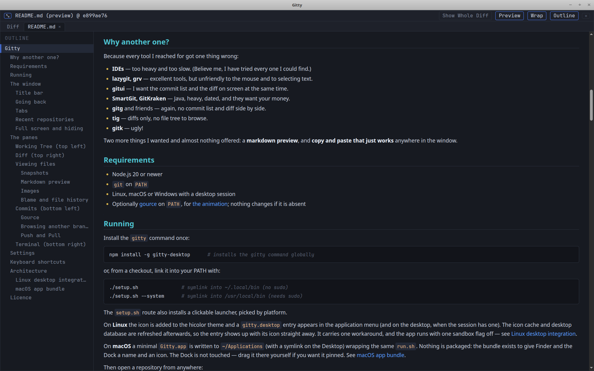
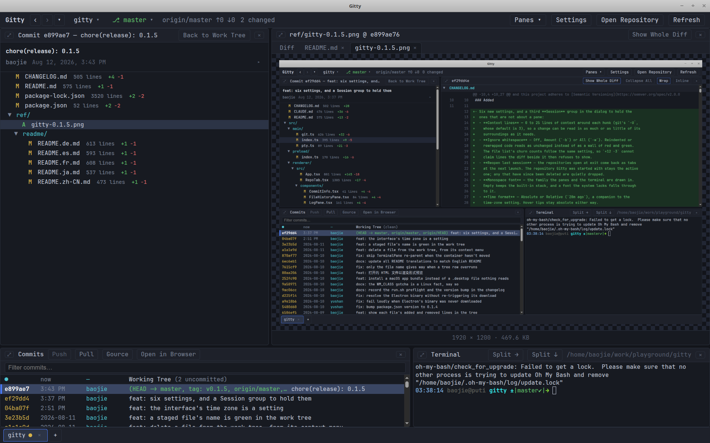
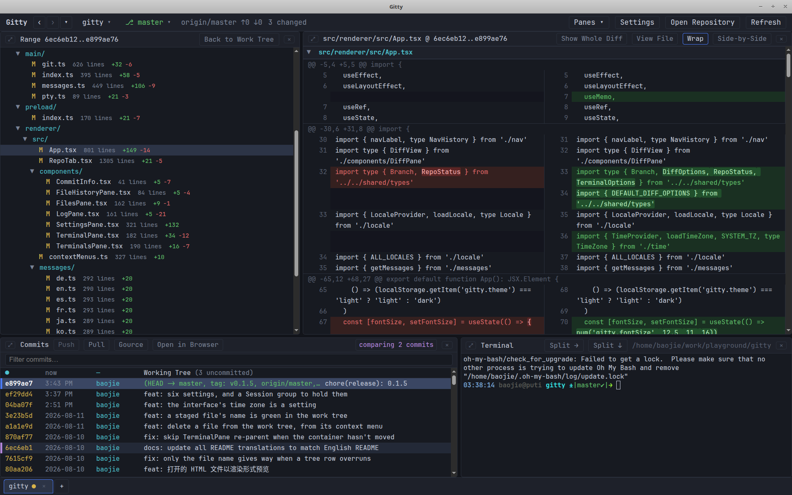

# Руководство по Gitty

[English](manual.md) · [简体中文](manual.zh-CN.md) · [日本語](manual.ja.md) · [한국어](manual.ko.md) · [Français](manual.fr.md) · [Deutsch](manual.de.md) · [Español](manual.es.md) · **Русский** · [Português](manual.pt.md)

Всё, что делает Gitty, панель за панелью. [README](../../README.md) — короткая
версия: что это, зачем оно существует и как установить, — и остаётся таковой;
подробности живут здесь.

> **Переведено 2026-11-18, соответствует Gitty v0.2.3.**
> Официальной версией является [английское руководство](manual.md) — единственное,
> которое поддерживается в актуальном состоянии. Этот документ — его моментальный
> снимок; там, где они расходятся, прав английский. Сам интерфейс англоязычный,
> поэтому названия кнопок и пунктов меню ниже сохранены в оригинале.

---

## Окно <a id="the-window"></a>

Четыре панели посередине, строка заголовка над ними и панель вкладок снизу.

### Строка заголовка <a id="title-bar"></a>

Слева направо она описывает активный репозиторий, а затем действует над ним:

- **Gitty** — значок и имя у левого края открывают диалог **About**: версию, время сборки,
  автора и версии Electron, Chromium и Node, со ссылками на домашнюю страницу и на
  [горячие клавиши](#keyboard-shortcuts).
- **‹ › ▾** — где вы уже были в этом репозитории. См. [Возврат назад](#going-back).
- **Путь к репозиторию** — кнопка: открывает меню
  [недавних репозиториев](#recent-repositories).
  **+** в конце [панели вкладок](#tabs) и <kbd>Ctrl+O</kbd> открывают то же
  меню.
- **⎇ ветка** — тоже кнопка: ветка, которую git сейчас извлёк, и меню всех остальных
  веток для чтения. См. [Просмотр другой ветки](#browsing-another-branch).
- **`origin/main ↑2 ↓0`** — апстрим извлечённой ветки и насколько она впереди и позади.
  Отсутствует на ветке, которая ничего не отслеживает.
- **`3 changes`** — сколько файлов в рабочем дереве не закоммичено, то же число, что
  несёт строка **Changes** в панели коммитов.
- **Panes ▾** — показать или скрыть каждую из четырёх; см.
  [Полный экран и скрытие](#full-screen-and-hiding).
- **Settings** — диалог настроек ([Настройки](#settings)), также <kbd>Ctrl+,</kbd>.
- **Refresh** — перечитать статус и журнал вручную (<kbd>F5</kbd> / <kbd>Ctrl+R</kbd>).
  Gitty следит за репозиторием и обновляется сам; это для случаев, когда наблюдение не
  видит изменения, — в Linux за рабочим деревом из более чем примерно 8 000 каталогов
  следят лишь частично.

Пока вы читаете другую ветку, кнопка ветки показывает `⎇ main › other-branch`, а ошибки
последней команды git появляются красным рядом со счётчиками.

### Возврат назад <a id="going-back"></a>

Читать историю — значит блуждать: коммит, файл внутри него, другой коммит на две страницы
ниже по журналу, затем назад к первому. Три кнопки слева от строки заголовка помнят эти
блуждания, как это делает браузер.

- **‹** (<kbd>Alt+←</kbd>) возвращает к месту, на которое вы смотрели до этого, а **›**
  (<kbd>Alt+→</kbd>) — вперёд к тому, от которого отошли. Обе гаснут, когда идти некуда,
  а наведение на любую называет место, куда она вас приведёт.
- **▾** перечисляет сами места, недавние первыми, с точкой на том, где вы сейчас. Выберите
  любое, чтобы прыгнуть прямо туда.

*Место* — это всё, что показывали две верхние панели: вид — незакоммиченные изменения,
один коммит, диапазон из двух, снимок, — выбранный внутри него файл и документ, открытый
рядом с diff. Так что остановка читается как `Changes`,
`7bb7787 — Refresh screenshot batches`,
`src/main/git.ts @ 7bb7787` или `blame: src/main/git.ts @ 7bb7787`, а возврат к ней кладёт
на экран тот же файл на той же ревизии, а не просто заново выбирает коммит.

История принадлежит репозиторию, а не окну: каждая вкладка помнит свои пятьдесят недавних
мест, и переключение вкладок переключает то, по каким из них ходят кнопки. Она не
сохраняется между перезапусками.

### Вкладки <a id="tabs"></a>

Панель вкладок вдоль низа держит каждый открытый репозиторий — его базовое имя, жёлтую
точку, когда в рабочем дереве есть незакоммиченные изменения, и **×** для закрытия. Точка
считает всё, что сообщает `git status`, включая неотслеживаемые файлы; и своё место она
заслуживает именно на вкладках, на которые вы *не* смотрите: активный репозиторий уже
говорит `3 changed` в строке заголовка, а фоновая вкладка скрыта целиком, так что точка —
единственный знак, что там осталась работа. Наведение на вкладку называет репозиторий и
говорит это словами.

**+** (и <kbd>Ctrl+O</kbd>) открывает другой репозиторий в новой вкладке — через меню
[недавних репозиториев](#recent-repositories); строка заголовка всегда показывает активный. Каждая вкладка хранит свои панели и терминал, так что коммит,
который вы читаете, и shell, оставленный работать, остаются ровно там, где были, когда вы
уходите и возвращаетесь. Перетащите вкладку на новое место в панели, чтобы изменить порядок
репозиториев. Правый щелчок по вкладке предлагает **Rename tab…** — имя запоминается для
этого репозитория, показывается в панели вкладок и в строке заголовка, а настоящий путь
остаётся в подсказке, — **Open in File Manager**, открывающий корневой каталог
репозитория, и **Close repository**. Закрытие последней вкладки оставляет пустое окно с
кнопкой открыть следующий репозиторий.

Вкладки, открытые в момент выхода из Gitty, снова открываются при следующем запуске —
репозиторий, с которым Gitty запущен, всё равно становится активной вкладкой, а тот, что с
тех пор удалён, молча отбрасывается. **Reopen last session** в настройках выключает это. При
нескольких окнах (**Instances: Multiple**) сохраняется сеанс окна, закрытого последним.

Закрытие окна или выход, когда открыто больше одного репозитория, сначала спрашивает, чтобы
случайный <kbd>Ctrl+Q</kbd> не унёс с собой весь набор. Один открытый репозиторий
закрывается без вопросов.

### Недавние репозитории <a id="recent-repositories"></a>

Путь к репозиторию в строке заголовка — это меню репозиториев, открытых ранее, — базовое
имя плюс его родительский каталог, — недавние первыми.

- **Щелчок** — открыть в новой вкладке.
- **Ctrl/Cmd+щелчок** или **средний щелчок** — открыть в текущей вкладке, заменив там
  репозиторий и сохранив место вкладки в панели.
- **×** справа от записи — убрать её из списка; правый щелчок по записи делает то же
  самое. Меню остаётся открытым, так что можно убрать несколько подряд.

Меню показывает двенадцать самых недавних; **More…** внизу перечисляет остальные. Поле
поиска сверху фильтрует весь список по мере набора — каждое слово должно встречаться в
имени репозитория или в его каталоге, и совпадения по имени идут первыми. <kbd>↑</kbd>/<kbd>↓</kbd>
перемещают, <kbd>Enter</kbd> открывает в новой вкладке, <kbd>Ctrl+Enter</kbd> — в текущей,
<kbd>Esc</kbd> закрывает.

Когда в списке ничего не совпало, поиск идёт на диск: Gitty ищет репозиторий с подходящим
именем каталога там, где живут запомненные репозитории, — в их родительских каталогах и в
тех, что над ними, на два уровня вниз, так что `~/work/<group>/<repo>` покрыт без всякой
настройки, — и в привычных местах под домашним каталогом (`~/work`, `~/code`, `~/src`,
`~/projects`, …). Найденное перечисляется под *Is it one of these?* с полным путём и
открывается, только когда вы его выберете; открытое, оно попадает в список.

**+** и <kbd>Ctrl+O</kbd> открывают это же меню, так что репозиторий находится набором его
имени; повторный <kbd>Ctrl+O</kbd> или **Open Repository…** ведёт дальше, к диалогу выбора
папки.

**Open Repository…** и **Clear Recent** находятся ниже; Clear Recent спрашивает, прежде чем
опустошить список, — отмены у этого нет. Список живёт в
`~/.config/Gitty/recent-repos.json`, хранит последние сто репозиториев и пропускает те, что
с тех пор перемещены или удалены.

### Полный экран и скрытие <a id="full-screen-and-hiding"></a>

Заголовок каждой панели несёт те же два элемента: **⤢** слева заполняет окно этой
панелью, а **×** справа её скрывает.

Полный экран накрывает всё остальное, включая строку заголовка и панель вкладок, а панели
под ним продолжают работать — терминал продолжает выполняться, пока он накрыт. **⤡** в
том же углу, <kbd>Esc</kbd>, двойной щелчок по пустому месту заголовка (у кнопок и у меню
заголовка панели Changes свой смысл) или
<kbd>Ctrl+Shift+1</kbd> … <kbd>Ctrl+Shift+4</kbd> восстанавливают раскладку. Одновременно
на весь экран может быть развёрнута только одна панель.

<kbd>Ctrl+Tab</kbd> переносит полноэкранный режим на следующую панель в порядке
раскладки, а <kbd>Ctrl+Shift+Tab</kbd> — на предыдущую, пропуская скрытые и заворачиваясь
на обоих концах. Работает только пока панель заполняет окно, то есть там, где это и
нужно: при видимой раскладке до любой панели и так один щелчок. Терминал этой клавиши не
видит, так что она работает и из shell.

Скрытие — обратное направление: любую панель можно убрать и вернуть:

- **Panes** в строке заголовка перечисляет все четыре, с точкой у видимых; щелчок по одной
  переключает её, а **Show All Panes** восстанавливает раскладку из четырёх панелей.
- <kbd>Ctrl+1</kbd> … <kbd>Ctrl+4</kbd> переключают Files, Diff, Commits и Terminal в этом
  порядке.
- <kbd>Ctrl+Shift+0</kbd> возвращает все четыре — ноль за «все сразу», на клавишу дальше
  тех четырёх, что переключают по одной. Shift нужен потому, что <kbd>Ctrl+0</kbd> — это
  сброс масштаба в движке браузера, который держит меню View.

Что осталось, делит окно между собой, так что скрытие панели коммитов отдаёт diff всю
высоту. У последней видимой панели нет **×** — пустое окно не оставило бы ничего, по чему
щёлкнуть. Скрытые панели запоминаются между перезапусками, а панель терминала лишь
убирается, но никогда не закрывается: её shell продолжают работать и возвращаются со своей
историей прокрутки, когда она возвращается.

Панель можно и сложить, перетащив разделитель к краю окна: разделитель между двумя рядами
складывает этот ряд, а любой из вертикальных разделителей складывает панель со своей
стороны — освободившееся место достаётся соседу. Перетащить разделитель обратно —
восстановить деление. Удобно, когда какая-то часть окна заслуживает всю ширину или всю
высоту.

## Панели <a id="the-panes"></a>

### Changes (слева вверху) <a id="changes-top-left"></a>

Изменённые файлы как сворачиваемое дерево, каждый с количеством строк рядом с именем.
Просмотр целого репозитория — рабочего дерева или снимка коммита — открывается со всеми
закрытыми каталогами, ведь это дерево, в которое надо спускаться, а не список изменений
для чтения; список изменений открывается развёрнутым. На каждом уровне каталоги идут перед
файлами, а внутри каждой группы имена сортируются так, как ожидает читатель, а не как
побайтовое сравнение: цифры в имени считаются числом, так что `W9` идёт перед `W10`, а
регистр — не различие первого порядка, так что `butler/` сортируется вместе с буквами b, а
не после всех заглавных.

У каждого имени есть значок типа: форма — это семейство (исходник, структурированные
данные, разметка, таблица стилей, проза, изображение, архив, shell-скрипт, lock-файл,
результат компиляции), а цвет — язык, так что `.ts` и `.py` — один и тот же глиф разных
цветов. Единственный язык, нарисованный как он сам, — Python, в его собственных синем и
жёлтом. Расширение, которого Gitty не знает, получает чистый лист, а не догадку.

Показываются два столбца статуса: проиндексированное состояние
(зелёное) и состояние рабочего дерева (жёлтое / красное); неотслеживаемые файлы — `??`.
Число строк читается с диска в рабочем дереве и из ревизии во всех остальных случаях;
там, где читать нечего, — бинарный файл или всё, что больше 8 МБ, — строка вместо этого
говорит, какого размера файл, а удалённый файл не говорит ничего. После
него идёт churn — сколько строк это изменение добавило и удалило в этом файле, `+12 −3`, —
против HEAD в рабочем дереве и против родителя для коммита или диапазона. Снимок — это
дерево, а не изменение, поэтому у него нет churn; нет его и у бинарных файлов или
коммита-слияния, чей объединённый diff ничего не приписывает.

Там, где был бы churn, дерево — листинг Working Tree и снимок коммита — вместо этого
называет **того, кто последним закоммитил каждый файл**: изменение уже чьё-то, а дерево —
это вопрос, чей это файл. Наведите на имя, чтобы увидеть всю фразу. У файла, которого git
никогда не видел, такого нет, поэтому неотслеживаемые и игнорируемые файлы не показывают
ничего.

Заголовок панели говорит, что именно перечислено, а щелчок по нему открывает меню двух
постоянных представлений: **Changes** — незакоммиченные, и **Working Tree** — каждый файл
каталога на диске, только для чтения. Галочка отмечает то, что на экране; из коммита,
диапазона или снимка то же меню служит дорогой назад к любому из двух.

**Working Tree** означает каждый файл: те, что покрывает `.gitignore` — результаты сборки,
`node_modules`, что угодно ещё, — перечисляются наравне с остальными, приглушённым курсивом,
и папка, в которой нет ничего, кроме игнорируемых файлов, тоже приглушена. Они открываются
и читаются как любой другой файл; опускается только число строк, потому что сосчитать их
значит прочитать каждый байт каталога, который обычно самый большой на диске. Сам `.git` не
перечисляется.

<kbd>Ctrl+B</kbd> — b как browse — это сочетание, ведущее туда откуда угодно, и оно не
только переключает представление, но и настраивает окно на чтение: Commits и терминал
уходят, оставляя дерево и то, что оно открывает. <kbd>Ctrl+D</kbd> — дорога назад: снова
изменения, со всеми четырьмя панелями. В терминале эта клавиша остаётся концом ввода — тем,
как выходят из shell, — так что пара работает всюду, кроме него. Обе клавиши перечислены в
подсказке заголовка панели.
- **Щелчок** — показать diff файла справа.
- **Двойной щелчок** — открыть весь файл как документ рядом с diff, с номерами строк и
  подсветкой синтаксиса (отрисованный документ для markdown, сама картинка для
  изображения).
- **Щелчок по столбцу статуса** — проиндексировать файл или снять индексацию, если он уже
  проиндексирован.
- **Правый щелчок** — View File, Open in System App, Reveal in File Manager, Open Remote
  URL, Copy Relative Path, Copy Absolute Path, Copy File Name, Blame File, File History,
  Stage / Unstage File, Discard Changes, Delete File. В строке подмодуля есть ещё и
  **Pull Submodule**.
- **Правый щелчок → Open Remote URL** — страница этого файла на сайте, где размещён
  репозиторий, открытая в системном браузере. Ревизия — та, на которую вы смотрите
  (коммит, снимок), а в представлениях Changes и Working Tree — извлечённая ветка. Адрес
  выводится из удалённого репозитория так же, как для [пункта меню коммита](#commits-bottom-left),
  поэтому пункт появляется только там, где этот вывод удаётся, и никогда — для
  неотслеживаемого файла, отсоединённого HEAD или коммита, который ещё не отправлен: у
  сайта пока нет для него страницы.
- **Щелчок по каталогу** — свернуть или развернуть его.
- **Правый щелчок по каталогу** — Copy Relative Path, Copy Absolute Path, Copy Folder
  Name и два способа открыть его вне Gitty: **Open in Browser** — собственный листинг
  каталога в браузере — и **Open in File Manager**. Снимок ревизии перечисляет дерево,
  которого нет на диске, поэтому предлагает только пути.
- **Правый щелчок по пустому месту под строками** — **Open in File Manager** на корневом
  каталоге репозитория (не в снимке ревизии) и **Paste**, когда есть файлы для вставки.

Файлы, скопированные в файловом менеджере, можно **вставить в дерево**: правый щелчок по
пустому месту под строками даёт **Paste**, который пишет в корень репозитория, а правый
щелчок по файлу — **Paste into `dir`/**, который пишет рядом с ним. <kbd>Ctrl+V</kbd>
делает то же при фокусе на этой панели — в каталог выбранного файла или в корень, когда не
выбрано ничего. Вырезанные файлы перемещаются, а не копируются, а об имени, которое в
каталоге уже есть, спрашивают один раз: оставить оба (к приходящему имени добавится
`(copy)`) или заменить.

Вставка принадлежит тем двум представлениям, что *и есть* каталог на диске, — **Changes** и
**Working Tree**. Коммит, диапазон или снимок ревизии — это перечень того, чего нет на
месте, чтобы туда писать, поэтому вставка не предлагается.

<kbd>Ctrl+F</kbd> при фокусе на этой панели — или **Filter** на кнопке поиска в
заголовке, чья стрелка выбирает между поиском по репозиторию и фильтрацией этого списка —
открывает поле фильтра над деревом и сужает его до путей, содержащих набранное, со
счётчиком, сколько из скольких файлов осталось. Набираемое — это **регулярное выражение**
(`\.tsx?$`, `main|renderer`), сверяемое со всем путём, так что `src/main` сохраняет всё под
этим каталогом, а регистр не важен. Обычный текст — выражение, означающее само себя, а
выражение, которое ещё не компилируется (`src/(`, половина `src/(main|renderer)`),
сверяется буквально, а не объявляется ошибкой. Пока в поле есть текст, ничто не остаётся
свёрнутым — совпадение пятью каталогами ниже и есть смысл набранного. <kbd>Esc</kbd> или
**✕** очищает его и возвращает дерево целиком, и переход к другому коммиту тоже.

<kbd>Ctrl+E</kbd> отвечает на другой вопрос — не «сузь то, что здесь перечислено», а
«покажи мне тот файл, где бы он ни был». Он открывает поле поверх окна откуда угодно, без
нужды в фокусе на какой-либо панели, и перечисляет весь рабочий каталог, а не дерево на
экране: каждый файл, который назвал бы `git`, без покрытых `.gitignore`, так что
`node_modules` не может похоронить ответ. Буквы сверяются **по порядку, но не обязательно
подряд** — `dfpn` находит `DiffPane.tsx`, — а ранжирование предпочитает буквы, начинающие
слово (сегмент пути, или после `-`, `_`, `.`, или на переходе от строчной к заглавной),
буквы в имени файла, а не в каталогах над ним, и идущие подряд серии; при равенстве
выигрывает более короткий путь. <kbd>↑</kbd> <kbd>↓</kbd> выбирают, <kbd>Enter</kbd>
открывает файл как документ рядом с diff, а <kbd>Esc</kbd> закрывает поле. Файл
открывается таким, какой он на диске, даже когда на экране коммит, ведь поле перечисляло
именно рабочий каталог. Клавиша работает и внутри терминала, где shell её не видит, — в
отличие от <kbd>Ctrl+D</kbd>, который остаётся концом ввода, потому что так выходят из
shell; конец строки в readline — это ещё и <kbd>End</kbd>.

**Pull Submodule** появляется в строке пути, который называет `.gitmodules`, в тех двух
представлениях, что и есть каталог на диске, — **Changes** и **Working Tree**. Он забирает
собственный удалённый репозиторий этого подмодуля и переводит его на вершину отслеживаемой
ветки (`git submodule update --init --remote`), так что подмодуль, который никогда не
извлекали, клонируется тем же пунктом. Надпроект остаётся указывающим на записанный им
коммит — потому подмодуль потом и появляется в **Changes**: закоммитить новый указатель
остаётся вашим решением. Что сказал git, оседает в полосе сообщений над журналом коммитов,
там же, где отчитываются push и pull.

**Discard Changes** возвращает файл к тому, что держит индекс, после нативного
подтверждения, которое прямо говорит, что отмены нет; у неотслеживаемого файла нет
индексной версии, к которой можно вернуться, поэтому вместо этого он предлагает
**Delete File**, отправляющий в системную корзину.

Правый щелчок по строке рабочего дерева в журнале коммитов также предлагает
**Copy Staged Diff**, для разговора, идущего в другом окне.

Когда выбран коммит или диапазон коммитов, эта панель вместо этого перечисляет файлы того
коммита; **Back to Changes** (или <kbd>Esc</kbd>) возвращает к незакоммиченным изменениям. В
[снимке](#snapshots) она перечисляет всё дерево на том коммите, а не только то, что
изменилось. У просмотра рабочего дерева такой кнопки нет — тот же выбор в заголовке,
которым его открыли, служит и выходом.

### Diff (справа вверху) <a id="diff-top-right"></a>

Унифицированный diff с номерами строк старого/нового, заголовками hunk и раскраской
добавлений/удалений, выложенный списком файлов: каждый путь — заголовок на всю ширину,
заголовок hunk приглушён — это диапазон строк, а не то, на что смотреть первым, — а
переименование читается как `old → new`. Когда файл не выбран, показывается всё сразу:
каждое незакоммиченное изменение в рабочем дереве или каждый файл в выбранном коммите.

- **Show Whole Diff** — назад к этому объединённому diff после выбора файла. Он остаётся в
  заголовке и загорается, пока на экране именно весь diff. Версия для рабочего дерева
  охватывает проиндексированные и непроиндексированные изменения вместе и встраивает
  неотслеживаемые файлы (до 50, дальше — уведомление), чего один `git diff` не показывает.
- **Wrap** — переносить длинные строки вместо горизонтальной прокрутки. Включено по
  умолчанию.
- **Inline** — переключатель того же вида, что и **Wrap**: нажат — одна колонка с
  метками `+`/`-`; отжат — старое и новое рядом, где цепочка удалений сцепляется с идущими
  за ней добавлениями. Перенесённые половины остаются выровненными.
- **Заголовки файлов** — каждый заголовок сворачивает свой файл: треугольник сжимает его
  до имени, а **Collapse All** / **Expand All** в заголовке делает всё разом.
  **Ctrl+щелчок** по заголовку открывает этот файл в новой вкладке документа; правый
  щелчок по нему даёт **Open in a New Tab**, **Select in the File List**, копирование
  путей и — в рабочем дереве, где файл на диске и есть показанная версия, —
  **Open in System App** и **Reveal in File Manager**. Переименование открывает новый путь.
- **Stage / Unstage** — пока diff является работой одного отслеживаемого файла, каждый
  заголовок hunk несёт кнопку, которая кладёт этот hunk в индекс или забирает его обратно.
  Сначала выделите строки — и кнопка становится **Stage 3 lines**: невыделенное добавление
  остаётся вне патча, невыделенное удаление понижается до контекстной строки, а заголовок
  hunk пересчитывается — то же разделение, что делает `git add -p`, из окна, где весь файл
  перед вами. Выделение — это обычное выделение текста, так что перетаскивание по-прежнему
  копирует. Выделение, охватывающее два hunk, даёт каждому свою часть.
- **Unstaged / Staged** — с какой стороны индекса читается файл, показывается, когда обе
  стороны что-то содержат. Индексация действует на то, что на экране. У бинарных файлов,
  смены режима и переименований нет hunk для выбора, и они индексируются целиком из списка
  файлов; кнопки hunk также исчезают, пока включён **Ignore whitespace**, потому что такой
  diff не содержит каждого изменения, которое применил бы.
- **Правый щелчок** — Copy Selection, Copy Whole Diff и те же переключатели.

Изменённые слова внутри изменённой строки подсвечиваются там, где это читается лучше, чем
вся строка разом; это **Word highlight** в [Настройках](#settings).

Настройки запоминаются между запусками. Строки отрисовываются блоками по 1500 и
наращиваются по мере прокрутки, так что большие коммиты остаются отзывчивыми; diff больше
2 МБ обрезаются с уведомлением.

### Просмотр файлов <a id="viewing-files"></a>

По умолчанию панель показывает diff, но любой файл можно открыть целиком: **двойной
щелчок** по нему в дереве, **View File** / **Preview** в заголовке, **Ctrl+щелчок** по
заголовку файла в diff или из любого контекстного меню.

Файл открывается как собственный документ в ленте вкладок рядом с diff, а не поверх него,
так что файл можно читать, не теряя diff, на котором вы были. Вкладка **Diff** всегда
первая, а одиночный щелчок в дереве по-прежнему листает diff на месте. Каждый документ
помнит ревизию, на которой был открыт, закрывается своим **×** и перечитывает файл
рабочего дерева, когда репозиторий меняется. **Правый щелчок** по вкладке документа даёт
то же меню, что у его строки в дереве файлов; файл, которого в списке нет, — неизменённый,
в представлении Changes, — получает версию Working Tree, без индексации, отмены и
удаления. Исходники получают номера строк и подсветку
синтаксиса; markdown открывается [отрисованным](#markdown-preview) с переключателем назад
к исходнику; HTML открывается [тоже отрисованным](#html-preview); изображение открывается
как [картинка](#images).

Какая ревизия вам достаётся, зависит от панели: файл на диске в рабочем дереве, файл,
каким он был на выбранном коммите, — во всех остальных случаях. Открытие документа — это
действие, а не режим: выбор другого файла или другого коммита возвращает diff, — так что
панель никогда не застревает на показе файлов, когда вы хотели изменения.

#### Оглавление файла с кодом <a id="the-outline-of-a-source-file"></a>

Файл с кодом несёт кнопку **Outline** — ту же, что и отрисованный документ: классы,
функции и члены этого файла рядом с ним в виде дерева, с отступом по вложенности и цветом
по тому, что каждый объявляет. Щелчок по записи переносит к ней — файл дорисовывается
настолько, чтобы её вместить, как бы глубоко она ни была, — а запись, до которой вы
доскроллили, отмечается. Разделитель перетаскивается, отдавая место любой из сторон;
ширина общая для всех файлов репозитория.

Читается шестнадцать языков — C, C++, C#, Go, Java, JavaScript, Lua, Perl, PHP, Python,
Ruby, Rust, shell, Swift, TypeScript и JSX-варианты последних двух — и читаются они
распознаванием объявлений, а не разбором: сначала комментарии и строки затираются,
вложенность берётся из глубины фигурных скобок (или из отступа, где язык так пишется), а
имя появляется только там, куда его поставило ключевое слово. Всё прочее — форматы данных,
таблицы стилей, незнакомый язык — не показывает панель вовсе, вместо того чтобы гадать. У
markdown [своё оглавление](#markdown-preview), из его заголовков.

#### Снимки <a id="snapshots"></a>

Щёлкните правой кнопкой по коммиту и выберите **Browse Snapshot**, чтобы прочитать
репозиторий, каким он был на том коммите: верхняя левая панель перечисляет *всё* дерево, а
не файлы, которые трогал этот коммит, а выбор любого файла открывает его на той ревизии. У
снимка нет diff для показа, так что каждый файл там — документ.

Файлы в снимке никогда не существовали на диске на той ревизии, поэтому
предлагается. **Back to Changes** (или <kbd>Esc</kbd>) выходит.

Файл, который git записал исполняемым — режим `755`, — предлагает ещё и
**Run in the Terminal**. Выбор извлекает коммит во временный каталог и вводит в панель
терминала `cd <тот каталог> && ./<файл>`, так что программа работает такой, какой была
тогда, рядом с теми соседями, что были у неё тогда, а не сегодняшними. Строка только
вводится: нажать <kbd>Enter</kbd> — ваше дело, и пока вы этого не сделали, ничего не
запускается. Панель терминала возвращается, если была скрыта. При просмотре рабочего дерева
предлагается тот же пункт, и копия там не нужна — команда выполняется в самом репозитории.

Тот временный каталог — настоящее связанное рабочее дерево (`git worktree`), отсоединённое
на этом коммите, так что программа, спрашивающая у git, где она находится, получает ответ;
у него собственные индекс и HEAD, и ничто, выполняемое там, не трогает вашу рабочую копию.
Это также означает запись в `.git/worktrees`, которую показывает `git worktree list` и
которую Gitty попутно подчищает; сама выкладка хранится по коммитам, так что запустить из
того же снимка что-то второе — мгновенно. Коммит, чьё дерево больше 256 МБ, отклоняется, а
не извлекается: этот пункт — чтобы запустить скрипт, а не чтобы записать во временный
каталог целый репозиторий двоичных файлов.
предлагается. **Back to Changes** (или <kbd>Esc</kbd>) выходит.

#### Предпросмотр Markdown <a id="markdown-preview"></a>

Выбор файла `.md` добавляет кнопку **Preview** — по умолчанию выключена, так что diff
остаётся diff, пока вы не попросите отрисованный документ. Она отрисовывает файл целиком:
версию на диске в рабочем дереве, версию на выбранном коммите — во всех остальных случаях.

Блоки кода в ограждении подсвечиваются синтаксисом, когда называют язык, YAML front
matter выносится и показывается собственным подсвеченным блоком, а уровни заголовков,
маркеры списков, ссылки и встроенный код раскрашены так, что структура читается с одного
взгляда.

- **Wrap** — тот же переключатель, что у diff, включён по умолчанию. Проза всегда
  переносится; в предпросмотре он решает, переносятся ли также блоки кода в ограждении,
  широкие таблицы и длинные встроенные строки, вместо горизонтальной прокрутки.
- **Столбцы таблиц** — ширина столбцов таблицы подбирается по содержимому, а каждую
  границу можно тащить: возьмитесь за правый край ячейки заголовка, и столбец пойдёт за
  указателем, а остальные сохранят свою ширину. Таблица шире панели прокручивается вбок.
  Двойной щелчок по границе возвращает таблицу браузеру, то есть к ширинам по содержимому.
  Ширины живут, пока документ открыт.
- **Outline** — структура заголовков рядом с документом, с отступом по уровню, следящая за
  заголовком, до которого вы доскроллили. Щёлкните запись, чтобы перейти, и тащите
  разделитель между ней и документом, чтобы дать любой стороне больше места. Ширина общая
  у всех документов репозитория — это предпочтение чтения, а не свойство одного файла — и
  живёт столько же, сколько окно, как и размеры других панелей.
- **Source lines** — выключено по умолчанию, включается в [Настройках](#settings): каждый
  заголовок, абзац, элемент списка, таблица, блок в ограждении и изображение нумеруются в
  левом желобе строкой, с которой начинаются в исходнике. Номера рисуются, а не вставляются,
  так что не попадают ни в выделение при копировании, ни в то, что ищет <kbd>Ctrl+F</kbd>.
  Когда документ — тот, о котором diff на экране, номер блока, который этот diff вставил
  или изменил, рисуется зелёным на зелёном — цветами, которыми сам diff красит строку `+`,
  — так что желоб отражает то, что сказал diff. Блок считается изменённым, если изменена
  любая строка, которую он охватывает, так что отредактированный блок в ограждении
  отмечен, даже если его открывающая строка не тронута. Изображение, написанное внутри предложения, берёт строку своего абзаца — своей у него
  нет.
- **<kbd>Ctrl+F</kbd>** — поиск в документе; см. [Поиск текста](#finding-text).
- **Правый щелчок** — Copy Selection, Copy Markdown Source, переключатели переноса и
  оглавления, а также Show Diff Instead.

Сырой HTML внутри markdown не отрисовывается, а ссылка в веб открывается в системном
браузере, а не внутри приложения. Ссылка на другой файл в репозитории —
`ref/readme/manual.md`, `../README.md`, `/CHANGELOG.md` — вместо этого отслеживается
здесь: **Ctrl/Cmd+щелчок** открывает этот файл как собственный документ рядом с diff, на
той же ревизии, что и документ, несущий ссылку, так что README, прочитанный на старом
коммите, ведёт к файлам того коммита. `#fragment` на конце путешествует с ним —
`manual.md#the-window` открывает руководство на том заголовке, как это было бы на forge, —
а заголовок, которого в этом документе нет, просто открывает его сверху. Наведение на такую
ссылку говорит об этом. Обычный щелчок, как и раньше, ничего не делает, а ссылка,
выбирающаяся за пределы корня репозитория, к таким не относится.

Ссылка, которая вместо этого называет каталог — `src/`, `ref/spec`, — открывает панель
файлов на этой папке, на той же ревизии: рабочее дерево для документа, прочитанного с
диска, и снимок того коммита для прочитанного на коммите.

Изображения, написанные относительно документа, читаются из репозитория — на той же
ревизии, что и документ, так что старый коммит показывает те скриншоты, с которыми вышел.
Того, чего в репозитории на той ревизии нет, оставляет пунктирный плейсхолдер с его
alt-текстом. Изображения из сети не загружаются вовсе: чтение чужого README не должно
выдавать вас тому хосту, на который оно ссылается.
ссылается.



#### Предпросмотр HTML <a id="html-preview"></a>

Файл `.html`, `.htm` или `.xhtml` получает ту же кнопку **Preview**, и документ
отрисовывается, а не показывается как исходник, — версия на диске в рабочем дереве, версия
на выбранном коммите — во всех остальных случаях.

Он отрисовывается в изолированном фрейме, загруженном через `srcdoc`, так что страница
никогда не может увести приложение от самого себя. Применяются её собственные таблицы
стилей — раскладка, цвета, шрифты принадлежат документу. Скрипты не выполняются, а удалённые
изображения не загружаются: фрейм наследует политику безопасности содержимого приложения,
которая не допускает ни того, ни другого. Страница показывается, а не исполняется. **Wrap**
решает, прокручивается ли фрейм сам по себе или растёт под своё содержимое, так что вся
страница прокручивается как одно целое. <kbd>Ctrl+F</kbd> и <kbd>Ctrl+Shift+C</kbd> работают
внутри фрейма, чьи клавиши никогда не достигают остального окна.

#### JSON <a id="json"></a>

Файл `.json`, `.geojson`, `.topojson` или `.webmanifest` открывается так, как файл его
хранит, и получает кнопку **Format** рядом с **Wrap**: нажатая, она переотступает документ
по два пробела на уровень, так что минифицированный файл, пришедший одной бесконечной
строкой, читается как дерево. Нажмите ещё раз — и файл снова такой, как хранится.

Пока документ отформатирован, каждый объект и массив, в котором что-то есть, несёт **▼**
рядом с номером своей строки: щёлкните, чтобы свернуть этот узел, и строка, на которой он
открывался, сохранит **…** как знак того, что чего-то не хватает. Щёлкните **▶**, в
который он превратился, чтобы снова развернуть. Свёртки вкладываются, так что узел,
свёрнутый внутри другого, остаётся свёрнутым, когда родитель раскрыт, а <kbd>Ctrl+F</kbd>
ищет по тому, что на экране, — строки свёрнутого узла вовсе не отрисовываются. Ничто не
остаётся свёрнутым, когда открыт другой документ или когда файл рабочего дерева
перечитывается после изменения репозитория: строки, которые называла свёртка, могут уже
быть не теми строками.

Меняются только пробелы между токенами. Числа сохраняют цифры, которыми их записал файл, —
значение слишком длинное для double, слишком большой показатель степени, — ключи
сохраняют свой порядок, а повторяющийся ключ остаётся. Кнопка появляется только там, где
текст разбирается как один полный JSON-документ, так что шаблон, полный заполнителей, или
недокачанный файл не предлагают ничего, а не кнопку, которая ничего не делает.
Форматирование — способ читать файл; обратно ничего не пишется.

#### Изображения <a id="images"></a>

`.png`, `.jpg`, `.gif`, `.webp`, `.bmp`, `.ico`, `.avif` или `.svg` открывается как
картинка, а не как отчёт о том, что это бинарный файл, — с диска в рабочем дереве, из
коммита — во всех остальных случаях. Она вписывается в панель поверх шахматной доски, так
что прозрачность читается как прозрачность; **щелчок** по ней даёт фактический размер и
прокрутку, ещё щелчок — снова вписать. Под ней — её размеры в пикселях и размер на диске.
Изображения больше 12 МБ не встраиваются.



#### PDF <a id="pdfs"></a>

`.pdf` открывается как документ, который читает просмотрщик, уже встроенный в движок
браузера: страницы сбоку, масштаб, поворот, собственный поиск и кнопки, чтобы напечатать
или сохранить копию. На ревизии это работает так же — PDF в снимке коммита читается из
git, так что старое издание статьи читается таким, каким было тогда, без всякого
извлечения. Под ним — размер файла. PDF больше 64 МБ не открываются, а имя в собственной
панели инструментов просмотрщика — не имя файла; имя файла — в заголовке панели над ним.

#### Файлы, хранимые в Git LFS <a id="files-stored-with-git-lfs"></a>

Файл, отслеживаемый [Git LFS](https://git-lfs.com/), — это трёхстрочный указатель в самом
репозитории, а настоящий файл лежит в хранилище рядом. Gitty следует по указателю, так что
изображение или PDF под LFS открывается в предпросмотре как любое другое — и на ревизии, и
в рабочем дереве, и независимо от того, установлен ли на машине `git lfs`. Когда объект не
загружен, панель так и говорит, вместо битой картинки или ошибки просмотрщика. `git lfs
pull` получает его, и предпросмотр после этого работает. Размер рядом с файлом в дереве
остаётся размером указателя — того, что репозиторий хранит на самом деле.

#### Blame и история файла <a id="blame-and-file-history"></a>

Щёлкните правой кнопкой по любому файлу в дереве и выберите **Blame File** или
**File History**; оба открываются как документы рядом с diff. Blame показывает по строке на
строку исходника — коммит, автора, дату и саму строку, подсвеченную как в просмотрщике
кода, с тире там, где строка ещё не закоммичена, — на ревизии, которую вы просматриваете.
File History перечисляет каждый коммит, касавшийся файла, и следует за переименованиями;
колонка между датой и автором говорит, какой длины был файл на том коммите, и каким был его
размер там, где счёт не вывести, — на бинарной ревизии и на всём, что старше неё. Её строки
ведут себя как строки журнала коммитов: щелчок выбирает одну, двойной щелчок открывает тот
коммит, а Shift+щелчок по второй строке сравнивает файл между двумя ревизиями — то же
представление диапазона, что открывает второй выбор в журнале, с уже выбранным файлом.

Правый щелчок по строке blame предлагает **History of These Lines**: `git log -L` по
строкам, которые покрывает выделение — или по строке, по которой щёлкнули, без выделения, —
что открывается собственным документом, показывающим каждый коммит, который их касался,
вместе с тем, что он с ними сделал. Blame отвечает *кто последним*; это отвечает *как оно
стало таким*. Диапазон отслеживается через переименования сам по себе.

#### Поиск по репозиторию <a id="searching-the-repository"></a>

**Search** в заголовке панели Changes открывает поле над списком файлов и выполняет
`git grep`. Стрелка рядом переключает эту кнопку в **Filter**, которая вместо этого сужает
список файлов; выбранное остаётся выбранным, и одновременно открыто только одно из двух
полей. Результаты — документ, сгруппированный по файлам, с номерами строк
слева; щелчок по одному открывает этот файл на той строке, с отмеченной строкой.

Поиск следует за ревизией на экране: в рабочем дереве он читает то, что на диске, включая
незакоммиченную работу, а в коммите или снимке — ту ревизию; поле говорит, какую. Свыше
2000 совпадений он останавливается и говорит об этом, как слишком большой diff.

Поле принимает запрос, а не голый паттерн, в той форме, которой почтовые клиенты научили
всех:

| Набрано | Найдено |
| --- | --- |
| `foo bar` | строки, где есть оба слова |
| `"foo bar"` | эта фраза, вместе с пробелами |
| `-foo` | строки без него |
| `foo in:*.py` | только файлы, подходящие под glob; `in:*.py,*.pyi` для нескольких |
| `foo -in:test/*` | эти файлы исключены |
| `foo in *.py` | то же, что `in:` — без двоеточия это читается как оператор, только если дальше идёт путь, так что `for x in list` — по-прежнему четыре слова |

Кавычки выключают операторы; так `"in:*.py"` ищется буквально. Каждое слово и каждый glob
достигают git отдельным аргументом — в командную строку ничего не сращивается, — так что
регулярное выражение не разваливается по пути. Запрос, который говорит, где искать, но не
что (`in:*.py` сам по себе), не выполняется; полоса говорит, что искать нечего.

### Commits (слева внизу) <a id="commits-bottom-left"></a>

Журнал текущей ветки, загружаемый по 300 за раз и наращиваемый по мере прокрутки. Первая
строка — **Changes**, незакоммиченные изменения, со счётчиком изменённых файлов;
выбор её возвращает верхние панели к ним. **Filter** справа в заголовке открывает поле
фильтра над журналом, сужающее список — с антидребезгом, — и результат листается так же.
Крестик ✕, <kbd>Esc</kbd> или та же кнопка убирают поле и возвращают журнал целиком.

В заголовке остаются **Push** и **Pull** — те два, что нужны часто; всё остальное о
журнале — в одном щелчке за **⋯**: **Graph**, **All Branches**, **Gource** там, где он
установлен, и **Open in Browser**. Оба переключателя несут точку в этом меню, пока
включены.

**Graph** рисует дорожки рядом с хэшами: где разошлась ветка, где приземлился
merge, какой линии принадлежит коммит. Он вычисляется из родителей каждого коммита, а не
разбирается из `git log --graph`, чей ASCII набран для терминала. Дорожка сохраняет свой
цвет вниз по странице, а палитра фиксирована — намеренно не в пример blame, чьи цвета
выводятся из SHA и означают «кто». За десятью дорожками излишек делит последнюю колонку,
окольцованную, так что репозиторий со многими головами не может вытолкнуть темы из панели.
**All Branches** показывает все ветки сразу (`git log --all`), и так видно, как две ветки
соотносятся друг с другом; меню ветки по-прежнему читает по одной за раз.

Журнал упорядочен по **дате автора** — той, что в столбце, — так что коммит, который был
переигран, а не написан (rebase, cherry-pick, слияние из сплющенного pull request),
читается среди тех дат, когда он был написан, а не в день, когда он приземлился. Чего не
изменит никакой порядок — родитель всегда рисуется ниже своих детей, так что такой коммит
всё же может сидеть среди строк, которые он предваряет; там, где это случается, дата
помечается, и подсказка говорит почему. Под фильтром пометка выключена: строка выше тогда
не является предыдущим коммитом, так что дата, идущая назад, говорит лишь о том, что
строки между ними не совпали.

Выбор коммита **затеняет журнал по родословной**: строки, на которых он построен, и
строки, построенные на нём, остаются как есть, всё прочее отступает. Это единственное
отношение, которое положение показать не может: строка прямо над ним может быть на другой
ветке, а родитель может сидеть сотней строк ниже. Обход покрывает загруженное, так что
родословная, уходящая за последнюю строку, показана настолько, насколько достаёт журнал;
под фильтром, где строки — подмножество, а цепочки между ними отсутствуют, не затеняется
ничего.

Раскрывающийся список рядом говорит, что ищется:

| | |
| --- | --- |
| **Message / Author** | Сообщение коммита и автор, без учёта регистра, как расширенное регулярное выражение — `fix\|revert` — любое из двух слов. По умолчанию. |
| **Content** | git'овый `-S`: коммиты, где *число вхождений* текста изменилось — где он был введён или удалён. Буквально, так что поиск, полный `.` и `(`, означает эти символы. |
| **Content regex** | git'овый `-G`: каждый коммит, чей diff соответствует выражению — расширенному, как и в режиме выше, — включая те, что лишь передвинули строку. |

Текст, который ещё не стал выражением — `(fix` по пути к `(fix|revert)`, — в обоих
режимах с выражениями ищется буквально, чтобы поле, читаемое на каждом нажатии, не
опустошало журнал, пока вы дописываете.

Два режима содержимого отвечают на вопрос, который не может blame, — *какой коммит ввёл
эту строку* — и для этого читают каждый diff в истории, так что поле говорит, что ищет,
пока они работают. Смена текста или режима убивает идущий поиск; в командную строку ничего
не сращивается, так что регулярное выражение достигает git одним аргументом.

- **Щелчок** или <kbd>Enter</kbd> — показать этот коммит: его файлы заполняют верхнюю
  левую панель, а его полный diff — верхнюю правую. Тема, автор, дата и полное тело коммита
  появляются в полосе над списком файлов; когда тело длинное, переключатель ▸ сворачивает
  его, оставляя место списку файлов.
- <kbd>Shift+щелчок</kbd> или <kbd>Space</kbd> — выбрать второй коммит и сравнить два,
  старый первым.
- **Ctrl+щелчок** (<kbd>Cmd</kbd> в macOS) — открыть страницу коммита на сайте, где
  размещён репозиторий, по тому же адресу, что и **Open Remote URL** ниже. Там, где такую
  страницу вывести не удаётся, щелчок ничего не делает, и строка остаётся как была.
- **↑ ↓ / j k / PgUp / PgDn / Home / End** — перемещать курсор.
- **Правый щелчок** — показать diff, скопировать хэш, короткий хэш или тему,
  [просмотреть снимок](#snapshots) или сравнить с текущим выбранным коммитом.
- **Правый щелчок → Open in Browser** — отрисовать этот коммит в системном браузере;
  **Copy Commit URL** копирует ссылку. Веб-сервер внутри приложения отдаёт каждый открытый
  репозиторий как просматриваемый список коммитов — кнопка **Open in Browser** панели
  коммитов ведёт туда — с метаданными, файлами и diff каждого коммита, а diff по отдельному
  файлу — в одном щелчке.
- **Правый щелчок → Open Remote URL** — страница этого коммита на сайте, где размещён
  репозиторий, открытая в системном браузере. Адрес выводится из удалённого репозитория
  (того, который отслеживает текущая ветка, иначе `origin`), и пункт появляется, только
  когда этот вывод удаётся: GitHub, GitLab, Bitbucket, Gitea, Forgejo, Codeberg и
  sourcehut известны, как и любой самостоятельно размещённый хост, следующий схеме
  `/commit/<hash>`. Репозиторий без удалённого или лежащий на Azure DevOps этот пункт не
  получает, как не получает его и коммит, который ещё не отправлен, — и Ctrl+щелчок такой
  тоже не открывает.

  Он слушает `127.0.0.1`, и само по себе это немного: loopback не пускает другие машины,
  но не другие страницы в вашем же браузере, любая из которых могла бы его получить. Поэтому
  каждый URL несёт токен, сгенерированный при старте и хранящийся в памяти, — `/t/<token>/…`
  — который у выдаваемых Gitty ссылок уже есть. Неверный токен — это 404, а не 403; запрос,
  чей `Host` не loopback, отклоняется (именно это делает DNS-rebinding бессмысленным), а
  страницы отдаются с `Referrer-Policy: no-referrer`, так что переход по ссылке из сообщения
  коммита не уносит токен с собой. Токен новый при каждом запуске, так что URL работают,
  пока идёт эта сессия.
- Выбор файла в верхней левой панели сужает diff до этого файла; **Show Whole Diff**
  расширяет его обратно.



#### Gource <a id="gource"></a>

Если [gource](https://gource.io/) есть в `PATH`, меню **⋯** в заголовке панели коммитов
получает пункт **Gource**: она проигрывает историю репозитория как анимацию — дерево
каталогов растёт, файлы загораются при каждом приземляющемся коммите, между ними летает по
одному автору на имя в журнале. Gource открывает собственное окно и продолжает работать
после закрытия Gitty; пункт ждёт ровно столько, чтобы увидеть, что он стартовал, и
показывает, что сказал gource, если нет.

Он запускается с днём истории на полсекунды, простаивающие файлы остаются на экране, а
длинные паузы пропускаются — именно это делает настоящий репозиторий читаемым, а не
медленной струйкой. Ничего не ставится за вас: где gource нет в `PATH`, пункта просто нет.

#### Просмотр другой ветки <a id="browsing-another-branch"></a>

Ветка в строке заголовка открывает меню каждой локальной и удалённо-отслеживаемой ветки,
новейший коммит первым, и выбор одной показывает историю той ветки вместо текущей. Это
взгляд только для чтения: gitty не запускает `checkout`, так что рабочее дерево, его diff и
терминалы остаются ровно там, где их оставил git. Пока вы смотрите другую ветку, строка
заголовка читается как `⎇ main › other-branch`, а панель коммитов говорит, какую ветку
перечисляет; **Back to \<branch\>** возвращает. У каждого из двух имён своя подсказка при
наведении, говорящая, какое из них какое, — ведь именно это различие и есть смысл всей
затеи. Каждая вкладка просматривает сама по себе.

#### Push и Pull <a id="push-and-pull"></a>

**Push** и **Pull** находятся в заголовке, и оба действуют на извлечённую ветку, на какую
бы ветку ни смотрел журнал. **Push** считает, что не запушено, — **Push 3** — и гаснет,
когда отправлять нечего; на ветке, которая ничего не отслеживает, он публикует ветку в
`origin` и задаёт апстрим. **Pull** делает fast-forward из апстрима и гаснет, когда апстрима
для вытягивания нет. Когда ветки разошлись, fast-forward невозможен, и Gitty спрашивает,
не вытянуть ли вместо этого с rebase — ваши локальные коммиты, переигранные поверх
апстрима. Отказ оставляет репозиторий как был и показывает отказ самого git; согласие
требует чистого рабочего дерева, а конфликт останавливает rebase, чтобы вы завершили его в
терминале. Что скажет git, появляется над журналом — щелчок снимает это; неудачи остаются,
пока вы не смахнёте их.

Ни тот, ни другой не могут ответить на запрос: за ними нет терминала, так что push,
требующий пароль или парольную фразу, падает с сообщением самого git, а не зависает. Затем
оба доводятся вручную в панели терминала, которая тут же рядом.

### Terminal (справа внизу) <a id="terminal-bottom-right"></a>

Настоящий интерактивный login-shell (`$SHELL`) с корнем в репозитории, так что любую
команду git можно запустить напрямую. <kbd>Ctrl+Shift+C</kbd> копирует выделение терминала
— <kbd>Ctrl+C</kbd> там прерывание и остаётся прерыванием. Та же комбинация копирует и во
всех остальных панелях, так что она не меняет смысл при перемещении фокуса. Остальные
панели обновляются автоматически, когда репозиторий меняется на диске. Какой shell
запускается и запускается ли он как login-shell — это [Настройки](#settings); оба читаются
при создании терминала, так что изменение вступает в силу при следующем разбиении.

Панель делится на сколько угодно shell: **Split →** ставит новый рядом со
сфокусированным терминалом, **Split ↓** — под ним, а разделители между ними тащатся, как у
любой другой панели. Щелчок по терминалу фокусирует его — обведённый и есть место, куда
ляжет следующее разбиение или **Close**. Двойное разбиение в ту же сторону удлиняет строку
или столбец, а не вкладывает, так что три бок-о-бок терминала переразмериваются друг против
друга.

**Close** завершает сфокусированный shell; уход из shell через `exit` сам закрывает его
ячейку. Последний терминал всегда остаётся: выход из него оставляет уведомление на экране,
а не пустую панель.

**Send** в заголовке этой панели передаёт индекс. Он вводит команду в сфокусированный
shell и нажимает Enter, и это всё: изнутри Gitty не вызывается никакая модель, ничто не
покидает машину, чего вы не отправили. Запросы и вывод агента появляются в терминале, где
есть настоящий tty, так что hooks и gpg-подпись работают как всегда.

Поле слева от неё называет команду, которую она выполнит, и там же выбирается другая:
настройки для этого нет, потому что это вопрос, задаваемый один раз на передачу, а не один
раз на установку. Раскрывающийся список перечисляет команды, которые помнит Gitty, недавно
выполненные первыми, и выполняет ту, что вы выбрали; выполненная команда уходит в начало,
так что поле всегда показывает последнюю использованную. Если не запомнено ничего, поле
бледное, а **Send** — серая. **×** справа от записи убирает её из списка после
подтверждения — список единственное место, где команда записана, а меню остаётся открытым,
так что можно убрать несколько подряд. **New command…** внизу открывает однострочное поле,
предзаполненное текущей командой, для всего, чего нет в списке. Список начинается с
нескольких подсказок — какой агент установлен, Gitty знать не может — а команда попадает в
список тем, что была выполнена, так что ничего не запоминается по силе наполовину набранной
строки.

## Поиск текста <a id="finding-text"></a>

<kbd>Ctrl+F</kbd> ищет в том, что показывает правая панель: diff, файл, отрисованный
документ markdown, [предпросмотр HTML](#html-preview), blame или историю файла. При фокусе
на дереве файлов он делает другое — фильтрует это дерево, см.
[Changes](#changes-top-left). Каждое
совпадение подсвечивается с выделенным текущим, <kbd>Enter</kbd> и
<kbd>Shift+Enter</kbd> (или стрелки) ходят по ним и заворачиваются на любом конце, счётчик
говорит, где вы, а <kbd>Esc</kbd> закрывает.

Поиск не чувствителен к регистру и читает текст как отрисованный, а не разметку за ним —
так что фраза находится поперёк жирных и кодовых участков, которые оставляет внутри
markdown, а diff ищется как строки, которые вы видите. Виды, которые отрисовываются блоками
по мере прокрутки (длинный файл, большой diff), дорисовывают остальное, когда открывается
полоса поиска, так что счётчик покрывает всё целиком, а не доскролленную часть. Свёрнутый
файл в многофайловом diff остаётся свёрнутым и не ищется.

## Настройки <a id="settings"></a>

**Settings** в строке заголовка или <kbd>Ctrl+,</kbd>. Всё здесь действует на каждую вкладку
и запоминается между перезапусками; **Restore Defaults** возвращает всё назад. Диалог — в
трёх вкладках, **Appearance**, **View** и **Session**, — так что он остаётся одним экраном
по мере роста; таблица ниже перечисляет их в этом порядке.

| | |
| --- | --- |
| **Theme** | Dark или Light. |
| **Language** | English, 简体中文, 日本語, 한국어, Français, Deutsch, Español, Русский or Português — интерфейс, меню и диалоги меняются вместе без перезапуска. |
| **Time zone** | Пояс, в котором отображаются все даты и время на экране: по умолчанию машинный, или UTC, или любой известный системе пояс. Git записывает каждый коммит со смещением его автора, так что метка времени — всегда выбор пояса, и он делается здесь. Колонка даты в журнале следует за ним, а значит, граница между «сегодня» и датой тоже движется вместе с ним. |
| **Time format** | Absolute (время на часах или дата) или Relative (`28m ago`, `2h ago`). Relative полностью обходит вопрос пояса; всплывающая подсказка на строке в любом случае остаётся абсолютной и называет свой пояс. |
| **Font size** | 9 – 20, с шагом в полпункта. Действует на каждую панель, включая терминал. |
| **Monospace font** | Семейство, которым рисуются панели и терминал, выбираемое из моноширинных шрифтов, найденных на этой машине. **System default** — встроенный стек (JetBrains Mono, Fira Code, DejaVu Sans Mono, …). |
| **Row height** | 18 – 26 пикселей — высота строки, на которой строится каждый список: дерево файлов, журнал и diff. Плотнее — больше на экране, свободнее — легче читать. |
| **Diff layout** | Inline или Side-by-Side, тот же переключатель, что несёт заголовок diff. |
| **Context lines** | 0 – 25 неизменённых строк вокруг каждого hunk — git'овый `-U`, чьё собственное значение по умолчанию — 3. Расширьте, чтобы видеть, во что вписано изменение, сузьте, чтобы уместить больше большого diff на экране. |
| **Ignore whitespace** | Off, Amount (git'овый `-b`: пробельная цепочка, меняющая длину, не считается изменением) или All (`-w`: никакое различие пробелов не считается). Переиндентированный или переперенесённый код читается как неизменённый, а не как стена красного и зелёного. Счётчики `+12 −3` в списке файлов следуют той же настройке, так что не могут заявить строки, которые diff потом откажется показывать. |
| **Word wrap** | Переносить длинные строки вместо горизонтальной прокрутки. |
| **Word highlight** | Отмечать слова, изменившиеся внутри изменённой строки, а не только строку. |
| **Outline** | Показывать оглавление рядом с документом: заголовки в отрисованном, классы и функции в файле с кодом. |
| **Markdown source lines** | Нумеровать каждый блок отрисованного документа строкой, с которой он начинается в исходнике. Заголовки, абзацы, элементы списков, таблицы, код в ограждении и изображения — все несут номер в желобе слева. Выключено по умолчанию. |
| **File sorting** | Natural или Byte order. Natural читает цифры в имени как число (`W9` перед `W10`) и ставит регистр вторым; byte order — собственный git'овый, где каждая заглавная сортируется раньше каждой строчной. |
| **Reopen last session** | Заново открыть репозитории, которые были открыты при последнем выходе из приложения. Репозиторий, с которым запустили Gitty, остаётся активной вкладкой; удалённые с тех пор тихо отбрасываются. |
| **Instances** | **Single** — по умолчанию — держит один Gitty на пользователя: `gitty <repo>` из любого каталога передаёт репозиторий уже открытому окну, которое добавляет его вкладкой и выходит на передний план, а второй запуск тут же завершается. **Multiple** вместо этого поднимает отдельное окно на каждый запуск. В отличие от остального в таблице, это хранит приложение, а не окно, так что оно одинаково для всех окон; изменение действует на следующий набранный `gitty`, а не со следующего перезапуска. |
| **Shell** | Shell, с которого стартует терминал, перечисляемый из `/etc/shells` плюс обычные пути (`COMSPEC` и PowerShell в Windows). **System default** — `$SHELL`. Путь, который с тех пор исчез, откатывается к нему, а не оставляет мёртвую панель. |
| **Login shell** | Запускать его с `-l`, чтобы подхватывался профиль пользователя. Выключите для более быстрого и тихого shell — без вывода профиля и проверок при входе. У shell в Windows нет такого флага, и они это игнорируют. |

### Плагины <a id="plugins"></a>

Последняя вкладка настроек. Всё, что не является ядром браузера истории, живёт
здесь как плагин: со своим выключателем, своими настройками, своими файлами. Все
они начинают выключенными.

| плагин | что делает |
| --- | --- |
| **Semantic reading** | Языковой анализатор читает прозу отрисованного markdown-документа и подчёркивает имена собственные в ней — имена людей, мест и организаций, — так что абзац можно окинуть взглядом и понять, о ком и о чём он. Латинские слова внутри CJK-прозы (`GPT-4`, `Claude`, `v0.1.9` в китайской фразе) получают собственный цвет вместо линии, а конец каждого предложения получает насыщенность и немного воздуха после себя, так что абзац с одного взгляда считается в предложениях. Ни то, ни другое не требует анализатора, так что оба держатся, даже когда ответить некому. Разметка не трогается, и код тоже: огороженный блок, встроенный фрагмент кода и цель ссылки никогда не помечаются. |

У Semantic reading три собственные настройки, показываемые после включения.
**Analyser** — кто читает: **jieba** сегментирует текст на этой машине, не требует
ни сети, ни ключа и знает китайский; **Model** отправляет текст на любую
OpenAI-совместимую конечную точку, которую называет `Model access`, что стоит
одного обращения на документ и читает любой язык, который читает модель. В любом
случае анализатор, который не может ответить, оставляет документ ровно таким, каким
он был.

**Mark styles** открывает `rules.json`, который говорит, как выглядит каждый вид
пометки: `underline` (`none`, `solid`, `dotted`, `dashed`, `double`, `wavy`),
`underlineColor`, `color`, `background`, `bold`, `italic` и `spaceAfter`, по одной
записи для `person`, `place`, `org`, `proper`, `latin` и `sentence-end`.
`spaceAfter` — дополнительный воздух после пометки, в em, до 2; именно его
умолчание даёт концу предложения вместо ещё одного цвета. Цвета — `#rgb`,
`#rrggbb` или `#rrggbbaa`, и они от тёмной темы: второй палитры для светлой в
файле нет. Отредактируйте, откройте документ заново — и изменение на месте.

**Model access** открывает `models.json`: `baseUrl`, `model` и ключ для
анализатора **Model**. `apiKeyEnv` называет переменную окружения, из которой читать
ключ, что держит его вне файла; `apiKey` хранит его прямо, для тех, кому так
удобнее. Оба файла лежат в собственном каталоге состояния Gitty, под
`plugins/semantic-reading/`, никогда не в репозитории, и их содержимое никогда не
покидает основной процесс.

**Shell** и **Login shell** читаются при создании терминала, поэтому действуют при
следующем разбиении или следующей вкладке репозитория, а не в уже работающих shell.
**Word wrap**, **Diff layout** и **Outline** — те же переключатели, что несёт
заголовок diff, так что изменение в любом месте меняет оба. **Word highlight** живёт только
здесь.

## Горячие клавиши <a id="keyboard-shortcuts"></a>

<kbd>F1</kbd> показывает эту таблицу внутри приложения — **Help ▸ Keyboard
Shortcuts** открывает тот же лист.

| Клавиша | Действие |
| --- | --- |
| <kbd>↑</kbd> <kbd>↓</kbd> / <kbd>PgUp</kbd> <kbd>PgDn</kbd> / <kbd>Home</kbd> <kbd>End</kbd> | Двигать выделение в списке коммитов |
| <kbd>Enter</kbd> | Показать выбранный коммит |
| <kbd>Space</kbd> / <kbd>Shift+Click</kbd> | Отметить второй коммит и сравнить пару |
| <kbd>Ctrl+Click</kbd> по коммиту | Открыть его страницу на хостящем сайте |
| <kbd>Ctrl+Click</kbd> по заголовку файла | Открыть этот файл в новой вкладке документа |
| <kbd>Ctrl+F</kbd> | Найти в diff, файле или в том, что показывает панель — или отфильтровать дерево файлов, если фокус на нём |
| <kbd>Ctrl+C</kbd> / <kbd>Ctrl+Shift+C</kbd> | Скопировать выделение в любом месте окна |
| <kbd>Esc</kbd> | Назад к незакоммиченным изменениям |
| <kbd>Ctrl+B</kbd> | Просматривать рабочее дерево, Commits и Terminal уходят с дороги |
| <kbd>Ctrl+D</kbd> | Назад к изменениям, со всеми четырьмя панелями (кроме терминала, где это конец ввода) |
| <kbd>Ctrl+V</kbd> | Вставить файлы из буфера обмена в дерево файлов, если фокус на этой панели |
| <kbd>Alt+←</kbd> / <kbd>Alt+→</kbd> | Назад и вперёд по просмотренным местам |
| <kbd>Alt</kbd> | Показать или скрыть строку меню приложения (кроме macOS, где она всегда на месте) |
| <kbd>F1</kbd> | Горячие клавиши — листом поверх окна |
| <kbd>F5</kbd> / <kbd>Ctrl+R</kbd> | Обновить статус и журнал |
| <kbd>Ctrl+O</kbd> | Открыть другой репозиторий в новой вкладке: меню недавних репозиториев; ещё раз — диалог выбора папки |
| <kbd>Ctrl+E</kbd> | Открыть файл по имени из любого места окна — включая терминал |
| <kbd>Ctrl+,</kbd> | Настройки |
| <kbd>Ctrl+1</kbd> … <kbd>Ctrl+4</kbd> | Скрыть или показать Files, Diff, Commits, Terminal |
| <kbd>Ctrl+Shift+0</kbd> | Снова показать все четыре панели |
| <kbd>Ctrl+Shift+1</kbd> … <kbd>Ctrl+Shift+4</kbd> | Заполнить окно этой панелью |
| <kbd>Ctrl+Tab</kbd> / <kbd>Ctrl+Shift+Tab</kbd> | Полный экран переходит к следующей панели или к предыдущей |

## Заметки о платформах <a id="platform-notes"></a>

### Интеграция с рабочим столом Linux <a id="linux-desktop-integration"></a>

У двух компромиссов ниже одна причина — Electron-приложение, которое *запускается*, а не
упаковывается, — так что оба исчезли в `.deb` и оба остались на пути `setup.sh`, который
действительно запускает неупакованный Electron.

**Класс окна.** Запись рабочего стола, которую пишет `setup.sh`, несёт
`StartupWMClass=electron`: именно это сообщает неупакованный Electron, как бы приложение
себя ни называло, и именно с этим список окон и док сопоставляют окно, чтобы найти его
значок. Побочный эффект — другое неупакованное Electron-приложение в том же сеансе
позаимствует значок Gitty. У упакованной сборки есть собственный исполняемый файл, так что
её запись совпадает с `gitty`, и коллизия не может произойти.

**Песочница.** `run.sh` и `cli.js` ставят `ELECTRON_DISABLE_SANDBOX=1`, потому что
`chrome-sandbox` не может держать setuid-бит, принадлежащий root, внутри `node_modules`.
У `.deb` обходить нечего: его `postinst` ставит помощнику 4755 на ядрах без
непривилегированных пользовательских пространств имён, оставляет 0755 там, где песочница
на пространствах имён работает, и ставит профиль AppArmor, который просит Ubuntu 24.04.
Так что для всего, установленного из пакета, песочница включена.

`.AppImage` — более слабый из двух: ничто в нём не может нести setuid-бит, так что он
зависит от непривилегированных пользовательских пространств имён — которые политика
AppArmor в Ubuntu 24.04 по умолчанию ограничивает. Там ожидайте передавать `--no-sandbox`
или поставить собственный профиль AppArmor. Где можно, предпочитайте `.deb`.

### Wayland и мониторы с разным масштабом <a id="wayland-and-monitors-scaled-differently"></a>

Сессия GNOME Wayland с двумя мониторами разного масштаба может не дать Chromium
остановиться на одном: он переключает коэффициент масштабирования окна между
двумя по несколько раз в секунду, при каждом переключении заново раскладывает
страницу, и весь интерфейс дрожит на пиксель-другой всё время, пока окно открыто.
Хуже всего это видно в полноэкранном режиме. Причина не в Gitty — окно Electron
вообще без содержимого дрожит точно так же, — и никакой размер окна от этого не
спасает.

Gitty берёт это на себя: при запуске он спрашивает, как масштабированы мониторы,
и если приходит два разных ответа — перезапускает себя с выключенным дробным
масштабированием Chromium. Это происходит до того, как появится хоть одно окно,
так что видно лишь чуть более поздний старт. Цена — дробное масштабирование
рабочего стола тогда игнорируется: интерфейс рисуется с масштабом 1 и выглядит
мельче остального рабочего стола. <kbd>Ctrl+=</kbd> возвращает масштаб, а размеры
шрифта в **Settings** — другой способ восполнить разницу.

Две переменные окружения перекрывают эту догадку.
`GITTY_DISABLE_FRACTIONAL_SCALE=1` выключает дробное масштабирование, что бы ни
говорили мониторы, — полезно, если второй монитор подключили уже после запуска
Gitty: единственный случай, который проверка при старте поймать не может.
`GITTY_DISABLE_FRACTIONAL_SCALE=0` оставляет его включённым и отменяет
перезапуск — вместе с дрожанием.

Выставить обоим мониторам одинаковый масштаб в **Settings → Displays** — значит
не оставить Chromium ничего, между чем переключаться: то же лечение с другого
конца, там где два экрана могут разделить один масштаб.

Одно следствие перезапуска: идентификатор процесса, который печатает `run.sh`,
принадлежит процессу, уступившему место, и мгновение спустя не называет ничего.

### macOS app bundle <a id="macos-app-bundle"></a>

`Gitty.app` — это обёртка, а не пакет: `Contents/MacOS/Gitty` — двухстрочный скрипт,
который делает exec `run.sh --fg --any`. `--fg` важен — exec до самого низа означает, что
плитка Dock остаётся на бандле, а не сиротеет от процесса, который его переживает, — а
`--any` позволяет запуску из Finder, у которого нет, по сути, рабочего каталога, откатиться
к репозиториям, открытым недавно.

Имя верно во всех трёх местах, где появляется, и только одно из них приходит из бандла.
Finder и Dock читают `CFBundleName` и `CFBundleIconFile` из `Info.plist`; строка меню — это
`app.name`, который `app.setName('Gitty')` задаёт до существования любого окна, а
`{ role: 'appMenu' }` использует как метку. Так что, в отличие от проблемы класса окна в
Linux выше, здесь нет никакого компромисса — поэтому пакетирование не купило бы ничего,
кроме подписи, и поэтому `electron-builder.yml` настраивает только цели Linux.

Бандл, запущенный из Finder, наследует минимальный `PATH` launchd, без nvm и без Homebrew,
а `run.sh` нужны `node` и `npm`, чтобы пересобрать, когда бандл устарел. `setup.sh`
разрешает их при установке и подставляет впереди — префиксом, так что запуск из терминала
не затронут. Переключение версии Node позже оставляет этот путь устаревшим; перезапустите
`setup.sh`, чтобы перенацелить его.

### Windows <a id="windows"></a>

Windows работает из клона, через те же `run.sh` и `setup.sh`, что и другие платформы,
выполняемые Git Bash, который идёт с [Git for Windows](https://gitforwindows.org/). README
перечисляет [шаги](../../README.md#on-windows). Ничего не пакетируется:
`electron-builder.yml` настраивает только цели Linux.

**Что ставит `setup.sh`.** Симлинк здесь бесполезен, потому что `ln -s` в Git Bash молча
делает копию, а копия `run.sh` ищет клон рядом с собой. Поэтому `%USERPROFILE%\.local\bin`
получает вместо этого две маленькие обёртки: `gitty` — bash-скрипт для Git Bash, и
`gitty.cmd` для cmd и PowerShell, передающий свои аргументы `bash.exe -l` из Git. `-l`
ставит собственные инструменты Git в `PATH`; `CHERE_INVOKING=1` не даёт login-профилю
перейти в домашний каталог, так что `gitty` по-прежнему означает текущий. Git Bash строит
свой `PATH` из виндового, так что одна запись для этого каталога обслуживает все shell, а
`setup.sh` печатает строку PowerShell, которая её добавляет, если её нет.

Меню «Пуск» и рабочий стол получают `Gitty.lnk`, который запускает `run.sh --any` в
свёрнутом окне Git Bash. Это окно закрывается, как только Electron запущен. Его значок —
`build/icon.png`, обёрнутый в `.ico` в `%LOCALAPPDATA%\Gitty`. Журнал —
`%USERPROFILE%\.local\state\gitty\gitty.log`, тот же путь, что и везде.

**Без Visual Studio.** `node-pty` панели терминала поставляет для Windows готовые бинарники
N-API, которые загружаются под любым Electron, поэтому шаг `postinstall` пропускает
`electron-rebuild`, который выполняет в Linux и macOS. Эта пересборка потребовала бы
инструментов C++ из Visual Studio и без них упала бы.

**_not a valid Win32 application_ во время `npm install`.** Это значит, что не хватает
64-битной среды выполнения Visual C++, а не что битая загрузка. Без неё Windows ищет
`vcruntime140.dll` по `PATH`, а 32-битная копия, оставленная там какой-то другой программой
(обычно это 32-битный Python), не может загрузиться в 64-битный Node. Установите среду
выполнения командой `winget install Microsoft.VCRedist.2015+.x64` и снова запустите
`npm install`.

**_dubious ownership_.** На диске, который не записывает владельцев файлов, — таком как
FAT/exFAT или некоторые сетевые ресурсы — git отказывается работать с репозиторием, владение
которым вы не можете доказать, и Gitty ничего для него не показывает. Доверьтесь этому
репозиторию — или всем репозиториям на этом диске — в собственной конфигурации git:

```bash
git config --global --add safe.directory D:/path/to/repo
git config --global --add safe.directory '*'   # every repository
```

**Терминал** запускает `COMSPEC`, то есть `cmd.exe`, если только **Settings → Shell** не
выбирает PowerShell или другой shell. **Login shell** здесь ничего не делает.

**Окончания строк.** Git for Windows по умолчанию извлекает текст с CRLF, а bash читает
завершающий CR как часть команды. `.gitattributes` держит `*.sh` в LF при любом
извлечении. Клон, сделанный до появления этого файла, подхватывает его, как только оба
скрипта извлечены заново, командой `rm run.sh setup.sh && git checkout -- run.sh setup.sh`.

### Когда окно зависает <a id="when-the-window-freezes"></a>

Gitty ведёт журнал собственных зависаний: всякий раз, когда главный процесс или окно
перестают отвечать на полсекунды или дольше, одна строка JSON записывает, как долго это
длилось и какие вызовы git выполнялись в тот момент. При запуске из клона журнал — это
`logs/stalls/<date>.jsonl` внутри него (git его игнорирует); в пакете — это
`~/.config/Gitty/logs/stalls/`. Файл того дня, приложенный к сообщению об ошибке о
зависании, говорит больше, чем его описание. `GITTY_STALL_MS=200` снижает порог.
