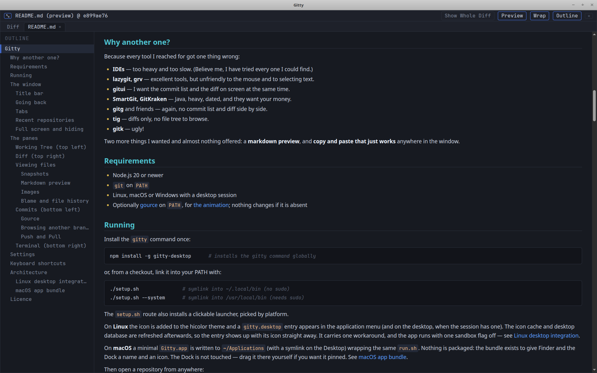
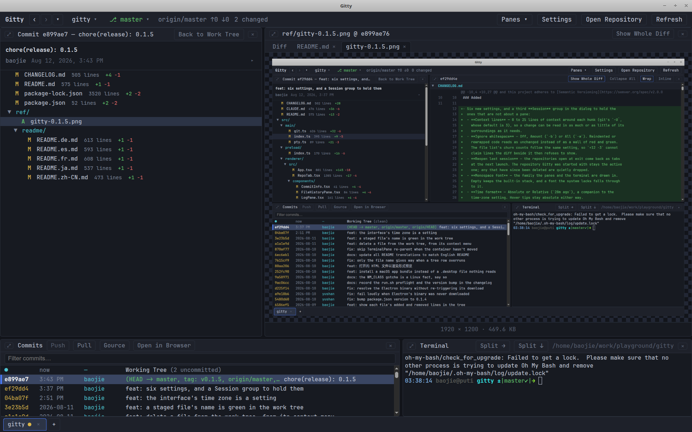
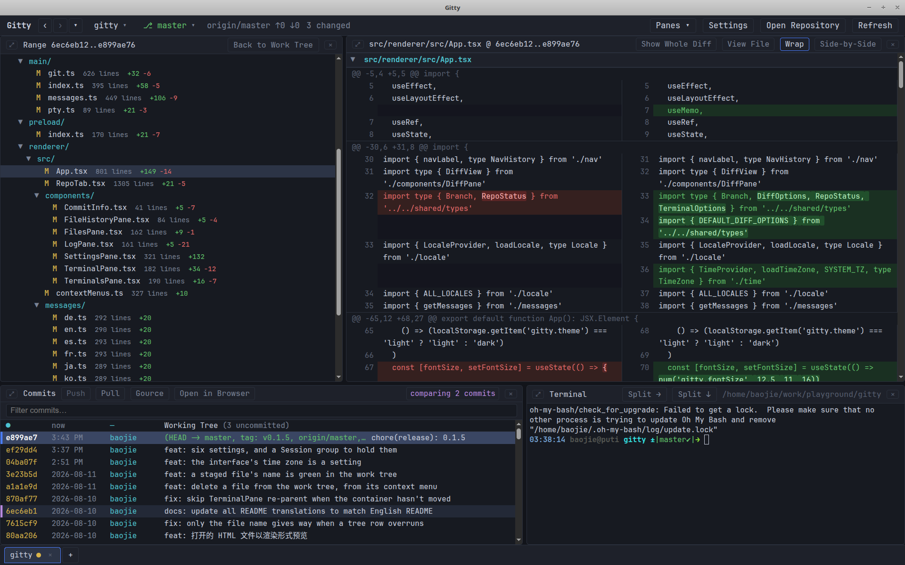

# Gitty 手册

[English](manual.md) · **简体中文** · [日本語](manual.ja.md) · [한국어](manual.ko.md) · [Français](manual.fr.md) · [Deutsch](manual.de.md) · [Español](manual.es.md) · [Русский](manual.ru.md) · [Português](manual.pt.md)

Gitty 做的每件事，逐窗格讲清楚。[README](../../README.md) 是简短版——它是什么、为什
么存在、怎么安装——并保持那样；细节都放在这里。

> **翻译于 2026-11-18，对应 Gitty v0.2.3。**
> [英文手册](manual.md) 是官方版本，也是唯一持续更新的版本。本文是那一刻的快照，两
> 者不一致时以英文版为准。界面本身全是英文，所以下文中的按钮名、菜单项一律保留原
> 文。

---

## 窗口 <a id="the-window"></a>

中间四个窗格，上方一条标题栏，下方一条标签栏。

### 标题栏 <a id="title-bar"></a>

从左到右，它先描述当前仓库，再对它动手：

- **Gitty** —— 最左边的图标和名字打开 **About** 对话框：版本、构建时间、作者，以及
  Electron、Chromium 和 Node 的版本，并带有指向主页和[键盘快捷键](#keyboard-shortcuts)
  的链接。
- **‹ › ▾** —— 你在这个仓库里去过的地方。见[后退](#going-back)。
- **仓库路径**是一个按钮：点开[最近仓库](#recent-repositories)菜单。
  [标签栏](#tabs)末尾的 **+** 和 <kbd>Ctrl+O</kbd> 打开的也是这个菜单。
- **⎇ 分支**也是按钮——显示 git 当前检出的分支，并给出其余分支的菜单供你阅读。见
  [浏览另一个分支](#browsing-another-branch)。
- **`origin/main ↑2 ↓0`** —— 当前检出分支的上游，以及领先、落后多少。分支没有跟踪
  目标时不显示。
- **`3 changes`** —— 工作区有多少个文件未提交，和提交窗格里 **Changes** 那行带的
  计数是同一个数。
- **Panes ▾** —— 显示或隐藏这四个窗格；见[全屏与隐藏](#full-screen-and-hiding)。
- **Settings** —— 首选项对话框（[设置](#settings)），也可按 <kbd>Ctrl+,</kbd>。
- **Refresh** —— 手动重新读取状态和日志（<kbd>F5</kbd> / <kbd>Ctrl+R</kbd>）。
  Gitty 会监视仓库并自动刷新；这个按钮留给监视看不见的情况——在 Linux 上，超过大约
  8,000 个目录的工作区只有一部分会被监视。

当你在读另一个分支时，分支按钮显示为 `⎇ main › other-branch`；上一条 git 命令的
错误会以红字出现在计数旁边。

### 后退 <a id="going-back"></a>

读历史就是到处逛：一个提交、里面的一个文件、往下翻两页日志后的另一个提交、再回到
第一个。标题栏最左边的三个按钮会记住这些脚步，就像浏览器的前进后退一样。

- **‹**（<kbd>Alt+←</kbd>）回到你看这一个之前的那个位置，**›**（<kbd>Alt+→</kbd>）
  向前回到你刚才离开的那个。无处可去时两者都会变灰，鼠标悬停时显示它会带你去的位
  置名称。
- **▾** 列出这些位置本身，最近的在最前面，你当前所在的那个旁边有个点。随便选一个
  就能直接跳过去。

一个*位置*包含了上方两个窗格所显示的一切：视图——未提交的改动、一个提交、两个提交的
区间、一个快照——其中选中的文件，以及 diff 旁边打开的文档。所以一个停留点读作
`Changes`、`7bb7787 — Refresh screenshot batches`、
`src/main/git.ts @ 7bb7787` 或 `blame: src/main/git.ts @ 7bb7787`，回到它意味着把
同一个文件以同一个版本放回屏幕，而不只是重新选中那个提交。

历史属于仓库，不属于窗口：每个标签页各自记住自己最近五十个位置，切换标签页就是切
换按钮漫步的是哪一组。历史不跨重启保留。

### 标签页 <a id="tabs"></a>

底部的标签栏容纳每一个打开的仓库——它的目录名、工作区有未提交改动时的一个黄点，以
及关闭用的 **×**。这个点统计 `git status` 报告的一切，包含未跟踪文件；而它真正的价
值在你*没有*在看的那些标签页上：当前仓库的标题栏已经写着 `3 changed`，而后台标签页
是完全隐藏的，于是这个点是「那边还有活儿没干完」的唯一信号。把鼠标停在标签上，会显
示仓库路径并用文字说明这一点。

**+**（以及 <kbd>Ctrl+O</kbd>）经由[最近仓库](#recent-repositories)菜单把另一个仓
库开进新标签页；标题栏永远显示当前那个。每
个标签页各自保有自己的窗格和终端，所以你正在读的提交、以及你留着跑的 shell，在你切
走再切回来时还在原处。把标签拖到栏里的另一个位置就能重排这些仓库。右键一个标签会给
出 **Rename tab…**——这个名字为那个仓库记住，显示在标签栏和标题栏上，真实路径仍留在
悬停提示里——**Open in File Manager**，打开仓库的根目录，以及 **Close repository**。
关掉最后一个标签页会留下一个空窗口和一个打开下一个仓库的按钮。

Gitty 退出时开着的标签页，下次启动时会重新打开——启动时指定的那个仓库仍然是当前标签
页，而其间已被删除的仓库会被悄悄略去。设置里的 **Reopen last session** 可以关掉这一
点。开着多个窗口时（**Instances: Multiple**），保留的是最后关闭的那个窗口的会话。

开着不止一个仓库时关闭窗口或退出，会先问一句，免得一次误按 <kbd>Ctrl+Q</kbd> 把整组
都带走。只开着一个仓库时直接关闭，不问。

### 最近仓库 <a id="recent-repositories"></a>

标题栏里的仓库路径是一个菜单，列出之前打开过的仓库——目录名加上它的父目录——最近的
在前。

- **点击** —— 在新标签页打开。
- **Ctrl/Cmd+点击**或**中键点击** —— 在当前标签页打开，替换掉那里的仓库，并保持标
  签在栏中的位置。
- 条目右侧的 **×** —— 把它移出列表；右键该条目也是同一件事。菜单会留着不关，所以可
  以连着删好几条。

菜单显示最近的十二个；底部的 **More…** 列出其余的。顶部的搜索框随着输入过滤整个列
表——每个词都得出现在仓库的名字或它所在的目录里，名字匹配的排在前面。
<kbd>↑</kbd>/<kbd>↓</kbd> 移动，<kbd>Enter</kbd> 在新标签页打开，
<kbd>Ctrl+Enter</kbd> 在当前标签页打开，<kbd>Esc</kbd> 关闭。

列表里没有匹配时，搜索会转向磁盘：Gitty 在你记住的那些仓库所在的地方找目录名相符的
仓库——它们各自的父目录，以及父目录的上一级（往下搜两层），所以 `~/work/<group>/<repo>` 不用配置
就能覆盖到——还有家目录下的常见位置（`~/work`、`~/code`、`~/src`、`~/projects`……）。
找到的会带着完整路径列在 *Is it one of these?* 下面，只有你选中时才打开；打开之后它
就加入列表。

**+** 和 <kbd>Ctrl+O</kbd> 打开的就是这个菜单，所以找仓库靠敲它的名字；再按一次
<kbd>Ctrl+O</kbd>，或者点 **Open Repository…**，就进到文件夹对话框。

**Open Repository…** 和 **Clear Recent** 在下方；Clear Recent 清空列表前会先问一句，
因为这一步没有撤销。列表存在 `~/.config/Gitty/recent-repos.json`，保留最近的一百个
仓库，并跳过那些已被移走或删除的。

### 全屏与隐藏 <a id="full-screen-and-hiding"></a>

每个窗格的标题栏都带着同样两个控件：左端的 **⤢** 让该窗格铺满窗口，右端的 **×** 把
它藏起来。

全屏会盖住其余一切，标题栏和标签栏也不例外，而底下的窗格照常工作——终端在被盖住期
间仍在运行。同一角上的 **⤡**、<kbd>Esc</kbd>、在标题栏的空白处双击（按钮，以及
Changes 窗格的标题菜单，各有各的含义），或者 <kbd>Ctrl+Shift+1</kbd> …
<kbd>Ctrl+Shift+4</kbd>，都能恢复布局。同一时刻只有一个窗格能全屏。

<kbd>Ctrl+Tab</kbd> 把全屏移到布局顺序里的下一个窗格，<kbd>Ctrl+Shift+Tab</kbd> 回
到上一个，跳过隐藏的，并在两端回绕。它只在某个窗格铺满窗口时起作用，那正是需要它的
地方：布局摊开时每个窗格本来就是一点即达。终端看不到这个键，所以在 shell 里也能用。

隐藏是另一个方向——任何窗格都能收起来再唤回：

- 标题栏里的 **Panes** 列出四个窗格，可见的那些旁边有个点；点一下切换，
  **Show All Panes** 恢复四窗格布局。
- <kbd>Ctrl+1</kbd> … <kbd>Ctrl+4</kbd> 依次切换 Files、Diff、Commits 和 Terminal。
- <kbd>Ctrl+Shift+0</kbd> 把四个全部带回——零代表「全都要」，比那四个各自切换的键
  多一个。它需要 Shift 是因为 <kbd>Ctrl+0</kbd> 是浏览器引擎的还原缩放，留在 View
  菜单里。

剩下的窗格会分掉整个窗口，所以隐藏提交窗格就把整个高度让给了 diff。最后一个可见窗
格没有 **×**——空窗口会让人无处可点。隐藏状态跨重启记住，而终端窗格只是被收起、从不
关闭：它的 shell 继续运行，回来时连滚动缓冲一起带回。

把分隔条拖到窗口边缘也能把一个窗格折走：两行之间的分隔条折掉那一行，而任一条竖直分
隔条折掉那一侧的窗格——空出的地方归邻居。把分隔条拖回来就恢复原来的划分。当窗口的某
一部分值得整个宽度或整个高度时，这很好用。

## 各个窗格 <a id="the-panes"></a>

### Changes（左上） <a id="changes-top-left"></a>

改动过的文件，呈可折叠的树，每个文件名旁边带着行数。浏览整个仓库——工作区或一个提
交的快照——打开时所有目录都折叠着，因为那是一棵要下钻的树，而不是一张要读的改动列
表；一张改动列表则打开即展开。每一层目录都排在文件前面，而每个组里的名字按读者期望
的方式排序，而不是按字节比较的方式：名字里的数字按数值算，所以 `W9` 排在 `W10` 前
面；大小写不是头等差别，所以 `butler/` 和 b 开头的排在一起，而不是排在每个大写字母
之后。

每个名字都带一个类型图标：形状是族类——源码、结构化数据、标记、样式表、散文、图片、
归档、shell 脚本、锁文件、编译产物——而颜色是语言，所以 `.ts` 和 `.py` 是同一个字形
的不同颜色。Python 是唯一被画成它自己的语言，用它自己的蓝与黄。Gitty 不认识的扩展名
得到一张朴素的纸，而不是一个猜测。

显示两列状态：暂存区状态（绿色）和工作区状态（黄 / 红）；未跟踪文件是 `??`。
行数在工作区从磁盘读取，其他情况从对应版本读取；没有行数可读的地方——二进制文件，
或超过 8 MB 的文件——这一行改为显示文件有多大，而已删除的文件什么都不显示。行数之后跟
着变更量（churn）——这个改动在这个文件里增删了多少
行，显示为 `+12 −3`：工作区里是与 HEAD 比较，提交或区间里是与父提交比较。快照是一
棵树而不是一次改动，所以没有变更量；二进制文件和合并提交也没有——合并 diff 不会把
改动归到具体文件。

在变更量的位置上，一棵树——Working Tree 列表和一个提交的快照——改为写出**最后提交每
个文件的人**：一次改动本来就属于某个人，而一棵树要问的是这是谁的文件。悬停名字可以看
到完整的句子。git 从没见过的文件没有这一项，所以未跟踪和被忽略的文件什么都不显示。

窗格的标题写着现在列的是什么，点它会打开一个菜单，里面是两个常驻视图：**Changes**，
未提交的那些；以及 **Working Tree**，磁盘上那个目录里的每一个文件，只读。屏幕上是哪
一个，哪一个就带对勾；从一个提交、一段区间或一个快照出发，同一个菜单也是回到两者的
路。

**Working Tree** 意味着每一个文件：`.gitignore` 覆盖的那些——构建产物、
`node_modules`，随便什么——和其余文件一样列出来，用暗淡的斜体；一个除了被忽略的文件
之外空无一物的目录同样暗淡。它们和别的文件一样能打开、能读；只是不给行数，因为数它
们意味着读遍一个通常是磁盘上最大的目录的每一个字节。`.git` 自己不列出来。

<kbd>Ctrl+B</kbd>——b 取自 browse——是从任何地方进到它的快捷键，而它不只是切换视图，
还把窗口摆成阅读的样子：Commits 和终端让开，只留下这棵树和它打开的东西。
<kbd>Ctrl+D</kbd> 是回来的路：又是那些改动，四个窗格齐全。在终端里那个键仍然是输入结
束，也就是离开 shell 的方式，所以这一对在其余任何地方都好用。两个键都写在窗格标题的
悬停提示里。

- **点击** —— 在右边显示该文件的 diff。
- **双击** —— 把整个文件作为文档开在 diff 旁边，带行号和语法高亮（Markdown 是渲染
  后的文档，图片则是图片本身）。
- **点击状态列** —— 暂存该文件；若已暂存则取消暂存。
- **右键** —— View File、Open in System App、Reveal in File Manager、Open Remote
  URL、Copy Relative Path、Copy Absolute Path、Copy File Name、Blame File、File
  History、Stage / Unstage File、Discard Changes、Delete File。子模块那一行还会多出
  **Pull Submodule**。
- **右键 → Open Remote URL** —— 这个文件在仓库所托管站点上的页面，在系统浏览器里打
  开。版本是正在看的那个——一个提交、一个快照——在 Changes 和 Working Tree 视图里则是
  当前检出的分支。地址和[提交菜单里那一条](#commits-bottom-left)一样从远端推出来，所以
  只在推得出来时才出现；未跟踪的文件、分离的 HEAD，或者还没 push 的提交都没有这一条
  ——站点上还没有它的页面。
- **点击文件夹** —— 折叠或展开。
- **右键文件夹** —— Copy Relative Path、Copy Absolute Path、Copy Folder Name，以及在
  Gitty 之外打开它的两种方式：**Open in Browser**，即浏览器自己的目录列表，和
  **Open in File Manager**。某个版本的快照列的是一棵不在磁盘上的树，所以只提供路径。
- **右键行下方的空白处** —— 在仓库根目录上 **Open in File Manager**（某个版本的快照里
  没有），有文件可粘贴时还有 **Paste**。

在文件管理器里复制的文件可以**粘贴进这棵树**：在行下方的空白处右键得到 **Paste**，
写进仓库根目录；在某个文件上右键得到 **Paste into `dir`/**，写在它旁边。焦点在这个窗
格时，<kbd>Ctrl+V</kbd> 做同一件事——写进选中文件所在的目录，没有选中时写进根目录。
剪切的文件是被移动而不是复制，而目录里已经有的名字会被问一次：两个都留（到达的那个
名字后面加 `(copy)`），还是替换。

粘贴属于那两个*就是*磁盘上那个目录的视图——**Changes** 和 **Working Tree**。一个提
交、一段区间或某个版本的快照，列的是一个并不在那里、写不进去的东西，所以不提供粘贴。

按下 <kbd>Ctrl+F</kbd>（焦点在这个窗格时），或者用标题栏搜索按钮上的 **Filter**
——那个按钮旁的箭头在「搜索仓库」和「过滤这个列表」之间选——会在树上方打开一个过滤
框，把树收窄到含有你所输入内容的路径，并给出还剩多少个、共多少个文件。你输入的是一
个**正则表达式**——`\.tsx?$`、`main|renderer`——拿整条路径来匹配，所以 `src/main` 会保
住那个目录下的一切，且不区分大小写。普通文本就是一个表示它自己的表达式；而还不能编译
的表达式（`src/(`，`src/(main|renderer)` 打到一半）会被按字面匹配，而不是报成错误。
框里有内容时不会有目录保持折叠——藏在五层之下的匹配正是你打字的目的。<kbd>Esc</kbd>
或 **✕** 清掉它并把整棵树放回来，换到另一个提交也一样。

<kbd>Ctrl+E</kbd> 回答的是另一个问题——不是「收窄这里列出的东西」，而是「把那个文件给
我，不管它在哪」。它从任何地方都能在窗口上方打开一个框，不需要哪个窗格有焦点，列出的
是整个工作目录而不是屏幕上的那棵树：`git` 会点名的每一个文件，`.gitignore` 覆盖的那些
除外，所以 `node_modules` 埋不掉答案。字母**按顺序、但不必相邻**地匹配——`dfpn` 能找到
`DiffPane.tsx`——排序偏好落在词首的字母（一个路径段的开头，或 `-`、`_`、`.` 之后，或
小写转大写的地方）、落在文件名而不是上层目录里的字母，以及连在一起的字母；路径更短的
在平局时胜出。<kbd>↑</kbd> <kbd>↓</kbd> 挑选，<kbd>Enter</kbd> 把文件作为文档开在
diff 旁边，<kbd>Esc</kbd> 关闭这个框。即使屏幕上是一个提交，文件也按磁盘上的样子打
开，因为框里列的就是工作目录。这个键在终端里也管用，shell 不会收到它——不像
<kbd>Ctrl+D</kbd>，它仍然是输入结束，因为那是离开 shell 的方式；readline 的行尾也可以
用 <kbd>End</kbd>。

**Pull Submodule** 出现在 `.gitmodules` 点名的那条路径上，在那两个就是磁盘上目录的视
图里——**Changes** 和 **Working Tree**。它抓取那个子模块自己的远端，并把它移到它所跟
踪的分支的顶端（`git submodule update --init --remote`），所以一个从未检出过的子模块
也由同一条菜单项克隆下来。父仓库仍然指着它记录的那个提交，这也是为什么子模块随后会出
现在 **Changes** 里：提交这个新指针仍然是你的决定。git 说了什么，落在提交日志上方那
条消息栏里，也就是 push 和 pull 汇报的地方。

**Discard Changes** 把文件放回 index 所持有的样子，之前会弹出一个系统确认框，直说没
有撤销；未跟踪的文件没有可回的 index 版本，所以它提供 **Delete File**，把文件丢进系
统回收站。

在提交日志里右键工作区那一行，还会提供 **Copy Staged Diff**，供在另一个窗口里进行的
对话使用。

选中一个提交或一段提交区间时，这个窗格改为列出那个提交涉及的文件；
**Back to Changes**（或 <kbd>Esc</kbd>）回到未提交的改动。在[快照](#snapshots)里，
它列出的是那个提交处的整棵树，而不只是改动过的部分。浏览工作区没有这样一个按钮——把
它打开的那个标题选择器，也是离开它的路。

### Diff（右上） <a id="diff-top-right"></a>

统一格式 diff，带新旧行号、hunk 头和增删着色，按文件列表排布：每个路径是一条通栏标
题，hunk 头是暗的——那是行号范围，不是该先看的东西——重命名显示为 `old → new`。没有
选中文件时，它一次显示全部：工作区里每一处未提交改动，或者选中提交里的每个文件。

- **Show Whole Diff** —— 挑过某个文件之后，回到那份合并的 diff。它常驻在标题栏里，
  当屏幕上正是整段 diff 时会亮起。工作区版本同时涵盖已暂存和未暂存的改动，并内联未
  跟踪文件（最多 50 个，之后给一条提示），这些是单靠 `git diff` 看不到的。
- **Wrap** —— 长行折行，而不是横向滚动。默认开。
- **Inline** —— 一个和 **Wrap** 一样的开关：按下时单栏加 `+`/`-` 标记，浮起时新旧
  并排；并排时一连串删除行会和紧随其后的新增行配对。折行后的两半仍保持对齐。
- **文件标题** —— 每条标题都能折叠它的文件：三角形把它收成只剩文件名，标题栏里的
  **Collapse All** / **Expand All** 一次搞定全部。**Ctrl+点击**标题会把那个文件开进
  新文档标签；右键它可以得到 **Open in a New Tab**、**Select in the File List**、各
  种路径复制，以及——在工作区里，也就是磁盘上的文件正是所显示版本时——
  **Open in System App** 和 **Reveal in File Manager**。重命名打开的是新路径。
- **Stage / Unstage** —— 当 diff 是某个已跟踪文件的改动时，每个 hunk 头都带一个按钮，
  把那个 hunk 放进 index，或再取出来。先选中行，按钮就变成 **Stage 3 lines**：未被选
  中的新增行被排除在补丁外，未被选中的删除行被降级为上下文行，hunk 头也会重算——这正
  是 `git add -p` 做的那种切分，只不过是在一个整份文件摆在眼前的窗口里。选区就是普通
  的文本选区，所以拖动仍然是在复制。跨两个 hunk 的选区会分别给它们各自的一部分。
- **Unstaged / Staged** —— 文件正从 index 的哪一侧被读取，两侧都有内容时显示。暂存作
  用于屏幕上当前显示的那一侧。二进制文件、模式变更和重命名没有可挑的 hunk，要从文件
  列表整体暂存；开启 **Ignore whitespace** 时 hunk 按钮也会消失，因为那份 diff 并不
  包含它会应用的每一处改动。
- **右键** —— Copy Selection、Copy Whole Diff，以及同样那些开关。

当逐词比整行更好读时，改动行内变化的词会被高亮；它是[设置](#settings)里的
**Word highlight**。

设置在多次运行之间记住。行以 1500 为一块渲染并随滚动延伸，所以大提交也不卡；超过
2 MB 的 diff 会被截断并给出提示。

### 查看整个文件 <a id="viewing-files"></a>

窗格默认显示的是 diff，但任何文件都能整个打开：在树里**双击**它，用标题栏的
**View File** / **Preview**，在 diff 里 **Ctrl+点击**文件标题，或者从两个右键菜单里
取用。

文件会作为独立文档开在 diff *旁边*的一条标签里，而不是盖在它上面，所以读文件不必丢
掉你正看的 diff。**Diff** 标签永远排第一，而在树里单击仍然是就地浏览 diff。每个文档
记住自己被打开时的版本，用自己的 **×** 关闭，并在仓库变化时重新读取工作区文件。
**右键**一个文档的标签，得到的菜单和它那一行在文件树里的一样；列表里没有的文件——比如
Changes 视图里一个没改动的文件——得到 Working Tree 里的那份菜单，只是没有暂存、丢弃和
删除。源码文件带行号和语法高亮；Markdown 打开时是[渲染好的](#markdown-preview)，可切回源码；
HTML 同样[渲染出来](#html-preview)；图片则作为[图片本身](#images)打开。

拿到哪个版本取决于窗格所处的位置：工作区里是磁盘上的文件，其余情况是所选提交处的那
个版本。打开文档是一个动作而非一种模式——选择另一个文件或另一个提交就会把 diff 放回
来——所以窗格绝不会在你想看改动时卡在文件上。

#### 源码文件的大纲 <a id="the-outline-of-a-source-file"></a>

源码文件带一个 **Outline** 按钮，和渲染文档用的是同一个：文件里的类、函数和成员作为
一棵树排在旁边，按嵌套缩进，按各自声明的东西着色。点一条就跳过去——文件会画到足够深
以容下它，无论多深——你滚到的那一条会被标出。拖分隔条可以给两边各多一点地方；这个宽
度由仓库里所有文件共享。

它能读十六种语言——C、C++、C#、Go、Java、JavaScript、Lua、Perl、PHP、Python、Ruby、
Rust、shell、Swift、TypeScript，以及后两者的 JSX 变体——而且是靠识别声明来读的，不
是靠解析：先把注释和字符串抹平，嵌套来自花括号深度（在以缩进书写的语言里则来自缩
进），名字只在关键字把它放在那里时才出现。其余的——数据格式、样式表、它不认识的语言
——不给出猜测的列表，而是干脆不显示这个面板。Markdown 有[自己的大纲](#markdown-preview)，
来自它的标题。

#### 快照 <a id="snapshots"></a>

右键一个提交，选 **Browse Snapshot**，就能按那个提交当时的样子阅读整个仓库：左上窗
格列出*整棵*树，而不是该提交碰过的文件，随便挑一个文件都会以那个版本打开。快照没有
diff 可显示，所以那里每个文件都是文档。

快照里的文件在那个版本从未存在于磁盘上，因此 **Open in System App** 交出去的是它的
一份临时副本，而 **Reveal in File Manager** 干脆不提供。
**Back to Changes**（或 <kbd>Esc</kbd>）离开快照。

git 记为可执行的文件——模式 `755`——还会多出 **Run in the Terminal**。选它会把那个提交
检出到一个临时目录，并往终端窗格里敲进 `cd <那个目录> && ./<文件>`，于是程序按它当时
的样子运行，身边是它当时的邻居而不是今天的。这一行只是被敲进去：按下 <kbd>Enter</kbd>
是你的事，不按就什么都不会跑。终端窗格若被隐藏，会被带回来。浏览工作区时也有同一条菜
单项，而且不需要副本——命令就在仓库自身里运行。

那个临时目录是一个真正的链接工作区（`git worktree`），以分离头指针停在那个提交上，所
以一个去问 git 自己身在何处的程序能得到答案；它有自己的 index 和 HEAD，在那里运行的
任何东西都不碰你的检出。这也意味着 `.git/worktrees` 下有一条注册，`git worktree list`
看得到，而 Gitty 会随手清理；检出本身按提交保留，所以从同一个快照再跑第二个东西是立
刻的。一个树超过 256 MB 的提交会被拒绝而不是检出——这条菜单项是用来跑一个脚本的，不
是用来把一整个仓库的二进制文件写进临时目录的。

#### Markdown 预览 <a id="markdown-preview"></a>

选中 `.md` 文件会多出一个 **Preview** 按钮——默认关闭，所以在你开口之前 diff 仍然是
diff。它把文件作为整体渲染：工作区里是磁盘上的版本，其余情况是所选提交处的版本。

围栏代码块在注明语言时会有语法高亮，YAML front matter 被单独摘出、作为自己的高亮块
显示，而标题层级、列表标记、链接和行内代码都有配色，让结构一眼可辨。

- **Wrap** —— 和 diff 那个是同一个开关，默认开。散文永远折行；在预览里，这个开关决
  定围栏代码块、宽表格和长的行内字符串是否也折行，而不是横向滚动。
- **表格列宽** —— 表格的列按内容定宽，每条边界都能拖：抓住表头单元格的右边缘，那一
  列就跟着指针走，其余各列保持原来的宽度。比窗格还宽的表格横向滚动。双击一条边界把
  表格交还给浏览器，也就是回到贴合内容的宽度。列宽在文档开着期间一直保留。
- **Outline** —— 文档旁边的标题结构，按层级缩进，跟随你滚动到的标题。点一条即可跳
  转，拖动它和文档之间的分隔条可以给任一侧更多空间。这个宽度由仓库里的每个文档共
  享——它是阅读偏好，不是单个文件的属性——和其他窗格的尺寸一样，随窗口存续。
- **Source lines** —— 默认关闭，在[设置](#settings)里打开：每个标题、段落、列表项、表
  格、围栏代码块和图片都会在左侧行号槽里标出它在源码里起始的那一行。数字是画出来的而
  不是插入的，所以它们不会进入你复制的选区，也不会进入 <kbd>Ctrl+F</kbd> 搜索的内容。
  当文档正是屏幕上那个 diff 所针对的文件时，diff 插入或改动过的块，其行号画成绿底绿
  字——就是 diff 自己给 `+` 行上的颜色——这样行号槽就映照出 diff 说过的话。一个块只要
  它跨的任何一行改过就算改动，所以改过的围栏代码块即使开头那行没动也会被标出来。
  写进句子里的图片取它所在段落的那一行，因为它自己没有行号。
- **<kbd>Ctrl+F</kbd>** —— 在文档里查找；见[查找文本](#finding-text)。
- **右键** —— Copy Selection、Copy Markdown Source、折行与大纲开关，以及
  Show Diff Instead。

Markdown 里的原始 HTML 不会被渲染，指向网络的链接在系统浏览器里打开，而不是应用内。
指向仓库里另一个文件的链接——`ref/readme/manual.md`、`../README.md`、`/CHANGELOG.md`
——反而会在这里被跟随：**Ctrl/Cmd+点击**把那个文件作为 diff 旁边的独立文档打开，版本
与持有该链接的文档相同，所以在旧提交读到的 README 会带你到那个提交的文件。末尾的
`#fragment` 会跟着走——`manual.md#the-window` 会把手册打开到那个标题，就像在 forge 上
那样——而这个文档没有的标题就只是把它打开到顶部。悬停这样的链接会说明这一点。普通点击
和以前一样什么都不做，而越出仓库根目录的链接不属于这一类。

指向一个目录的链接——`src/`、`ref/spec`——则改为把文件窗格打开在那个文件夹上，版本相
同：从磁盘读的文档给工作区，在某个提交处读的文档给那个提交的快照。

相对于文档写的图片路径会从仓库里读出来——版本与文档相同，所以旧提交显示的是它当时随附
的截图。仓库在那个版本没有的图片，留下一个带 alt 文本的虚线占位框。网络上的图片根本不
会去取：读别人的 README 不该向对方的主机报到。



#### HTML 预览 <a id="html-preview"></a>

`.html`、`.htm` 或 `.xhtml` 文件得到同样的 **Preview** 按钮，文档被渲染出来而不是显
示为源码——工作区里是磁盘上的版本，其余情况是所选提交处的版本。

它渲染在一个通过 `srcdoc` 载入的沙箱 frame 里，所以页面永远无法把应用从自身导航走。
它自己的样式表会生效——布局、颜色、字体都是文档的。脚本不运行，远程图片也不抓取：
frame 继承应用的内容安全策略，而它两者都不允许。页面是被显示，不是被执行。**Wrap**
决定 frame 自己滚动，还是长到内容那么高、让页面作为整体滚动。<kbd>Ctrl+F</kbd> 和
<kbd>Ctrl+Shift+C</kbd> 在 frame 内管用，而 frame 里的按键永远不会到达窗口其余部分。

#### JSON <a id="json"></a>

`.json`、`.geojson`、`.topojson` 或 `.webmanifest` 文件按它存储的样子打开，并在
**Wrap** 旁边多一个 **Format** 按钮：按下后，文档按每层两个空格重新缩进，于是一个压
缩成一整行、长得没有尽头的文件读起来就是一棵树。再按一次回到文件存储的样子。

文档处于格式化状态时，每个有内容的对象和数组在行号旁都带一个 **▼**：点它把那个节点折
起来，它开头的那一行留一个 **…** 表示少了东西。点它变成的 **▶** 再展开。折叠可以嵌套，
所以一个折在另一个里面的节点，在父节点展开时仍然是折着的；<kbd>Ctrl+F</kbd> 搜的是屏
幕上的内容——折起来的节点那些行根本没有渲染。打开另一个文档，或者仓库变化后重新读取
工作区文件时，什么都不会保持折叠：一个折叠所指的那些行，可能已经不是那些行了。

变的只有记号之间的空白。数字保留文件里写的那些位数——长得双精度装不下的值、大得过头的
指数——键保持原来的顺序，重复的键也留着。只有文本能解析为一个完整的 JSON 文档时才会出
现这个按钮，所以满是占位符的模板，或者下载到一半的文件，什么都不提供，而不是给一个按
了没用的按钮。格式化是读文件的一种方式；什么都不会写回去。

#### 图片 <a id="images"></a>

`.png`、`.jpg`、`.gif`、`.webp`、`.bmp`、`.ico`、`.avif` 或 `.svg` 打开时是图片本
身，而不是一句「这是二进制文件」——工作区里从磁盘取，其余情况从提交里取。它被适配到
窗格大小，衬在棋盘格上，所以透明就看得出是透明；**点击**它切到原始尺寸并可滚动查
看，再点一次回到适配。像素尺寸和磁盘占用写在下方。超过 12 MB 的图片不内联。



#### PDF <a id="pdfs"></a>

`.pdf` 打开时就是文档本身，由浏览器引擎自带的查看器来读：侧边的页面列表、缩放、旋转、
它自己的查找，以及打印或另存一份的按钮。在某个版本上也一样——提交快照里的 PDF 从 git
里读出来，所以一篇论文的旧版本不用检出任何东西就能按当时的样子读。文件大小写在下方。
超过 64 MB 的 PDF 不打开；查看器自己工具栏上的名字不是文件名，上方的窗格标题才是。

#### 用 Git LFS 存储的文件 <a id="files-stored-with-git-lfs"></a>

由 [Git LFS](https://git-lfs.com/) 跟踪的文件，在仓库里本身只是一个三行的指针，真正的
文件放在旁边的存储里。Gitty 会顺着指针去取，所以一个 LFS 跟踪的图片或 PDF 和别的文件
一样能预览——在某个版本上和在工作区里都行，也不管机器上装没装 `git lfs`。对象还没被抓
取时，窗格会直说，而不是显示一张破图或查看器报错。`git lfs pull` 把它取下来，预览随
后就能用了。树里文件旁边的大小仍然是指针的大小，因为那才是仓库实际存储的东西。

#### Blame 与文件历史 <a id="blame-and-file-history"></a>

在树里右键任何文件，选择 **Blame File** 或 **File History**；两者都作为 diff 旁边的
文档打开。Blame 每行源码一行——提交、作者、日期以及行本身，像代码查看器一样高亮，尚
未提交的行显示为 em dash——在你正在查看的版本上。File History 列出碰过这个文件的每一
次提交，并跟踪重命名；日期和作者之间有一列写着文件在那次提交时有多长，算不出来的地方
则写它有多大——二进制版本，以及比它更早的一切。它的行和提交日志的行一样操作：单击选
中一个，双击打开那个提交，Shift+点击第二行则在两个版本之间 diff 这个文件——和日志里
第二次选取打开的是同一种区间视图，并且已经选好了这个文件。

右键一个 blame 行会提供 **History of These Lines**：对选区覆盖的行——没有选区时就是被
点击的那一行——运行 `git log -L`，它会作为自己的文档打开，显示每个碰过这些行的提交，
以及它对它们做了什么。Blame 回答*谁最后改的*；这个回答*它怎么会变成这样*。它自己会
跨重命名跟踪这个范围。

#### 搜索仓库 <a id="searching-the-repository"></a>

Changes 窗格标题栏里的 **Search** 会在文件列表上方打开一个框，并运行 `git grep`。它
旁边的箭头能把这个按钮切成 **Filter**，改为收窄文件列表；你选的那个会保持选中，而两
个框一次只开一个。结果是一份按文件分组的文档，行号在左侧；点一条会在那一行打开那个
文件，并标出那一行。

搜索跟随屏幕上显示的版本：在工作区里它读磁盘上的内容，未提交的改动也算在内；在提交
或快照里它读那个版本——框里会说明是哪个。超过 2000 条命中它就停下并说明，和过大的
diff 一样。

这个框收的是一条查询，而不是一个光秃秃的模式，形状是邮件客户端教会所有人的那种：

| 输入 | 找到 |
| --- | --- |
| `foo bar` | 同时含有这两个词的行 |
| `"foo bar"` | 这个短语，连空格一起 |
| `-foo` | 不含它的行 |
| `foo in:*.py` | 只在匹配该 glob 的文件里；要几个就写 `in:*.py,*.pyi` |
| `foo -in:test/*` | 把那些文件排除在外 |
| `foo in *.py` | 和 `in:` 一样——不带冒号时，只有后面跟着路径才读作这个操作符，所以 `for x in list` 仍然是四个词 |

加引号会关掉这些操作符，`"in:*.py"` 就是这样按字面搜索的。每一个词项、每一个 glob 都
作为自己独立的参数到达 git——不会把任何东西拼进命令行——所以正则表达式不会在路上被拆
开。一条只说了去哪里找、却没说找什么的查询（只有 `in:*.py`）不会运行；消息条会说没有
可搜的东西。

### Commits（左下） <a id="commits-bottom-left"></a>

当前分支的日志，一次加载 300 条并随滚动延伸。第一行是 **Changes** —— 未提交的改动，
带改动文件数；选中它会把上方两个窗格带回这些改动。标题栏右侧的 **Filter** 会在日志上
方打开一个过滤框，把列表收窄——带防抖，结果同样按页加载。✕、<kbd>Esc</kbd> 或再按一次
那个按钮，会收起这个框并把整份日志放回来。

标题栏留着 **Push** 和 **Pull** 这两个常用的；关于日志的其余一切都在 **⋯** 后面一击
——**Graph**、**All Branches**、装了才有的 **Gource**，以及 **Open in Browser**。那两
个开关开着时，在菜单里带一个圆点。

**Graph** 在哈希旁边画出那些连线（lane）：分支在哪里岔开，merge 在哪里落地，一个提
交属于哪条线。它是从每个提交的父提交算出来的，而不是解析
`git log --graph`——那个 ASCII 是为终端排版的。一条连线在页面上保持自己的颜色，而调
色板是固定的——故意和 blame 不同，blame 的颜色由 SHA 派生、表示「是谁」。超过十条连
线后，溢出的共享最后一列、套着圆环，所以有很多头（head）的仓库也没法把提交标题挤下
窗格。**All Branches** 一次显示所有分支（`git log --all`），这样两个分支的相互关系就
能被看到；分支菜单仍然一次只读一个。

日志按**作者日期**排序，也就是那一列里显示的日期，所以一个被重放而不是被写下的提交
——rebase、cherry-pick、从 squash 过的 pull request 合入——读起来落在它被写出来的那些
日期之间，而不是它落地的那一天。任何排序都改不了的是：父提交永远画在子提交下面，所以
这样的提交仍可能坐在比它更早的行之间；发生这种情况时那个日期会被标出，悬停提示会说明
原因。在过滤之下这个标记关掉：那时上面那一行并不是这一个之前的提交，所以日期往回走只
说明中间那些行没有匹配上。

选中一个提交会**按血缘给日志上阴影**：它所建立于的那些行、以及建立在它之上的那些行保
持原样，其余一切退到后面。这正是位置无法显示的那一种关系——正上方那一行可能属于另一条
分支，而一个父提交可能坐在一百行以下。这次行走覆盖已经加载的部分，所以一条越过最后一
行的血缘只显示到日志所能及的地方；在过滤之下，行是一个子集、它们之间的链条又缺着，所
以什么都不上阴影。

它旁边的下拉框说明正在搜什么：

| | |
| --- | --- |
| **Message / Author** | 提交消息和作者，大小写不敏感，按扩展正则表达式解释——`fix\|revert` 就是这两个词中的任一个。默认。 |
| **Content** | git 的 `-S`：那些文本*出现次数*发生变化的提交——即文本被引入或被删除的地方。字面量，所以满是 `.` 和 `(` 的搜索就表示那些字符。 |
| **Content regex** | git 的 `-G`：每个 diff 匹配该表达式的提交——和上面那个模式一样是扩展正则——包括那些只是把这一行挪来挪去的提交。 |

还不成其为表达式的文本——`(fix`，正打向 `(fix|revert)` 的路上——在两个表达式模式里都
按字面搜索，这样一个每敲一下就被读一次的框，不会在你还没打完时就把日志清空。

这两种内容模式回答 blame 答不了的问题——*是哪次提交引入了这一行*——为此它们要读历史
里的每一个 diff，所以运行期间框里会显示正在搜索。改文本或改模式会杀掉仍在进行的搜索；
不会把任何东西拼进命令行，所以正则表达式以单个参数到达 git。

- **点击**或 <kbd>Enter</kbd> —— 显示那个提交：它的文件填满左上窗格，它的完整 diff
  填满右上窗格。提交的 subject、作者、日期和完整正文显示在文件列表上方的一个信息条
  里；正文太长时，▸ 开关可以把它折起，把空间留给文件列表。
- <kbd>Shift+点击</kbd> 或 <kbd>Space</kbd> —— 选第二个提交并比较两者，旧的在前。
- **Ctrl+点击**（macOS 上是 <kbd>Cmd</kbd>）—— 打开这个提交在托管仓库的站点上的页
  面，地址和下面的 **Open Remote URL** 是同一个。推不出这样一个页面时，这次点击什么
  也不做，那一行保持原样。
- **↑ ↓ / j k / PgUp / PgDn / Home / End** —— 移动光标。
- **右键** —— 显示 diff，复制哈希、短哈希或标题，[浏览快照](#snapshots)，或者与当
  前选中的提交比较。
- **右键 → Open in Browser** —— 在系统浏览器里渲染这个提交；**Copy Commit URL** 复
  制链接。应用内部有一个 web 服务器，把每个打开的仓库作为可浏览的提交列表提供出去
  ——提交窗格的 **Open in Browser** 按钮就落在那里——每个提交有自己的元数据、文件列
  表和 diff，单个文件的 diff 也只差一次点击。
- **右键 → Open Remote URL** —— 这个提交在仓库所托管站点上的页面，在系统浏览器里打
  开。地址是从远端推出来的（当前分支跟踪的那个，否则是 `origin`），而这一条只在推得
  出来时才出现：GitHub、GitLab、Bitbucket、Gitea、Forgejo、Codeberg 和 sourcehut 都
  认识，任何遵循 `/commit/<hash>` 布局的自建站点也一样。没有远端的仓库，或者放在
  Azure DevOps 上的仓库，得不到这一条；还没 push 的提交也得不到——Ctrl+Click 也不会
  打开它的页面。

  它监听 `127.0.0.1`，而仅凭这一点算不上什么：loopback 挡住的是别的机器，挡不住你
  自己浏览器里的别的页面，它们任何一个都能抓取它。所以每个 URL 都带一个启动时生成、
  保存在内存里的 token——`/t/<token>/…`——Gitty 交给你的链接里已经有它。错误的 token
  是 404 而不是 403，`Host` 不是 loopback 的请求会被拒绝（这正是 DNS rebinding 变得
  无意义的原因），页面以 `Referrer-Policy: no-referrer` 提供，所以顺着提交消息里的链
  接点出去也不会把 token 带走。token 每次启动都是新的，所以这些 URL 只在本会话运行期
  间有效。
- 在左上窗格选中一个文件会把 diff 收窄到那个文件；**Show Whole Diff** 再把它放回
  去。



#### Gource <a id="gource"></a>

如果 [gource](https://gource.io/) 在 `PATH` 上，提交窗格标题栏的 **⋯** 菜单里会多出
一条 **Gource**：它把仓库历史播放成动画——目录树生长，每次提交落地时文件
亮起，日志中每个名字对应一个作者在文件间飞来飞去。Gource 打开自己的窗口，在你关掉
Gitty 之后继续运行；这一条只等足够确认它已启动的时间，如果没启动成就显示 gource 说的
话。

启动时每天历史占半秒，空闲文件留在屏幕上，长间隔被跳过——这才是让真实仓库可读而非缓
慢滴淌的配置。不会替你安装任何东西：gource 不在 `PATH` 上时，这一条干脆不出现。

#### 浏览另一个分支 <a id="browsing-another-branch"></a>

标题栏里的分支会打开一个菜单，列出每个本地分支和远程跟踪分支，最新提交的在前，选一
个就改为显示那个分支的历史。这是只读的一瞥：gitty 不跑 `checkout`，所以工作区、它的
diff 和终端全都停在 git 留下的地方。你在看另一个分支时，标题栏读作
`⎇ main › other-branch`，提交窗格会说明自己正在列哪个分支；**Back to \<branch\>**
返回。这两个名字各有自己的悬停文字说明哪个是哪个——毕竟这个区分正是这个功能的全部意
义。每个标签页各自浏览各自的。

#### Push 与 Pull <a id="push-and-pull"></a>

**Push** 和 **Pull** 位于标题栏，无论日志指向哪个分支，两者都作用于已检出的那个分
支。**Push** 会数出还没推的提交数——**Push 3**——没有东西可推时变灰；在一个没有跟踪目
标的分支上，它会把该分支发布到 `origin` 并设置上游。**Pull** 从上游做快进，没有上游
可拉时变灰。两条分支分岔时快进不可能，Gitty 会问要不要改用 rebase 来拉——把你本地的提
交重放到上游之上。拒绝就让仓库保持原样，并显示 git 的那句拒绝；接受则需要一个干净的工
作区，而冲突会让 rebase 停下来，由你在终端里收尾。git 说了什么就显示在日志上方——点一
下消掉；失败的会一直留到你消掉为止。

两者都无法回答提示：它们背后没有终端，所以一次要密码或口令的 push 会带着 git 自己的
消息失败，而不是挂在那里。之后这两件事都在终端窗格里手动收尾——它就在旁边。

### Terminal（右下） <a id="terminal-bottom-right"></a>

一个真正的交互式登录 shell（`$SHELL`），根在仓库目录，所以任何 git 命令都能直接跑。
<kbd>Ctrl+Shift+C</kbd> 复制终端的选中内容——<kbd>Ctrl+C</kbd> 在那里是中断，也始终
保持是中断。同一个组合键在其余每个窗格里也是复制，所以它不会随着焦点移动而改变含
义。仓库在磁盘上变化时，其余窗格自动刷新。它启动哪个 shell、是否作为登录 shell，都
是[设置](#settings)；两者在创建终端时读取，所以改动在下一次分裂时生效。

这个窗格能分裂成任意多个 shell：**Split →** 在聚焦的终端旁边放一个新的，
**Split ↓** 放在它下面，它们之间的分隔条和其他窗格一样可拖动。点一个终端即聚焦
它——带轮廓的那个就是下一次分裂或 **Close** 落点。朝同一方向连分两次会延长这一行或
这一列，而不是嵌套，所以三个并排的终端是彼此互调大小的。

**Close** 结束聚焦的那个 shell；用 `exit` 离开一个 shell 也会自行关掉它那一格。最后
一个终端始终留着：退出它只会在屏幕上留下提示，而不是一个空窗格。

这个窗格标题栏里的 **Send** 把 index 交出去。它往聚焦的那个 shell 里敲一条命令并按下
回车，就只做这些：Gitty 内部不调用任何模型，你没有送出去的东西不会离开这台机器。
agent 的提示和输出出现在终端里，那里有真正的 tty，所以 hooks 和 gpg 签名照常工作。

按钮左边那个框写着它会运行的命令，也是换一条命令的地方——没有对应的设置项，因为这是
一个每次交接问一次、而不是每次安装问一次的问题。下拉框列出 Gitty 记住的命令，最近运
行的在最前，点哪条就运行哪条；一条命令运行过就挪到最前，所以框里显示的始终是上次用
的那条。一条都没记住时，框是灰的，**Send** 也变灰。条目右侧的 **×** 在确认后把它移
出列表——列表是唯一记录命令的地方，而菜单保持打开，所以能连着删掉几个。底部的
**New command…** 打开一个单行输入框，预填当前命令，用来填列表里没有的。列表起步是几
条建议——装了哪个 agent 不是 Gitty 能知道的——而一条命令要真的被运行过才会加入列表，所
以半打好的行不会被记住。

## 查找文本 <a id="finding-text"></a>

<kbd>Ctrl+F</kbd> 搜索右侧窗格显示的任何内容：diff、文件、渲染好的 markdown 文档、
[HTML 预览](#html-preview)、blame，或文件历史。焦点在文件树上时它做的是另一件事——过
滤那棵树，见 [Changes](#changes-top-left)。每个匹配都被高亮，当前那个被挑出来，
<kbd>Enter</kbd> 和 <kbd>Shift+Enter</kbd>（或方向键）在它们之间走动并在两端回绕，计
数告诉你所在位置，<kbd>Esc</kbd> 关闭。

搜索大小写不敏感，读的是渲染后的文本而非背后的标记——所以一个短语能跨 markdown 留在
其中的加粗和代码片段找到，diff 也按你看到的那些行来搜。随滚动分块渲染的视图（长文
件、大 diff）在搜索条打开时会渲染其余部分，所以计数覆盖的是整份内容，而不是目前滚到
的那部分。多文件 diff 里折叠起来的文件保持折叠，不会被搜到。

## 设置 <a id="settings"></a>

标题栏里的 **Settings**，或 <kbd>Ctrl+,</kbd>。这里的一切对每个标签页都生效，并跨重
启记住；**Restore Defaults** 把它们全部还原。对话框分三栏——**Appearance**、**View**
和 **Session**——所以即使内容增长也保持一屏装得下；下表按这个顺序列出。

| | |
| --- | --- |
| **Theme** | Dark 或 Light。 |
| **Language** | English、简体中文、日本語、한국어、Français、Deutsch、Español、Русский 或 Português——界面、菜单和对话框一起切换，无需重启。 |
| **Time zone** | 屏幕上每个日期和时间以哪个时区渲染：默认是机器自己的，或 UTC，或系统认识的任何时区。git 给每个提交记录作者的偏移量，所以时间戳永远是时区选择——就在这里做。日志的日期列跟随它，也就意味着「今天」和某个日期的分界也随之移动。 |
| **Time format** | Absolute（一个钟点或一个日期）或 Relative（`28m ago`、`2h ago`）。Relative 完全绕开时区问题；行的悬停提示无论如何都保持绝对，并标明时区。 |
| **Font size** | 9 – 20，以半磅为步长。作用于每个窗格，终端也算在内。 |
| **Monospace font** | 窗格和终端所用的字体族，从这台机器上找到的等宽字体里挑选。**System default** 是内置栈（JetBrains Mono、Fira Code、DejaVu Sans Mono、…）。 |
| **Row height** | 18 – 26 像素——所有列表赖以构建的行高，文件树、日志和 diff 都在内。紧一点屏幕装得下更多，松一点更好读。 |
| **Diff layout** | Inline 或 Side-by-Side，和 diff 标题栏里那个开关是同一个。 |
| **Context lines** | 每个 hunk 周围 0 – 25 行未变行——git 的 `-U`，它自己的默认是 3。放宽看改动所处的上下文，收窄好让大 diff 在屏幕上装下更多。 |
| **Ignore whitespace** | Off、Amount（git 的 `-b`：一串空格长度变化不算改动）或 All（`-w`：没有任何空白差异算改动）。重新缩进或重新折行的代码读作未变，而不是一片红绿。文件列表的 `+12 −3` 计数遵循同一设置，所以它不会声称某些行有改动而 diff 随后拒绝显示。 |
| **Word wrap** | 长行折行，而不是横向滚动。 |
| **Word highlight** | 标出改动行内部变化的词，而不只是整行。 |
| **Outline** | 在文档旁显示大纲：渲染文档给标题，源码文件给类和函数。 |
| **Markdown source lines** | 给渲染文档的每个块标上它在源码里起始的那一行。标题、段落、列表项、表格、围栏代码和图片都带一个，在左侧行号槽里。默认关。 |
| **File sorting** | Natural 或 Byte order。Natural 把名字里的数字当数值读（`W9` 在 `W10` 前）并把大小写放到次要；byte order 是 git 自己的，每个大写都排在每个小写之前。 |
| **Reopen last session** | 重新打开应用上次退出时开着的那些仓库。Gitty 启动时所在的那个仓库仍是活动标签；已被删除的则悄悄丢弃。 |
| **Instances** | **Single**——默认——为每个用户只保留一个 Gitty：从任何目录敲 `gitty <repo>` 都把那个仓库交给已经开着的窗口，它会把它添为一个标签页并来到最前，而第二次启动立刻退出。**Multiple** 则为每次启动开一个独立窗口。与表里其余项不同，这一项由应用而不是窗口保管，所以对每个窗口都一样；改动作用于下一次敲 `gitty`，而不是下一次重启。 |
| **Shell** | 终端启动的 shell，从 `/etc/shells` 加常见路径（Windows 上是 `COMSPEC` 和 PowerShell）列出。**System default** 是 `$SHELL`。已经失效的路径会回退到它，而不是留下一个死窗格。 |
| **Login shell** | 用 `-l` 启动，好让用户的 profile 被加载。关掉它得到更快、更安静的 shell——没有 profile 输出，没有登录时检查。Windows 的 shell 没有这个旗标，会忽略它。 |

### 插件 <a id="plugins"></a>

设置的最后一栏。凡是不属于一个历史浏览器内核的东西，都作为插件住在这里：自己的开关、
自己的设置、自己的文件。它们全都以关闭状态起步。

| 插件 | 它做什么 |
| --- | --- |
| **Semantic reading** | 一个语言分析器读渲染后 markdown 文档里的散文，给其中的专有名词——人名、地名、组织名——加下划线，于是一个段落可以被扫一眼看出它在讲谁、讲哪里。CJK 散文里的拉丁词（中文句子里的 `GPT-4`、`Claude`、`v0.1.9`）得到属于自己的颜色而不是一条线，而每个句子的末尾得到一点字重和一点额外的空隙，于是一个段落一眼就能按句子数清。后两者都不需要分析器，所以即使没有分析器能回答，它们照样成立。标记不被碰，代码也一样：围栏代码块、行内代码片段和链接目标从不被标。 |

Semantic reading 打开后会显示它自己的三项设置。**Analyser** 是谁在读：**jieba** 在
这台机器上切分文本，不需要网络也不需要密钥，并且懂中文；**Model** 把文本发给
`Model access` 所指的任何 OpenAI 兼容端点，代价是每篇文档一次往返，而它读得懂模型读得
懂的任何语言。无论哪一种，一个答不上来的分析器都会让文档保持原样。

**Mark styles** 打开 `rules.json`，它说明每一种标记长什么样：`underline`（`none`、
`solid`、`dotted`、`dashed`、`double`、`wavy`）、`underlineColor`、`color`、
`background`、`bold`、`italic` 和 `spaceAfter`，`person`、`place`、`org`、`proper`、
`latin` 和 `sentence-end` 各一条。`spaceAfter` 是标记之后额外的空隙，以 em 计，最多
2——这正是默认给句子结尾的东西，而不是又一种颜色。颜色写作 `#rgb`、`#rrggbb` 或
`#rrggbbaa`，且是暗色主题的那一套——这个文件没有给亮色主题准备第二套调色板。改它，重新
打开文档，改动就在那里。

**Model access** 打开 `models.json`：**Model** 分析器要用的 `baseUrl`、`model` 和密
钥。`apiKeyEnv` 点名一个环境变量去读密钥，好让它不进文件；`apiKey` 则给愿意直接写的人
存着。两个文件都待在 Gitty 自己的状态目录下的 `plugins/semantic-reading/` 里，从不进
入任何仓库，而它们的内容从不离开主进程。

**Shell** 和 **Login shell** 在创建终端时读取，所以它们在下一次分裂或下一个仓库标签
页生效，而不是在已经运行的 shell 里。**Word wrap**、**Diff layout** 和
**Outline** 与 diff 标题栏上的开关是同一批，在哪边改，另一边跟着变。
**Word highlight** 只在这里有。

## 键盘快捷键 <a id="keyboard-shortcuts"></a>

<kbd>F1</kbd> 会在应用内显示这张表——**Help ▸ Keyboard Shortcuts** 打开的是同一张。

| 按键 | 动作 |
| --- | --- |
| <kbd>↑</kbd> <kbd>↓</kbd> / <kbd>PgUp</kbd> <kbd>PgDn</kbd> / <kbd>Home</kbd> <kbd>End</kbd> | 在提交列表里移动选择 |
| <kbd>Enter</kbd> | 显示选中的提交 |
| <kbd>Space</kbd> / <kbd>Shift+Click</kbd> | 标记第二个提交并比较这一对 |
| <kbd>Ctrl+Click</kbd> 于一个提交 | 打开它在托管站点上的页面 |
| <kbd>Ctrl+Click</kbd> 于文件标题 | 把那个文件开进新文档标签 |
| <kbd>Ctrl+F</kbd> | 在 diff、文件或窗格显示的任何内容里查找——焦点在文件树上时则过滤那棵树 |
| <kbd>Ctrl+C</kbd> / <kbd>Ctrl+Shift+C</kbd> | 复制选中内容，窗口任何地方 |
| <kbd>Esc</kbd> | 回到未提交的改动 |
| <kbd>Ctrl+B</kbd> | 浏览工作区，让 Commits 和 Terminal 让开 |
| <kbd>Ctrl+D</kbd> | 回到未提交的改动，四个窗格齐全（终端里除外，那里它是输入结束） |
| <kbd>Ctrl+V</kbd> | 把剪贴板里的文件粘贴进文件树，焦点在那个窗格时 |
| <kbd>Alt+←</kbd> / <kbd>Alt+→</kbd> | 在浏览过的位置间后退和前进 |
| <kbd>Alt</kbd> | 显示或隐藏应用菜单栏（macOS 除外，那里它一直都在） |
| <kbd>F1</kbd> | 快捷键一览，铺在窗口之上 |
| <kbd>F5</kbd> / <kbd>Ctrl+R</kbd> | 刷新状态和日志 |
| <kbd>Ctrl+O</kbd> | 在新标签页打开另一个仓库：最近仓库菜单；再按一次进到文件夹对话框 |
| <kbd>Ctrl+E</kbd> | 按名字打开文件，窗口里任何地方都行——终端也包括在内 |
| <kbd>Ctrl+,</kbd> | 设置 |
| <kbd>Ctrl+1</kbd> … <kbd>Ctrl+4</kbd> | 隐藏或显示 Files、Diff、Commits、Terminal |
| <kbd>Ctrl+Shift+0</kbd> | 把四个窗格全部带回 |
| <kbd>Ctrl+Shift+1</kbd> … <kbd>Ctrl+Shift+4</kbd> | 让那个窗格铺满窗口 |
| <kbd>Ctrl+Tab</kbd> / <kbd>Ctrl+Shift+Tab</kbd> | 全屏移到下一个窗格，或上一个 |

## 平台说明 <a id="platform-notes"></a>

### Linux 桌面集成 <a id="linux-desktop-integration"></a>

下面这两处妥协有同一个成因——一个被*运行*而非打包的 Electron 应用——所以两者在 `.deb`
里都不存在，也都留在 `setup.sh` 这条路上，而这条路确实是运行一个未打包的 Electron。

**窗口类。** `setup.sh` 写的桌面条目带着 `StartupWMClass=electron`：不管应用自称什么，
未打包的 Electron 报告的都是这个值，而窗口列表和 dock 正是拿它去匹配一个窗口、找到它
的图标。副作用是同一会话里另一个未打包的 Electron 应用会借走 Gitty 的图标。打包版有
自己的可执行文件，所以它的条目匹配 `gitty`，碰撞不会发生。

**沙箱。** `run.sh` 和 `cli.js` 设置 `ELECTRON_DISABLE_SANDBOX=1`，因为
`chrome-sandbox` 没法在 `node_modules` 里保留一个 root 所有的 setuid 位。`.deb` 没有
需要绕开的东西：它的 `postinst` 在没有非特权用户命名空间的内核上把辅助程序设为 4755，
在命名空间沙箱可用的地方留作 0755，并装上 Ubuntu 24.04 要求的 AppArmor profile。所以
从安装包装的任何东西，沙箱都是开着的。

`.AppImage` 是两者里较弱的一个：它没法携带 setuid 位，所以依赖非特权用户命名空间——
而 Ubuntu 24.04 的 AppArmor 策略默认限制了它。在那里预期要传 `--no-sandbox`，或者自
己装一个 AppArmor profile。能用 `.deb` 就用 `.deb`。

### Wayland 与缩放不同的显示器 <a id="wayland-and-monitors-scaled-differently"></a>

一个 GNOME Wayland 会话在驱动两台缩放比例不同的显示器时，会让 Chromium 定不下来用哪
个：它每秒钟在两者之间翻转窗口的缩放因子好几次，每翻一次就重新排版一次页面，于是整个
界面在窗口开着的时间里一直抖动一两个像素。全屏时最明显。这不是 Gitty 造成的——一个内
容完全为空的 Electron 窗口照样抖——而且没有哪个窗口尺寸能躲开它。

Gitty 替你处理了：启动时它会问显示器是怎么缩放的，如果收到两个答案，它就关掉 Chromium
的分数缩放再把自己启动一遍。这发生在任何窗口存在之前，所以你看到的只是稍晚一点的启
动。代价是桌面的分数缩放随后被忽略——界面按缩放 1 渲染，看起来比桌面其余部分小。
<kbd>Ctrl+=</kbd> 可以把它放大回来，而 **Settings** 里的字号是补回这个差别的另一条路。

两个环境变量可以推翻这个判断。`GITTY_DISABLE_FRACTIONAL_SCALE=1` 不管显示器怎么说都
关掉分数缩放——如果第二台显示器是在 Gitty 启动之后才插上的，这很有用，那正是启动时的
检查唯一抓不住的情况。`GITTY_DISABLE_FRACTIONAL_SCALE=0` 则保持它开着并阻止那次重启，
连同抖动一起。

在 **Settings → Displays** 里把两台显示器设成同一个缩放，也让 Chromium 无可翻转——这
是同一个修复从另一头做起，适用于两块屏幕能共用一个缩放的情况。

那次重启的一个后果：`run.sh` 打印的进程号属于那个让位的进程，所以过一会儿它就谁也不
指了。

### macOS 应用 bundle <a id="macos-app-bundle"></a>

`Gitty.app` 是一个封装，不是一个打包好的应用：`Contents/MacOS/Gitty` 是一个两行脚
本，exec 到 `run.sh --fg --any`。`--fg` 很关键——一路 exec 到底意味着 Dock 图标留在
bundle 上，而不是被一个比它活得更久的进程孤立——`--any` 让从 Finder 启动（没有工作目
录可言）回退到最近打开的仓库。

它在三个出现的地方名字都是对的，而只有一处来自 bundle。Finder 和 Dock 从
`Info.plist` 中读取 `CFBundleName` 和 `CFBundleIconFile`；菜单栏是 `app.name`，由
`app.setName('Gitty')` 在任何窗口存在之前设置，被 `{ role: 'appMenu' }` 用作标签。
所以不像上面 Linux 的窗口类问题，这里没有任何妥协——这也是为什么打包除了签名什么也
买不到，以及为什么 `electron-builder.yml` 只配置了 Linux 目标。

从 Finder 启动的 bundle 继承的是 launchd 的极简 `PATH`，上面没有 nvm 也没有
Homebrew，而 `run.sh` 在 bundle 过期时需要 `node` 和 `npm` 来重建。`setup.sh` 在安
装时解析它们并把路径前置——用前缀，所以从终端启动不受影响。之后切换 Node 版本会让那
条路径过时；重新运行 `setup.sh` 来重新指向。

### Windows <a id="windows"></a>

Windows 从源码检出运行，用的是和其他平台相同的 `run.sh` 和 `setup.sh`，由
[Git for Windows](https://gitforwindows.org/) 自带的 Git Bash 执行。README 列出了
[步骤](../../README.md#on-windows)。没有任何打包：`electron-builder.yml` 只配置了
Linux 目标。

**`setup.sh` 装了什么。** 在这里符号链接没用，因为 Git Bash 的 `ln -s` 会悄悄做一份
拷贝，而 `run.sh` 的拷贝会在自己旁边找源码目录。所以 `%USERPROFILE%\.local\bin` 得到
的是两个小包装：`gitty`，给 Git Bash 用的 bash 脚本；以及 `gitty.cmd`，给 cmd 和
PowerShell 用，它把参数交给 Git 的 `bash.exe -l`。`-l` 把 Git 自己的工具放进
`PATH`；`CHERE_INVOKING=1` 让登录 profile 不把目录切到你的家目录，所以 `gitty` 仍然
指当前目录。Git Bash 的 `PATH` 是从 Windows 的那份构造出来的，所以那个目录只要一条
记录就能服务所有 shell；缺这条时，`setup.sh` 会打印出添加它的 PowerShell 命令。

开始菜单和桌面得到一个 `Gitty.lnk`，它在一个最小化的 Git Bash 窗口里运行
`run.sh --any`。Electron 一启动，那个窗口就关掉。它的图标是 `build/icon.png` 包成的
`.ico`，放在 `%LOCALAPPDATA%\Gitty` 下。日志是
`%USERPROFILE%\.local\state\gitty\gitty.log`，和其他平台路径相同。

**不需要 Visual Studio。** 终端窗格用的 `node-pty` 为 Windows 带了预编译的 N-API 二
进制，在任何 Electron 下都能加载，所以 `postinstall` 这一步跳过它在 Linux 和 macOS
上运行的 `electron-rebuild`。那次重建需要 Visual Studio 的 C++ 工具，没有就会失败。

**`npm install` 时报 _not a valid Win32 application_。** 这意味着缺 64 位 Visual C++
运行库，而不是哪个下载坏了。没有它时，Windows 会沿着 `PATH` 找 `vcruntime140.dll`，
而别的程序留在那里的一份 32 位拷贝（通常是 32 位的 Python）没法加载进 64 位的 Node。
用 `winget install Microsoft.VCRedist.2015+.x64` 装上运行库，再跑一次 `npm install`。

**_dubious ownership_。** 在不记录文件所有者的驱动器上，比如 FAT/exFAT 或某些网络共
享，git 会拒绝一个它无法证明归你所有的仓库，Gitty 也就对它什么都显示不出来。在 git 自
己的配置里信任这个仓库，或者那个驱动器上的所有仓库：

```bash
git config --global --add safe.directory D:/path/to/repo
git config --global --add safe.directory '*'   # every repository
```

**终端**启动的是 `COMSPEC`，也就是 `cmd.exe`，除非 **Settings → Shell** 选了
PowerShell 或别的 shell。**Login shell** 在这里不起作用。

**换行符。** Git for Windows 默认以 CRLF 检出文本，而 bash 会把行尾的 CR 当成命令的
一部分。`.gitattributes` 让 `*.sh` 在每次检出时都保持 LF。在那个文件出现之前做的检出，
要把这两个脚本重新检出一次才会用上它：
`rm run.sh setup.sh && git checkout -- run.sh setup.sh`。

### 窗口卡住时 <a id="when-the-window-freezes"></a>

Gitty 会记录自己的卡顿：每当主进程或窗口停止响应半秒或更久，就有一行 JSON 记下卡了多
久，以及当时有哪些 git 调用正在运行。从源码检出运行时，日志在检出目录里的
`logs/stalls/<date>.jsonl`（被 git 忽略）；打包版则在 `~/.config/Gitty/logs/stalls/`。
报告卡死的 bug 时附上当天的文件，比任何描述都说得更多。`GITTY_STALL_MS=200` 会降低
这个阈值。
